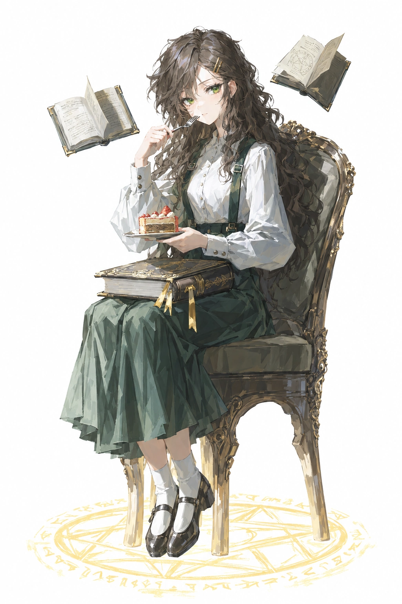

# 白塔（baita / 法师）

## 身份与参考使用

运行立绘 `game/assets/portraits/full/baita.webp` 于2026-10-20按老板确认接入贝雷帽书卷版，1037×1516；本页图片为同图副本。保留绿裙坐姿、蛋糕、腿上古书、左右两本浮书与椅下法阵，上衣轻微整理细褶、裙子保留层叠褶皱。来源、备份及验证见[实装记录](../evidence/2026-10-20-roster-nai5-redo/baita-install-receipt.json)。下面的09-19配方为历史版本；当前画风见[美术方向](../production/art/ART-DIRECTION-BRIEF.md)。

## 现行身份锚点（2026-10-20确认，10-21补充）

- 深棕色超长大波浪卷发、绿色眼瞳、两枚细长金色发夹，安静书卷气。
- **金色耳环**。
- **现行服装（2026-10-24老板确认）**：白色长袖高领衬衫，小巧领口、简洁前襟；领口正中一枚竖椭圆深蓝宝石胸针，简洁金色椭圆托边，体积克制。深绿双宽背带长裙，背带配小金色矩形扣。卡面沿用这套服装时保留胸前蓝宝石，不改成黑领带、星形托或圆按钮式背带扣；自然遮挡时不强行显露。款式参照已实装的 `game/assets/cards/spell-tt7-arcanebolt.webp` 等白塔卡面；运行立绘未显示胸针，不据此删去现行服装锚点。
- **厚侧刘海遮住一只眼睛**：现行认可运行图为观众视角右眼被头发遮住、左侧绿眼可见，金色双发夹在露眼一侧。此前车站任务要求相反方向，本轮最终图已明确记录该偏差并获老板实装确认；新任务以当前运行图为参考，不为了双眼可见撩开刘海。
- 本版配绿色贝雷帽，老板明确要求保留。服装与场景道具按当次任务设计，不把本版坐姿、蛋糕、书阵或神态动作套入其他场景。

## 当前角色数据（core/characters.js）

| 项 | 值 |
|---|---|
| id | `baita` |
| 名字 | 白塔 |
| 职业 | 法师 |
| 主题色 | `#e9bd69` |

## 参考立绘描述（2026-09-19 版本）

2026-09-19 老板授权 Friday 按 painterly 全身立绘定稿，当日二次修订（老板反馈）定稿：
依据 `roster-fix-20260919-170117/lituan-170117.png`（seed 1486003179），已实装 `portraits/full/baita.webp`。

- **女性**，安静书卷气，表情平静温柔，目视镜头。
- **深棕色长卷发**，刘海别开不遮眼；**绿色眼瞳**（0919 二次修订：老板令参考原立绘定绿瞳，琥珀瞳作废）。
- **白色长袖衬衫**（收口袖扣）+ **深绿背带长裙**，白色短袜 + 黑色皮鞋。
- **坐姿演出（0919 二次修订）**：坐在雕花木椅上吃甜品——手托小盘蛋糕、持叉进食；**雕花古书放腿上**（金书签垂下，出图时需句子钉"古书保持在腿上"防被带飞）。
- **法师锚点（0919 方案 B 老板拍板）**：**椅子下地面一圈淡金魔法阵**（`magic circle`，金色符文沿环漂浮）+ **两三本打开的小书悬浮绕肩缓转**（`floating books`）——与腿上大书构成"书阵"，是白塔"法师"身份的主视觉证据。
- 肩侧另绕几粒**金色魔法光尘**；**暖金色为全身点缀色**（主题色 `#e9bd69` 落地）；simple background 素底。
- 构图：坐姿全身（含椅），三分钟视角正脸、双眼可见。
- 画风：painterly 统一画风模块（miv4t+quasarcake，`official_painterly_style.py`）。
- 旧立绘的花拱门白塔场景为历史版本口径，非现行立绘要素。

### 历史：0919 配方细节

依据 `roster-fix2-20260919-170853/lituan-170853-2202.png`（实装版）：

- **发型结构**：深棕近黑褐色**超长大波浪卷发**，坐姿下垂至椅侧/膝下（近地）；**厚刘海侧分、右侧用两枚金色长条金属夹别起**露出右眼；左侧卷发遮耳、垂落成卷丛。
- **脸**：翠绿瞳（清亮）；平静淡然；进食时嘴含叉。
- **服装层次**：白色长袖衬衫（小立领、门襟一排扣、**袖口双扣、袖蓬起收口**）；深绿背带长裙（**宽背带+正面金属搭扣**、裙摆及踝微层叠）。
- **道具形状**：**雕花古书平摊在腿上**——封面四角金属雕花包角、书脊纹章、**两条金色丝带书签垂下**；小银盘托**分层草莓顶蛋糕**；右手银叉入口、左手托盘。
- **椅子**：深色木质雕花扶手椅——卷涡纹扶手、雕花靠背、弯腿。
- **魔法元素位置**：**椅子下地面一圈淡金魔法阵**（外环符文圈+内环几何线）；**两三本打开的小书悬浮**（左肩上方一本、右上角一本，书页摊开微亮）；肩侧金色光尘数粒。
- **腿脚**：白短袜+**黑色横扣玛丽珍皮鞋**；双腿并拢斜放。
- **姿态**：坐姿正面三分视角，头微低看蛋糕、目视镜头。

## 游戏剧情与人物关系（2026-10-25确认）

第一部共同背景、结尾与玩家知情范围见[第一部剧情设定](../production/design/STORY-PART-ONE.md)。以下是游戏设定，小说作为平行宇宙参考。

- 阵营与地位：升格会的首领。
- 目的：知道污染源是原属升格会的第四原初，与常无欲前来收回。由于污染严重，选择先处理污染，再接近目标；对平民并不十分在意。
- 私人旧账：曾因嫉妒误杀前代无，即现任无的母亲。黑像因此与白塔决裂、退出升格会，如今属于灰域。现任无在第一部暂时不知道这一真相。
- 关系：与常无欲同属升格会，但两人对平民的在意程度不同；与黑像有上述私仇。
- 未定：嫉妒的具体缘由、旧事经过、完整性格与语言习惯尚待补充。
