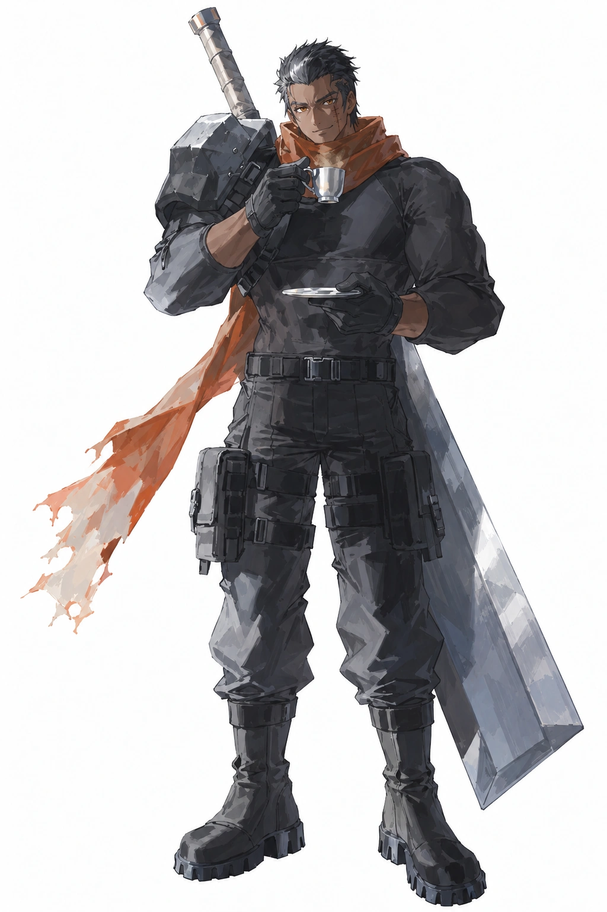

# 黑像（heixiang / 战士）

## 身份与参考使用

运行立绘 `game/assets/portraits/full/heixiang.webp` 于2026-10-18按老板要求恢复至本轮重绘前的10-13版本，1024×1536；保留喝咖啡与背剑，本页图片为同图副本。来源及验证见[统一立绘记录](../evidence/2026-10-18-roster-reference-final/README.md)。当前画风见[美术方向](../production/art/ART-DIRECTION-BRIEF.md)。下方09-12与09-19描述保留历史版本差异。

## 现行头发锚点（2026-10-24老板确认）

纯黑短发背头，额头露出；没有白发、白色挑染或银白额发。Q版头像与新图沿用此锚点。

## 当前角色数据（core/characters.js）

| 项 | 值 |
|---|---|
| id | `heixiang` |
| 名字 | 黑像 |
| 职业 | 战士 |
| 主题色 | `#d0805a` |

## 历史：2026-09-12 立绘口径

2026-09-12 老板逐轮定稿并验收主立绘（赛璐璐色块风大图，`roster-main-0912-big/heixiang_v3_seed645024971.png`，已入库三组立绘）。

- **男性**，**黑皮**（深肤色），高大壮硕：huge muscles / massive build / broad shoulders / thick arms。
- **黑色短发，背头露出额头**（2026-09-13 老板钉死）：发型必须写 `slicked back hair, exposed forehead`，且提示词带发型句 `His black hair is slicked back from his forehead, fully exposing it.`——只写裸标签 `black hair, short hair` 各卡会画出刘海/碎发导致脸不像（09-13 六卡翻车教训）。**金瞳**（amber eyes，露出不遮眼）。
- **脸颊缝线疤痕**（stitched scar）。
- 神态：**坏笑嚣张**（smirk），目视镜头——名字意象：像一尊黑色雕像般伫立，反差感是角色魅力核心。
- 服装：**黑色紧身长袖作战服 + 肩甲 + 黑手套黑裤黑靴**，**棕橙色围巾**（主题色 `#d0805a` 落地，全身唯一暖色点缀）。
- 武器：**巨型大剑**。
- 定稿主立绘演出：**纯白底**，单手捏小咖啡杯啜饮（小指微翘、托碟、热气），大剑插身侧——巨汉×小咖啡杯的反差感老板拍板定稿。
- 画风：**赛璐璐色块**（cel shading + flat color）。
- 构图：全身居中、约占画幅高 85%、不出框；横版宽幅 16:9（4096×2304）。

## 参考立绘描述（2026-09-19 painterly 版本）

- 依据：`roster-painterly-four-v2-20260919-120257/xuanli-120257.png`（seed 1111442184），已实装 `portraits/full/heixiang.webp`。
- 演出：延续定稿反差萌——**单手捏小咖啡杯啜饮（小指微翘、托碟、热气）**；巨剑由"插身侧"改为**背负**（剑柄露出肩上）。
- 围巾：**围在颈间 + 单条飘带**（不再是整幅披风）。
- 疤痕钉死左脸颊（his left cheek / 观众视角右）；发型句必带 `slicked back hair, exposed forehead` + 发型句原文。
- 色调：黑白灰 + 棕橙围巾为全身唯一暖色（主题色 `#d0805a` 落地）；simple background 素底。
- 画风：painterly 统一画风模块（miv4t+quasarcake，`official_painterly_style.py`）。

### 对应参考版本的细节

依据 `roster-painterly-four-v2-20260919-120257/xuanli-120257.png`（实装版）：

- **发型结构**：黑短发**两侧剃短、顶发厚且后梳、发梢微翘**，额头全露；发色在光下泛灰蓝高光。
- **脸**：深肤色；**琥珀金瞳**；浓眉；**左脸颊（观众视角右）三道短线缝合疤痕**；坏笑微露上排牙。
- **围巾形状**：棕橙色围巾**绕颈一圈 + 长尾从左肩垂至左大腿下方**，尾端磨损破洞撕边。
- **服装层次**：黑色紧身高领长袖作战服；**左肩单块重型金属肩甲**（银灰、多层板+铆钉）；黑色战术腰带（多排扣具）；黑色战术裤（**双侧大腿挂件包/弹匣袋**、膝部束带）；黑色全指战术手套；**黑灰拼色高帮军靴**（系带+侧拉链+锯齿厚底）。
- **武器背负**：巨型大剑——**银灰宽刃如门板、无纹饰**；**剑柄从左肩后上方露出（缠布柄）**，剑身沿背后右侧垂至小腿。
- **道具**：**右手捏银白小咖啡杯举至嘴边啜饮（杯口热气）**，**左手托白瓷碟**。
- **姿态**：正面站立微侧、重心沉稳，坏笑目视镜头。

## 游戏剧情与人物关系（2026-10-25确认）

第一部共同背景、结尾与玩家知情范围见[第一部剧情设定](../production/design/STORY-PART-ONE.md)。以下是游戏设定，小说作为平行宇宙参考。

- 阵营经历：原属升格会，因前代无之死与白塔决裂、退出升格会；具体旧账见[白塔](baita.md)。现在属于灰域。
- 目的：知道污染源是第四原初，前来夺取。污染过于严重，因此选择先处理污染，再接近目标。
- 关系：与白塔有私人旧仇；季渊是灰域的另一名首领，其商人及特殊援助用途见[第一部剧情设定](../production/design/STORY-PART-ONE.md#王诩与季渊)。
- 性格与口吻：现有立绘神态可参考坏笑、寡言与压迫感；完整性格、与前代无的具体关系、语言习惯尚待确定。
