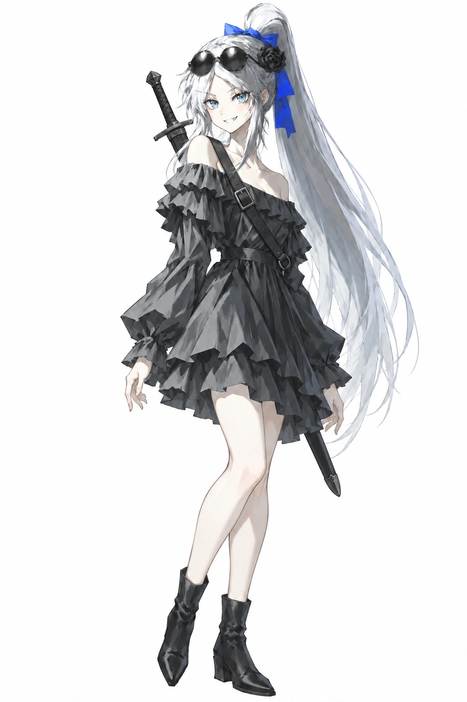

# 无（wu / 侠客）

## 现行外观锚点（2026-10-09）

选人界面运行立绘为 `game/assets/portraits/full/wu.webp`，本页 ref-images 为同图副本。2026-10-18按老板指定的10-16原图补背后黑剑与固定剑带，保持1024×1536白底、交错站姿；来源及验证见[背剑修订记录](../evidence/2026-10-18-wu-back-sword/README.md)。画风方向见[美术方向](../production/art/ART-DIRECTION-BRIEF.md)，接入要求见[视觉规范](../production/art/VISUAL-BIBLE.md)。

- **身高与体态**：身高约170厘米，身形修长；大腿与小腿略显丰润，膝部和脚踝自然收束，皮肤白皙。
- **脸与神态**：青蓝色眼睛，额前碎刘海露出双眼；带笑、自信，嘴角露小尖牙。
- **头发与头饰**：银白色长发束成高马尾，蓝色缎带蝴蝶结系在马尾根部；黑蔷薇位于角色左侧头发边（画面右侧），靠近太阳穴上方。黑色圆框墨镜架在头顶，普通眼镜结构，两片深色圆镜片、细镜框与镜腿；镜片带灰白反光。2026-10-16 老板再次明确为墨镜，生图使用 `sunglasses`，护目镜加入人物专属负面。
- **服装**：黑灰色露肩长袖短裙，领口、袖口和裙摆有层叠荷叶边，腰间黑色系带收腰；前后及两侧裙摆均止于膝上，大腿与膝盖清楚露出。层叠荷叶边只在短裙范围内形成不规则轮廓，不延长后摆，不带拖尾。本版没有可见蓝星纹内衬。
- **腿脚与姿态**：裸腿，穿黑色短靴；双手自然垂落，双腿交错站立。
- **本版武器**：黑色直身长剑入黑鞘，黑色缠柄、棱角柄首、简洁横向护手；背后斜挂，黑色皮革剑带跨过胸前连接腰侧固定环，带深色金属方扣。剑柄从角色右肩后（画面左侧）露出，下段黑鞘从画面右侧裙摆后显露。
- **背负方式**：长剑入鞘斜背，以黑色背带固定；剑柄从角色右肩后上方露出，鞘尖从左侧裙摆后延伸至小腿上段，约在膝下15厘米处。
- **画风**：新图统一沿[游戏默认画风](../production/art/ART-STYLE-V1.md)；本版运行立绘的黑白灰与蓝色点睛仅用于描述当前图。皮肤配色、服装和构图按老板当次指定图，不套黑裙或站姿。

身高与剑长为本轮按画面比例确认的约值，不是模型测量值；剑刃藏在鞘内，刃面细节尚未确定。下方旧文字保留为修订史，冲突的裙长、头饰、画风与姿态不拼入本版；未定背景不由画面推断。

### 现行头饰与服装提示词（2026-10-16 明确墨镜及短裙边界）

头饰正向：`black round sunglasses on head, thin black round frames, dark tinted lenses, sunglasses pushed up onto her hair`。双眼完整露出；墨镜架在头顶。

正向：`black charcoal off-shoulder long-sleeved short dress, layered ruffles at neckline and cuffs, black tied waist, short layered ruffled skirt, front, back and side hems all end above the knees, thighs and knees clearly visible, bare legs, black ankle boots`。

人物专属负面：`goggles, ski goggles, swimming goggles, aviator goggles, safety goggles, long skirt, high-low skirt, long back hem, dress train, floor-length dress, blue star pattern, stockings, pantyhose, thighhighs`。新请求用此头饰与服装段，不使用 `goggles` 正向或含糊的 `asymmetrical layered ruffled skirt`；不继承下方历史版小腿后摆。完整身份继续组合上方现行锚点，画师与画法沿当次指定配方。

## 当前角色数据（core/characters.js）

| 项 | 值 |
|---|---|
| id | `wu` |
| 名字 | 无 |
| 职业 | 侠客 |
| 主题色 | `#ed9b53` |
| 历史卡面记录 | `expedition-starters/wu-*.webp` 3 张能力卡 + 6 张人物卡（2026-09 重绘记录；当前卡面状态查对应任务） |

## 历史：2026-09-12 职业卡外观口径

来源：2026-09-12 交接文档定稿口径；同日老板逐项复核确认；同日老板增补**脸部特征须对齐定稿卡面**（出图"长得不像"是硬伤）。

**脸部（以三张定稿人物卡 wu-void / wu-myriadswords / wu-heavensword 为脸参考）**：
- 亮蓝色眼睛，眼型偏大微吊、眼神锐利带笑。
- **额前碎刘海、两眼完全可见**——⚠️ tag 禁用 `hair over one eye`（该词本义=遮住一只眼，曾导致出图遮眼被老板打回）；用 `parted bangs, eyebrows visible through hair`。
- 嘴微张嚣张笑、**露小虎牙**（`fang`）。
- 皮肤白皙、小圆脸少女感。
- 黑色圆框墨镜横架头顶（`black round sunglasses on head`），旁有黑蔷薇头饰与蓝丝带。

**整体**：
- 白色长发大波浪、**高马尾**，扎马尾用**丝带**（定稿色=蓝缎带）。
- **黑礼裙**（露肩哥特款、层叠荷叶边裙、蓝色星纹裙里衬）。
- **裸腿**——禁止裤袜/长袜。
- 神态**嚣张、自信**。
- 画风：**赛璐璐色块**（cel shading + flat color，2026-09-12 职业卡重做定调）。
- 共同参照首页壁纸与本页定稿立绘及三张定稿人物卡；**不要每张卡随机改变脸、眼色和发型**。
- 早期错误眼色的 `cards/wu-*.webp` 旧图已被映射绕开，切勿改回旧图。

## 历史：2026-09-19 全身立绘修订过程

- 依据：`roster-fix-20260919-170117/shuangling-170117.png`（seed 1769771149），已实装 `portraits/full/wu.webp`。
- **发型修订（0919 老板反馈）**：马尾收紧=**光滑束紧的高马尾**（`sleek smooth hair, tight neat high ponytail`），头发平贴不蓬松（禁 fluffy/voluminous/messy hair）——原「大波浪」口径按此收紧执行。
- **墨镜修订（0919 老板反馈）**：**哑光黑镜片、不反光无眩光**（`matte black`；UC 排 reflective sunglasses / lens flare / glasses reflection）。
- 演出：全身站姿叉腰，**黑色长剑斜背背后**（剑柄露肩上）+ 主句归属；裙摆 `high-low` 前短后长且**后摆止于小腿**（有效钉法=`the skirt in back stops at the shins`，`high-low skirt` tag 有拖地先验禁用）。
- 画风：painterly 统一画风模块（`official_painterly_style.py`）。

### 0919 实装版逐要素记录（现图优先）

依据 `roster-fix2-20260919-170853/shuangling-170853-2701.png`（实装版）：

- **发型结构**：高马尾束在头顶偏后；马尾垂落**左侧身后、直达小腿中部**（比裙摆低）；马尾根部扎**蓝色缎带蝴蝶结**（双层垂带）。额前碎刘海；**两缕长鬓发垂至锁骨/胸前**。
- **头饰位置**：圆框墨镜（两大圆深色镜片+细框、哑光）横架头顶**偏左**；**黑色蔷薇花饰**在马尾根**右侧**，与缎带相邻。
- **服装层次**：黑色一字肩连衣裙——肩头锁骨裸露；领口**横向褶皱荷叶边一层**；**腰间细黑腰带**收腰；裙两层=外层黑荷叶边裙（下摆锯齿状）+内层蓝星裙里衬（深蓝底、浅蓝四角星满布），**裙长前后一致到小腿**，星衬在下摆露出一圈。
- **武器背负**：黑色长剑+黑鞘斜背——**剑柄从左肩后上方露出、鞘尖从身体右下方伸至膝下**；另有黑色细背带从右肩斜挎到左腰。
- **腿脚**：裸腿；**黑色厚底踝靴**（翻边+拉链质感）。
- **姿态**：右手叉腰（手背朝外）、正面偏三分视角、双腿微分站立、嚣张笑露虎牙。

## 性格与背景（待老板提供）

- 性格：立绘神态可参考「嚣张、自信」，完整定稿文字待老板提供。
- 背景故事：待老板提供。
- 与其他角色的关系：待老板提供。
- 口头禅 / 语言习惯：待老板提供。
