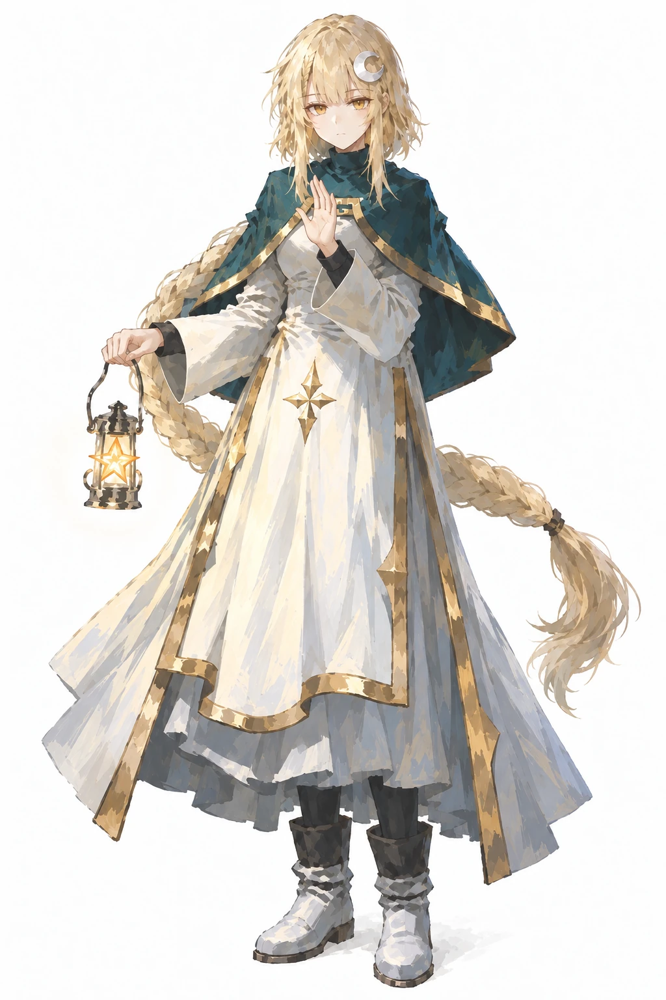

# 星月（xingyue / 牧师）

## 身份与参考使用

运行立绘 `game/assets/portraits/full/xingyue.webp` 于2026-10-24按老板要求参考圣盾、圣疗卡面的脸部与笔触重绘，1024×1536；本页图片为同图副本，保留胸前单手祝祷、长辫、星灯与白底全身构图。老板最终选用衣鞋局部简化前的一版；来源与备份见[立绘收据](../evidence/2026-10-24-xingyue-card-roster/portrait-receipt.json)，本轮按要求未检测。当前通用画风见[美术方向](../production/art/ART-DIRECTION-BRIEF.md)；历史姿态和配方保留在下方版本描述。

## 卡面光牧与暗牧外观（2026-10-10老板确认）

星月有光牧、暗牧两套卡面形象。本轮恶魔之力用暗牧，形象按禁咒系列参考。

- 光牧：浅金长发与侧辫/低马尾、金瞳、白色新月发饰、白神官裙与深青绿披肩。
- 暗牧：底色仍是淡金，出图时头发形状与可见颜色直接对照禁咒卡面，不能用自拟“奶油/香槟”等色名替代参考。形状锁整齐直刘海、圆顺头顶轮廓、两侧长鬓发、低处扎起的侧辫；跟随参考的极浅低饱和底色、高光与冷暖阴影关系，不画成侧分蓬松发、额外头顶编发或亮黄橙金。紫瞳、深黑/靛色新月发饰、黑灰高领神官服、紫色披肩与金色边饰、黑手套。脸部与饰物位置按当次选用参考核对。
- 星月一般不动声色，表情变化通过视线、眼睑与极小的嘴角动作表达；不默认用夸张邪笑、愤怒眉峰或狂热神态。吟唱等卡面动作可有相应口型，身份与沉静气质保持。
- 暗牧卡面参考：[禁咒I](../../game/assets/cards/curse-drain.webp)、[禁咒IV](../../game/assets/cards/curse-silence.webp)；固定动作与构图不套用到所有暗牧牌。

## 当前角色数据（core/characters.js）

| 项 | 值 |
|---|---|
| id | `xingyue` |
| 名字 | 星月 |
| 职业 | 牧师 |
| 主题色 | `#81bcb0` |

## 历史：2026-09-12 立绘口径

2026-09-12 老板逐轮定稿并验收主立绘（赛璐璐色块风大图，`roster-main-0912-big/xingyue_seed1411148278.png`，已入库三组立绘）。

- **女性**，安静淡然气质，表情平静（expressionless），目视镜头。
- **淡金色超长发**，单侧编发汇入**低马尾**。
- **金瞳**。
- **白色神官风连衣裙 + 深青绿短披肩**（青绿=主题色 `#81bcb0` 落地）+ **金色滚边**。
- **月牙形发饰**（位置已文字钉死，2026-09-13 老板令）：**白色新月发夹，别在头顶刘海上方、偏她左侧（观众视角右侧）的发间，斜置、贴着头发**——不是悬浮光环、不在脑后、不在头顶正中立起。出图提示词必须带位置句，不能只写裸标签：
  `a white crescent moon hairpin clipped flat into the hair at the top of her head just above the bangs, slightly off-center to the viewer's right, tilted, resting against the hair (not floating, not a halo)`
- **右手提一盏发光的星灯**（**2026-09-20 老板令：星灯道具已排除出星月锚点**——后续出图不强制携带，改为按画面需要可选）；身后背景画**巨大淡色月牙 + 星尘**。
- 画风：**赛璐璐色块**（cel shading + flat color），纯深藏青渐变底。
- 构图：全身居中、约占画幅高 85%、不出框；横版宽幅 16:9（4096×2304）。

## 参考立绘描述（2026-09-19 painterly 版本）

- 依据：`roster-painterly-four-v2-20260919-120257/dengkui-120257.png`（seed 1412045851），已实装 `portraits/full/xingyue.webp`。
- 演出：全身站姿，**右手提星灯平举身侧（灯光照亮裙摆）+ 左手胸前祈祷手势**（此为该张已实装立绘的演出记录；**2026-09-20 老板令后星灯不再是锚点**，后续出图不必携带）；正脸三分钟视角、双眼金色可见（禁全侧面）。
- 月牙发饰沿用钉死句：观众视角**右侧**、贴发斜置（v1 曾出在左侧，v2 已修正）。
- 服装：白神官裙金滚边（层叠裙摆）+ 深青绿披肩金边；白袜短靴。
- 色调：**白 + 青绿 + 暖金**（主题色 `#81bcb0` 落地）；simple background 素底（旧版"背景大月牙+星尘"为历史口径，painterly 版不用）。
- 画风：painterly 统一画风模块（miv4t+quasarcake，`official_painterly_style.py`）。

### 对应参考版本的细节

依据 `roster-painterly-four-v2-20260919-120257/dengkui-120257.png`（实装版）：

- **发型结构**：淡奶金色超长发；**眉上平齐厚刘海（圣女切）**；**她左侧一条细编发沿鬓角向下**；脑后低马尾为**粗麻花辫、垂至小腿**，辫梢发圈收束、发尾散开。
- **月牙发饰形状位置**：**白色 C 形月牙、两尖朝右上**，平贴在**观众视角右侧**头顶发面上（刘海正上方偏右），斜置不悬浮。
- **脸**：暖金瞳；平静无表情、薄唇轻抿。
- **服装层次**：白色神官风连衣裙——小高领+**金色颈环**；胸前**金色四角星徽章**；金色宽滚边沿襟线与裙摆；**深青绿短披肩**披挂双肩（及上臂、金边镶口）；裙摆多层（白外层+金边开衩层+青蓝衬裙）。
- **手部**：深色护腕/半指腕套；~~**右手侧平举提星灯**——银质提灯、提环手柄、灯罩内**金色五角星发光**~~（**2026-09-20 老板令：星灯道具排除出锚点**，出图不强制携带，可选）。
- **腿脚**：深色打底裤袜 + **白灰拼色翻口短靴**。
- **姿态**：正面站立；**左手抬至胸前五指并拢（祈祷手势）**；右手姿态不再绑定提灯（星灯 2026-09-20 老板令解绑出锚点，按画面需要可选）。

## 游戏剧情与人物关系（2026-10-25确认）

第一部共同背景、结尾与玩家知情范围见[第一部剧情设定](../production/design/STORY-PART-ONE.md)。以下是游戏设定，小说作为平行宇宙参考。

- 身世：原本住在污染城市。此前受困，被无救出，随后由无和王诩护送回家。
- 转折：与父母短暂团聚后，父母被异常感染、变成怪物，并被无击杀。星月在巨大情绪波动中觉醒异常能力。
- 情感与行动：她不怨恨无，而是自责，将悲痛转化为力量，在无与王诩帮助下前往处理污染。与无一起行动，是本部的情感主线之一。
- 能力：采用游戏的独立设定，具体原理不是本部叙事重点；不自动继承小说的重力与惯性能力。
- 性格与口吻：保留已确认的沉静神态；完整语言习惯与口头禅尚待确定。
