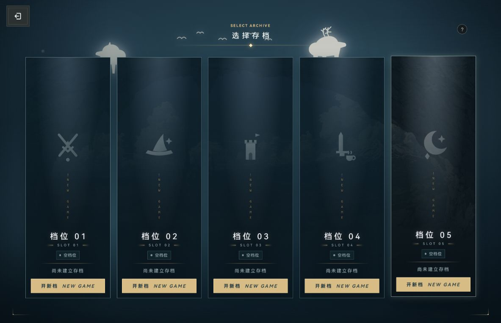
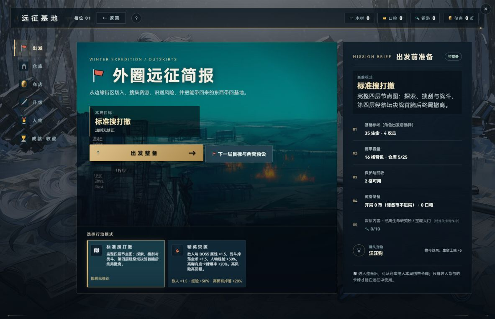
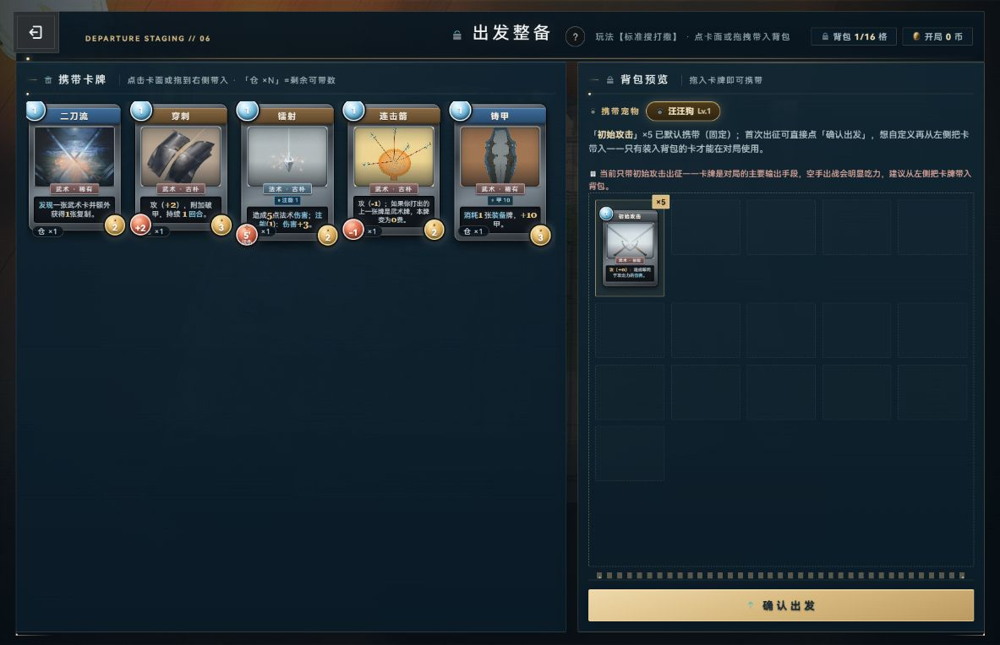
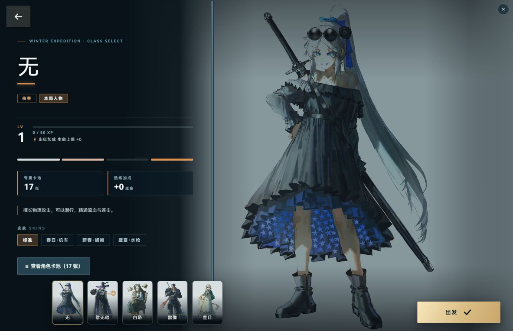
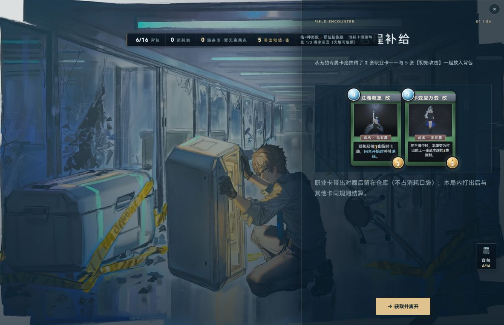
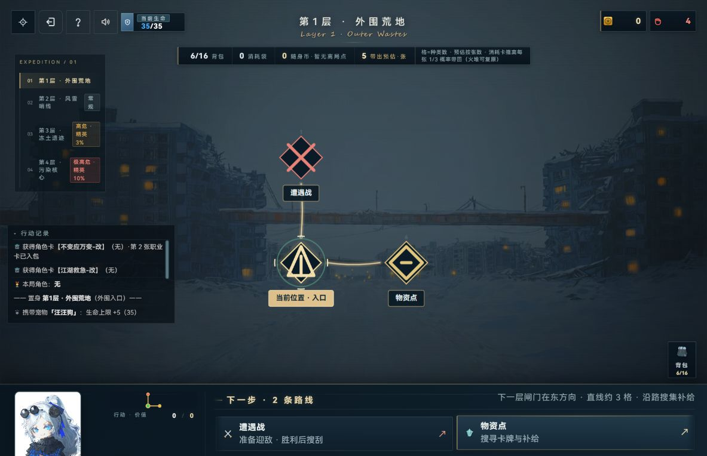
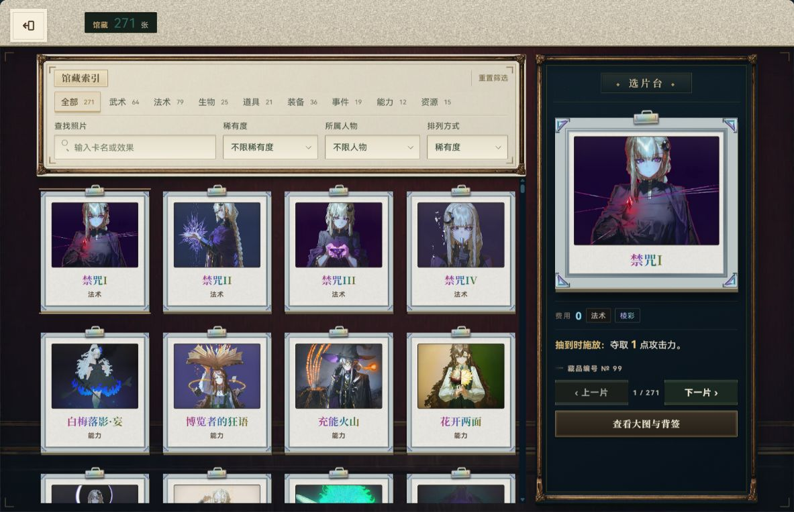

# 每个界面的独立美术批注

2026-10-02；只读诊断，未改游戏/存档/build/安装/提交。

每张证据已由本代理view_image亲读；H/B/A均是已有证据，不称此次代理新采。658×764是当时当前窗口，不是主动多尺寸。静态图片不证明动态、音频、操作可靠性、自然通关、全资产覆盖或当前源码逐项一致。 新增来源N不是本代理采集；H/B/A为复用已有证据。参考图S1由专属对照代理亲读，不冒充本代理亲玩。

H：前会话历史8图，来源v2/browser-evidence.json

B：本次研究已有首层正常输入5图，来源browser/README.md与evidence-manifest.json

A：已有四层辅助14图，来源browser-assisted/README.md、manifest和final-trace；控制台/Agent辅助与正常点击分别记录

N：本轮主会话新增截图，1183×764，正常UI与正式守卫quick-nav分别记录；本代理逐张view_image阅读，未操作游戏。

统计：{"basicInterfaces":110,"basicImageReviewed":44,"basicSourceOnly":66,"variants":55,"variantImageReviewed":22,"variantSourceOnly":33,"independentImagesReviewed":66,"comparisonS1":55,"comparisonDesignOnly":110,"localMotionReviewed":0,"basicTransitionOnly":1,"referenceLimitedMotionApplied":4,"referenceMotionFramesRead":3}。55内容变体是共享模板的独立内容行，不当作55套新布局。功能详析见[覆盖清单](../coverage/INTERFACE-INVENTORY.md)。改法为建议，无实施授权。

## TITLE — 标题／主入口

状态：**有图且已亲读**。

源码依据：[game/src/ui/game.menu.js](../../../../../game/src/ui/game.menu.js#L25)；锚点 function showTitle；状态 current。这是定义/边界证据，不是实页。

H：前会话历史实页，2026-10-02，1183×764，正常UI；已亲读。

| 维度 | 此页观察／源码审查条件 |
|---|---|
| 视觉焦点 | 角色脸部、左侧标题与右下金色进入按钮构成三角焦点。 |
| 构图层级 | 人物占据中心，照相馆、成就、设置以圆形实体图标分居边缘；辅助导航放顶栏。 |
| 字体读性 | 主中文标题轮廓鲜明；花体英文副标题笔画细、背景复杂，适合装饰而非必要信息。 |
| 控件状态 | 主入口金光与大字号可见；档案为空、成就0/26可辨；悬停、焦点和设置开合未见。 |
| 风格与题材 | 冬境废墟与二次元角色统一；剑形入口提供题材锚点，周边圆形器物像空间中的收藏物。 |
| 反馈 | 静态主入口有光晕，不能用单帧推断呼吸动画、点击或音效。 |
| 跨页连续性 | 返回图标与后续深色方盒不同，标题中的次入口保留各自物件身份。 |

具体优点：人物与场景具有明确关系，主入口面积足够。；照相馆/成就/设置无需依赖文字才能粗分。

- **P2／英文副标题**：细花体叠在复杂废墟和人物发丝前。 影响：将英文当作说明阅读时吃力。 定向改法：明确其为装饰角色；必要副说明另用实色简短正文。 出口：必要入口含义均可由中文及稳定标签读懂。

反证：右下入口突出，不能称入口难找。

未核：标题图本身不证明设置/手册/留言/成就弹层；当前覆盖以各独立ID条目为准。动态、键盘焦点仍未核。

**独立游戏对照：Darkest Dungeon／营地成长／角色档案、收藏和远征结果**

项目已亲读：角色脸部、左侧标题与右下金色进入按钮构成三角焦点。 细花体叠在复杂废墟和人物发丝前。 对照依据：该参考卡仅有设计依据/待核，具体像素外观没有亲见；本项只列比较目标。

美术水平口径：这是适配本页的对标目标；不作美术水平高低判定。

可借鉴：人物与功能壳、成长数据、风险操作与收获身份；在标题／主入口中优先核对象、成本、结果的可见关系。

不可照搬：粗墨恐怖画风不等于冬境二次元题材，应借信息分工而非换全部资产

参考证据：D1；实际看见的场景：城镇队伍长期成长、远征损失与成功/失败收束（设计依据）；[来源1](https://www.darkestdungeon.com/darkest-dungeon/)、[来源2](https://store.steampowered.com/app/262060/Darkest_Dungeon/)、[来源3](https://img2.storyblok.com/fit-in/1536x768/filters%3Aformat%28jpeg%29/f/127947/1920x1080/a104a66c90/town_event_promo_desktop2.jpeg)；[参考卡](../visual-comparators/COMPARATORS.md)。

动效：参考 M0 / 本项目 M0。未实际观察双方动效，不比较时长、节奏、流畅、打击感或输入响应。

动效后续对比目标：本页标题／主入口进入/退出保持来源位置；本页操作前后计数/选中/风险状态不被过渡遮盖。

## SLOTS — 五档远征档案

状态：**有图且已亲读**。

源码依据：[game/src/ui/game.menu.js](../../../../../game/src/ui/game.menu.js#L586)；锚点 function openSlotPicker；状态 current。这是定义/边界证据，不是实页。

H：前会话历史实页，2026-10-02，1183×764，正常UI；已亲读。

| 维度 | 此页观察／源码审查条件 |
|---|---|
| 视觉焦点 | 五张高竖档案卡是唯一核心对象，主标题居中。 |
| 构图层级 | 卡列平齐，图案/编号/状态/开新档按钮位置一致；上半卡面留白承担氛围。 |
| 字体读性 | 档位编号和中文状态可读；竖排NEW GAME间距大，形成装饰字串。 |
| 控件状态 | 空档状态与开新档金按钮明确；无在途、通关或删除状态画面。 |
| 风格与题材 | 符号与迷雾山形保持冷色档案语言。 |
| 反馈 | 空档可见，但新建确认、覆盖风险和加载反馈未见。 |
| 跨页连续性 | 顶部返回盒承接整备；金按钮延续主动作语言。 |

具体优点：五档有独立徽记，但没有破坏对齐。；每档操作与状态邻近，识别负担小。

- **P2／卡中部竖排英文字**：大量高度给装饰字和雾景，实际状态集中底部。 影响：有存档后关键信息可能需要争夺底部空间。 定向改法：有档状态优先分配给角色、进度和最近活动，保持五卡基线。 出口：在途/完成/空档三种卡能仅看状态区区分。

反证：当前均为空档，留白不构成缺信息错误。

未核：五档非空、继续/新建冲突、确认/删除、载入中未拍。

**独立游戏对照：Darkest Dungeon／营地成长／角色档案、收藏和远征结果**

项目已亲读：五张高竖档案卡是唯一核心对象，主标题居中。 大量高度给装饰字和雾景，实际状态集中底部。 对照依据：该参考卡仅有设计依据/待核，具体像素外观没有亲见；本项只列比较目标。

美术水平口径：这是适配本页的对标目标；不作美术水平高低判定。

可借鉴：人物与功能壳、成长数据、风险操作与收获身份；在五档远征档案中优先核对象、成本、结果的可见关系。

不可照搬：粗墨恐怖画风不等于冬境二次元题材，应借信息分工而非换全部资产

参考证据：D1；实际看见的场景：城镇队伍长期成长、远征损失与成功/失败收束（设计依据）；[来源1](https://www.darkestdungeon.com/darkest-dungeon/)、[来源2](https://store.steampowered.com/app/262060/Darkest_Dungeon/)、[来源3](https://img2.storyblok.com/fit-in/1536x768/filters%3Aformat%28jpeg%29/f/127947/1920x1080/a104a66c90/town_event_promo_desktop2.jpeg)；[参考卡](../visual-comparators/COMPARATORS.md)。

动效：参考 M0 / 本项目 M0。未实际观察双方动效，不比较时长、节奏、流畅、打击感或输入响应。

动效后续对比目标：本页五档远征档案进入/退出保持来源位置；本页操作前后计数/选中/风险状态不被过渡遮盖。

## HUB-DEPLOY — 远征基地／出发页

状态：**有图且已亲读**。

源码依据：[game/src/hub/game.hub.depart.js](../../../../../game/src/hub/game.hub.depart.js#L14)；锚点 function hubDeployHTML；状态 current。这是定义/边界证据，不是实页。

H：前会话历史实页，2026-10-02，1183×764，正常UI；已亲读。

A：已有辅助四层实页，2026-10-02，658×764；包含既有Agent/调试辅助，见原轨迹；已亲读。

| 维度 | 此页观察／源码审查条件 |
|---|---|
| 视觉焦点 | 青绿外圈简报与金色出发整备按钮占主视线。 |
| 构图层级 | 1183图左侧导航、中部简报、右侧任务摘要分工清楚；658已有图改为上下文档与横向导航。 |
| 字体读性 | 中文主标题大；右侧准备项和模式小卡的解释较细密。 |
| 控件状态 | 标准模式金边选中，精英模式同尺寸但较暗；主/次操作金与蓝区分。 |
| 风格与题材 | 基地背景沿用标题人物，简报以景观叠加终端面板，符合任务准备语义。 |
| 反馈 | 已选模式、可整备与宠物属性可见；模式切换实际结果未见。 |
| 跨页连续性 | 基地资源固定顶栏；出发进入整备仍用金主按钮。 |

具体优点：准备摘要把生命、背包、仓库、宠物和金币规则放在一处。；主动作与目标预设的次动作相邻。

- **P2／标准/精英模式小卡**：模式说明字号明显小于上方背景标语。 影响：比较风险收益时需要靠近阅读。 定向改法：把倍率/带回比例作为首行摘要，说明折叠为次级内容。 出口：不用放大画面可读出两模式的关键区别。

反证：658图是当时当前窗口，不是本轮主动多尺寸；不能视为响应式全验。

未核：精英模式选中、目标预设及滚动后摘要未核；各基地子页当前覆盖以独立ID为准。

**独立游戏对照：Darkest Dungeon／营地成长／角色档案、收藏和远征结果**

项目已亲读：青绿外圈简报与金色出发整备按钮占主视线。 模式说明字号明显小于上方背景标语。 对照依据：该参考卡仅有设计依据/待核，具体像素外观没有亲见；本项只列比较目标。

美术水平口径：这是适配本页的对标目标；不作美术水平高低判定。

可借鉴：人物与功能壳、成长数据、风险操作与收获身份；在远征基地／出发页中优先核对象、成本、结果的可见关系。

不可照搬：粗墨恐怖画风不等于冬境二次元题材，应借信息分工而非换全部资产

参考证据：D1；实际看见的场景：城镇队伍长期成长、远征损失与成功/失败收束（设计依据）；[来源1](https://www.darkestdungeon.com/darkest-dungeon/)、[来源2](https://store.steampowered.com/app/262060/Darkest_Dungeon/)、[来源3](https://img2.storyblok.com/fit-in/1536x768/filters%3Aformat%28jpeg%29/f/127947/1920x1080/a104a66c90/town_event_promo_desktop2.jpeg)；[参考卡](../visual-comparators/COMPARATORS.md)。

动效：参考 M0 / 本项目 M0。未实际观察双方动效，不比较时长、节奏、流畅、打击感或输入响应。

动效后续对比目标：本页远征基地／出发页进入/退出保持来源位置；本页操作前后计数/选中/风险状态不被过渡遮盖。

### HUB-DEPLOY-STANDARD — standard

状态：**有图且已亲读（共享图局部）**。

共享已亲读画面中的实际内容/状态；不宣称另采或单独完成交互；已亲读。

| 维度 | 此页观察／源码审查条件 |
|---|---|
| 视觉焦点 | 独立内容审查重点：standard的已选/未选或空态规则 |
| 构图层级 | 同地图倍率变体，不是额外地图。；应保留standard的对象/状态与原模板信息分区。 |
| 字体读性 | 需读清standard相关名称、数量、规则和失败原因；非此变体实图不能代验长文本。 |
| 控件状态 | 核standard的已选/未选或空态规则对应选中/不可用/已完成状态，不把同模板按钮存在当本变体操作已验。 |
| 风格与题材 | 共享HUB-DEPLOY框式；内容身份重点是standard的已选/未选或空态规则。 |
| 反馈 | 应配对standard动作前后信息变化；本轮不证明未操作的动态。 |
| 跨页连续性 | 回到HUB-DEPLOY的来源，保持standard身份；同地图倍率变体，不是额外地图。 |

定向审查：standard的已选/未选或空态规则

反证：共享模板内容变体，不计新的导航壳；来源：game/src/run/game.session.modes.js:9

未核：只审图中实际可见部分，其它状态/动作待核。

**独立游戏对照：Darkest Dungeon／营地成长／角色档案、收藏和远征结果**

项目已亲读：独立内容审查重点：standard的已选/未选或空态规则 同地图倍率变体，不是额外地图。；应保留standard的对象/状态与原模板信息分区。 对照依据：该参考卡仅有设计依据/待核，具体像素外观没有亲见；本项只列比较目标。

美术水平口径：这是适配本页的对标目标；不作美术水平高低判定。

可借鉴：人物与功能壳、成长数据、风险操作与收获身份；在standard中优先核对象、成本、结果的可见关系。

不可照搬：粗墨恐怖画风不等于冬境二次元题材，应借信息分工而非换全部资产

参考证据：D1；实际看见的场景：城镇队伍长期成长、远征损失与成功/失败收束（设计依据）；[来源1](https://www.darkestdungeon.com/darkest-dungeon/)、[来源2](https://store.steampowered.com/app/262060/Darkest_Dungeon/)、[来源3](https://img2.storyblok.com/fit-in/1536x768/filters%3Aformat%28jpeg%29/f/127947/1920x1080/a104a66c90/town_event_promo_desktop2.jpeg)；[参考卡](../visual-comparators/COMPARATORS.md)。

动效：参考 M0 / 本项目 M0。未实际观察双方动效，不比较时长、节奏、流畅、打击感或输入响应。

动效后续对比目标：本页standard进入/退出保持来源位置；本页操作前后计数/选中/风险状态不被过渡遮盖。

### HUB-DEPLOY-ELITE — elite

状态：**源码层批注，待实页复核**。

| 维度 | 此页观察／源码审查条件 |
|---|---|
| 视觉焦点 | 独立内容审查重点：elite的已选/未选或空态规则 |
| 构图层级 | 同地图倍率变体，不是额外地图。；应保留elite的对象/状态与原模板信息分区。 |
| 字体读性 | 需读清elite相关名称、数量、规则和失败原因；非此变体实图不能代验长文本。 |
| 控件状态 | 核elite的已选/未选或空态规则对应选中/不可用/已完成状态，不把同模板按钮存在当本变体操作已验。 |
| 风格与题材 | 共享HUB-DEPLOY框式；内容身份重点是elite的已选/未选或空态规则。 |
| 反馈 | 应配对elite动作前后信息变化；本轮不证明未操作的动态。 |
| 跨页连续性 | 回到HUB-DEPLOY的来源，保持elite身份；同地图倍率变体，不是额外地图。 |

定向审查：elite的已选/未选或空态规则

反证：共享模板内容变体，不计新的导航壳；来源：game/src/run/game.session.modes.js:9

未核：暂无此变体实图；源定义不能证明最终外观。

**独立游戏对照：Darkest Dungeon／营地成长／角色档案、收藏和远征结果**

项目只有源码定义：独立内容审查重点：elite的已选/未选或空态规则；不能给实际美术高低结论。 对照依据：该参考卡仅有设计依据/待核，具体像素外观没有亲见；本项只列比较目标。

美术水平口径：这是适配本页的对标目标；不作美术水平高低判定。

可借鉴：人物与功能壳、成长数据、风险操作与收获身份；在elite中优先核对象、成本、结果的可见关系。

不可照搬：粗墨恐怖画风不等于冬境二次元题材，应借信息分工而非换全部资产

参考证据：D1；实际看见的场景：城镇队伍长期成长、远征损失与成功/失败收束（设计依据）；[来源1](https://www.darkestdungeon.com/darkest-dungeon/)、[来源2](https://store.steampowered.com/app/262060/Darkest_Dungeon/)、[来源3](https://img2.storyblok.com/fit-in/1536x768/filters%3Aformat%28jpeg%29/f/127947/1920x1080/a104a66c90/town_event_promo_desktop2.jpeg)；[参考卡](../visual-comparators/COMPARATORS.md)。

动效：参考 M0 / 本项目 M0。未实际观察双方动效，不比较时长、节奏、流畅、打击感或输入响应。

动效后续对比目标：本页elite进入/退出保持来源位置；本页操作前后计数/选中/风险状态不被过渡遮盖。

## HUB-STASH — 基地／仓库及消耗口袋

状态：**有图且已亲读**。

源码依据：[game/src/hub/game.hub.pages.js](../../../../../game/src/hub/game.hub.pages.js#L87)；锚点 function hubStashHTML；状态 current。这是定义/边界证据，不是实页。

A：已有辅助四层实页，2026-10-02，658×764；包含既有Agent/调试辅助，见原轨迹；已亲读。

| 维度 | 此页观察／源码审查条件 |
|---|---|
| 视觉焦点 | 22/25容量条与卡牌仓库是当前主焦点。 |
| 构图层级 | 顶部资源、导航、转换说明、容量、卡网格依序；下方消耗口袋独立面板。 |
| 字体读性 | 卡名费用容易找；顶部资源转换细字和卡面长效果密度较高。 |
| 控件状态 | 仓库导航金线、口袋复原按钮灰态；截图只一张口袋牌。 |
| 风格与题材 | 与整备同一战斗卡框；基地背景被压暗，能维持对象优先。 |
| 反馈 | 容量进度条与复原×4呈现状态；刷新留存来自原采证记录，不是本代理操作。 |
| 跨页连续性 | 卡面身份延续整备/战斗，库与消耗口袋的分区有经济语义。 |

具体优点：容量条把仓库接近上限可视化。；消耗袋与永久库独立，避免同一网格混杂。

- **P2／仓库网格与口袋分界**：在658图中只见仓库前两行与一张口袋牌，双滚动轨迹较多。 影响：清库/复原时可能反复滚动找目标。 定向改法：保持库/口袋独立，增加定位到选中牌或容量变化的局部反馈。 出口：转移或复原后新位置与容量变化同时可见。

反证：右侧可见滚动条，截断不等于卡牌丢失。

未核：空库、库满、复原成功/不足、转移状态未核；物品/材料详情及确认分别见STASH-ITEM/STASH-MATERIAL/MATERIAL-CONFIRM。

**独立游戏对照：Backpack Hero／背包布局／物品存取与风险管理**

项目已亲读：22/25容量条与卡牌仓库是当前主焦点。 在658图中只见仓库前两行与一张口袋牌，双滚动轨迹较多。 对照依据：该参考卡仅有设计依据/待核，具体像素外观没有亲见；本项只列比较目标。

美术水平口径：这是适配本页的对标目标；不作美术水平高低判定。

可借鉴：物品容器、容量、选择与确认后的去向；在基地／仓库及消耗口袋中优先核对象、成本、结果的可见关系。

不可照搬：几何拼装玩法与本项目普通/安全格不同，不能照搬格子尺寸机制

参考证据：D1；实际看见的场景：物品整理、奖励取用与库存战斗（设计依据）；[来源1](https://store.steampowered.com/app/1970580/Backpack_Hero/)、[来源2](https://thejaspel.itch.io/backpack-hero)、[来源3](https://thejaspel.itch.io/backpack-hero/devlog/361238/backpack-hero-archery-update)、[来源4](https://cdn.akamai.steamstatic.com/steam/apps/1970580/ss_34f8989603fae6271448b2c5965096c783a3ee09.1920x1080.jpg?t=1707741983)；[参考卡](../visual-comparators/COMPARATORS.md)。

动效：参考 M0 / 本项目 M0。未实际观察双方动效，不比较时长、节奏、流畅、打击感或输入响应。

动效后续对比目标：本页基地／仓库及消耗口袋进入/退出保持来源位置；本页操作前后计数/选中/风险状态不被过渡遮盖。

## PREP — 出发整备

状态：**有图且已亲读**。

源码依据：[game/src/hub/game.hub.depart.js](../../../../../game/src/hub/game.hub.depart.js#L126)；锚点 function renderDepartPrep；状态 current。这是定义/边界证据，不是实页。

H：前会话历史实页，2026-10-02，1183×764，正常UI；已亲读。

N：本轮主会话内置浏览器1183×764，正常UI；详见captures.json；已亲读。

| 维度 | 此页观察／源码审查条件 |
|---|---|
| 视觉焦点 | 左侧可携卡与右侧背包预览并列，底部确认出发是唯一强操作。 |
| 构图层级 | 新稳图左15种库存三行五列，右16格背包；固定初始攻击×5占一格，底部确认出发。 |
| 字体读性 | 费用/卡名/伤害/币值可找，117×162左右小卡中的长效果读起来密。 |
| 控件状态 | 背包1/16、初始攻击×5、携带宠物与拖入提示可见；未见实际悬停或选中。 |
| 风格与题材 | 冷青面板和金分隔线统一，卡框不同色有类型身份。 |
| 反馈 | 固定初始攻击说明明确；拖放与点击详细页后的反馈未采。 |
| 跨页连续性 | 背包从基地容量摘要到整备格位连续；主按钮承接出发。 |

具体优点：背包格位与容量数字一致，不靠文字抽象解释。；不可移出的初始牌以固定说明区提示。

- **P1／左侧小卡效果正文**：长规则集中于约117×162小卡底部。 影响：带入决策可能需要频繁逐张打开详情。 定向改法：小卡只保留可决策摘要与稳定详情入口，完整效果放放大页。 出口：长效果牌的小卡摘要、详情及带入操作同链可辨。

反证：源码与旧报告表明已有详情；不能称没有大卡。；真实初始攻击放大可完整读规则；不是没有详情。长卡未逐张核。

未核：拖拽/详情可发现性、满包、移出、长规则详情的真实效果待核。

**独立游戏对照：Slay the Spire／卡牌观看／选牌与战斗分层**

项目已亲读：左侧可携卡与右侧背包预览并列，底部确认出发是唯一强操作。 长规则集中于约117×162小卡底部。 对照依据：资源横条与遗物行位于画面顶边，角色场景占中部，手牌靠底部组成扇形

美术水平口径：可比较上述所见构图/读性/状态语法；没有跨游戏统一尺度评分，未见对应页面的材质细节不作优劣。

可借鉴：卡面纵向层级、选择描边、规则区与背景分离；在出发整备中优先核对象、成本、结果的可见关系。

不可照搬：循环卡组不同于本项目消耗与职业牌命运；卡池对应页面未见

参考证据：S1；实际看见的场景：Defect战斗、Zap+放大、闪电伤害截面；[来源1](https://store.steampowered.com/app/646570/Slay_the_Spire/)、[来源2](https://shared.fastly.steamstatic.com/store_item_assets/steam/apps/646570/ss_01aa3e7759e457bfbf2422f31c325d7b3ba8a6eb.1920x1080.jpg?t=1774015376)；[参考卡](../visual-comparators/COMPARATORS.md)。

动效：参考 M0 / 本项目 M0。未实际观察双方动效，不比较时长、节奏、流畅、打击感或输入响应。

动效后续对比目标：本页出发整备进入/退出保持来源位置；本页操作前后计数/选中/风险状态不被过渡遮盖。

## CLASS-CHOICE — 出发／人物选择

状态：**有图且已亲读**。

源码依据：[game/src/run/game.run.altar.js](../../../../../game/src/run/game.run.altar.js#L78)；锚点 export function openClassChoice；状态 current。这是定义/边界证据，不是实页。

H：前会话历史实页，2026-10-02，1183×764，正常UI；已亲读。

N：本轮主会话内置浏览器1183×764，正常UI；详见captures.json；已亲读。

| 维度 | 此页观察／源码审查条件 |
|---|---|
| 视觉焦点 | 右侧大立绘与左侧“无”角色名构成主体。 |
| 构图层级 | 左信息右立绘；等级、卡池/熟练度、说明、皮肤、人物缩略列有稳定顺序。 |
| 字体读性 | 名字和等级大；属性卡文字与皮肤标签较细但短。 |
| 控件状态 | 当前人物金边、标准皮肤金边与出发金按钮可见；其他皮肤和人物未切换。 |
| 风格与题材 | 立绘精度较高，冷色背景给蓝白人物留出了轮廓。 |
| 反馈 | 新图为无Lv4/56 of 170 XP/+3生命；与历史Lv1来自不同时间，不作矛盾。 |
| 跨页连续性 | 角色缩略与地图角落形象连续；卡池入口承接卡牌家族。 |

具体优点：立绘展示空间充分，发丝与武器未被信息卡挤压。；左侧信息能支撑角色选择而非纯展柜。

- **P2／皮肤标签与角色列**：两种选择都使用金色边，语义只能靠所在区域。 影响：新玩家需先读栏目才区分换角色与换皮肤。 定向改法：给皮肤选中保留细金线，人物选中加名字/勾或主框强化。 出口：去掉立绘后仍能区分当前人物与当前皮肤。

反证：区域标题SKINS和独立人物缩略已提供区分，不能称状态完全混淆。

未核：人物选择截图本身不证明人物卡池和卡牌详情；这些当前覆盖见CLASS-POOL/CARD-ZOOM独立条目。皮肤切换、锁定状态与确认开局仍未核。

**独立游戏对照：Slay the Spire／卡牌观看／选牌与战斗分层**

项目已亲读：右侧大立绘与左侧“无”角色名构成主体。 两种选择都使用金色边，语义只能靠所在区域。 对照依据：资源横条与遗物行位于画面顶边，角色场景占中部，手牌靠底部组成扇形

美术水平口径：可比较上述所见构图/读性/状态语法；没有跨游戏统一尺度评分，未见对应页面的材质细节不作优劣。

可借鉴：卡面纵向层级、选择描边、规则区与背景分离；在出发／人物选择中优先核对象、成本、结果的可见关系。

不可照搬：循环卡组不同于本项目消耗与职业牌命运；卡池对应页面未见

参考证据：S1；实际看见的场景：Defect战斗、Zap+放大、闪电伤害截面；[来源1](https://store.steampowered.com/app/646570/Slay_the_Spire/)、[来源2](https://shared.fastly.steamstatic.com/store_item_assets/steam/apps/646570/ss_01aa3e7759e457bfbf2422f31c325d7b3ba8a6eb.1920x1080.jpg?t=1774015376)；[参考卡](../visual-comparators/COMPARATORS.md)。

动效：参考 M0 / 本项目 M0。未实际观察双方动效，不比较时长、节奏、流畅、打击感或输入响应。

动效后续对比目标：本页出发／人物选择进入/退出保持来源位置；本页操作前后计数/选中/风险状态不被过渡遮盖。

### CLASS-CHOICE-WU — 无·侠客

状态：**有图且已亲读（共享图局部）**。

共享已亲读画面中的实际内容/状态；不宣称另采或单独完成交互；已亲读。

| 维度 | 此页观察／源码审查条件 |
|---|---|
| 视觉焦点 | 独立内容审查重点：抽牌、潜行与流血关键词及绿职业框 |
| 构图层级 | 数据/立绘/规则变体；不是独立导航壳。；应保留无·侠客的对象/状态与原模板信息分区。 |
| 字体读性 | 需读清无·侠客相关名称、数量、规则和失败原因；非此变体实图不能代验长文本。 |
| 控件状态 | 核抽牌、潜行与流血关键词及绿职业框对应选中/不可用/已完成状态，不把同模板按钮存在当本变体操作已验。 |
| 风格与题材 | 共享CLASS-CHOICE框式；内容身份重点是抽牌、潜行与流血关键词及绿职业框。 |
| 反馈 | 应配对无·侠客动作前后信息变化；本轮不证明未操作的动态。 |
| 跨页连续性 | 回到CLASS-CHOICE的来源，保持无·侠客身份；数据/立绘/规则变体；不是独立导航壳。 |

定向审查：抽牌、潜行与流血关键词及绿职业框

反证：共享模板内容变体，不计新的导航壳；来源：game/src/core/characters.js:3

未核：只审图中实际可见部分，其它状态/动作待核。

**独立游戏对照：Slay the Spire／卡牌观看／选牌与战斗分层**

项目已亲读：独立内容审查重点：抽牌、潜行与流血关键词及绿职业框 数据/立绘/规则变体；不是独立导航壳。；应保留无·侠客的对象/状态与原模板信息分区。 对照依据：资源横条与遗物行位于画面顶边，角色场景占中部，手牌靠底部组成扇形

美术水平口径：可比较上述所见构图/读性/状态语法；没有跨游戏统一尺度评分，未见对应页面的材质细节不作优劣。

可借鉴：卡面纵向层级、选择描边、规则区与背景分离；在无·侠客中优先核对象、成本、结果的可见关系。

不可照搬：循环卡组不同于本项目消耗与职业牌命运；卡池对应页面未见

参考证据：S1；实际看见的场景：Defect战斗、Zap+放大、闪电伤害截面；[来源1](https://store.steampowered.com/app/646570/Slay_the_Spire/)、[来源2](https://shared.fastly.steamstatic.com/store_item_assets/steam/apps/646570/ss_01aa3e7759e457bfbf2422f31c325d7b3ba8a6eb.1920x1080.jpg?t=1774015376)；[参考卡](../visual-comparators/COMPARATORS.md)。

动效：参考 M0 / 本项目 M0。未实际观察双方动效，不比较时长、节奏、流畅、打击感或输入响应。

动效后续对比目标：本页无·侠客进入/退出保持来源位置；本页操作前后计数/选中/风险状态不被过渡遮盖。

### CLASS-CHOICE-CHANGWUYU — 常无欲·降临者

状态：**源码层批注，待实页复核**。

| 维度 | 此页观察／源码审查条件 |
|---|---|
| 视觉焦点 | 独立内容审查重点：火球、注能/发现的成本产物及紫框 |
| 构图层级 | 数据/立绘/规则变体；不是独立导航壳。；应保留常无欲·降临者的对象/状态与原模板信息分区。 |
| 字体读性 | 需读清常无欲·降临者相关名称、数量、规则和失败原因；非此变体实图不能代验长文本。 |
| 控件状态 | 核火球、注能/发现的成本产物及紫框对应选中/不可用/已完成状态，不把同模板按钮存在当本变体操作已验。 |
| 风格与题材 | 共享CLASS-CHOICE框式；内容身份重点是火球、注能/发现的成本产物及紫框。 |
| 反馈 | 应配对常无欲·降临者动作前后信息变化；本轮不证明未操作的动态。 |
| 跨页连续性 | 回到CLASS-CHOICE的来源，保持常无欲·降临者身份；数据/立绘/规则变体；不是独立导航壳。 |

定向审查：火球、注能/发现的成本产物及紫框

反证：共享模板内容变体，不计新的导航壳；来源：game/src/core/characters.js:3

未核：暂无此变体实图；源定义不能证明最终外观。

**独立游戏对照：Slay the Spire／卡牌观看／选牌与战斗分层**

项目只有源码定义：独立内容审查重点：火球、注能/发现的成本产物及紫框；不能给实际美术高低结论。 对照依据：资源横条与遗物行位于画面顶边，角色场景占中部，手牌靠底部组成扇形

美术水平口径：这是适配本页的对标目标；不作美术水平高低判定。

可借鉴：卡面纵向层级、选择描边、规则区与背景分离；在常无欲·降临者中优先核对象、成本、结果的可见关系。

不可照搬：循环卡组不同于本项目消耗与职业牌命运；卡池对应页面未见

参考证据：S1；实际看见的场景：Defect战斗、Zap+放大、闪电伤害截面；[来源1](https://store.steampowered.com/app/646570/Slay_the_Spire/)、[来源2](https://shared.fastly.steamstatic.com/store_item_assets/steam/apps/646570/ss_01aa3e7759e457bfbf2422f31c325d7b3ba8a6eb.1920x1080.jpg?t=1774015376)；[参考卡](../visual-comparators/COMPARATORS.md)。

动效：参考 M0 / 本项目 M0。未实际观察双方动效，不比较时长、节奏、流畅、打击感或输入响应。

动效后续对比目标：本页常无欲·降临者进入/退出保持来源位置；本页操作前后计数/选中/风险状态不被过渡遮盖。

### CLASS-CHOICE-BAITA — 白塔·法师

状态：**源码层批注，待实页复核**。

| 维度 | 此页观察／源码审查条件 |
|---|---|
| 视觉焦点 | 独立内容审查重点：冰冻/聚能/0伤害词条与浅底冰图 |
| 构图层级 | 数据/立绘/规则变体；不是独立导航壳。；应保留白塔·法师的对象/状态与原模板信息分区。 |
| 字体读性 | 需读清白塔·法师相关名称、数量、规则和失败原因；非此变体实图不能代验长文本。 |
| 控件状态 | 核冰冻/聚能/0伤害词条与浅底冰图对应选中/不可用/已完成状态，不把同模板按钮存在当本变体操作已验。 |
| 风格与题材 | 共享CLASS-CHOICE框式；内容身份重点是冰冻/聚能/0伤害词条与浅底冰图。 |
| 反馈 | 应配对白塔·法师动作前后信息变化；本轮不证明未操作的动态。 |
| 跨页连续性 | 回到CLASS-CHOICE的来源，保持白塔·法师身份；数据/立绘/规则变体；不是独立导航壳。 |

定向审查：冰冻/聚能/0伤害词条与浅底冰图

反证：共享模板内容变体，不计新的导航壳；来源：game/src/core/characters.js:3

未核：暂无此变体实图；源定义不能证明最终外观。

**独立游戏对照：Slay the Spire／卡牌观看／选牌与战斗分层**

项目只有源码定义：独立内容审查重点：冰冻/聚能/0伤害词条与浅底冰图；不能给实际美术高低结论。 对照依据：资源横条与遗物行位于画面顶边，角色场景占中部，手牌靠底部组成扇形

美术水平口径：这是适配本页的对标目标；不作美术水平高低判定。

可借鉴：卡面纵向层级、选择描边、规则区与背景分离；在白塔·法师中优先核对象、成本、结果的可见关系。

不可照搬：循环卡组不同于本项目消耗与职业牌命运；卡池对应页面未见

参考证据：S1；实际看见的场景：Defect战斗、Zap+放大、闪电伤害截面；[来源1](https://store.steampowered.com/app/646570/Slay_the_Spire/)、[来源2](https://shared.fastly.steamstatic.com/store_item_assets/steam/apps/646570/ss_01aa3e7759e457bfbf2422f31c325d7b3ba8a6eb.1920x1080.jpg?t=1774015376)；[参考卡](../visual-comparators/COMPARATORS.md)。

动效：参考 M0 / 本项目 M0。未实际观察双方动效，不比较时长、节奏、流畅、打击感或输入响应。

动效后续对比目标：本页白塔·法师进入/退出保持来源位置；本页操作前后计数/选中/风险状态不被过渡遮盖。

### CLASS-CHOICE-HEIXIANG — 黑像·战士

状态：**源码层批注，待实页复核**。

| 维度 | 此页观察／源码审查条件 |
|---|---|
| 视觉焦点 | 独立内容审查重点：护甲/物理伤害与红框主体裁切 |
| 构图层级 | 数据/立绘/规则变体；不是独立导航壳。；应保留黑像·战士的对象/状态与原模板信息分区。 |
| 字体读性 | 需读清黑像·战士相关名称、数量、规则和失败原因；非此变体实图不能代验长文本。 |
| 控件状态 | 核护甲/物理伤害与红框主体裁切对应选中/不可用/已完成状态，不把同模板按钮存在当本变体操作已验。 |
| 风格与题材 | 共享CLASS-CHOICE框式；内容身份重点是护甲/物理伤害与红框主体裁切。 |
| 反馈 | 应配对黑像·战士动作前后信息变化；本轮不证明未操作的动态。 |
| 跨页连续性 | 回到CLASS-CHOICE的来源，保持黑像·战士身份；数据/立绘/规则变体；不是独立导航壳。 |

定向审查：护甲/物理伤害与红框主体裁切

反证：共享模板内容变体，不计新的导航壳；来源：game/src/core/characters.js:3

未核：暂无此变体实图；源定义不能证明最终外观。

**独立游戏对照：Slay the Spire／卡牌观看／选牌与战斗分层**

项目只有源码定义：独立内容审查重点：护甲/物理伤害与红框主体裁切；不能给实际美术高低结论。 对照依据：资源横条与遗物行位于画面顶边，角色场景占中部，手牌靠底部组成扇形

美术水平口径：这是适配本页的对标目标；不作美术水平高低判定。

可借鉴：卡面纵向层级、选择描边、规则区与背景分离；在黑像·战士中优先核对象、成本、结果的可见关系。

不可照搬：循环卡组不同于本项目消耗与职业牌命运；卡池对应页面未见

参考证据：S1；实际看见的场景：Defect战斗、Zap+放大、闪电伤害截面；[来源1](https://store.steampowered.com/app/646570/Slay_the_Spire/)、[来源2](https://shared.fastly.steamstatic.com/store_item_assets/steam/apps/646570/ss_01aa3e7759e457bfbf2422f31c325d7b3ba8a6eb.1920x1080.jpg?t=1774015376)；[参考卡](../visual-comparators/COMPARATORS.md)。

动效：参考 M0 / 本项目 M0。未实际观察双方动效，不比较时长、节奏、流畅、打击感或输入响应。

动效后续对比目标：本页黑像·战士进入/退出保持来源位置；本页操作前后计数/选中/风险状态不被过渡遮盖。

### CLASS-CHOICE-XINGYUE — 星月·牧师

状态：**源码层批注，待实页复核**。

| 维度 | 此页观察／源码审查条件 |
|---|---|
| 视觉焦点 | 独立内容审查重点：治疗/诅咒不同效果与金职业框 |
| 构图层级 | 数据/立绘/规则变体；不是独立导航壳。；应保留星月·牧师的对象/状态与原模板信息分区。 |
| 字体读性 | 需读清星月·牧师相关名称、数量、规则和失败原因；非此变体实图不能代验长文本。 |
| 控件状态 | 核治疗/诅咒不同效果与金职业框对应选中/不可用/已完成状态，不把同模板按钮存在当本变体操作已验。 |
| 风格与题材 | 共享CLASS-CHOICE框式；内容身份重点是治疗/诅咒不同效果与金职业框。 |
| 反馈 | 应配对星月·牧师动作前后信息变化；本轮不证明未操作的动态。 |
| 跨页连续性 | 回到CLASS-CHOICE的来源，保持星月·牧师身份；数据/立绘/规则变体；不是独立导航壳。 |

定向审查：治疗/诅咒不同效果与金职业框

反证：共享模板内容变体，不计新的导航壳；来源：game/src/core/characters.js:3

未核：暂无此变体实图；源定义不能证明最终外观。

**独立游戏对照：Slay the Spire／卡牌观看／选牌与战斗分层**

项目只有源码定义：独立内容审查重点：治疗/诅咒不同效果与金职业框；不能给实际美术高低结论。 对照依据：资源横条与遗物行位于画面顶边，角色场景占中部，手牌靠底部组成扇形

美术水平口径：这是适配本页的对标目标；不作美术水平高低判定。

可借鉴：卡面纵向层级、选择描边、规则区与背景分离；在星月·牧师中优先核对象、成本、结果的可见关系。

不可照搬：循环卡组不同于本项目消耗与职业牌命运；卡池对应页面未见

参考证据：S1；实际看见的场景：Defect战斗、Zap+放大、闪电伤害截面；[来源1](https://store.steampowered.com/app/646570/Slay_the_Spire/)、[来源2](https://shared.fastly.steamstatic.com/store_item_assets/steam/apps/646570/ss_01aa3e7759e457bfbf2422f31c325d7b3ba8a6eb.1920x1080.jpg?t=1774015376)；[参考卡](../visual-comparators/COMPARATORS.md)。

动效：参考 M0 / 本项目 M0。未实际观察双方动效，不比较时长、节奏、流畅、打击感或输入响应。

动效后续对比目标：本页星月·牧师进入/退出保持来源位置；本页操作前后计数/选中/风险状态不被过渡遮盖。

## CLASS-GRANT — 职业补给

状态：**有图且已亲读**。

源码依据：[game/src/run/game.run.altar.js](../../../../../game/src/run/game.run.altar.js#L400)；锚点 clsGrantGo；状态 current。这是定义/边界证据，不是实页。

H：前会话历史实页，2026-10-02，1183×764，正常UI；已亲读。

N：slot02正常整备/选人物后实际启程补给；使用最新实际页文件，不是旧过场；已亲读。

| 维度 | 此页观察／源码审查条件 |
|---|---|
| 视觉焦点 | 地铁搜寻插画与右侧两張职业牌对分，卡牌是操作对象。 |
| 构图层级 | 右侧信息、卡对、规则说明、获取并离开沿纵向排布；口袋条跨越页面上部。 |
| 字体读性 | 正文说明与牌名可读；顶层口袋条遮到标题左半/中部。 |
| 控件状态 | 6/16背包与获取并离开明确；无法从图判断两张是否可独选。 |
| 风格与题材 | 冬境地铁搜寻与职业牌剪影具有题材关系，但卡图精细度低于大场景。 |
| 反馈 | 获取按钮可见；领取后的变化由历史来源叙述，单帧不证动态。 |
| 跨页连续性 | 同一口袋条在地图合理，在场景页侵入标题安全区。 |

具体优点：职业卡领取规则有独立说明，非只给两张图。

- **P1／页顶标题与口袋条**：口袋横条压在职业补给标题上。 影响：首次辨认场景用途受阻，跨页面固定条忽略了安全区。 定向改法：按场景为标题/口袋条分配不重叠的轨道，保留资源前景可见。 出口：标题全句与口袋数据在当前窗口各自完整。

- **P1／新图潜匿卡图**：图像位置出现破图标与“潜匿”alt文字，卡框/效果仍在。 影响：动作/收藏对象身份不能通过图像识别。 定向改法：先核该测试origin实际素材URL与加载结果，修具体失效引用后重看此牌；不把源文件存在当加载成功。 出口：同入口潜匿图完整显示，规则和费用不变。

反证：卡牌和领取按钮仍完整，未证阻断功能。；新实际启程页仍有口袋条压标题；左场景空深蓝与历史地铁场景不同，不证明所有职业补给为空。

未核：领取后、长规则卡、选择状态未见。

**独立游戏对照：Slay the Spire／卡牌观看／选牌与战斗分层**

项目已亲读：地铁搜寻插画与右侧两張职业牌对分，卡牌是操作对象。 口袋横条压在职业补给标题上。 对照依据：资源横条与遗物行位于画面顶边，角色场景占中部，手牌靠底部组成扇形

美术水平口径：可比较上述所见构图/读性/状态语法；没有跨游戏统一尺度评分，未见对应页面的材质细节不作优劣。

可借鉴：卡面纵向层级、选择描边、规则区与背景分离；在职业补给中优先核对象、成本、结果的可见关系。

不可照搬：循环卡组不同于本项目消耗与职业牌命运；卡池对应页面未见

参考证据：S1；实际看见的场景：Defect战斗、Zap+放大、闪电伤害截面；[来源1](https://store.steampowered.com/app/646570/Slay_the_Spire/)、[来源2](https://shared.fastly.steamstatic.com/store_item_assets/steam/apps/646570/ss_01aa3e7759e457bfbf2422f31c325d7b3ba8a6eb.1920x1080.jpg?t=1774015376)；[参考卡](../visual-comparators/COMPARATORS.md)。

动效：参考 M0 / 本项目 M0。未实际观察双方动效，不比较时长、节奏、流畅、打击感或输入响应。

动效后续对比目标：本页职业补给进入/退出保持来源位置；本页操作前后计数/选中/风险状态不被过渡遮盖。

## MAP — 远征地图（四层／行动后／满包）

状态：**有图且已亲读**。

源码依据：[game/src/run/expedition.view.js](../../../../../game/src/run/expedition.view.js#L72)；锚点 export function renderExpeditionPanel；状态 current。这是定义/边界证据，不是实页。

H：前会话历史实页，2026-10-02，1183×764，正常UI；已亲读。

B：已有首层实页，2026-10-02，1183×764，正常UI；已亲读。

B：已有首层实页，2026-10-02，1183×764，正常UI；已亲读。

A：已有辅助四层实页，2026-10-02，658×764；包含既有Agent/调试辅助，见原轨迹；已亲读。

A：已有辅助四层实页，2026-10-02，658×764；包含既有Agent/调试辅助，见原轨迹；已亲读。

A：已有辅助四层实页，2026-10-02，658×764；包含既有Agent/调试辅助，见原轨迹；已亲读。

A：已有辅助四层实页，2026-10-02，658×764；包含既有Agent/调试辅助，见原轨迹；已亲读。

| 维度 | 此页观察／源码审查条件 |
|---|---|
| 视觉焦点 | 发光金节点与连接线是首眼，当前节点有文字牌；各层场景作低对比背景。 |
| 构图层级 | 左章节/日志、中央节点、下方下一步路线、顶部资源形成导航骨架；658图底部列表只露一行。 |
| 字体读性 | 当前位置和节点名短且清楚；章节风险、口袋解释、日志属于较小字。 |
| 控件状态 | 当前节点金环、可行类型有色框、已探索节点较暗；满包橙“满”标与红风险币有可见区分。 |
| 风格与题材 | 第1荒地/2哨线/3遗迹/4核心背景变化明确；同一节点符号和线条贯穿。 |
| 反馈 | 行动记录、背包和当前标签共同反馈移动；节点动画和键盘反馈未验。 |
| 跨页连续性 | 背包与战斗共用计数，章节风险持续可见；场景进入后的顶部条冲突另列。 |

具体优点：“下一步路线”与闸门方向把视觉地图翻译成可读动作。；各层背景换景，信息骨架稳定。

- **P2／658图下方路线区**：列表只露顶部一行且有局部滚动条，目标提示与路线挤在底部。 影响：多路线比较依赖滚动，页面中央的安静空间未帮助操作。 定向改法：在当前窗口优先保证至少一张完整路线按钮及当前目标；保持地图占位语义。 出口：关键路线按钮和目标不被底部固定提示切断。

- **P2／日志与节点局部重叠**：第3层左侧日志接近当前入口与标牌。 影响：局部遮挡可能增加空间图与记录的互相干扰。 定向改法：日志默认收敛高度/透明度或置于不覆盖节点的固定边区。 出口：当前节点和可行连接不会落入日志文字背后。

反证：有滚动与正文路线兜底，不能凭截断判地图不可操作。；满包与风险已出现显式文字，不能称状态只靠颜色。

未核：迷雾大量分支、全图展开、非默认输入、动效、全部节点可达未核。

**独立游戏对照：Into the Breach／战术舞台的就地信息与边缘目标HUD**

项目已亲读：发光金节点与连接线是首眼，当前节点有文字牌；各层场景作低对比背景。 列表只露顶部一行且有局部滚动条，目标提示与路线挤在底部。 对照依据：中心白色等距网格与周围近黑背景形成独立主舞台，状态面板占四周边缘

美术水平口径：可比较上述所见构图/读性/状态语法；没有跨游戏统一尺度评分，未见对应页面的材质细节不作优劣。

可借鉴：中央对象、边缘状态、风险目标与合法操作；在远征地图（四层／行动后／满包）中优先核对象、成本、结果的可见关系。

不可照搬：战术地块不是探索节点，不能照抄等距棋盘或完全公开迷雾

参考证据：S1；实际看见的场景：冰雪战术网格、目标与攻击标记；[来源1](https://store.steampowered.com/app/590380/Into_the_Breach/)、[来源2](https://steamdb.info/app/590380/screenshots/)、[来源3](https://shared.fastly.steamstatic.com/store_item_assets/steam/apps/590380/ss_567488bb66f15710b4fd40eb57446e5d652717f5.jpg)；[参考卡](../visual-comparators/COMPARATORS.md)。

动效：参考 M0 / 本项目 M0。未实际观察双方动效，不比较时长、节奏、流畅、打击感或输入响应。

动效后续对比目标：本页远征地图（四层／行动后／满包）进入/退出保持来源位置；本页操作前后计数/选中/风险状态不被过渡遮盖。

### MAP-LAYER1 — 第1层

状态：**有图且已亲读（共享图局部）**。

共享已亲读画面中的实际内容/状态；不宣称另采或单独完成交互；已亲读。

| 维度 | 此页观察／源码审查条件 |
|---|---|
| 视觉焦点 | 独立内容审查重点：本层场景、章节风险与闸门/撤离目标的对应 |
| 构图层级 | 不同地图内容/节点，非重复独立壳。；应保留第1层的对象/状态与原模板信息分区。 |
| 字体读性 | 需读清第1层相关名称、数量、规则和失败原因；非此变体实图不能代验长文本。 |
| 控件状态 | 核本层场景、章节风险与闸门/撤离目标的对应对应选中/不可用/已完成状态，不把同模板按钮存在当本变体操作已验。 |
| 风格与题材 | 共享MAP框式；内容身份重点是本层场景、章节风险与闸门/撤离目标的对应。 |
| 反馈 | 应配对第1层动作前后信息变化；本轮不证明未操作的动态。 |
| 跨页连续性 | 回到MAP的来源，保持第1层身份；不同地图内容/节点，非重复独立壳。 |

定向审查：本层场景、章节风险与闸门/撤离目标的对应

反证：共享模板内容变体，不计新的导航壳；来源：game/src/run/layeredMap.js

未核：只审图中实际可见部分，其它状态/动作待核。

**独立游戏对照：Into the Breach／战术舞台的就地信息与边缘目标HUD**

项目已亲读：独立内容审查重点：本层场景、章节风险与闸门/撤离目标的对应 不同地图内容/节点，非重复独立壳。；应保留第1层的对象/状态与原模板信息分区。 对照依据：中心白色等距网格与周围近黑背景形成独立主舞台，状态面板占四周边缘

美术水平口径：可比较上述所见构图/读性/状态语法；没有跨游戏统一尺度评分，未见对应页面的材质细节不作优劣。

可借鉴：中央对象、边缘状态、风险目标与合法操作；在第1层中优先核对象、成本、结果的可见关系。

不可照搬：战术地块不是探索节点，不能照抄等距棋盘或完全公开迷雾

参考证据：S1；实际看见的场景：冰雪战术网格、目标与攻击标记；[来源1](https://store.steampowered.com/app/590380/Into_the_Breach/)、[来源2](https://steamdb.info/app/590380/screenshots/)、[来源3](https://shared.fastly.steamstatic.com/store_item_assets/steam/apps/590380/ss_567488bb66f15710b4fd40eb57446e5d652717f5.jpg)；[参考卡](../visual-comparators/COMPARATORS.md)。

动效：参考 M0 / 本项目 M0。未实际观察双方动效，不比较时长、节奏、流畅、打击感或输入响应。

动效后续对比目标：本页第1层进入/退出保持来源位置；本页操作前后计数/选中/风险状态不被过渡遮盖。

### MAP-LAYER2 — 第2层

状态：**有图且已亲读（共享图局部）**。

共享已亲读画面中的实际内容/状态；不宣称另采或单独完成交互；已亲读。

| 维度 | 此页观察／源码审查条件 |
|---|---|
| 视觉焦点 | 独立内容审查重点：本层场景、章节风险与闸门/撤离目标的对应 |
| 构图层级 | 不同地图内容/节点，非重复独立壳。；应保留第2层的对象/状态与原模板信息分区。 |
| 字体读性 | 需读清第2层相关名称、数量、规则和失败原因；非此变体实图不能代验长文本。 |
| 控件状态 | 核本层场景、章节风险与闸门/撤离目标的对应对应选中/不可用/已完成状态，不把同模板按钮存在当本变体操作已验。 |
| 风格与题材 | 共享MAP框式；内容身份重点是本层场景、章节风险与闸门/撤离目标的对应。 |
| 反馈 | 应配对第2层动作前后信息变化；本轮不证明未操作的动态。 |
| 跨页连续性 | 回到MAP的来源，保持第2层身份；不同地图内容/节点，非重复独立壳。 |

定向审查：本层场景、章节风险与闸门/撤离目标的对应

反证：共享模板内容变体，不计新的导航壳；来源：game/src/run/layeredMap.js

未核：只审图中实际可见部分，其它状态/动作待核。

**独立游戏对照：Into the Breach／战术舞台的就地信息与边缘目标HUD**

项目已亲读：独立内容审查重点：本层场景、章节风险与闸门/撤离目标的对应 不同地图内容/节点，非重复独立壳。；应保留第2层的对象/状态与原模板信息分区。 对照依据：中心白色等距网格与周围近黑背景形成独立主舞台，状态面板占四周边缘

美术水平口径：可比较上述所见构图/读性/状态语法；没有跨游戏统一尺度评分，未见对应页面的材质细节不作优劣。

可借鉴：中央对象、边缘状态、风险目标与合法操作；在第2层中优先核对象、成本、结果的可见关系。

不可照搬：战术地块不是探索节点，不能照抄等距棋盘或完全公开迷雾

参考证据：S1；实际看见的场景：冰雪战术网格、目标与攻击标记；[来源1](https://store.steampowered.com/app/590380/Into_the_Breach/)、[来源2](https://steamdb.info/app/590380/screenshots/)、[来源3](https://shared.fastly.steamstatic.com/store_item_assets/steam/apps/590380/ss_567488bb66f15710b4fd40eb57446e5d652717f5.jpg)；[参考卡](../visual-comparators/COMPARATORS.md)。

动效：参考 M0 / 本项目 M0。未实际观察双方动效，不比较时长、节奏、流畅、打击感或输入响应。

动效后续对比目标：本页第2层进入/退出保持来源位置；本页操作前后计数/选中/风险状态不被过渡遮盖。

### MAP-LAYER3 — 第3层

状态：**有图且已亲读（共享图局部）**。

共享已亲读画面中的实际内容/状态；不宣称另采或单独完成交互；已亲读。

| 维度 | 此页观察／源码审查条件 |
|---|---|
| 视觉焦点 | 独立内容审查重点：本层场景、章节风险与闸门/撤离目标的对应 |
| 构图层级 | 不同地图内容/节点，非重复独立壳。；应保留第3层的对象/状态与原模板信息分区。 |
| 字体读性 | 需读清第3层相关名称、数量、规则和失败原因；非此变体实图不能代验长文本。 |
| 控件状态 | 核本层场景、章节风险与闸门/撤离目标的对应对应选中/不可用/已完成状态，不把同模板按钮存在当本变体操作已验。 |
| 风格与题材 | 共享MAP框式；内容身份重点是本层场景、章节风险与闸门/撤离目标的对应。 |
| 反馈 | 应配对第3层动作前后信息变化；本轮不证明未操作的动态。 |
| 跨页连续性 | 回到MAP的来源，保持第3层身份；不同地图内容/节点，非重复独立壳。 |

定向审查：本层场景、章节风险与闸门/撤离目标的对应

反证：共享模板内容变体，不计新的导航壳；来源：game/src/run/layeredMap.js

未核：只审图中实际可见部分，其它状态/动作待核。

**独立游戏对照：Into the Breach／战术舞台的就地信息与边缘目标HUD**

项目已亲读：独立内容审查重点：本层场景、章节风险与闸门/撤离目标的对应 不同地图内容/节点，非重复独立壳。；应保留第3层的对象/状态与原模板信息分区。 对照依据：中心白色等距网格与周围近黑背景形成独立主舞台，状态面板占四周边缘

美术水平口径：可比较上述所见构图/读性/状态语法；没有跨游戏统一尺度评分，未见对应页面的材质细节不作优劣。

可借鉴：中央对象、边缘状态、风险目标与合法操作；在第3层中优先核对象、成本、结果的可见关系。

不可照搬：战术地块不是探索节点，不能照抄等距棋盘或完全公开迷雾

参考证据：S1；实际看见的场景：冰雪战术网格、目标与攻击标记；[来源1](https://store.steampowered.com/app/590380/Into_the_Breach/)、[来源2](https://steamdb.info/app/590380/screenshots/)、[来源3](https://shared.fastly.steamstatic.com/store_item_assets/steam/apps/590380/ss_567488bb66f15710b4fd40eb57446e5d652717f5.jpg)；[参考卡](../visual-comparators/COMPARATORS.md)。

动效：参考 M0 / 本项目 M0。未实际观察双方动效，不比较时长、节奏、流畅、打击感或输入响应。

动效后续对比目标：本页第3层进入/退出保持来源位置；本页操作前后计数/选中/风险状态不被过渡遮盖。

### MAP-LAYER4 — 第4层

状态：**有图且已亲读（共享图局部）**。

共享已亲读画面中的实际内容/状态；不宣称另采或单独完成交互；已亲读。

| 维度 | 此页观察／源码审查条件 |
|---|---|
| 视觉焦点 | 独立内容审查重点：本层场景、章节风险与闸门/撤离目标的对应 |
| 构图层级 | 不同地图内容/节点，非重复独立壳。；应保留第4层的对象/状态与原模板信息分区。 |
| 字体读性 | 需读清第4层相关名称、数量、规则和失败原因；非此变体实图不能代验长文本。 |
| 控件状态 | 核本层场景、章节风险与闸门/撤离目标的对应对应选中/不可用/已完成状态，不把同模板按钮存在当本变体操作已验。 |
| 风格与题材 | 共享MAP框式；内容身份重点是本层场景、章节风险与闸门/撤离目标的对应。 |
| 反馈 | 应配对第4层动作前后信息变化；本轮不证明未操作的动态。 |
| 跨页连续性 | 回到MAP的来源，保持第4层身份；不同地图内容/节点，非重复独立壳。 |

定向审查：本层场景、章节风险与闸门/撤离目标的对应

反证：共享模板内容变体，不计新的导航壳；来源：game/src/run/layeredMap.js

未核：只审图中实际可见部分，其它状态/动作待核。

**独立游戏对照：Into the Breach／战术舞台的就地信息与边缘目标HUD**

项目已亲读：独立内容审查重点：本层场景、章节风险与闸门/撤离目标的对应 不同地图内容/节点，非重复独立壳。；应保留第4层的对象/状态与原模板信息分区。 对照依据：中心白色等距网格与周围近黑背景形成独立主舞台，状态面板占四周边缘

美术水平口径：可比较上述所见构图/读性/状态语法；没有跨游戏统一尺度评分，未见对应页面的材质细节不作优劣。

可借鉴：中央对象、边缘状态、风险目标与合法操作；在第4层中优先核对象、成本、结果的可见关系。

不可照搬：战术地块不是探索节点，不能照抄等距棋盘或完全公开迷雾

参考证据：S1；实际看见的场景：冰雪战术网格、目标与攻击标记；[来源1](https://store.steampowered.com/app/590380/Into_the_Breach/)、[来源2](https://steamdb.info/app/590380/screenshots/)、[来源3](https://shared.fastly.steamstatic.com/store_item_assets/steam/apps/590380/ss_567488bb66f15710b4fd40eb57446e5d652717f5.jpg)；[参考卡](../visual-comparators/COMPARATORS.md)。

动效：参考 M0 / 本项目 M0。未实际观察双方动效，不比较时长、节奏、流畅、打击感或输入响应。

动效后续对比目标：本页第4层进入/退出保持来源位置；本页操作前后计数/选中/风险状态不被过渡遮盖。

## CHEST-PICK — 物资搜刮／三选一箱

状态：**有图且已亲读**。

源码依据：[game/src/run/chests.js](../../../../../game/src/run/chests.js#L277)；锚点 function render()；状态 current。这是定义/边界证据，不是实页。

B：已有首层实页，2026-10-02，1183×764，正常UI；已亲读。

| 维度 | 此页观察／源码审查条件 |
|---|---|
| 视觉焦点 | 三张大卡是最强对象，箱体置于上方中心。 |
| 构图层级 | 标题与规则在顶部，卡组居中；弹层背后地图退成模糊底。 |
| 字体读性 | 卡牌比整备大，规则可读；“选一件，继续前行”被口袋条遮。 |
| 控件状态 | 三牌费用/稀有度/币值清晰，背包6/16可见；当前未见选择框。 |
| 风格与题材 | 金属箱与卡框统一为拾取语义；箱光较克制。 |
| 反馈 | 底部“点击一张收下”提示接近弹层边界，已存在但弱。 |
| 跨页连续性 | 口袋条在地图之上再压弹层标题，是场景切换的固定层冲突。 |

具体优点：三选一画幅有效增大卡牌，比较对象在同一行。

- **P1／物资窗标题**：固定口袋条实际挡住标题中后段。 影响：削弱当前动作说明。 定向改法：调整场景安全区/条显隐约定，保持标题与经济前景都可读。 出口：当前窗口重开此箱标题完整。

- **P2／卡组下方操作说明**：点击收下说明颜色弱且贴近弹层下边。 影响：新玩家可能先寻找确认按钮而不敢点牌。 定向改法：把“点选一张领取”放在卡组前或贴近牌列，配一次选中反馈。 出口：无需滚动即可看见领取方式。

反证：主会话已有正常收牌入战，不能判领取失败。

未核：悬停/选中、放大、空包/满包、跳过分支未拍。

**独立游戏对照：Slay the Spire／卡牌观看／选牌与战斗分层**

项目已亲读：三张大卡是最强对象，箱体置于上方中心。 固定口袋条实际挡住标题中后段。 对照依据：资源横条与遗物行位于画面顶边，角色场景占中部，手牌靠底部组成扇形

美术水平口径：可比较上述所见构图/读性/状态语法；没有跨游戏统一尺度评分，未见对应页面的材质细节不作优劣。

可借鉴：卡面纵向层级、选择描边、规则区与背景分离；在物资搜刮／三选一箱中优先核对象、成本、结果的可见关系。

不可照搬：循环卡组不同于本项目消耗与职业牌命运；卡池对应页面未见

参考证据：S1；实际看见的场景：Defect战斗、Zap+放大、闪电伤害截面；[来源1](https://store.steampowered.com/app/646570/Slay_the_Spire/)、[来源2](https://shared.fastly.steamstatic.com/store_item_assets/steam/apps/646570/ss_01aa3e7759e457bfbf2422f31c325d7b3ba8a6eb.1920x1080.jpg?t=1774015376)；[参考卡](../visual-comparators/COMPARATORS.md)。

动效：参考 M0 / 本项目 M0。未实际观察双方动效，不比较时长、节奏、流畅、打击感或输入响应。

动效后续对比目标：本页物资搜刮／三选一箱进入/退出保持来源位置；本页操作前后计数/选中/风险状态不被过渡遮盖。

### CHEST-MEDIUM — medium

状态：**源码层批注，待实页复核**。

| 维度 | 此页观察／源码审查条件 |
|---|---|
| 视觉焦点 | 独立内容审查重点：该箱级领取数量、队列序号与容量不足处理 |
| 构图层级 | 箱级/奖励/满包/队列状态变体，规则分别见F36/F37/F38。；应保留medium的对象/状态与原模板信息分区。 |
| 字体读性 | 需读清medium相关名称、数量、规则和失败原因；非此变体实图不能代验长文本。 |
| 控件状态 | 核该箱级领取数量、队列序号与容量不足处理对应选中/不可用/已完成状态，不把同模板按钮存在当本变体操作已验。 |
| 风格与题材 | 共享CHEST-PICK框式；内容身份重点是该箱级领取数量、队列序号与容量不足处理。 |
| 反馈 | 应配对medium动作前后信息变化；本轮不证明未操作的动态。 |
| 跨页连续性 | 回到CHEST-PICK的来源，保持medium身份；箱级/奖励/满包/队列状态变体，规则分别见F36/F37/F38。 |

定向审查：该箱级领取数量、队列序号与容量不足处理

反证：共享模板内容变体，不计新的导航壳；来源：game/src/run/chests.js:277

未核：暂无此变体实图；源定义不能证明最终外观。

**独立游戏对照：Slay the Spire／卡牌观看／选牌与战斗分层**

项目只有源码定义：独立内容审查重点：该箱级领取数量、队列序号与容量不足处理；不能给实际美术高低结论。 对照依据：资源横条与遗物行位于画面顶边，角色场景占中部，手牌靠底部组成扇形

美术水平口径：这是适配本页的对标目标；不作美术水平高低判定。

可借鉴：卡面纵向层级、选择描边、规则区与背景分离；在medium中优先核对象、成本、结果的可见关系。

不可照搬：循环卡组不同于本项目消耗与职业牌命运；卡池对应页面未见

参考证据：S1；实际看见的场景：Defect战斗、Zap+放大、闪电伤害截面；[来源1](https://store.steampowered.com/app/646570/Slay_the_Spire/)、[来源2](https://shared.fastly.steamstatic.com/store_item_assets/steam/apps/646570/ss_01aa3e7759e457bfbf2422f31c325d7b3ba8a6eb.1920x1080.jpg?t=1774015376)；[参考卡](../visual-comparators/COMPARATORS.md)。

动效：参考 M0 / 本项目 M0。未实际观察双方动效，不比较时长、节奏、流畅、打击感或输入响应。

动效后续对比目标：本页medium进入/退出保持来源位置；本页操作前后计数/选中/风险状态不被过渡遮盖。

## BATTLE — 普通遭遇战／低生命状态

状态：**有图且已亲读**。

源码依据：[game/src/battle/view/battle.view.js](../../../../../game/src/battle/view/battle.view.js#L203)；锚点 function render(snapshot；状态 current。这是定义/边界证据，不是实页。

B：已有首层实页，2026-10-02，1183×764，正常UI；已亲读。

A：已有辅助四层实页，2026-10-02，658×764；包含既有Agent/调试辅助，见原轨迹；已亲读。

| 维度 | 此页观察／源码审查条件 |
|---|---|
| 视觉焦点 | 大场景纵深强，人物位于下半部；玩家左、敌人右、手牌底部。 |
| 构图层级 | 三敌在1183图有各自HP与意图；658低生命图单敌，手牌占底部横条。 |
| 字体读性 | 伤害4/5与HP条短清晰；敌名可能缩略，卡牌下段被窗口下缘截断。 |
| 控件状态 | 你的行动、能量2/2、结束回合金按钮、撤离判负蓝按钮与硬击可见。 |
| 风格与题材 | 废墟战场与探索题材一致，角色与敌人大小有身份差异。 |
| 反馈 | 抬起的“江湖救急”手牌呈选中/悬停层级；7/35低生命HP条缩短，但单帧不证受击动效。 |
| 跨页连续性 | 牌框费用语法延续整备/物资；普通战暖色背景提供和地图冷色的场景区分。 |

具体优点：敌意图贴着各自人物而非仅统一文本日志。；回合与能量从视线可识别区域提供决策约束。

- **P1／手牌底边**：1183与658已有图均部分卡牌伸出下缘，底部规则仅局部出现。 影响：比较长效果或确认消耗可能依赖展开。 定向改法：保留扇形重叠但选中牌完整升起并配稳定大卡入口；确保关键数值不随展开被切。 出口：实际操作选中长效果牌时全文、费用和目标说明可见。

- **P2／低生命提示**：7/35仍为绿色HP条，危险主要靠数值与长度。 影响：余量低时风险反馈可能弱于场景氛围。 定向改法：低生命添加明确文字/边缘状态，不替换基础HP数据。 出口：低血能在不读小数字时识别，仍不遮意图。

反证：正常首层点击闭环已成功，不能把手牌局部遮挡写成不能打牌。；低生命仅一张图，不证明缺乏动态警告或音效。

未核：击杀动态、拖拽/键盘、完整预览、长效果展开、敌方阶段和设置未核。

**独立游戏对照：Slay the Spire／卡牌观看／选牌与战斗分层**

项目已亲读：大场景纵深强，人物位于下半部；玩家左、敌人右、手牌底部。 1183与658已有图均部分卡牌伸出下缘，底部规则仅局部出现。 对照依据：资源横条与遗物行位于画面顶边，角色场景占中部，手牌靠底部组成扇形

美术水平口径：可比较上述所见构图/读性/状态语法；没有跨游戏统一尺度评分，未见对应页面的材质细节不作优劣。

可借鉴：卡面纵向层级、选择描边、规则区与背景分离；在普通遭遇战／低生命状态中优先核对象、成本、结果的可见关系。

不可照搬：循环卡组不同于本项目消耗与职业牌命运；卡池对应页面未见

参考证据：S1；实际看见的场景：Defect战斗、Zap+放大、闪电伤害截面；[来源1](https://store.steampowered.com/app/646570/Slay_the_Spire/)、[来源2](https://shared.fastly.steamstatic.com/store_item_assets/steam/apps/646570/ss_01aa3e7759e457bfbf2422f31c325d7b3ba8a6eb.1920x1080.jpg?t=1774015376)；[参考卡](../visual-comparators/COMPARATORS.md)。

动效：参考 M1-limited / 本项目 M0。参考短片可观察到临时受击/状态特效与持久血条/图标分层；本项目仅静态帧M0，只把“瞬时反馈不遮持久决策信息”作为此页核对目标，不比较节奏、延迟、打击感或艺术优劣。

动效后续对比目标：本页普通遭遇战／低生命状态进入/退出保持来源位置；本页操作前后计数/选中/风险状态不被过渡遮盖。

参考短片证据：[采样0](../visual-comparators/motion/visible-samples.json)、[采样1](../visual-comparators/motion/sts-visible-0.jpg)、[采样2](../visual-comparators/motion/sts-visible-1.jpg)、[采样3](../visual-comparators/motion/sts-visible-2.jpg)。仅已读范围。

## BATTLE-REWARD — 普通战后物资箱

状态：**有图且已亲读**。

源码依据：[game/src/run/chests.js](../../../../../game/src/run/chests.js#L230)；锚点 cur.battleSummary；状态 current。这是定义/边界证据，不是实页。

B：已有首层实页，2026-10-02，1183×764，正常UI；已亲读。

| 维度 | 此页观察／源码审查条件 |
|---|---|
| 视觉焦点 | 亮横幅和箱体先见，获得卡牌在弹层下半。 |
| 构图层级 | 战果条在标题下独立，箱体居中；一张奖励卡在当前滚动位置只露上半。 |
| 字体读性 | 击败3敌/31/35可读；卡规则/操作在画面外，不能评其字体。 |
| 控件状态 | 背包7/16与本战数据出现；领取按钮当前画面未见。 |
| 风格与题材 | 废土横幅、金属箱、深色终端继承普通物资窗。 |
| 反馈 | 战斗结果以文案与HP对账；单帧没有独立庆祝动画证据。 |
| 跨页连续性 | 从战场转回地图上的物资窗，资源前景保持；与首脑奖励共用容器。 |

具体优点：战果条让奖励确实属于上一战。

- **P2／当前滚动位置奖励牌**：横幅、标题、战果与箱体合计占据大半高，牌面规则留在下方。 影响：胜利后最需要读的收获可能需要滚动。 定向改法：减少顶部重复铺陈，优先让一张奖励牌和领取操作同屏；保留战果短条。 出口：本窗口无需先滚动即可读本次主要奖励与领取方式。

反证：原流程能收下并返回地图，画外不等于操作不存在。

未核：收下/跳过、空奖励、满包、升级状态待核。

**独立游戏对照：Slay the Spire／卡牌观看／选牌与战斗分层**

项目已亲读：亮横幅和箱体先见，获得卡牌在弹层下半。 横幅、标题、战果与箱体合计占据大半高，牌面规则留在下方。 对照依据：资源横条与遗物行位于画面顶边，角色场景占中部，手牌靠底部组成扇形

美术水平口径：可比较上述所见构图/读性/状态语法；没有跨游戏统一尺度评分，未见对应页面的材质细节不作优劣。

可借鉴：卡面纵向层级、选择描边、规则区与背景分离；在普通战后物资箱中优先核对象、成本、结果的可见关系。

不可照搬：循环卡组不同于本项目消耗与职业牌命运；卡池对应页面未见

参考证据：S1；实际看见的场景：Defect战斗、Zap+放大、闪电伤害截面；[来源1](https://store.steampowered.com/app/646570/Slay_the_Spire/)、[来源2](https://shared.fastly.steamstatic.com/store_item_assets/steam/apps/646570/ss_01aa3e7759e457bfbf2422f31c325d7b3ba8a6eb.1920x1080.jpg?t=1774015376)；[参考卡](../visual-comparators/COMPARATORS.md)。

动效：参考 M0 / 本项目 M0。未实际观察双方动效，不比较时长、节奏、流畅、打击感或输入响应。

动效后续对比目标：本页普通战后物资箱进入/退出保持来源位置；本页操作前后计数/选中/风险状态不被过渡遮盖。

## BOSS-GATE — 首脑巢穴／挑战门

状态：**有图且已亲读**。

源码依据：[game/src/run/game.run.altar.js](../../../../../game/src/run/game.run.altar.js#L574)；锚点 export function openBossGate；状态 current。这是定义/边界证据，不是实页。

A：已有辅助四层实页，2026-10-02，658×764；包含既有Agent/调试辅助，见原轨迹；已亲读。

| 维度 | 此页观察／源码审查条件 |
|---|---|
| 视觉焦点 | “首脑巢穴·决战”与挑战选项是主焦点，左侧破败温室给环境线索。 |
| 构图层级 | 右信息区纵排首脑说明、编组、暂不挑战；下半大面积环境留白。 |
| 字体读性 | 首脑名8-48与词缀规则可读；混沌之眼备注与编组卡数较密。 |
| 控件状态 | 挑战金标题、暂不挑战白字，两个整面板按钮有指向箭头。 |
| 风格与题材 | 晶体/温室背景把决战空间与地图区分；未见敌人实体预览。 |
| 反馈 | 进入挑战/留下的实际过渡没有本页动态证据。 |
| 跨页连续性 | 与职业补给及撤离点相同的左右场景分栏；退出/背包位置持续。 |

具体优点：提前说明编组要求及首脑词缀，能支撑挑战决定。

- **P2／首脑身份与说明**：名字与数值压在一行短说明中，没有更独立的首脑识别块。 影响：决战对象的记忆点弱于场景。 定向改法：增加小型首脑名牌/剪影与词缀块，维持原规则可读。 出口：首脑名、HP/攻击、特殊规则能分块辨认。

反证：挑战说明真实存在，不能称完全没有风险预告。

未核：撤退、可返回状态、其他首脑、自然触发与动效待核。

**独立游戏对照：Into the Breach／战术舞台的就地信息与边缘目标HUD**

项目已亲读：“首脑巢穴·决战”与挑战选项是主焦点，左侧破败温室给环境线索。 名字与数值压在一行短说明中，没有更独立的首脑识别块。 对照依据：中心白色等距网格与周围近黑背景形成独立主舞台，状态面板占四周边缘

美术水平口径：可比较上述所见构图/读性/状态语法；没有跨游戏统一尺度评分，未见对应页面的材质细节不作优劣。

可借鉴：中央对象、边缘状态、风险目标与合法操作；在首脑巢穴／挑战门中优先核对象、成本、结果的可见关系。

不可照搬：战术地块不是探索节点，不能照抄等距棋盘或完全公开迷雾

参考证据：S1；实际看见的场景：冰雪战术网格、目标与攻击标记；[来源1](https://store.steampowered.com/app/590380/Into_the_Breach/)、[来源2](https://steamdb.info/app/590380/screenshots/)、[来源3](https://shared.fastly.steamstatic.com/store_item_assets/steam/apps/590380/ss_567488bb66f15710b4fd40eb57446e5d652717f5.jpg)；[参考卡](../visual-comparators/COMPARATORS.md)。

动效：参考 M0 / 本项目 M0。未实际观察双方动效，不比较时长、节奏、流畅、打击感或输入响应。

动效后续对比目标：本页首脑巢穴／挑战门进入/退出保持来源位置；本页操作前后计数/选中/风险状态不被过渡遮盖。

## BOSS-DECK — 首脑战／编组牌库

状态：**有图且已亲读**。

源码依据：[game/src/battle/view/battle.overlays.js](../../../../../game/src/battle/view/battle.overlays.js#L19)；锚点 function renderDeckSelection；状态 current。这是定义/边界证据，不是实页。

A：已有辅助四层实页，2026-10-02，658×764；包含既有Agent/调试辅助，见原轨迹；已亲读。

| 维度 | 此页观察／源码审查条件 |
|---|---|
| 视觉焦点 | 上方规则说明和下方卡格并重，首屏约半高用于规则。 |
| 构图层级 | 黑底白字长说明形成一块，卡网格滚动，底部确认/放弃双按钮固定。 |
| 字体读性 | 编组15张、固定初始4张、现有14张以不同符号/颜色提示；正文行长接近全宽。 |
| 控件状态 | “还需选择14张”禁用确认与蓝色放弃可区分；尚未选中任何牌。 |
| 风格与题材 | 相较场景页趋近纯操作桌面，卡框仍保持身份。 |
| 反馈 | 选中0、至多14、可用不足说明同时可见；加入牌后的反馈未见。 |
| 跨页连续性 | 从首脑门的场景叙事切到集中选择表；黑底比深蓝页壳更突兀。 |

具体优点：禁用原因比只变灰按钮更明确。；允许不足15张时全选挑战的规则有说明。

- **P1／规则说明与选牌区**：六行说明+红警示占上半屏，卡列只能见两行局部。 影响：选大量牌时阅读规则与实际选择来回争空间。 定向改法：分成“本次要求/已选/特殊规则”短摘要；详细说明可展开，保留不足牌规则。 出口：首屏能看到至少一行完整牌、已选计数和主动作。

- **P2／弹层页壳**：黑底与相邻冷青终端界面差异明显。 影响：空间连续性断裂。 定向改法：沿用首脑门边框与页眉语言，但保持操作页背景安静。 出口：不看标题也能识别为同一产品的首脑流程。

反证：禁用理由完整可见，不能称编组反馈不存在。

未核：已选态、超限/不足牌确认、长卡详情与弃战结果待核。

**独立游戏对照：Dicey Dungeons／输入支付／装备槽与动作确认**

项目已亲读：上方规则说明和下方卡格并重，首屏约半高用于规则。 六行说明+红警示占上半屏，卡列只能见两行局部。 对照依据：卡面用大块红、绿、灰底区分功能，标题固定于上沿，骰子虚线插槽占中央，效果在下部

美术水平口径：可比较上述所见构图/读性/状态语法；没有跨游戏统一尺度评分，未见对应页面的材质细节不作优劣。

可借鉴：输入约束、成本、产生效果、取消分区；在首脑战／编组牌库中优先核对象、成本、结果的可见关系。

不可照搬：骰子不是UID卡牌燃料；不能照搬插槽或资源去向

参考证据：S1；实际看见的场景：Warrior对Dryad，Whip/Pitchfork/Bump/Combat Roll的骰子插槽卡；[来源1](https://store.steampowered.com/app/861540/Dicey_Dungeons/)、[来源2](https://cdn.cloudflare.steamstatic.com/steam/apps/861540/ss_ff6462111212aa9618405e30db7f7229f31e46ba.1920x1080.jpg?t=1661358070)；[参考卡](../visual-comparators/COMPARATORS.md)。

动效：参考 M0 / 本项目 M0。未实际观察双方动效，不比较时长、节奏、流畅、打击感或输入响应。

动效后续对比目标：本页首脑战／编组牌库进入/退出保持来源位置；本页操作前后计数/选中/风险状态不被过渡遮盖。

## BOSS-BATTLE — 首脑战

状态：**有图且已亲读**。

源码依据：[game/src/battle/view/battle.view.js](../../../../../game/src/battle/view/battle.view.js#L233)；锚点 opts.isBoss；状态 current。这是定义/边界证据，不是实页。

A：已有辅助四层实页，2026-10-02，658×764；包含既有Agent/调试辅助，见原轨迹；已亲读。

| 维度 | 此页观察／源码审查条件 |
|---|---|
| 视觉焦点 | 冷青温室纵深与紫色首脑形成主焦点；人物左右分列。 |
| 构图层级 | 首脑意图贴在敌身下、HP48/48；顶部牌库/弃牌/消耗，底部四张手牌。 |
| 字体读性 | 特殊意图“偶数回合庇幕8”分行密集，名字被简写“异”；正常数值可辨。 |
| 控件状态 | 你的行动、牌库13、能量2、混沌之眼状态可见；回合结束操作在该截图外。 |
| 风格与题材 | 首脑紫晶轮廓鲜明，场景与门页温室相呼应。 |
| 反馈 | 特殊词缀显示，但没有动态亮帧、首脑登场或击破高潮的帧证据。 |
| 跨页连续性 | 战斗信息语法与普通战一致；环境及敌人颜色显著换档。 |

具体优点：首脑造型与场景特征形成明显区别。；词缀并非仅在门页解释，战中有可见提示。

- **P1／首脑意图块**：特殊规则字块紧邻人物和HP，文本挤为多行。 影响：持续读庇幕规则会挤占关注剩余HP和动作的时间。 定向改法：将当回合实算意图作为主行，持续词缀作短徽记+详情。 出口：当前伤害/庇幕值与长期规则可快速分辨。

反证：首脑实算与HP有可见位置，不能说首脑战没有策略信息。；本图来自辅助轨迹，之后调试胜利不证明自然通关难度。

未核：自然首脑击破、回合变化、全部词缀、完整控制区、音效待核。

**独立游戏对照：Slay the Spire／卡牌观看／选牌与战斗分层**

项目已亲读：冷青温室纵深与紫色首脑形成主焦点；人物左右分列。 特殊规则字块紧邻人物和HP，文本挤为多行。 对照依据：资源横条与遗物行位于画面顶边，角色场景占中部，手牌靠底部组成扇形

美术水平口径：可比较上述所见构图/读性/状态语法；没有跨游戏统一尺度评分，未见对应页面的材质细节不作优劣。

可借鉴：卡面纵向层级、选择描边、规则区与背景分离；在首脑战中优先核对象、成本、结果的可见关系。

不可照搬：循环卡组不同于本项目消耗与职业牌命运；卡池对应页面未见

参考证据：S1；实际看见的场景：Defect战斗、Zap+放大、闪电伤害截面；[来源1](https://store.steampowered.com/app/646570/Slay_the_Spire/)、[来源2](https://shared.fastly.steamstatic.com/store_item_assets/steam/apps/646570/ss_01aa3e7759e457bfbf2422f31c325d7b3ba8a6eb.1920x1080.jpg?t=1774015376)；[参考卡](../visual-comparators/COMPARATORS.md)。

动效：参考 M1-limited / 本项目 M0。参考短片可观察到临时受击/状态特效与持久血条/图标分层；本项目仅静态帧M0，只把“瞬时反馈不遮持久决策信息”作为此页核对目标，不比较节奏、延迟、打击感或艺术优劣。

动效后续对比目标：本页首脑战进入/退出保持来源位置；本页操作前后计数/选中/风险状态不被过渡遮盖。

参考短片证据：[采样0](../visual-comparators/motion/visible-samples.json)、[采样1](../visual-comparators/motion/sts-visible-0.jpg)、[采样2](../visual-comparators/motion/sts-visible-1.jpg)、[采样3](../visual-comparators/motion/sts-visible-2.jpg)。仅已读范围。

## CHEST-ALL — 首脑保险柜／满包收获

状态：**有图且已亲读**。

源码依据：[game/src/run/chests.js](../../../../../game/src/run/chests.js#L404)；锚点 function takeAll；状态 current。这是定义/边界证据，不是实页。

A：已有辅助四层实页，2026-10-02，658×764；包含既有Agent/调试辅助，见原轨迹；已亲读。

| 维度 | 此页观察／源码审查条件 |
|---|---|
| 视觉焦点 | 棕色容量警告块比卡牌更强，宝箱居中；奖励卡在当前画面只露顶部。 |
| 构图层级 | 顶部口袋条、横幅、标题、战果、容量说明、箱体、卡列层层纵排。 |
| 字体读性 | 只可取4张、放不下2张、最低价值牌信息明确；文字块行数多。 |
| 控件状态 | 满包背包标、红色随身币高风险、容量13/16均可见。 |
| 风格与题材 | 普通物资页壳与首脑金属柜体一致，胜利身份主要靠标题与开出6牌。 |
| 反馈 | 战果50/58与容量警告立即可见；胜利由调试辅助完成，不能算自然首脑验收。 |
| 跨页连续性 | 普通战后容器沿用到首脑，风险经济说明持续。 |

具体优点：容量警告给出了具体可拿数和处理方式。

- **P1／顶部信息栈与收获牌**：多块信息堆叠后奖励牌只露顶部。 影响：先胜利后管理包的流程中，实际战利品更晚被看到。 定向改法：将容量摘要缩成一行和独立“管理背包”动作，首屏至少展示主要奖励完整牌。 出口：容量限制与至少一张完整奖励/领取操作同屏。

反证：包容量是有用风险信息，不应仅为了漂亮隐藏。

未核：奖励底部、挑牌/弃牌、重复牌/全满空态待核。

**独立游戏对照：Slay the Spire／卡牌观看／选牌与战斗分层**

项目已亲读：棕色容量警告块比卡牌更强，宝箱居中；奖励卡在当前画面只露顶部。 多块信息堆叠后奖励牌只露顶部。 对照依据：资源横条与遗物行位于画面顶边，角色场景占中部，手牌靠底部组成扇形

美术水平口径：可比较上述所见构图/读性/状态语法；没有跨游戏统一尺度评分，未见对应页面的材质细节不作优劣。

可借鉴：卡面纵向层级、选择描边、规则区与背景分离；在首脑保险柜／满包收获中优先核对象、成本、结果的可见关系。

不可照搬：循环卡组不同于本项目消耗与职业牌命运；卡池对应页面未见

参考证据：S1；实际看见的场景：Defect战斗、Zap+放大、闪电伤害截面；[来源1](https://store.steampowered.com/app/646570/Slay_the_Spire/)、[来源2](https://shared.fastly.steamstatic.com/store_item_assets/steam/apps/646570/ss_01aa3e7759e457bfbf2422f31c325d7b3ba8a6eb.1920x1080.jpg?t=1774015376)；[参考卡](../visual-comparators/COMPARATORS.md)。

动效：参考 M0 / 本项目 M0。未实际观察双方动效，不比较时长、节奏、流畅、打击感或输入响应。

动效后续对比目标：本页首脑保险柜／满包收获进入/退出保持来源位置；本页操作前后计数/选中/风险状态不被过渡遮盖。

### CHEST-SMALL — small

状态：**源码层批注，待实页复核**。

| 维度 | 此页观察／源码审查条件 |
|---|---|
| 视觉焦点 | 独立内容审查重点：该箱级领取数量、队列序号与容量不足处理 |
| 构图层级 | 箱级/奖励/满包/队列状态变体，规则分别见F36/F37/F38。；应保留small的对象/状态与原模板信息分区。 |
| 字体读性 | 需读清small相关名称、数量、规则和失败原因；非此变体实图不能代验长文本。 |
| 控件状态 | 核该箱级领取数量、队列序号与容量不足处理对应选中/不可用/已完成状态，不把同模板按钮存在当本变体操作已验。 |
| 风格与题材 | 共享CHEST-ALL框式；内容身份重点是该箱级领取数量、队列序号与容量不足处理。 |
| 反馈 | 应配对small动作前后信息变化；本轮不证明未操作的动态。 |
| 跨页连续性 | 回到CHEST-ALL的来源，保持small身份；箱级/奖励/满包/队列状态变体，规则分别见F36/F37/F38。 |

定向审查：该箱级领取数量、队列序号与容量不足处理

反证：共享模板内容变体，不计新的导航壳；来源：game/src/run/chests.js:277

未核：暂无此变体实图；源定义不能证明最终外观。

**独立游戏对照：Slay the Spire／卡牌观看／选牌与战斗分层**

项目只有源码定义：独立内容审查重点：该箱级领取数量、队列序号与容量不足处理；不能给实际美术高低结论。 对照依据：资源横条与遗物行位于画面顶边，角色场景占中部，手牌靠底部组成扇形

美术水平口径：这是适配本页的对标目标；不作美术水平高低判定。

可借鉴：卡面纵向层级、选择描边、规则区与背景分离；在small中优先核对象、成本、结果的可见关系。

不可照搬：循环卡组不同于本项目消耗与职业牌命运；卡池对应页面未见

参考证据：S1；实际看见的场景：Defect战斗、Zap+放大、闪电伤害截面；[来源1](https://store.steampowered.com/app/646570/Slay_the_Spire/)、[来源2](https://shared.fastly.steamstatic.com/store_item_assets/steam/apps/646570/ss_01aa3e7759e457bfbf2422f31c325d7b3ba8a6eb.1920x1080.jpg?t=1774015376)；[参考卡](../visual-comparators/COMPARATORS.md)。

动效：参考 M0 / 本项目 M0。未实际观察双方动效，不比较时长、节奏、流畅、打击感或输入响应。

动效后续对比目标：本页small进入/退出保持来源位置；本页操作前后计数/选中/风险状态不被过渡遮盖。

### CHEST-BIG — big

状态：**源码层批注，待实页复核**。

| 维度 | 此页观察／源码审查条件 |
|---|---|
| 视觉焦点 | 独立内容审查重点：该箱级领取数量、队列序号与容量不足处理 |
| 构图层级 | 箱级/奖励/满包/队列状态变体，规则分别见F36/F37/F38。；应保留big的对象/状态与原模板信息分区。 |
| 字体读性 | 需读清big相关名称、数量、规则和失败原因；非此变体实图不能代验长文本。 |
| 控件状态 | 核该箱级领取数量、队列序号与容量不足处理对应选中/不可用/已完成状态，不把同模板按钮存在当本变体操作已验。 |
| 风格与题材 | 共享CHEST-ALL框式；内容身份重点是该箱级领取数量、队列序号与容量不足处理。 |
| 反馈 | 应配对big动作前后信息变化；本轮不证明未操作的动态。 |
| 跨页连续性 | 回到CHEST-ALL的来源，保持big身份；箱级/奖励/满包/队列状态变体，规则分别见F36/F37/F38。 |

定向审查：该箱级领取数量、队列序号与容量不足处理

反证：共享模板内容变体，不计新的导航壳；来源：game/src/run/chests.js:277

未核：暂无此变体实图；源定义不能证明最终外观。

**独立游戏对照：Slay the Spire／卡牌观看／选牌与战斗分层**

项目只有源码定义：独立内容审查重点：该箱级领取数量、队列序号与容量不足处理；不能给实际美术高低结论。 对照依据：资源横条与遗物行位于画面顶边，角色场景占中部，手牌靠底部组成扇形

美术水平口径：这是适配本页的对标目标；不作美术水平高低判定。

可借鉴：卡面纵向层级、选择描边、规则区与背景分离；在big中优先核对象、成本、结果的可见关系。

不可照搬：循环卡组不同于本项目消耗与职业牌命运；卡池对应页面未见

参考证据：S1；实际看见的场景：Defect战斗、Zap+放大、闪电伤害截面；[来源1](https://store.steampowered.com/app/646570/Slay_the_Spire/)、[来源2](https://shared.fastly.steamstatic.com/store_item_assets/steam/apps/646570/ss_01aa3e7759e457bfbf2422f31c325d7b3ba8a6eb.1920x1080.jpg?t=1774015376)；[参考卡](../visual-comparators/COMPARATORS.md)。

动效：参考 M0 / 本项目 M0。未实际观察双方动效，不比较时长、节奏、流畅、打击感或输入响应。

动效后续对比目标：本页big进入/退出保持来源位置；本页操作前后计数/选中/风险状态不被过渡遮盖。

### CHEST-CLASS — class

状态：**源码层批注，待实页复核**。

| 维度 | 此页观察／源码审查条件 |
|---|---|
| 视觉焦点 | 独立内容审查重点：该箱级领取数量、队列序号与容量不足处理 |
| 构图层级 | 箱级/奖励/满包/队列状态变体，规则分别见F36/F37/F38。；应保留class的对象/状态与原模板信息分区。 |
| 字体读性 | 需读清class相关名称、数量、规则和失败原因；非此变体实图不能代验长文本。 |
| 控件状态 | 核该箱级领取数量、队列序号与容量不足处理对应选中/不可用/已完成状态，不把同模板按钮存在当本变体操作已验。 |
| 风格与题材 | 共享CHEST-ALL框式；内容身份重点是该箱级领取数量、队列序号与容量不足处理。 |
| 反馈 | 应配对class动作前后信息变化；本轮不证明未操作的动态。 |
| 跨页连续性 | 回到CHEST-ALL的来源，保持class身份；箱级/奖励/满包/队列状态变体，规则分别见F36/F37/F38。 |

定向审查：该箱级领取数量、队列序号与容量不足处理

反证：共享模板内容变体，不计新的导航壳；来源：game/src/run/chests.js:277

未核：暂无此变体实图；源定义不能证明最终外观。

**独立游戏对照：Slay the Spire／卡牌观看／选牌与战斗分层**

项目只有源码定义：独立内容审查重点：该箱级领取数量、队列序号与容量不足处理；不能给实际美术高低结论。 对照依据：资源横条与遗物行位于画面顶边，角色场景占中部，手牌靠底部组成扇形

美术水平口径：这是适配本页的对标目标；不作美术水平高低判定。

可借鉴：卡面纵向层级、选择描边、规则区与背景分离；在class中优先核对象、成本、结果的可见关系。

不可照搬：循环卡组不同于本项目消耗与职业牌命运；卡池对应页面未见

参考证据：S1；实际看见的场景：Defect战斗、Zap+放大、闪电伤害截面；[来源1](https://store.steampowered.com/app/646570/Slay_the_Spire/)、[来源2](https://shared.fastly.steamstatic.com/store_item_assets/steam/apps/646570/ss_01aa3e7759e457bfbf2422f31c325d7b3ba8a6eb.1920x1080.jpg?t=1774015376)；[参考卡](../visual-comparators/COMPARATORS.md)。

动效：参考 M0 / 本项目 M0。未实际观察双方动效，不比较时长、节奏、流畅、打击感或输入响应。

动效后续对比目标：本页class进入/退出保持来源位置；本页操作前后计数/选中/风险状态不被过渡遮盖。

### CHEST-BOSSREWARD — bossReward

状态：**有图且已亲读（共享图局部）**。

共享已亲读画面中的实际内容/状态；不宣称另采或单独完成交互；已亲读。

| 维度 | 此页观察／源码审查条件 |
|---|---|
| 视觉焦点 | 独立内容审查重点：该箱级领取数量、队列序号与容量不足处理 |
| 构图层级 | 箱级/奖励/满包/队列状态变体，规则分别见F36/F37/F38。；应保留bossReward的对象/状态与原模板信息分区。 |
| 字体读性 | 需读清bossReward相关名称、数量、规则和失败原因；非此变体实图不能代验长文本。 |
| 控件状态 | 核该箱级领取数量、队列序号与容量不足处理对应选中/不可用/已完成状态，不把同模板按钮存在当本变体操作已验。 |
| 风格与题材 | 共享CHEST-ALL框式；内容身份重点是该箱级领取数量、队列序号与容量不足处理。 |
| 反馈 | 应配对bossReward动作前后信息变化；本轮不证明未操作的动态。 |
| 跨页连续性 | 回到CHEST-ALL的来源，保持bossReward身份；箱级/奖励/满包/队列状态变体，规则分别见F36/F37/F38。 |

定向审查：该箱级领取数量、队列序号与容量不足处理

反证：共享模板内容变体，不计新的导航壳；来源：game/src/run/chests.js:277

未核：只审图中实际可见部分，其它状态/动作待核。

**独立游戏对照：Slay the Spire／卡牌观看／选牌与战斗分层**

项目已亲读：独立内容审查重点：该箱级领取数量、队列序号与容量不足处理 箱级/奖励/满包/队列状态变体，规则分别见F36/F37/F38。；应保留bossReward的对象/状态与原模板信息分区。 对照依据：资源横条与遗物行位于画面顶边，角色场景占中部，手牌靠底部组成扇形

美术水平口径：可比较上述所见构图/读性/状态语法；没有跨游戏统一尺度评分，未见对应页面的材质细节不作优劣。

可借鉴：卡面纵向层级、选择描边、规则区与背景分离；在bossReward中优先核对象、成本、结果的可见关系。

不可照搬：循环卡组不同于本项目消耗与职业牌命运；卡池对应页面未见

参考证据：S1；实际看见的场景：Defect战斗、Zap+放大、闪电伤害截面；[来源1](https://store.steampowered.com/app/646570/Slay_the_Spire/)、[来源2](https://shared.fastly.steamstatic.com/store_item_assets/steam/apps/646570/ss_01aa3e7759e457bfbf2422f31c325d7b3ba8a6eb.1920x1080.jpg?t=1774015376)；[参考卡](../visual-comparators/COMPARATORS.md)。

动效：参考 M0 / 本项目 M0。未实际观察双方动效，不比较时长、节奏、流畅、打击感或输入响应。

动效后续对比目标：本页bossReward进入/退出保持来源位置；本页操作前后计数/选中/风险状态不被过渡遮盖。

### CHEST-MULTIQUEUE — multiQueue

状态：**源码层批注，待实页复核**。

| 维度 | 此页观察／源码审查条件 |
|---|---|
| 视觉焦点 | 独立内容审查重点：该箱级领取数量、队列序号与容量不足处理 |
| 构图层级 | 箱级/奖励/满包/队列状态变体，规则分别见F36/F37/F38。；应保留multiQueue的对象/状态与原模板信息分区。 |
| 字体读性 | 需读清multiQueue相关名称、数量、规则和失败原因；非此变体实图不能代验长文本。 |
| 控件状态 | 核该箱级领取数量、队列序号与容量不足处理对应选中/不可用/已完成状态，不把同模板按钮存在当本变体操作已验。 |
| 风格与题材 | 共享CHEST-ALL框式；内容身份重点是该箱级领取数量、队列序号与容量不足处理。 |
| 反馈 | 应配对multiQueue动作前后信息变化；本轮不证明未操作的动态。 |
| 跨页连续性 | 回到CHEST-ALL的来源，保持multiQueue身份；箱级/奖励/满包/队列状态变体，规则分别见F36/F37/F38。 |

定向审查：该箱级领取数量、队列序号与容量不足处理

反证：共享模板内容变体，不计新的导航壳；来源：game/src/run/chests.js:277

未核：暂无此变体实图；源定义不能证明最终外观。

**独立游戏对照：Slay the Spire／卡牌观看／选牌与战斗分层**

项目只有源码定义：独立内容审查重点：该箱级领取数量、队列序号与容量不足处理；不能给实际美术高低结论。 对照依据：资源横条与遗物行位于画面顶边，角色场景占中部，手牌靠底部组成扇形

美术水平口径：这是适配本页的对标目标；不作美术水平高低判定。

可借鉴：卡面纵向层级、选择描边、规则区与背景分离；在multiQueue中优先核对象、成本、结果的可见关系。

不可照搬：循环卡组不同于本项目消耗与职业牌命运；卡池对应页面未见

参考证据：S1；实际看见的场景：Defect战斗、Zap+放大、闪电伤害截面；[来源1](https://store.steampowered.com/app/646570/Slay_the_Spire/)、[来源2](https://shared.fastly.steamstatic.com/store_item_assets/steam/apps/646570/ss_01aa3e7759e457bfbf2422f31c325d7b3ba8a6eb.1920x1080.jpg?t=1774015376)；[参考卡](../visual-comparators/COMPARATORS.md)。

动效：参考 M0 / 本项目 M0。未实际观察双方动效，不比较时长、节奏、流畅、打击感或输入响应。

动效后续对比目标：本页multiQueue进入/退出保持来源位置；本页操作前后计数/选中/风险状态不被过渡遮盖。

### CHEST-FULLBAG — fullBag

状态：**有图且已亲读（共享图局部）**。

共享已亲读画面中的实际内容/状态；不宣称另采或单独完成交互；已亲读。

| 维度 | 此页观察／源码审查条件 |
|---|---|
| 视觉焦点 | 独立内容审查重点：该箱级领取数量、队列序号与容量不足处理 |
| 构图层级 | 箱级/奖励/满包/队列状态变体，规则分别见F36/F37/F38。；应保留fullBag的对象/状态与原模板信息分区。 |
| 字体读性 | 需读清fullBag相关名称、数量、规则和失败原因；非此变体实图不能代验长文本。 |
| 控件状态 | 核该箱级领取数量、队列序号与容量不足处理对应选中/不可用/已完成状态，不把同模板按钮存在当本变体操作已验。 |
| 风格与题材 | 共享CHEST-ALL框式；内容身份重点是该箱级领取数量、队列序号与容量不足处理。 |
| 反馈 | 应配对fullBag动作前后信息变化；本轮不证明未操作的动态。 |
| 跨页连续性 | 回到CHEST-ALL的来源，保持fullBag身份；箱级/奖励/满包/队列状态变体，规则分别见F36/F37/F38。 |

定向审查：该箱级领取数量、队列序号与容量不足处理

反证：共享模板内容变体，不计新的导航壳；来源：game/src/run/chests.js:277

未核：只审图中实际可见部分，其它状态/动作待核。

**独立游戏对照：Slay the Spire／卡牌观看／选牌与战斗分层**

项目已亲读：独立内容审查重点：该箱级领取数量、队列序号与容量不足处理 箱级/奖励/满包/队列状态变体，规则分别见F36/F37/F38。；应保留fullBag的对象/状态与原模板信息分区。 对照依据：资源横条与遗物行位于画面顶边，角色场景占中部，手牌靠底部组成扇形

美术水平口径：可比较上述所见构图/读性/状态语法；没有跨游戏统一尺度评分，未见对应页面的材质细节不作优劣。

可借鉴：卡面纵向层级、选择描边、规则区与背景分离；在fullBag中优先核对象、成本、结果的可见关系。

不可照搬：循环卡组不同于本项目消耗与职业牌命运；卡池对应页面未见

参考证据：S1；实际看见的场景：Defect战斗、Zap+放大、闪电伤害截面；[来源1](https://store.steampowered.com/app/646570/Slay_the_Spire/)、[来源2](https://shared.fastly.steamstatic.com/store_item_assets/steam/apps/646570/ss_01aa3e7759e457bfbf2422f31c325d7b3ba8a6eb.1920x1080.jpg?t=1774015376)；[参考卡](../visual-comparators/COMPARATORS.md)。

动效：参考 M0 / 本项目 M0。未实际观察双方动效，不比较时长、节奏、流畅、打击感或输入响应。

动效后续对比目标：本页fullBag进入/退出保持来源位置；本页操作前后计数/选中/风险状态不被过渡遮盖。

### CHEST-EMPTYCATALOG — emptyCatalog

状态：**源码层批注，待实页复核**。

| 维度 | 此页观察／源码审查条件 |
|---|---|
| 视觉焦点 | 独立内容审查重点：该箱级领取数量、队列序号与容量不足处理 |
| 构图层级 | 箱级/奖励/满包/队列状态变体，规则分别见F36/F37/F38。；应保留emptyCatalog的对象/状态与原模板信息分区。 |
| 字体读性 | 需读清emptyCatalog相关名称、数量、规则和失败原因；非此变体实图不能代验长文本。 |
| 控件状态 | 核该箱级领取数量、队列序号与容量不足处理对应选中/不可用/已完成状态，不把同模板按钮存在当本变体操作已验。 |
| 风格与题材 | 共享CHEST-ALL框式；内容身份重点是该箱级领取数量、队列序号与容量不足处理。 |
| 反馈 | 应配对emptyCatalog动作前后信息变化；本轮不证明未操作的动态。 |
| 跨页连续性 | 回到CHEST-ALL的来源，保持emptyCatalog身份；箱级/奖励/满包/队列状态变体，规则分别见F36/F37/F38。 |

定向审查：该箱级领取数量、队列序号与容量不足处理

反证：共享模板内容变体，不计新的导航壳；来源：game/src/run/chests.js:277

未核：暂无此变体实图；源定义不能证明最终外观。

**独立游戏对照：Slay the Spire／卡牌观看／选牌与战斗分层**

项目只有源码定义：独立内容审查重点：该箱级领取数量、队列序号与容量不足处理；不能给实际美术高低结论。 对照依据：资源横条与遗物行位于画面顶边，角色场景占中部，手牌靠底部组成扇形

美术水平口径：这是适配本页的对标目标；不作美术水平高低判定。

可借鉴：卡面纵向层级、选择描边、规则区与背景分离；在emptyCatalog中优先核对象、成本、结果的可见关系。

不可照搬：循环卡组不同于本项目消耗与职业牌命运；卡池对应页面未见

参考证据：S1；实际看见的场景：Defect战斗、Zap+放大、闪电伤害截面；[来源1](https://store.steampowered.com/app/646570/Slay_the_Spire/)、[来源2](https://shared.fastly.steamstatic.com/store_item_assets/steam/apps/646570/ss_01aa3e7759e457bfbf2422f31c325d7b3ba8a6eb.1920x1080.jpg?t=1774015376)；[参考卡](../visual-comparators/COMPARATORS.md)。

动效：参考 M0 / 本项目 M0。未实际观察双方动效，不比较时长、节奏、流畅、打击感或输入响应。

动效后续对比目标：本页emptyCatalog进入/退出保持来源位置；本页操作前后计数/选中/风险状态不被过渡遮盖。

## EXIT-FINAL — 终局撤离点

状态：**有图且已亲读**。

源码依据：[game/src/run/game.run.altar.js](../../../../../game/src/run/game.run.altar.js#L418)；锚点 终局撤离点；状态 current。这是定义/边界证据，不是实页。

A：已有辅助四层实页，2026-10-02，658×764；包含既有Agent/调试辅助，见原轨迹；已亲读。

| 维度 | 此页观察／源码审查条件 |
|---|---|
| 视觉焦点 | 右上撤离标题和22币不能带回提示形成主焦点。 |
| 构图层级 | 立即撤离与继续深入按纵向两卡排列，环境留白较大。 |
| 字体读性 | 主标题足够大，币数金色突出；说明长句但可读。 |
| 控件状态 | 立即撤离金标题、继续深入白字；背包满橙标保留。 |
| 风格与题材 | 夜色废墟加绿光出口给出目标氛围。 |
| 反馈 | 首脑已击破、撤离无条件放行以文案确认。 |
| 跨页连续性 | 与首脑门同骨架，继续/离开是相同空间动作。 |

具体优点：离开前币损失提醒贴近撤离操作。

- **P2／撤离警告与按钮**：22币留在局中是正文一段，风险数据与主操作分隔。 影响：玩家快速点主动作时可能漏读资产损失。 定向改法：把“22币留在局中”并入主动作附近的固定摘要，保留继续深入。 出口：撤离前无滚动可读清带回/留下内容。

反证：现有金色22币已经强调风险，非无提示。

未核：普通撤离概率/条件失败、取消、继续深入实际效果待核。

**独立游戏对照：Darkest Dungeon／营地成长／角色档案、收藏和远征结果**

项目已亲读：右上撤离标题和22币不能带回提示形成主焦点。 22币留在局中是正文一段，风险数据与主操作分隔。 对照依据：该参考卡仅有设计依据/待核，具体像素外观没有亲见；本项只列比较目标。

美术水平口径：这是适配本页的对标目标；不作美术水平高低判定。

可借鉴：人物与功能壳、成长数据、风险操作与收获身份；在终局撤离点中优先核对象、成本、结果的可见关系。

不可照搬：粗墨恐怖画风不等于冬境二次元题材，应借信息分工而非换全部资产

参考证据：D1；实际看见的场景：城镇队伍长期成长、远征损失与成功/失败收束（设计依据）；[来源1](https://www.darkestdungeon.com/darkest-dungeon/)、[来源2](https://store.steampowered.com/app/262060/Darkest_Dungeon/)、[来源3](https://img2.storyblok.com/fit-in/1536x768/filters%3Aformat%28jpeg%29/f/127947/1920x1080/a104a66c90/town_event_promo_desktop2.jpeg)；[参考卡](../visual-comparators/COMPARATORS.md)。

动效：参考 M0 / 本项目 M0。未实际观察双方动效，不比较时长、节奏、流畅、打击感或输入响应。

动效后续对比目标：本页终局撤离点进入/退出保持来源位置；本页操作前后计数/选中/风险状态不被过渡遮盖。

## EXTRACT-STASH — 撤离／战利品入库整理

状态：**有图且已亲读**。

源码依据：[game/src/run/game.run.altar.js](../../../../../game/src/run/game.run.altar.js#L821)；锚点 function renderExtractStash；状态 current。这是定义/边界证据，不是实页。

A：已有辅助四层实页，2026-10-02，658×764；包含既有Agent/调试辅助，见原轨迹；已亲读。

| 维度 | 此页观察／源码审查条件 |
|---|---|
| 视觉焦点 | 卡牌网格与三枚金色整理按钮同等醒目。 |
| 构图层级 | 上方容量/币说明、主卡网格、自动入库列表、全部入库、底部双按钮；底部有水平滚动条。 |
| 字体读性 | 容量2/25、20/20可入、20张将丢失都可读；自动入库明细细密。 |
| 控件状态 | 全部入库、智能整理、完成整理均金色强度；背包满橙标悬在右下盖到面板边。 |
| 风格与题材 | 深青操作台延续整备与仓库，卡牌对象保持身份。 |
| 反馈 | 已入库资源、消耗袋带回1/散失2有状态文案。 |
| 跨页连续性 | 从背包物品过渡永久库，经济身份连续；当前页成功与损失操作并列。 |

具体优点：容量与可入数量明确，不能称入库规则隐蔽。；自动入库资源与手动卡牌分开。

- **P1／底部操作权重**：“完成整理（20张将丢失）”与“智能整理/全部入库”使用同等金色主按钮。 影响：误点结束可能丢失尚未入库牌，危险语义不能靠括号独撑。 定向改法：全部入库保留主按钮，完成整理用风险独立色/二次明确确认；同步显示未入库数。 出口：未入库>0时结束操作显著区分，确认明确数量。

- **P2／网格与页面滚动**：卡网格和整页都见滚动轨迹，卡牌下排被切。 影响：整理大量牌时定位与容量核对可能变长。 定向改法：保持容量/剩余未入库计数固定，网格只保留一种明确滚动轴。 出口：卡转移后计数和目标位置可直接看到。

反证：“20张将丢失”已写在按钮上，不能说完全没有损失说明。；未操作该危险按钮，不宣称现行没有确认。

未核：全部入库后、库满、丢失确认、智能优先算法可视反馈、卡详情待核。

**独立游戏对照：Backpack Hero／背包布局／物品存取与风险管理**

项目已亲读：卡牌网格与三枚金色整理按钮同等醒目。 “完成整理（20张将丢失）”与“智能整理/全部入库”使用同等金色主按钮。 对照依据：该参考卡仅有设计依据/待核，具体像素外观没有亲见；本项只列比较目标。

美术水平口径：这是适配本页的对标目标；不作美术水平高低判定。

可借鉴：物品容器、容量、选择与确认后的去向；在撤离／战利品入库整理中优先核对象、成本、结果的可见关系。

不可照搬：几何拼装玩法与本项目普通/安全格不同，不能照搬格子尺寸机制

参考证据：D1；实际看见的场景：物品整理、奖励取用与库存战斗（设计依据）；[来源1](https://store.steampowered.com/app/1970580/Backpack_Hero/)、[来源2](https://thejaspel.itch.io/backpack-hero)、[来源3](https://thejaspel.itch.io/backpack-hero/devlog/361238/backpack-hero-archery-update)、[来源4](https://cdn.akamai.steamstatic.com/steam/apps/1970580/ss_34f8989603fae6271448b2c5965096c783a3ee09.1920x1080.jpg?t=1707741983)；[参考卡](../visual-comparators/COMPARATORS.md)。

动效：参考 M0 / 本项目 M0。未实际观察双方动效，不比较时长、节奏、流畅、打击感或输入响应。

动效后续对比目标：本页撤离／战利品入库整理进入/退出保持来源位置；本页操作前后计数/选中/风险状态不被过渡遮盖。

## EXTRACT-DONE — 撤离成功／回基地或再出发

状态：**有图且已亲读**。

源码依据：[game/src/run/game.run.altar.js](../../../../../game/src/run/game.run.altar.js#L952)；锚点 function showExtractDone；状态 current。这是定义/边界证据，不是实页。

A：已有辅助四层实页，2026-10-02，658×764；包含既有Agent/调试辅助，见原轨迹；已亲读。

| 维度 | 此页观察／源码审查条件 |
|---|---|
| 视觉焦点 | 撤离成功标题与仓库22/25结果块是主要信息。 |
| 构图层级 | 右侧文字结果，上部摘要、中间带回说明、底部回基地/再出发；左场景占约四成。 |
| 字体读性 | “撤离成功”和下次规则可读；详细统计为一行多字段。 |
| 控件状态 | 回基地深蓝、再出发金色，操作优先明显；没有重新出发后画面。 |
| 风格与题材 | 与撤离门完全同场景骨架，平静回收符合落幕。 |
| 反馈 | 仓库结果、留下22币与经验等以文案陈列；不把静态平静直接判“没有高潮”。 |
| 跨页连续性 | 回基地后仓库22/25由既有辅助证据接续，但本代理未操作刷新。 |

具体优点：结算明确区分局内币、带回仓库与基地储币。

- **P2／统计行与收获身份**：成功摘要密集列用时/行动/HP/币/物资价值，实际卡牌收获只用仓库总量。 影响：收藏感主要靠前一页整理，成功页难回忆本次带回内容。 定向改法：展示一组本次入库牌/数量与散失摘要，保留结果总量和下次规则。 出口：能区分本次带回数与已有仓库总数。

反证：这是静态辅助结算图，不证动态、自然通关或音效质量。

未核：失败结算、稀有收获、零带回、再出发/回基地分支待核。

**独立游戏对照：Darkest Dungeon／营地成长／角色档案、收藏和远征结果**

项目已亲读：撤离成功标题与仓库22/25结果块是主要信息。 成功摘要密集列用时/行动/HP/币/物资价值，实际卡牌收获只用仓库总量。 对照依据：该参考卡仅有设计依据/待核，具体像素外观没有亲见；本项只列比较目标。

美术水平口径：这是适配本页的对标目标；不作美术水平高低判定。

可借鉴：人物与功能壳、成长数据、风险操作与收获身份；在撤离成功／回基地或再出发中优先核对象、成本、结果的可见关系。

不可照搬：粗墨恐怖画风不等于冬境二次元题材，应借信息分工而非换全部资产

参考证据：D1；实际看见的场景：城镇队伍长期成长、远征损失与成功/失败收束（设计依据）；[来源1](https://www.darkestdungeon.com/darkest-dungeon/)、[来源2](https://store.steampowered.com/app/262060/Darkest_Dungeon/)、[来源3](https://img2.storyblok.com/fit-in/1536x768/filters%3Aformat%28jpeg%29/f/127947/1920x1080/a104a66c90/town_event_promo_desktop2.jpeg)；[参考卡](../visual-comparators/COMPARATORS.md)。

动效：参考 M0 / 本项目 M0。未实际观察双方动效，不比较时长、节奏、流畅、打击感或输入响应。

动效后续对比目标：本页撤离成功／回基地或再出发进入/退出保持来源位置；本页操作前后计数/选中/风险状态不被过渡遮盖。

## STUDIO — 照相馆／馆藏索引与选片台

状态：**有图且已亲读**。

源码依据：[game/src/hub/game.cardslib.page.js](../../../../../game/src/hub/game.cardslib.page.js#L463)；锚点 function renderCardLibrary；状态 current。这是定义/边界证据，不是实页。

H：前会话历史实页，2026-10-02，1183×764，正常UI；已亲读。

N：本轮主会话内置浏览器1183×764，正常UI；详见captures.json；已亲读。

| 维度 | 此页观察／源码审查条件 |
|---|---|
| 视觉焦点 | 左相片网格与右大幅选片台是观看主体，上方纸质索引是工具区。 |
| 构图层级 | 筛选集中于左上，右侧预览、效果、编号、上下片、大图按钮连成独立列。 |
| 字体读性 | 相片名称紫色衬线字有身份；纸底文字黑灰可辨，效果重点金色加粗。 |
| 控件状态 | 全部271、分类计数、搜索和三个选择器可见；第一张选片台同步禁咒I。 |
| 风格与题材 | 暖纸、相夹、照片护角与深色柜台形成收藏语义；不是战斗卡框直接放大。 |
| 反馈 | 选片台将选择结果展示为同一照片，静态可见但切换动画未验。 |
| 跨页连续性 | 背景从冬境终端转为馆藏纸页，金框与冷青选片台保留产品家族。 |

具体优点：工具与观看区分工清楚，不需要在每张缩略里塞全部规则。；列表、预览共用图像和护角，对象身份连续。

- **P2／预览下方信息**：效果说明、编号、翻页、大图多层叠在照片下。 影响：收藏观看的主图与编辑/规则入口有竞争。 定向改法：保持主图最大，规则与背签入口聚成一个清楚信息区。 出口：选片后能直接辨认名称、效果、大图和当前序号。

反证：仅首屏样本证明可见图加载，271数值不证明全资产视觉覆盖。

未核：全图库、无结果、各稀有度同图对比、筛选后同步仍未核；大图背签见PHOTO-ZOOM独立条目。

**独立游戏对照：Darkest Dungeon／营地成长／角色档案、收藏和远征结果**

项目已亲读：左相片网格与右大幅选片台是观看主体，上方纸质索引是工具区。 效果说明、编号、翻页、大图多层叠在照片下。 对照依据：该参考卡仅有设计依据/待核，具体像素外观没有亲见；本项只列比较目标。

美术水平口径：这是适配本页的对标目标；不作美术水平高低判定。

可借鉴：人物与功能壳、成长数据、风险操作与收获身份；在照相馆／馆藏索引与选片台中优先核对象、成本、结果的可见关系。

不可照搬：粗墨恐怖画风不等于冬境二次元题材，应借信息分工而非换全部资产

参考证据：D1；实际看见的场景：城镇队伍长期成长、远征损失与成功/失败收束（设计依据）；[来源1](https://www.darkestdungeon.com/darkest-dungeon/)、[来源2](https://store.steampowered.com/app/262060/Darkest_Dungeon/)、[来源3](https://img2.storyblok.com/fit-in/1536x768/filters%3Aformat%28jpeg%29/f/127947/1920x1080/a104a66c90/town_event_promo_desktop2.jpeg)；[参考卡](../visual-comparators/COMPARATORS.md)。

动效：参考 M0 / 本项目 M0。未实际观察双方动效，不比较时长、节奏、流畅、打击感或输入响应。

动效后续对比目标：本页照相馆／馆藏索引与选片台进入/退出保持来源位置；本页操作前后计数/选中/风险状态不被过渡遮盖。

### STUDIO-TYPE-全部 — 全部

状态：**有图且已亲读（共享图局部）**。

共享已亲读画面中的实际内容/状态；不宣称另采或单独完成交互；已亲读。

| 维度 | 此页观察／源码审查条件 |
|---|---|
| 视觉焦点 | 独立内容审查重点：筛选“全部”后的条数、照片类型身份、无结果与选片台同步 |
| 构图层级 | 真实TYPES数组生成，共享筛选模板；不承诺每类有卡。；应保留全部的对象/状态与原模板信息分区。 |
| 字体读性 | 需读清全部相关名称、数量、规则和失败原因；非此变体实图不能代验长文本。 |
| 控件状态 | 核筛选“全部”后的条数、照片类型身份、无结果与选片台同步对应选中/不可用/已完成状态，不把同模板按钮存在当本变体操作已验。 |
| 风格与题材 | 共享STUDIO框式；内容身份重点是筛选“全部”后的条数、照片类型身份、无结果与选片台同步。 |
| 反馈 | 应配对全部动作前后信息变化；本轮不证明未操作的动态。 |
| 跨页连续性 | 回到STUDIO的来源，保持全部身份；真实TYPES数组生成，共享筛选模板；不承诺每类有卡。 |

定向审查：筛选“全部”后的条数、照片类型身份、无结果与选片台同步

反证：共享模板内容变体，不计新的导航壳；来源：game/src/hub/game.cardslib.page.js:485; game/src/cards/cards.rules.js:25

未核：只审图中实际可见部分，其它状态/动作待核。

**独立游戏对照：Darkest Dungeon／营地成长／角色档案、收藏和远征结果**

项目已亲读：独立内容审查重点：筛选“全部”后的条数、照片类型身份、无结果与选片台同步 真实TYPES数组生成，共享筛选模板；不承诺每类有卡。；应保留全部的对象/状态与原模板信息分区。 对照依据：该参考卡仅有设计依据/待核，具体像素外观没有亲见；本项只列比较目标。

美术水平口径：这是适配本页的对标目标；不作美术水平高低判定。

可借鉴：人物与功能壳、成长数据、风险操作与收获身份；在全部中优先核对象、成本、结果的可见关系。

不可照搬：粗墨恐怖画风不等于冬境二次元题材，应借信息分工而非换全部资产

参考证据：D1；实际看见的场景：城镇队伍长期成长、远征损失与成功/失败收束（设计依据）；[来源1](https://www.darkestdungeon.com/darkest-dungeon/)、[来源2](https://store.steampowered.com/app/262060/Darkest_Dungeon/)、[来源3](https://img2.storyblok.com/fit-in/1536x768/filters%3Aformat%28jpeg%29/f/127947/1920x1080/a104a66c90/town_event_promo_desktop2.jpeg)；[参考卡](../visual-comparators/COMPARATORS.md)。

动效：参考 M0 / 本项目 M0。未实际观察双方动效，不比较时长、节奏、流畅、打击感或输入响应。

动效后续对比目标：本页全部进入/退出保持来源位置；本页操作前后计数/选中/风险状态不被过渡遮盖。

### STUDIO-TYPE-武术 — 武术

状态：**源码层批注，待实页复核**。

| 维度 | 此页观察／源码审查条件 |
|---|---|
| 视觉焦点 | 独立内容审查重点：筛选“武术”后的条数、照片类型身份、无结果与选片台同步 |
| 构图层级 | 真实TYPES数组生成，共享筛选模板；不承诺每类有卡。；应保留武术的对象/状态与原模板信息分区。 |
| 字体读性 | 需读清武术相关名称、数量、规则和失败原因；非此变体实图不能代验长文本。 |
| 控件状态 | 核筛选“武术”后的条数、照片类型身份、无结果与选片台同步对应选中/不可用/已完成状态，不把同模板按钮存在当本变体操作已验。 |
| 风格与题材 | 共享STUDIO框式；内容身份重点是筛选“武术”后的条数、照片类型身份、无结果与选片台同步。 |
| 反馈 | 应配对武术动作前后信息变化；本轮不证明未操作的动态。 |
| 跨页连续性 | 回到STUDIO的来源，保持武术身份；真实TYPES数组生成，共享筛选模板；不承诺每类有卡。 |

定向审查：筛选“武术”后的条数、照片类型身份、无结果与选片台同步

反证：共享模板内容变体，不计新的导航壳；来源：game/src/hub/game.cardslib.page.js:485; game/src/cards/cards.rules.js:25

未核：暂无此变体实图；源定义不能证明最终外观。

**独立游戏对照：Darkest Dungeon／营地成长／角色档案、收藏和远征结果**

项目只有源码定义：独立内容审查重点：筛选“武术”后的条数、照片类型身份、无结果与选片台同步；不能给实际美术高低结论。 对照依据：该参考卡仅有设计依据/待核，具体像素外观没有亲见；本项只列比较目标。

美术水平口径：这是适配本页的对标目标；不作美术水平高低判定。

可借鉴：人物与功能壳、成长数据、风险操作与收获身份；在武术中优先核对象、成本、结果的可见关系。

不可照搬：粗墨恐怖画风不等于冬境二次元题材，应借信息分工而非换全部资产

参考证据：D1；实际看见的场景：城镇队伍长期成长、远征损失与成功/失败收束（设计依据）；[来源1](https://www.darkestdungeon.com/darkest-dungeon/)、[来源2](https://store.steampowered.com/app/262060/Darkest_Dungeon/)、[来源3](https://img2.storyblok.com/fit-in/1536x768/filters%3Aformat%28jpeg%29/f/127947/1920x1080/a104a66c90/town_event_promo_desktop2.jpeg)；[参考卡](../visual-comparators/COMPARATORS.md)。

动效：参考 M0 / 本项目 M0。未实际观察双方动效，不比较时长、节奏、流畅、打击感或输入响应。

动效后续对比目标：本页武术进入/退出保持来源位置；本页操作前后计数/选中/风险状态不被过渡遮盖。

### STUDIO-TYPE-法术 — 法术

状态：**源码层批注，待实页复核**。

| 维度 | 此页观察／源码审查条件 |
|---|---|
| 视觉焦点 | 独立内容审查重点：筛选“法术”后的条数、照片类型身份、无结果与选片台同步 |
| 构图层级 | 真实TYPES数组生成，共享筛选模板；不承诺每类有卡。；应保留法术的对象/状态与原模板信息分区。 |
| 字体读性 | 需读清法术相关名称、数量、规则和失败原因；非此变体实图不能代验长文本。 |
| 控件状态 | 核筛选“法术”后的条数、照片类型身份、无结果与选片台同步对应选中/不可用/已完成状态，不把同模板按钮存在当本变体操作已验。 |
| 风格与题材 | 共享STUDIO框式；内容身份重点是筛选“法术”后的条数、照片类型身份、无结果与选片台同步。 |
| 反馈 | 应配对法术动作前后信息变化；本轮不证明未操作的动态。 |
| 跨页连续性 | 回到STUDIO的来源，保持法术身份；真实TYPES数组生成，共享筛选模板；不承诺每类有卡。 |

定向审查：筛选“法术”后的条数、照片类型身份、无结果与选片台同步

反证：共享模板内容变体，不计新的导航壳；来源：game/src/hub/game.cardslib.page.js:485; game/src/cards/cards.rules.js:25

未核：暂无此变体实图；源定义不能证明最终外观。

**独立游戏对照：Darkest Dungeon／营地成长／角色档案、收藏和远征结果**

项目只有源码定义：独立内容审查重点：筛选“法术”后的条数、照片类型身份、无结果与选片台同步；不能给实际美术高低结论。 对照依据：该参考卡仅有设计依据/待核，具体像素外观没有亲见；本项只列比较目标。

美术水平口径：这是适配本页的对标目标；不作美术水平高低判定。

可借鉴：人物与功能壳、成长数据、风险操作与收获身份；在法术中优先核对象、成本、结果的可见关系。

不可照搬：粗墨恐怖画风不等于冬境二次元题材，应借信息分工而非换全部资产

参考证据：D1；实际看见的场景：城镇队伍长期成长、远征损失与成功/失败收束（设计依据）；[来源1](https://www.darkestdungeon.com/darkest-dungeon/)、[来源2](https://store.steampowered.com/app/262060/Darkest_Dungeon/)、[来源3](https://img2.storyblok.com/fit-in/1536x768/filters%3Aformat%28jpeg%29/f/127947/1920x1080/a104a66c90/town_event_promo_desktop2.jpeg)；[参考卡](../visual-comparators/COMPARATORS.md)。

动效：参考 M0 / 本项目 M0。未实际观察双方动效，不比较时长、节奏、流畅、打击感或输入响应。

动效后续对比目标：本页法术进入/退出保持来源位置；本页操作前后计数/选中/风险状态不被过渡遮盖。

### STUDIO-TYPE-生物 — 生物

状态：**源码层批注，待实页复核**。

| 维度 | 此页观察／源码审查条件 |
|---|---|
| 视觉焦点 | 独立内容审查重点：筛选“生物”后的条数、照片类型身份、无结果与选片台同步 |
| 构图层级 | 真实TYPES数组生成，共享筛选模板；不承诺每类有卡。；应保留生物的对象/状态与原模板信息分区。 |
| 字体读性 | 需读清生物相关名称、数量、规则和失败原因；非此变体实图不能代验长文本。 |
| 控件状态 | 核筛选“生物”后的条数、照片类型身份、无结果与选片台同步对应选中/不可用/已完成状态，不把同模板按钮存在当本变体操作已验。 |
| 风格与题材 | 共享STUDIO框式；内容身份重点是筛选“生物”后的条数、照片类型身份、无结果与选片台同步。 |
| 反馈 | 应配对生物动作前后信息变化；本轮不证明未操作的动态。 |
| 跨页连续性 | 回到STUDIO的来源，保持生物身份；真实TYPES数组生成，共享筛选模板；不承诺每类有卡。 |

定向审查：筛选“生物”后的条数、照片类型身份、无结果与选片台同步

反证：共享模板内容变体，不计新的导航壳；来源：game/src/hub/game.cardslib.page.js:485; game/src/cards/cards.rules.js:25

未核：暂无此变体实图；源定义不能证明最终外观。

**独立游戏对照：Darkest Dungeon／营地成长／角色档案、收藏和远征结果**

项目只有源码定义：独立内容审查重点：筛选“生物”后的条数、照片类型身份、无结果与选片台同步；不能给实际美术高低结论。 对照依据：该参考卡仅有设计依据/待核，具体像素外观没有亲见；本项只列比较目标。

美术水平口径：这是适配本页的对标目标；不作美术水平高低判定。

可借鉴：人物与功能壳、成长数据、风险操作与收获身份；在生物中优先核对象、成本、结果的可见关系。

不可照搬：粗墨恐怖画风不等于冬境二次元题材，应借信息分工而非换全部资产

参考证据：D1；实际看见的场景：城镇队伍长期成长、远征损失与成功/失败收束（设计依据）；[来源1](https://www.darkestdungeon.com/darkest-dungeon/)、[来源2](https://store.steampowered.com/app/262060/Darkest_Dungeon/)、[来源3](https://img2.storyblok.com/fit-in/1536x768/filters%3Aformat%28jpeg%29/f/127947/1920x1080/a104a66c90/town_event_promo_desktop2.jpeg)；[参考卡](../visual-comparators/COMPARATORS.md)。

动效：参考 M0 / 本项目 M0。未实际观察双方动效，不比较时长、节奏、流畅、打击感或输入响应。

动效后续对比目标：本页生物进入/退出保持来源位置；本页操作前后计数/选中/风险状态不被过渡遮盖。

### STUDIO-TYPE-道具 — 道具

状态：**源码层批注，待实页复核**。

| 维度 | 此页观察／源码审查条件 |
|---|---|
| 视觉焦点 | 独立内容审查重点：筛选“道具”后的条数、照片类型身份、无结果与选片台同步 |
| 构图层级 | 真实TYPES数组生成，共享筛选模板；不承诺每类有卡。；应保留道具的对象/状态与原模板信息分区。 |
| 字体读性 | 需读清道具相关名称、数量、规则和失败原因；非此变体实图不能代验长文本。 |
| 控件状态 | 核筛选“道具”后的条数、照片类型身份、无结果与选片台同步对应选中/不可用/已完成状态，不把同模板按钮存在当本变体操作已验。 |
| 风格与题材 | 共享STUDIO框式；内容身份重点是筛选“道具”后的条数、照片类型身份、无结果与选片台同步。 |
| 反馈 | 应配对道具动作前后信息变化；本轮不证明未操作的动态。 |
| 跨页连续性 | 回到STUDIO的来源，保持道具身份；真实TYPES数组生成，共享筛选模板；不承诺每类有卡。 |

定向审查：筛选“道具”后的条数、照片类型身份、无结果与选片台同步

反证：共享模板内容变体，不计新的导航壳；来源：game/src/hub/game.cardslib.page.js:485; game/src/cards/cards.rules.js:25

未核：暂无此变体实图；源定义不能证明最终外观。

**独立游戏对照：Darkest Dungeon／营地成长／角色档案、收藏和远征结果**

项目只有源码定义：独立内容审查重点：筛选“道具”后的条数、照片类型身份、无结果与选片台同步；不能给实际美术高低结论。 对照依据：该参考卡仅有设计依据/待核，具体像素外观没有亲见；本项只列比较目标。

美术水平口径：这是适配本页的对标目标；不作美术水平高低判定。

可借鉴：人物与功能壳、成长数据、风险操作与收获身份；在道具中优先核对象、成本、结果的可见关系。

不可照搬：粗墨恐怖画风不等于冬境二次元题材，应借信息分工而非换全部资产

参考证据：D1；实际看见的场景：城镇队伍长期成长、远征损失与成功/失败收束（设计依据）；[来源1](https://www.darkestdungeon.com/darkest-dungeon/)、[来源2](https://store.steampowered.com/app/262060/Darkest_Dungeon/)、[来源3](https://img2.storyblok.com/fit-in/1536x768/filters%3Aformat%28jpeg%29/f/127947/1920x1080/a104a66c90/town_event_promo_desktop2.jpeg)；[参考卡](../visual-comparators/COMPARATORS.md)。

动效：参考 M0 / 本项目 M0。未实际观察双方动效，不比较时长、节奏、流畅、打击感或输入响应。

动效后续对比目标：本页道具进入/退出保持来源位置；本页操作前后计数/选中/风险状态不被过渡遮盖。

### STUDIO-TYPE-装备 — 装备

状态：**源码层批注，待实页复核**。

| 维度 | 此页观察／源码审查条件 |
|---|---|
| 视觉焦点 | 独立内容审查重点：筛选“装备”后的条数、照片类型身份、无结果与选片台同步 |
| 构图层级 | 真实TYPES数组生成，共享筛选模板；不承诺每类有卡。；应保留装备的对象/状态与原模板信息分区。 |
| 字体读性 | 需读清装备相关名称、数量、规则和失败原因；非此变体实图不能代验长文本。 |
| 控件状态 | 核筛选“装备”后的条数、照片类型身份、无结果与选片台同步对应选中/不可用/已完成状态，不把同模板按钮存在当本变体操作已验。 |
| 风格与题材 | 共享STUDIO框式；内容身份重点是筛选“装备”后的条数、照片类型身份、无结果与选片台同步。 |
| 反馈 | 应配对装备动作前后信息变化；本轮不证明未操作的动态。 |
| 跨页连续性 | 回到STUDIO的来源，保持装备身份；真实TYPES数组生成，共享筛选模板；不承诺每类有卡。 |

定向审查：筛选“装备”后的条数、照片类型身份、无结果与选片台同步

反证：共享模板内容变体，不计新的导航壳；来源：game/src/hub/game.cardslib.page.js:485; game/src/cards/cards.rules.js:25

未核：暂无此变体实图；源定义不能证明最终外观。

**独立游戏对照：Darkest Dungeon／营地成长／角色档案、收藏和远征结果**

项目只有源码定义：独立内容审查重点：筛选“装备”后的条数、照片类型身份、无结果与选片台同步；不能给实际美术高低结论。 对照依据：该参考卡仅有设计依据/待核，具体像素外观没有亲见；本项只列比较目标。

美术水平口径：这是适配本页的对标目标；不作美术水平高低判定。

可借鉴：人物与功能壳、成长数据、风险操作与收获身份；在装备中优先核对象、成本、结果的可见关系。

不可照搬：粗墨恐怖画风不等于冬境二次元题材，应借信息分工而非换全部资产

参考证据：D1；实际看见的场景：城镇队伍长期成长、远征损失与成功/失败收束（设计依据）；[来源1](https://www.darkestdungeon.com/darkest-dungeon/)、[来源2](https://store.steampowered.com/app/262060/Darkest_Dungeon/)、[来源3](https://img2.storyblok.com/fit-in/1536x768/filters%3Aformat%28jpeg%29/f/127947/1920x1080/a104a66c90/town_event_promo_desktop2.jpeg)；[参考卡](../visual-comparators/COMPARATORS.md)。

动效：参考 M0 / 本项目 M0。未实际观察双方动效，不比较时长、节奏、流畅、打击感或输入响应。

动效后续对比目标：本页装备进入/退出保持来源位置；本页操作前后计数/选中/风险状态不被过渡遮盖。

### STUDIO-TYPE-事件 — 事件

状态：**源码层批注，待实页复核**。

| 维度 | 此页观察／源码审查条件 |
|---|---|
| 视觉焦点 | 独立内容审查重点：筛选“事件”后的条数、照片类型身份、无结果与选片台同步 |
| 构图层级 | 真实TYPES数组生成，共享筛选模板；不承诺每类有卡。；应保留事件的对象/状态与原模板信息分区。 |
| 字体读性 | 需读清事件相关名称、数量、规则和失败原因；非此变体实图不能代验长文本。 |
| 控件状态 | 核筛选“事件”后的条数、照片类型身份、无结果与选片台同步对应选中/不可用/已完成状态，不把同模板按钮存在当本变体操作已验。 |
| 风格与题材 | 共享STUDIO框式；内容身份重点是筛选“事件”后的条数、照片类型身份、无结果与选片台同步。 |
| 反馈 | 应配对事件动作前后信息变化；本轮不证明未操作的动态。 |
| 跨页连续性 | 回到STUDIO的来源，保持事件身份；真实TYPES数组生成，共享筛选模板；不承诺每类有卡。 |

定向审查：筛选“事件”后的条数、照片类型身份、无结果与选片台同步

反证：共享模板内容变体，不计新的导航壳；来源：game/src/hub/game.cardslib.page.js:485; game/src/cards/cards.rules.js:25

未核：暂无此变体实图；源定义不能证明最终外观。

**独立游戏对照：Darkest Dungeon／营地成长／角色档案、收藏和远征结果**

项目只有源码定义：独立内容审查重点：筛选“事件”后的条数、照片类型身份、无结果与选片台同步；不能给实际美术高低结论。 对照依据：该参考卡仅有设计依据/待核，具体像素外观没有亲见；本项只列比较目标。

美术水平口径：这是适配本页的对标目标；不作美术水平高低判定。

可借鉴：人物与功能壳、成长数据、风险操作与收获身份；在事件中优先核对象、成本、结果的可见关系。

不可照搬：粗墨恐怖画风不等于冬境二次元题材，应借信息分工而非换全部资产

参考证据：D1；实际看见的场景：城镇队伍长期成长、远征损失与成功/失败收束（设计依据）；[来源1](https://www.darkestdungeon.com/darkest-dungeon/)、[来源2](https://store.steampowered.com/app/262060/Darkest_Dungeon/)、[来源3](https://img2.storyblok.com/fit-in/1536x768/filters%3Aformat%28jpeg%29/f/127947/1920x1080/a104a66c90/town_event_promo_desktop2.jpeg)；[参考卡](../visual-comparators/COMPARATORS.md)。

动效：参考 M0 / 本项目 M0。未实际观察双方动效，不比较时长、节奏、流畅、打击感或输入响应。

动效后续对比目标：本页事件进入/退出保持来源位置；本页操作前后计数/选中/风险状态不被过渡遮盖。

### STUDIO-TYPE-能力卡 — 能力卡

状态：**源码层批注，待实页复核**。

| 维度 | 此页观察／源码审查条件 |
|---|---|
| 视觉焦点 | 独立内容审查重点：筛选“能力卡”后的条数、照片类型身份、无结果与选片台同步 |
| 构图层级 | 真实TYPES数组生成，共享筛选模板；不承诺每类有卡。；应保留能力卡的对象/状态与原模板信息分区。 |
| 字体读性 | 需读清能力卡相关名称、数量、规则和失败原因；非此变体实图不能代验长文本。 |
| 控件状态 | 核筛选“能力卡”后的条数、照片类型身份、无结果与选片台同步对应选中/不可用/已完成状态，不把同模板按钮存在当本变体操作已验。 |
| 风格与题材 | 共享STUDIO框式；内容身份重点是筛选“能力卡”后的条数、照片类型身份、无结果与选片台同步。 |
| 反馈 | 应配对能力卡动作前后信息变化；本轮不证明未操作的动态。 |
| 跨页连续性 | 回到STUDIO的来源，保持能力卡身份；真实TYPES数组生成，共享筛选模板；不承诺每类有卡。 |

定向审查：筛选“能力卡”后的条数、照片类型身份、无结果与选片台同步

反证：共享模板内容变体，不计新的导航壳；来源：game/src/hub/game.cardslib.page.js:485; game/src/cards/cards.rules.js:25

未核：暂无此变体实图；源定义不能证明最终外观。

**独立游戏对照：Darkest Dungeon／营地成长／角色档案、收藏和远征结果**

项目只有源码定义：独立内容审查重点：筛选“能力卡”后的条数、照片类型身份、无结果与选片台同步；不能给实际美术高低结论。 对照依据：该参考卡仅有设计依据/待核，具体像素外观没有亲见；本项只列比较目标。

美术水平口径：这是适配本页的对标目标；不作美术水平高低判定。

可借鉴：人物与功能壳、成长数据、风险操作与收获身份；在能力卡中优先核对象、成本、结果的可见关系。

不可照搬：粗墨恐怖画风不等于冬境二次元题材，应借信息分工而非换全部资产

参考证据：D1；实际看见的场景：城镇队伍长期成长、远征损失与成功/失败收束（设计依据）；[来源1](https://www.darkestdungeon.com/darkest-dungeon/)、[来源2](https://store.steampowered.com/app/262060/Darkest_Dungeon/)、[来源3](https://img2.storyblok.com/fit-in/1536x768/filters%3Aformat%28jpeg%29/f/127947/1920x1080/a104a66c90/town_event_promo_desktop2.jpeg)；[参考卡](../visual-comparators/COMPARATORS.md)。

动效：参考 M0 / 本项目 M0。未实际观察双方动效，不比较时长、节奏、流畅、打击感或输入响应。

动效后续对比目标：本页能力卡进入/退出保持来源位置；本页操作前后计数/选中/风险状态不被过渡遮盖。

### STUDIO-TYPE-资源 — 资源

状态：**源码层批注，待实页复核**。

| 维度 | 此页观察／源码审查条件 |
|---|---|
| 视觉焦点 | 独立内容审查重点：筛选“资源”后的条数、照片类型身份、无结果与选片台同步 |
| 构图层级 | 真实TYPES数组生成，共享筛选模板；不承诺每类有卡。；应保留资源的对象/状态与原模板信息分区。 |
| 字体读性 | 需读清资源相关名称、数量、规则和失败原因；非此变体实图不能代验长文本。 |
| 控件状态 | 核筛选“资源”后的条数、照片类型身份、无结果与选片台同步对应选中/不可用/已完成状态，不把同模板按钮存在当本变体操作已验。 |
| 风格与题材 | 共享STUDIO框式；内容身份重点是筛选“资源”后的条数、照片类型身份、无结果与选片台同步。 |
| 反馈 | 应配对资源动作前后信息变化；本轮不证明未操作的动态。 |
| 跨页连续性 | 回到STUDIO的来源，保持资源身份；真实TYPES数组生成，共享筛选模板；不承诺每类有卡。 |

定向审查：筛选“资源”后的条数、照片类型身份、无结果与选片台同步

反证：共享模板内容变体，不计新的导航壳；来源：game/src/hub/game.cardslib.page.js:485; game/src/cards/cards.rules.js:25

未核：暂无此变体实图；源定义不能证明最终外观。

**独立游戏对照：Darkest Dungeon／营地成长／角色档案、收藏和远征结果**

项目只有源码定义：独立内容审查重点：筛选“资源”后的条数、照片类型身份、无结果与选片台同步；不能给实际美术高低结论。 对照依据：该参考卡仅有设计依据/待核，具体像素外观没有亲见；本项只列比较目标。

美术水平口径：这是适配本页的对标目标；不作美术水平高低判定。

可借鉴：人物与功能壳、成长数据、风险操作与收获身份；在资源中优先核对象、成本、结果的可见关系。

不可照搬：粗墨恐怖画风不等于冬境二次元题材，应借信息分工而非换全部资产

参考证据：D1；实际看见的场景：城镇队伍长期成长、远征损失与成功/失败收束（设计依据）；[来源1](https://www.darkestdungeon.com/darkest-dungeon/)、[来源2](https://store.steampowered.com/app/262060/Darkest_Dungeon/)、[来源3](https://img2.storyblok.com/fit-in/1536x768/filters%3Aformat%28jpeg%29/f/127947/1920x1080/a104a66c90/town_event_promo_desktop2.jpeg)；[参考卡](../visual-comparators/COMPARATORS.md)。

动效：参考 M0 / 本项目 M0。未实际观察双方动效，不比较时长、节奏、流畅、打击感或输入响应。

动效后续对比目标：本页资源进入/退出保持来源位置；本页操作前后计数/选中/风险状态不被过渡遮盖。

## GUIDE — 远征手册／首屏

状态：**有图且已亲读**。

源码依据：[game/src/ui/game.menu.js](../../../../../game/src/ui/game.menu.js#L396)；锚点 function openTitleGuide；状态 current。这是定义/边界证据，不是实页。

N：主会话新增采证，2026-10-02，Codex内置当前窗口1183×764；具体输入见captures.json；已亲读。

| 维度 | 此页观察／源码审查条件 |
|---|---|
| 视觉焦点 | 中央深青手册，01整备、02探索在上排，03战斗在下排。 |
| 构图层级 | 双列步骤面板配编号；当前图下方留白较多，撤离步骤未显现。 |
| 字体读性 | 步骤号较大，正文颜色偏淡；图像可能处于逐项入场中。 |
| 控件状态 | 返回盒可見，没有可操作表单。 |
| 风格与题材 | 作为游戏中的终端手册，冷青金线承接游戏壳。 |
| 反馈 | 步骤强弱渐变可能来自过渡帧；不据此判稳定态不可读。 |
| 跨页连续性 | 模糊来源页面仍可感知，返回语义明显。 |

具体优点：以过程步骤代替大段连续说明，适合新玩家理解。

反证：截图疑处入场过渡；必须稳帧后评价真实对比度。

未核：撤离块、完整正文、首屏以外及战斗来源返回未核。

**独立游戏对照：Cogmind／密集状态信息／日志与工具提示**

项目已亲读：中央深青手册，01整备、02探索在上排，03战斗在下排。 以过程步骤代替大段连续说明，适合新玩家理解。 对照依据：该参考卡仅有设计依据/待核，具体像素外观没有亲见；本项只列比较目标。

美术水平口径：这是适配本页的对标目标；不作美术水平高低判定。

可借鉴：高密度数字、状态编码、反馈追溯、危险操作标识；在远征手册／首屏中优先核对象、成本、结果的可见关系。

不可照搬：终端密度不适合直接覆盖收藏立绘；开发工具不是玩家主流程

参考证据：D1；实际看见的场景：终局摘要、跑局数据、音效视觉冗余和设置（作者设计依据）；[来源1](https://www.gridsagegames.com/cogmind/)、[来源2](https://www.gridsagegames.com/blog/2015/10/morgue-files/)、[来源3](https://www.gridsagegames.com/blog/2020/06/audio-accessibility-features-roguelikes/)；[参考卡](../visual-comparators/COMPARATORS.md)。

动效：参考 M0 / 本项目 M0。未实际观察双方动效，不比较时长、节奏、流畅、打击感或输入响应。

动效后续对比目标：本页远征手册／首屏进入/退出保持来源位置；本页操作前后计数/选中/风险状态不被过渡遮盖。

## HUB-SHOP — 基地商店／首屏

状态：**有图且已亲读**。

源码依据：[game/src/hub/game.hub.pages.js](../../../../../game/src/hub/game.hub.pages.js#L40)；锚点 function hubShopHTML；状态 current。这是定义/边界证据，不是实页。

N：主会话新增采证，2026-10-02，Codex内置当前窗口1183×764；具体输入见captures.json；已亲读。

N：主会话稳帧新增采证，2026-10-02，1183×764；具体输入与等待见captures.json；已亲读。

| 维度 | 此页观察／源码审查条件 |
|---|---|
| 视觉焦点 | 四格货架是主对象，两张基础牌与口粮/木材图示有不同物品身份。 |
| 构图层级 | 货架2×2，卡或资源图左、名称/效果/禁用原因/价格右；右说明单列。 |
| 字体读性 | 卡名/价格完整，额外文字效果使小卡不必承担全部阅读。 |
| 控件状态 | 0储币导致所有价格按钮灰态，并逐项明示不足；仓库空格3在抬头。 |
| 风格与题材 | 卡面和简单资源图标有题材抽象层级，不冒充全为收藏卡。 |
| 反馈 | 当前不足币即时可见；未试购买成功/满库/售罄。 |
| 跨页连续性 | 顶部基地资源与货架使用同一币口径，右侧说明回到仓库/出发。 |

具体优点：货物旁直接写效果，优于只放小卡让人读细字。；每格禁用原因可见。

反证：quick-nav正式守卫导航，未买卖；可能存在逐项入场。；初始同名截图有过渡帧，稳定外观按-stable图；未实点产生资源/设置改变。

未核：充足储币/满库/购买后反馈与其它库存未核。

**独立游戏对照：Darkest Dungeon／营地成长／角色档案、收藏和远征结果**

项目已亲读：四格货架是主对象，两张基础牌与口粮/木材图示有不同物品身份。 货物旁直接写效果，优于只放小卡让人读细字。 对照依据：该参考卡仅有设计依据/待核，具体像素外观没有亲见；本项只列比较目标。

美术水平口径：这是适配本页的对标目标；不作美术水平高低判定。

可借鉴：人物与功能壳、成长数据、风险操作与收获身份；在基地商店／首屏中优先核对象、成本、结果的可见关系。

不可照搬：粗墨恐怖画风不等于冬境二次元题材，应借信息分工而非换全部资产

参考证据：D1；实际看见的场景：城镇队伍长期成长、远征损失与成功/失败收束（设计依据）；[来源1](https://www.darkestdungeon.com/darkest-dungeon/)、[来源2](https://store.steampowered.com/app/262060/Darkest_Dungeon/)、[来源3](https://img2.storyblok.com/fit-in/1536x768/filters%3Aformat%28jpeg%29/f/127947/1920x1080/a104a66c90/town_event_promo_desktop2.jpeg)；[参考卡](../visual-comparators/COMPARATORS.md)。

动效：参考 M0 / 本项目 M0。未实际观察双方动效，不比较时长、节奏、流畅、打击感或输入响应。

动效后续对比目标：本页基地商店／首屏进入/退出保持来源位置；本页操作前后计数/选中/风险状态不被过渡遮盖。

## HUB-UPGRADE — 基地升级／首屏

状态：**有图且已亲读**。

源码依据：[game/src/hub/game.hub.pages.js](../../../../../game/src/hub/game.hub.pages.js#L419)；锚点 function hubUpgradeHTML；状态 current。这是定义/边界证据，不是实页。

N：主会话新增采证，2026-10-02，Codex内置当前窗口1183×764；具体输入见captures.json；已亲读。

N：主会话稳帧新增采证，2026-10-02，1183×764；具体输入与等待见captures.json；已亲读。

| 维度 | 此页观察／源码审查条件 |
|---|---|
| 视觉焦点 | 上方扩建容量与下方宠物升级共同构成成长页。 |
| 构图层级 | 双扩建卡横排，逐宠升级纵表，下方一行未孵化蛋摘要。 |
| 字体读性 | 16/30与25/100大数优先；逐宠解释行长较长，但成本按钮短。 |
| 控件状态 | 木材0禁扩建；口粮0禁宠物升级；宠物携带勾选和蛋×5可见。 |
| 风格与题材 | 深青卡片金进度条延续基地，宠物按脚印符号轻度拟物。 |
| 反馈 | 携带中、Lv1→2与安全格2写在页内，升级收益前置。 |
| 跨页连续性 | 容量连接整备/仓库，宠物升级连接安全格机制。 |

具体优点：成长上限、成本、增量与携带宠物各有位置。

反证：不能由0资源禁用态推断拥有资源后的正常操作外观。；初始同名截图有过渡帧，稳定外观按-stable图；未实点产生资源/设置改变。

未核：MAX/升级成功、其它宠物不同安全格、入口跳仓库后状态未核。

**独立游戏对照：Darkest Dungeon／营地成长／角色档案、收藏和远征结果**

项目已亲读：上方扩建容量与下方宠物升级共同构成成长页。 成长上限、成本、增量与携带宠物各有位置。 对照依据：该参考卡仅有设计依据/待核，具体像素外观没有亲见；本项只列比较目标。

美术水平口径：这是适配本页的对标目标；不作美术水平高低判定。

可借鉴：人物与功能壳、成长数据、风险操作与收获身份；在基地升级／首屏中优先核对象、成本、结果的可见关系。

不可照搬：粗墨恐怖画风不等于冬境二次元题材，应借信息分工而非换全部资产

参考证据：D1；实际看见的场景：城镇队伍长期成长、远征损失与成功/失败收束（设计依据）；[来源1](https://www.darkestdungeon.com/darkest-dungeon/)、[来源2](https://store.steampowered.com/app/262060/Darkest_Dungeon/)、[来源3](https://img2.storyblok.com/fit-in/1536x768/filters%3Aformat%28jpeg%29/f/127947/1920x1080/a104a66c90/town_event_promo_desktop2.jpeg)；[参考卡](../visual-comparators/COMPARATORS.md)。

动效：参考 M0 / 本项目 M0。未实际观察双方动效，不比较时长、节奏、流畅、打击感或输入响应。

动效后续对比目标：本页基地升级／首屏进入/退出保持来源位置；本页操作前后计数/选中/风险状态不被过渡遮盖。

## HUB-CLASSES — 基地人物档案／首屏

状态：**有图且已亲读**。

源码依据：[game/src/hub/game.hub.pages.js](../../../../../game/src/hub/game.hub.pages.js#L473)；锚点 function hubClassesHTML；状态 current。这是定义/边界证据，不是实页。

N：主会话新增采证，2026-10-02，Codex内置当前窗口1183×764；具体输入见captures.json；已亲读。

N：主会话稳帧新增采证，2026-10-02，1183×764；具体输入与等待见captures.json；已亲读。

| 维度 | 此页观察／源码审查条件 |
|---|---|
| 视觉焦点 | 五名人物统一档案卡，顶部5/1/75摘要。 |
| 构图层级 | 同一基线五列，立绘头、姓名、生命加成、等级XP、皮肤按钮顺排；无的四皮肤占两行。 |
| 字体读性 | 人物名/等级清楚，XP与卡池数较小，当前列宽仍足够短名。 |
| 控件状态 | 各默认皮肤都金色表示该人物默认被选；不能误读为选了五个人物。 |
| 风格与题材 | 大立绘缩成白底档案照，不同造型在同一尺度区。 |
| 反馈 | 无Lv4/+3与其它Lv1/+0形成培养差别，切肤反馈未试。 |
| 跨页连续性 | 名字和头像承接出征人物选择，基地页主要展示长期成长。 |

具体优点：全五人物稳定显示，过渡帧不是缺素材。；同列信息位置能比较成长。

反证：后列逐渐消隐疑过渡，不据此判白塔/常无欲缺失。；初始同名截图有过渡帧，稳定外观按-stable图；未实点产生资源/设置改变。

未核：皮肤切换/缺素材降级、长人物名、XP升级前后未核。

**独立游戏对照：Darkest Dungeon／营地成长／角色档案、收藏和远征结果**

项目已亲读：五名人物统一档案卡，顶部5/1/75摘要。 全五人物稳定显示，过渡帧不是缺素材。 对照依据：该参考卡仅有设计依据/待核，具体像素外观没有亲见；本项只列比较目标。

美术水平口径：这是适配本页的对标目标；不作美术水平高低判定。

可借鉴：人物与功能壳、成长数据、风险操作与收获身份；在基地人物档案／首屏中优先核对象、成本、结果的可见关系。

不可照搬：粗墨恐怖画风不等于冬境二次元题材，应借信息分工而非换全部资产

参考证据：D1；实际看见的场景：城镇队伍长期成长、远征损失与成功/失败收束（设计依据）；[来源1](https://www.darkestdungeon.com/darkest-dungeon/)、[来源2](https://store.steampowered.com/app/262060/Darkest_Dungeon/)、[来源3](https://img2.storyblok.com/fit-in/1536x768/filters%3Aformat%28jpeg%29/f/127947/1920x1080/a104a66c90/town_event_promo_desktop2.jpeg)；[参考卡](../visual-comparators/COMPARATORS.md)。

动效：参考 M0 / 本项目 M0。未实际观察双方动效，不比较时长、节奏、流畅、打击感或输入响应。

动效后续对比目标：本页基地人物档案／首屏进入/退出保持来源位置；本页操作前后计数/选中/风险状态不被过渡遮盖。

### HUB-CLASSES-WU — 无·侠客

状态：**有图且已亲读（共享图局部）**。

共享已亲读画面中的实际内容/状态；不宣称另采或单独完成交互；已亲读。

| 维度 | 此页观察／源码审查条件 |
|---|---|
| 视觉焦点 | 独立内容审查重点：抽牌、潜行与流血关键词及绿职业框 |
| 构图层级 | 数据/立绘/规则变体；不是独立导航壳。；应保留无·侠客的对象/状态与原模板信息分区。 |
| 字体读性 | 需读清无·侠客相关名称、数量、规则和失败原因；非此变体实图不能代验长文本。 |
| 控件状态 | 核抽牌、潜行与流血关键词及绿职业框对应选中/不可用/已完成状态，不把同模板按钮存在当本变体操作已验。 |
| 风格与题材 | 共享HUB-CLASSES框式；内容身份重点是抽牌、潜行与流血关键词及绿职业框。 |
| 反馈 | 应配对无·侠客动作前后信息变化；本轮不证明未操作的动态。 |
| 跨页连续性 | 回到HUB-CLASSES的来源，保持无·侠客身份；数据/立绘/规则变体；不是独立导航壳。 |

定向审查：抽牌、潜行与流血关键词及绿职业框

反证：共享模板内容变体，不计新的导航壳；来源：game/src/core/characters.js:3

未核：只审图中实际可见部分，其它状态/动作待核。

**独立游戏对照：Darkest Dungeon／营地成长／角色档案、收藏和远征结果**

项目已亲读：独立内容审查重点：抽牌、潜行与流血关键词及绿职业框 数据/立绘/规则变体；不是独立导航壳。；应保留无·侠客的对象/状态与原模板信息分区。 对照依据：该参考卡仅有设计依据/待核，具体像素外观没有亲见；本项只列比较目标。

美术水平口径：这是适配本页的对标目标；不作美术水平高低判定。

可借鉴：人物与功能壳、成长数据、风险操作与收获身份；在无·侠客中优先核对象、成本、结果的可见关系。

不可照搬：粗墨恐怖画风不等于冬境二次元题材，应借信息分工而非换全部资产

参考证据：D1；实际看见的场景：城镇队伍长期成长、远征损失与成功/失败收束（设计依据）；[来源1](https://www.darkestdungeon.com/darkest-dungeon/)、[来源2](https://store.steampowered.com/app/262060/Darkest_Dungeon/)、[来源3](https://img2.storyblok.com/fit-in/1536x768/filters%3Aformat%28jpeg%29/f/127947/1920x1080/a104a66c90/town_event_promo_desktop2.jpeg)；[参考卡](../visual-comparators/COMPARATORS.md)。

动效：参考 M0 / 本项目 M0。未实际观察双方动效，不比较时长、节奏、流畅、打击感或输入响应。

动效后续对比目标：本页无·侠客进入/退出保持来源位置；本页操作前后计数/选中/风险状态不被过渡遮盖。

### HUB-CLASSES-CHANGWUYU — 常无欲·降临者

状态：**有图且已亲读（共享图局部）**。

共享已亲读画面中的实际内容/状态；不宣称另采或单独完成交互；已亲读。

| 维度 | 此页观察／源码审查条件 |
|---|---|
| 视觉焦点 | 独立内容审查重点：火球、注能/发现的成本产物及紫框 |
| 构图层级 | 数据/立绘/规则变体；不是独立导航壳。；应保留常无欲·降临者的对象/状态与原模板信息分区。 |
| 字体读性 | 需读清常无欲·降临者相关名称、数量、规则和失败原因；非此变体实图不能代验长文本。 |
| 控件状态 | 核火球、注能/发现的成本产物及紫框对应选中/不可用/已完成状态，不把同模板按钮存在当本变体操作已验。 |
| 风格与题材 | 共享HUB-CLASSES框式；内容身份重点是火球、注能/发现的成本产物及紫框。 |
| 反馈 | 应配对常无欲·降临者动作前后信息变化；本轮不证明未操作的动态。 |
| 跨页连续性 | 回到HUB-CLASSES的来源，保持常无欲·降临者身份；数据/立绘/规则变体；不是独立导航壳。 |

定向审查：火球、注能/发现的成本产物及紫框

反证：共享模板内容变体，不计新的导航壳；来源：game/src/core/characters.js:3

未核：只审图中实际可见部分，其它状态/动作待核。

**独立游戏对照：Darkest Dungeon／营地成长／角色档案、收藏和远征结果**

项目已亲读：独立内容审查重点：火球、注能/发现的成本产物及紫框 数据/立绘/规则变体；不是独立导航壳。；应保留常无欲·降临者的对象/状态与原模板信息分区。 对照依据：该参考卡仅有设计依据/待核，具体像素外观没有亲见；本项只列比较目标。

美术水平口径：这是适配本页的对标目标；不作美术水平高低判定。

可借鉴：人物与功能壳、成长数据、风险操作与收获身份；在常无欲·降临者中优先核对象、成本、结果的可见关系。

不可照搬：粗墨恐怖画风不等于冬境二次元题材，应借信息分工而非换全部资产

参考证据：D1；实际看见的场景：城镇队伍长期成长、远征损失与成功/失败收束（设计依据）；[来源1](https://www.darkestdungeon.com/darkest-dungeon/)、[来源2](https://store.steampowered.com/app/262060/Darkest_Dungeon/)、[来源3](https://img2.storyblok.com/fit-in/1536x768/filters%3Aformat%28jpeg%29/f/127947/1920x1080/a104a66c90/town_event_promo_desktop2.jpeg)；[参考卡](../visual-comparators/COMPARATORS.md)。

动效：参考 M0 / 本项目 M0。未实际观察双方动效，不比较时长、节奏、流畅、打击感或输入响应。

动效后续对比目标：本页常无欲·降临者进入/退出保持来源位置；本页操作前后计数/选中/风险状态不被过渡遮盖。

### HUB-CLASSES-BAITA — 白塔·法师

状态：**有图且已亲读（共享图局部）**。

共享已亲读画面中的实际内容/状态；不宣称另采或单独完成交互；已亲读。

| 维度 | 此页观察／源码审查条件 |
|---|---|
| 视觉焦点 | 独立内容审查重点：冰冻/聚能/0伤害词条与浅底冰图 |
| 构图层级 | 数据/立绘/规则变体；不是独立导航壳。；应保留白塔·法师的对象/状态与原模板信息分区。 |
| 字体读性 | 需读清白塔·法师相关名称、数量、规则和失败原因；非此变体实图不能代验长文本。 |
| 控件状态 | 核冰冻/聚能/0伤害词条与浅底冰图对应选中/不可用/已完成状态，不把同模板按钮存在当本变体操作已验。 |
| 风格与题材 | 共享HUB-CLASSES框式；内容身份重点是冰冻/聚能/0伤害词条与浅底冰图。 |
| 反馈 | 应配对白塔·法师动作前后信息变化；本轮不证明未操作的动态。 |
| 跨页连续性 | 回到HUB-CLASSES的来源，保持白塔·法师身份；数据/立绘/规则变体；不是独立导航壳。 |

定向审查：冰冻/聚能/0伤害词条与浅底冰图

反证：共享模板内容变体，不计新的导航壳；来源：game/src/core/characters.js:3

未核：只审图中实际可见部分，其它状态/动作待核。

**独立游戏对照：Darkest Dungeon／营地成长／角色档案、收藏和远征结果**

项目已亲读：独立内容审查重点：冰冻/聚能/0伤害词条与浅底冰图 数据/立绘/规则变体；不是独立导航壳。；应保留白塔·法师的对象/状态与原模板信息分区。 对照依据：该参考卡仅有设计依据/待核，具体像素外观没有亲见；本项只列比较目标。

美术水平口径：这是适配本页的对标目标；不作美术水平高低判定。

可借鉴：人物与功能壳、成长数据、风险操作与收获身份；在白塔·法师中优先核对象、成本、结果的可见关系。

不可照搬：粗墨恐怖画风不等于冬境二次元题材，应借信息分工而非换全部资产

参考证据：D1；实际看见的场景：城镇队伍长期成长、远征损失与成功/失败收束（设计依据）；[来源1](https://www.darkestdungeon.com/darkest-dungeon/)、[来源2](https://store.steampowered.com/app/262060/Darkest_Dungeon/)、[来源3](https://img2.storyblok.com/fit-in/1536x768/filters%3Aformat%28jpeg%29/f/127947/1920x1080/a104a66c90/town_event_promo_desktop2.jpeg)；[参考卡](../visual-comparators/COMPARATORS.md)。

动效：参考 M0 / 本项目 M0。未实际观察双方动效，不比较时长、节奏、流畅、打击感或输入响应。

动效后续对比目标：本页白塔·法师进入/退出保持来源位置；本页操作前后计数/选中/风险状态不被过渡遮盖。

### HUB-CLASSES-HEIXIANG — 黑像·战士

状态：**有图且已亲读（共享图局部）**。

共享已亲读画面中的实际内容/状态；不宣称另采或单独完成交互；已亲读。

| 维度 | 此页观察／源码审查条件 |
|---|---|
| 视觉焦点 | 独立内容审查重点：护甲/物理伤害与红框主体裁切 |
| 构图层级 | 数据/立绘/规则变体；不是独立导航壳。；应保留黑像·战士的对象/状态与原模板信息分区。 |
| 字体读性 | 需读清黑像·战士相关名称、数量、规则和失败原因；非此变体实图不能代验长文本。 |
| 控件状态 | 核护甲/物理伤害与红框主体裁切对应选中/不可用/已完成状态，不把同模板按钮存在当本变体操作已验。 |
| 风格与题材 | 共享HUB-CLASSES框式；内容身份重点是护甲/物理伤害与红框主体裁切。 |
| 反馈 | 应配对黑像·战士动作前后信息变化；本轮不证明未操作的动态。 |
| 跨页连续性 | 回到HUB-CLASSES的来源，保持黑像·战士身份；数据/立绘/规则变体；不是独立导航壳。 |

定向审查：护甲/物理伤害与红框主体裁切

反证：共享模板内容变体，不计新的导航壳；来源：game/src/core/characters.js:3

未核：只审图中实际可见部分，其它状态/动作待核。

**独立游戏对照：Darkest Dungeon／营地成长／角色档案、收藏和远征结果**

项目已亲读：独立内容审查重点：护甲/物理伤害与红框主体裁切 数据/立绘/规则变体；不是独立导航壳。；应保留黑像·战士的对象/状态与原模板信息分区。 对照依据：该参考卡仅有设计依据/待核，具体像素外观没有亲见；本项只列比较目标。

美术水平口径：这是适配本页的对标目标；不作美术水平高低判定。

可借鉴：人物与功能壳、成长数据、风险操作与收获身份；在黑像·战士中优先核对象、成本、结果的可见关系。

不可照搬：粗墨恐怖画风不等于冬境二次元题材，应借信息分工而非换全部资产

参考证据：D1；实际看见的场景：城镇队伍长期成长、远征损失与成功/失败收束（设计依据）；[来源1](https://www.darkestdungeon.com/darkest-dungeon/)、[来源2](https://store.steampowered.com/app/262060/Darkest_Dungeon/)、[来源3](https://img2.storyblok.com/fit-in/1536x768/filters%3Aformat%28jpeg%29/f/127947/1920x1080/a104a66c90/town_event_promo_desktop2.jpeg)；[参考卡](../visual-comparators/COMPARATORS.md)。

动效：参考 M0 / 本项目 M0。未实际观察双方动效，不比较时长、节奏、流畅、打击感或输入响应。

动效后续对比目标：本页黑像·战士进入/退出保持来源位置；本页操作前后计数/选中/风险状态不被过渡遮盖。

### HUB-CLASSES-XINGYUE — 星月·牧师

状态：**有图且已亲读（共享图局部）**。

共享已亲读画面中的实际内容/状态；不宣称另采或单独完成交互；已亲读。

| 维度 | 此页观察／源码审查条件 |
|---|---|
| 视觉焦点 | 独立内容审查重点：治疗/诅咒不同效果与金职业框 |
| 构图层级 | 数据/立绘/规则变体；不是独立导航壳。；应保留星月·牧师的对象/状态与原模板信息分区。 |
| 字体读性 | 需读清星月·牧师相关名称、数量、规则和失败原因；非此变体实图不能代验长文本。 |
| 控件状态 | 核治疗/诅咒不同效果与金职业框对应选中/不可用/已完成状态，不把同模板按钮存在当本变体操作已验。 |
| 风格与题材 | 共享HUB-CLASSES框式；内容身份重点是治疗/诅咒不同效果与金职业框。 |
| 反馈 | 应配对星月·牧师动作前后信息变化；本轮不证明未操作的动态。 |
| 跨页连续性 | 回到HUB-CLASSES的来源，保持星月·牧师身份；数据/立绘/规则变体；不是独立导航壳。 |

定向审查：治疗/诅咒不同效果与金职业框

反证：共享模板内容变体，不计新的导航壳；来源：game/src/core/characters.js:3

未核：只审图中实际可见部分，其它状态/动作待核。

**独立游戏对照：Darkest Dungeon／营地成长／角色档案、收藏和远征结果**

项目已亲读：独立内容审查重点：治疗/诅咒不同效果与金职业框 数据/立绘/规则变体；不是独立导航壳。；应保留星月·牧师的对象/状态与原模板信息分区。 对照依据：该参考卡仅有设计依据/待核，具体像素外观没有亲见；本项只列比较目标。

美术水平口径：这是适配本页的对标目标；不作美术水平高低判定。

可借鉴：人物与功能壳、成长数据、风险操作与收获身份；在星月·牧师中优先核对象、成本、结果的可见关系。

不可照搬：粗墨恐怖画风不等于冬境二次元题材，应借信息分工而非换全部资产

参考证据：D1；实际看见的场景：城镇队伍长期成长、远征损失与成功/失败收束（设计依据）；[来源1](https://www.darkestdungeon.com/darkest-dungeon/)、[来源2](https://store.steampowered.com/app/262060/Darkest_Dungeon/)、[来源3](https://img2.storyblok.com/fit-in/1536x768/filters%3Aformat%28jpeg%29/f/127947/1920x1080/a104a66c90/town_event_promo_desktop2.jpeg)；[参考卡](../visual-comparators/COMPARATORS.md)。

动效：参考 M0 / 本项目 M0。未实际观察双方动效，不比较时长、节奏、流畅、打击感或输入响应。

动效后续对比目标：本页星月·牧师进入/退出保持来源位置；本页操作前后计数/选中/风险状态不被过渡遮盖。

## HUB-ACH — 基地成就收藏／外壳

状态：**有图且已亲读**。

源码依据：[game/src/hub/game.hub.pages.js](../../../../../game/src/hub/game.hub.pages.js#L564)；锚点 function hubAchHTML；状态 current。这是定义/边界证据，不是实页。

N：主会话新增采证，2026-10-02，Codex内置当前窗口1183×764；具体输入见captures.json；已亲读。

| 维度 | 此页观察／源码审查条件 |
|---|---|
| 视觉焦点 | 成就收藏标题与三项总进度是共享焦点。 |
| 构图层级 | 大标题/记忆线索/统计区，下面三子页标签；选中人物收藏以金框标出。 |
| 字体读性 | 卡背1/7、成就5/26、人物0/67用同样数值卡，标签清楚。 |
| 控件状态 | 子页切换保留基地左导航与顶部资源；人物收藏金框。 |
| 风格与题材 | 基地终端式档案壳统一，避免每个收藏系统另开独立主题。 |
| 反馈 | “见闻纪念1/3”的持久线索可见，未测试更新。 |
| 跨页连续性 | 三子页共享进度与导航；不同子内容另有独立批注。 |

具体优点：共享壳提供跨页进度概览。

- **P2／共享页眉高度**：标题、説明、故事线索和统计占据约160px。 影响：首屏子内容展示量受限，列表页尤其明显。 定向改法：保持标题与总进度，故事线索可收为单行折叠摘要。 出口：子页首屏主对象与一项完整操作可见。

反证：公共摘要有进度价值，不建议全删。

未核：三子页稳态切换/完整滚动边界、见闻更新未核。

**独立游戏对照：Darkest Dungeon／营地成长／角色档案、收藏和远征结果**

项目已亲读：成就收藏标题与三项总进度是共享焦点。 标题、説明、故事线索和统计占据约160px。 对照依据：该参考卡仅有设计依据/待核，具体像素外观没有亲见；本项只列比较目标。

美术水平口径：这是适配本页的对标目标；不作美术水平高低判定。

可借鉴：人物与功能壳、成长数据、风险操作与收获身份；在基地成就收藏／外壳中优先核对象、成本、结果的可见关系。

不可照搬：粗墨恐怖画风不等于冬境二次元题材，应借信息分工而非换全部资产

参考证据：D1；实际看见的场景：城镇队伍长期成长、远征损失与成功/失败收束（设计依据）；[来源1](https://www.darkestdungeon.com/darkest-dungeon/)、[来源2](https://store.steampowered.com/app/262060/Darkest_Dungeon/)、[来源3](https://img2.storyblok.com/fit-in/1536x768/filters%3Aformat%28jpeg%29/f/127947/1920x1080/a104a66c90/town_event_promo_desktop2.jpeg)；[参考卡](../visual-comparators/COMPARATORS.md)。

动效：参考 M0 / 本项目 M0。未实际观察双方动效，不比较时长、节奏、流畅、打击感或输入响应。

动效后续对比目标：本页基地成就收藏／外壳进入/退出保持来源位置；本页操作前后计数/选中/风险状态不被过渡遮盖。

## HUB-BACKS — 卡背图鉴／初始帧

状态：**有图且已亲读**。

源码依据：[game/src/hub/game.hub.pages.js](../../../../../game/src/hub/game.hub.pages.js#L593)；锚点 const equipped = B.backSel；状态 current。这是定义/边界证据，不是实页。

N：主会话新增采证，2026-10-02，Codex内置当前窗口1183×764；具体输入见captures.json；已亲读。

| 维度 | 此页观察／源码审查条件 |
|---|---|
| 视觉焦点 | 共享标题先出现；下方卡背仅隐约可见，属于待稳帧对象。 |
| 构图层级 | 三个卡背卡组位于子页工具之下，锁与已用状态位置尚不清晰。 |
| 字体读性 | 可见1/7摘要，卡背名受过渡淡入影响。 |
| 控件状态 | 当前用的卡背和锁定卡有不同符号；完整状态需稳图。 |
| 风格与题材 | 卡背本是收藏对象，完整图像外观此帧未证。 |
| 反馈 | 装备/解锁结果未操作。 |
| 跨页连续性 | 同HUB-ACH壳，卡背对应战斗牌背的身份连续待配对。 |

反证：该截图疑过渡，不能把卡背低对比定为最终美术缺陷。

未核：稳定卡背、锁定条件、已选/解锁态待图。

**独立游戏对照：Darkest Dungeon／营地成长／角色档案、收藏和远征结果**

项目已亲读：共享标题先出现；下方卡背仅隐约可见，属于待稳帧对象。 三个卡背卡组位于子页工具之下，锁与已用状态位置尚不清晰。 对照依据：该参考卡仅有设计依据/待核，具体像素外观没有亲见；本项只列比较目标。

美术水平口径：这是适配本页的对标目标；不作美术水平高低判定。

可借鉴：人物与功能壳、成长数据、风险操作与收获身份；在卡背图鉴／初始帧中优先核对象、成本、结果的可见关系。

不可照搬：粗墨恐怖画风不等于冬境二次元题材，应借信息分工而非换全部资产

参考证据：D1；实际看见的场景：城镇队伍长期成长、远征损失与成功/失败收束（设计依据）；[来源1](https://www.darkestdungeon.com/darkest-dungeon/)、[来源2](https://store.steampowered.com/app/262060/Darkest_Dungeon/)、[来源3](https://img2.storyblok.com/fit-in/1536x768/filters%3Aformat%28jpeg%29/f/127947/1920x1080/a104a66c90/town_event_promo_desktop2.jpeg)；[参考卡](../visual-comparators/COMPARATORS.md)。

动效：参考 M0 / 本项目 M0。未实际观察双方动效，不比较时长、节奏、流畅、打击感或输入响应。

动效后续对比目标：本页卡背图鉴／初始帧进入/退出保持来源位置；本页操作前后计数/选中/风险状态不被过渡遮盖。

### HUB-ACH-VIEW-BACKS — backs

状态：**源码层批注，待实页复核**。

| 维度 | 此页观察／源码审查条件 |
|---|---|
| 视觉焦点 | 独立内容审查重点：backs的已选/未选或空态规则 |
| 构图层级 | 三项在interface目录已各自单列。；应保留backs的对象/状态与原模板信息分区。 |
| 字体读性 | 需读清backs相关名称、数量、规则和失败原因；非此变体实图不能代验长文本。 |
| 控件状态 | 核backs的已选/未选或空态规则对应选中/不可用/已完成状态，不把同模板按钮存在当本变体操作已验。 |
| 风格与题材 | 共享HUB-BACKS框式；内容身份重点是backs的已选/未选或空态规则。 |
| 反馈 | 应配对backs动作前后信息变化；本轮不证明未操作的动态。 |
| 跨页连续性 | 回到HUB-BACKS的来源，保持backs身份；三项在interface目录已各自单列。 |

定向审查：backs的已选/未选或空态规则

反证：共享模板内容变体，不计新的导航壳；来源：game/src/hub/game.hub.js:214

未核：暂无此变体实图；源定义不能证明最终外观。

**独立游戏对照：Darkest Dungeon／营地成长／角色档案、收藏和远征结果**

项目只有源码定义：独立内容审查重点：backs的已选/未选或空态规则；不能给实际美术高低结论。 对照依据：该参考卡仅有设计依据/待核，具体像素外观没有亲见；本项只列比较目标。

美术水平口径：这是适配本页的对标目标；不作美术水平高低判定。

可借鉴：人物与功能壳、成长数据、风险操作与收获身份；在backs中优先核对象、成本、结果的可见关系。

不可照搬：粗墨恐怖画风不等于冬境二次元题材，应借信息分工而非换全部资产

参考证据：D1；实际看见的场景：城镇队伍长期成长、远征损失与成功/失败收束（设计依据）；[来源1](https://www.darkestdungeon.com/darkest-dungeon/)、[来源2](https://store.steampowered.com/app/262060/Darkest_Dungeon/)、[来源3](https://img2.storyblok.com/fit-in/1536x768/filters%3Aformat%28jpeg%29/f/127947/1920x1080/a104a66c90/town_event_promo_desktop2.jpeg)；[参考卡](../visual-comparators/COMPARATORS.md)。

动效：参考 M0 / 本项目 M0。未实际观察双方动效，不比较时长、节奏、流畅、打击感或输入响应。

动效后续对比目标：本页backs进入/退出保持来源位置；本页操作前后计数/选中/风险状态不被过渡遮盖。

## HUB-COLLECTION — 职业收藏室／零收藏首屏

状态：**有图且已亲读**。

源码依据：[game/src/hub/game.hub.pages.js](../../../../../game/src/hub/game.hub.pages.js#L517)；锚点 function collRoomHTML；状态 current。这是定义/边界证据，不是实页。

N：主会话新增采证，2026-10-02，Codex内置当前窗口1183×764；具体输入见captures.json；已亲读。

| 维度 | 此页观察／源码审查条件 |
|---|---|
| 视觉焦点 | 收藏规则、0/67总进度、五项阶段目标与人物“无”0/14展开。 |
| 构图层级 | 先规则再奖励里程碑再人物卡网格；首屏只露第一排问号卡顶部。 |
| 字体读性 | 消耗牌/XP说明用加粗突出，五级目标用表格式行排。 |
| 控件状态 | 人物收藏金框选中，未收藏问号；0/5等目标进度未显示领赏操作。 |
| 风格与题材 | 空陈列仍保留卡位形状，收藏空间语义稳定。 |
| 反馈 | 0/67、0/14及各里程碑形成一致空态。 |
| 跨页连续性 | 规则承接仓库物品“收藏消耗牌”，避免误当纯图鉴解锁。 |

具体优点：明确告知收藏从仓库移除、重复只给XP与首次推进。

- **P2／规则与里程碑前置**：长规则与五项目标占据子页首屏，大部分卡位在下沿。 影响：想看已收卡的人要先经过重复说明。 定向改法：首次保留规则，后续将规则收折；阶段目标压为紧凑条，给陈列更大画幅。 出口：首屏至少见一排完整收藏卡和当前人物进度。

反证：当前零收藏，没有证据说已收卡无法展示。

未核：已收藏、重复、满库领赏、其他人物与长名待核。

**独立游戏对照：Darkest Dungeon／营地成长／角色档案、收藏和远征结果**

项目已亲读：收藏规则、0/67总进度、五项阶段目标与人物“无”0/14展开。 长规则与五项目标占据子页首屏，大部分卡位在下沿。 对照依据：该参考卡仅有设计依据/待核，具体像素外观没有亲见；本项只列比较目标。

美术水平口径：这是适配本页的对标目标；不作美术水平高低判定。

可借鉴：人物与功能壳、成长数据、风险操作与收获身份；在职业收藏室／零收藏首屏中优先核对象、成本、结果的可见关系。

不可照搬：粗墨恐怖画风不等于冬境二次元题材，应借信息分工而非换全部资产

参考证据：D1；实际看见的场景：城镇队伍长期成长、远征损失与成功/失败收束（设计依据）；[来源1](https://www.darkestdungeon.com/darkest-dungeon/)、[来源2](https://store.steampowered.com/app/262060/Darkest_Dungeon/)、[来源3](https://img2.storyblok.com/fit-in/1536x768/filters%3Aformat%28jpeg%29/f/127947/1920x1080/a104a66c90/town_event_promo_desktop2.jpeg)；[参考卡](../visual-comparators/COMPARATORS.md)。

动效：参考 M0 / 本项目 M0。未实际观察双方动效，不比较时长、节奏、流畅、打击感或输入响应。

动效后续对比目标：本页职业收藏室／零收藏首屏进入/退出保持来源位置；本页操作前后计数/选中/风险状态不被过渡遮盖。

### HUB-COLLECTION-WU — 无·侠客

状态：**有图且已亲读（共享图局部）**。

共享已亲读画面中的实际内容/状态；不宣称另采或单独完成交互；已亲读。

| 维度 | 此页观察／源码审查条件 |
|---|---|
| 视觉焦点 | 独立内容审查重点：抽牌、潜行与流血关键词及绿职业框 |
| 构图层级 | 数据/立绘/规则变体；不是独立导航壳。；应保留无·侠客的对象/状态与原模板信息分区。 |
| 字体读性 | 需读清无·侠客相关名称、数量、规则和失败原因；非此变体实图不能代验长文本。 |
| 控件状态 | 核抽牌、潜行与流血关键词及绿职业框对应选中/不可用/已完成状态，不把同模板按钮存在当本变体操作已验。 |
| 风格与题材 | 共享HUB-COLLECTION框式；内容身份重点是抽牌、潜行与流血关键词及绿职业框。 |
| 反馈 | 应配对无·侠客动作前后信息变化；本轮不证明未操作的动态。 |
| 跨页连续性 | 回到HUB-COLLECTION的来源，保持无·侠客身份；数据/立绘/规则变体；不是独立导航壳。 |

定向审查：抽牌、潜行与流血关键词及绿职业框

反证：共享模板内容变体，不计新的导航壳；来源：game/src/core/characters.js:3

未核：只审图中实际可见部分，其它状态/动作待核。

**独立游戏对照：Darkest Dungeon／营地成长／角色档案、收藏和远征结果**

项目已亲读：独立内容审查重点：抽牌、潜行与流血关键词及绿职业框 数据/立绘/规则变体；不是独立导航壳。；应保留无·侠客的对象/状态与原模板信息分区。 对照依据：该参考卡仅有设计依据/待核，具体像素外观没有亲见；本项只列比较目标。

美术水平口径：这是适配本页的对标目标；不作美术水平高低判定。

可借鉴：人物与功能壳、成长数据、风险操作与收获身份；在无·侠客中优先核对象、成本、结果的可见关系。

不可照搬：粗墨恐怖画风不等于冬境二次元题材，应借信息分工而非换全部资产

参考证据：D1；实际看见的场景：城镇队伍长期成长、远征损失与成功/失败收束（设计依据）；[来源1](https://www.darkestdungeon.com/darkest-dungeon/)、[来源2](https://store.steampowered.com/app/262060/Darkest_Dungeon/)、[来源3](https://img2.storyblok.com/fit-in/1536x768/filters%3Aformat%28jpeg%29/f/127947/1920x1080/a104a66c90/town_event_promo_desktop2.jpeg)；[参考卡](../visual-comparators/COMPARATORS.md)。

动效：参考 M0 / 本项目 M0。未实际观察双方动效，不比较时长、节奏、流畅、打击感或输入响应。

动效后续对比目标：本页无·侠客进入/退出保持来源位置；本页操作前后计数/选中/风险状态不被过渡遮盖。

### HUB-COLLECTION-CHANGWUYU — 常无欲·降临者

状态：**源码层批注，待实页复核**。

| 维度 | 此页观察／源码审查条件 |
|---|---|
| 视觉焦点 | 独立内容审查重点：火球、注能/发现的成本产物及紫框 |
| 构图层级 | 数据/立绘/规则变体；不是独立导航壳。；应保留常无欲·降临者的对象/状态与原模板信息分区。 |
| 字体读性 | 需读清常无欲·降临者相关名称、数量、规则和失败原因；非此变体实图不能代验长文本。 |
| 控件状态 | 核火球、注能/发现的成本产物及紫框对应选中/不可用/已完成状态，不把同模板按钮存在当本变体操作已验。 |
| 风格与题材 | 共享HUB-COLLECTION框式；内容身份重点是火球、注能/发现的成本产物及紫框。 |
| 反馈 | 应配对常无欲·降临者动作前后信息变化；本轮不证明未操作的动态。 |
| 跨页连续性 | 回到HUB-COLLECTION的来源，保持常无欲·降临者身份；数据/立绘/规则变体；不是独立导航壳。 |

定向审查：火球、注能/发现的成本产物及紫框

反证：共享模板内容变体，不计新的导航壳；来源：game/src/core/characters.js:3

未核：暂无此变体实图；源定义不能证明最终外观。

**独立游戏对照：Darkest Dungeon／营地成长／角色档案、收藏和远征结果**

项目只有源码定义：独立内容审查重点：火球、注能/发现的成本产物及紫框；不能给实际美术高低结论。 对照依据：该参考卡仅有设计依据/待核，具体像素外观没有亲见；本项只列比较目标。

美术水平口径：这是适配本页的对标目标；不作美术水平高低判定。

可借鉴：人物与功能壳、成长数据、风险操作与收获身份；在常无欲·降临者中优先核对象、成本、结果的可见关系。

不可照搬：粗墨恐怖画风不等于冬境二次元题材，应借信息分工而非换全部资产

参考证据：D1；实际看见的场景：城镇队伍长期成长、远征损失与成功/失败收束（设计依据）；[来源1](https://www.darkestdungeon.com/darkest-dungeon/)、[来源2](https://store.steampowered.com/app/262060/Darkest_Dungeon/)、[来源3](https://img2.storyblok.com/fit-in/1536x768/filters%3Aformat%28jpeg%29/f/127947/1920x1080/a104a66c90/town_event_promo_desktop2.jpeg)；[参考卡](../visual-comparators/COMPARATORS.md)。

动效：参考 M0 / 本项目 M0。未实际观察双方动效，不比较时长、节奏、流畅、打击感或输入响应。

动效后续对比目标：本页常无欲·降临者进入/退出保持来源位置；本页操作前后计数/选中/风险状态不被过渡遮盖。

### HUB-COLLECTION-BAITA — 白塔·法师

状态：**源码层批注，待实页复核**。

| 维度 | 此页观察／源码审查条件 |
|---|---|
| 视觉焦点 | 独立内容审查重点：冰冻/聚能/0伤害词条与浅底冰图 |
| 构图层级 | 数据/立绘/规则变体；不是独立导航壳。；应保留白塔·法师的对象/状态与原模板信息分区。 |
| 字体读性 | 需读清白塔·法师相关名称、数量、规则和失败原因；非此变体实图不能代验长文本。 |
| 控件状态 | 核冰冻/聚能/0伤害词条与浅底冰图对应选中/不可用/已完成状态，不把同模板按钮存在当本变体操作已验。 |
| 风格与题材 | 共享HUB-COLLECTION框式；内容身份重点是冰冻/聚能/0伤害词条与浅底冰图。 |
| 反馈 | 应配对白塔·法师动作前后信息变化；本轮不证明未操作的动态。 |
| 跨页连续性 | 回到HUB-COLLECTION的来源，保持白塔·法师身份；数据/立绘/规则变体；不是独立导航壳。 |

定向审查：冰冻/聚能/0伤害词条与浅底冰图

反证：共享模板内容变体，不计新的导航壳；来源：game/src/core/characters.js:3

未核：暂无此变体实图；源定义不能证明最终外观。

**独立游戏对照：Darkest Dungeon／营地成长／角色档案、收藏和远征结果**

项目只有源码定义：独立内容审查重点：冰冻/聚能/0伤害词条与浅底冰图；不能给实际美术高低结论。 对照依据：该参考卡仅有设计依据/待核，具体像素外观没有亲见；本项只列比较目标。

美术水平口径：这是适配本页的对标目标；不作美术水平高低判定。

可借鉴：人物与功能壳、成长数据、风险操作与收获身份；在白塔·法师中优先核对象、成本、结果的可见关系。

不可照搬：粗墨恐怖画风不等于冬境二次元题材，应借信息分工而非换全部资产

参考证据：D1；实际看见的场景：城镇队伍长期成长、远征损失与成功/失败收束（设计依据）；[来源1](https://www.darkestdungeon.com/darkest-dungeon/)、[来源2](https://store.steampowered.com/app/262060/Darkest_Dungeon/)、[来源3](https://img2.storyblok.com/fit-in/1536x768/filters%3Aformat%28jpeg%29/f/127947/1920x1080/a104a66c90/town_event_promo_desktop2.jpeg)；[参考卡](../visual-comparators/COMPARATORS.md)。

动效：参考 M0 / 本项目 M0。未实际观察双方动效，不比较时长、节奏、流畅、打击感或输入响应。

动效后续对比目标：本页白塔·法师进入/退出保持来源位置；本页操作前后计数/选中/风险状态不被过渡遮盖。

### HUB-COLLECTION-HEIXIANG — 黑像·战士

状态：**源码层批注，待实页复核**。

| 维度 | 此页观察／源码审查条件 |
|---|---|
| 视觉焦点 | 独立内容审查重点：护甲/物理伤害与红框主体裁切 |
| 构图层级 | 数据/立绘/规则变体；不是独立导航壳。；应保留黑像·战士的对象/状态与原模板信息分区。 |
| 字体读性 | 需读清黑像·战士相关名称、数量、规则和失败原因；非此变体实图不能代验长文本。 |
| 控件状态 | 核护甲/物理伤害与红框主体裁切对应选中/不可用/已完成状态，不把同模板按钮存在当本变体操作已验。 |
| 风格与题材 | 共享HUB-COLLECTION框式；内容身份重点是护甲/物理伤害与红框主体裁切。 |
| 反馈 | 应配对黑像·战士动作前后信息变化；本轮不证明未操作的动态。 |
| 跨页连续性 | 回到HUB-COLLECTION的来源，保持黑像·战士身份；数据/立绘/规则变体；不是独立导航壳。 |

定向审查：护甲/物理伤害与红框主体裁切

反证：共享模板内容变体，不计新的导航壳；来源：game/src/core/characters.js:3

未核：暂无此变体实图；源定义不能证明最终外观。

**独立游戏对照：Darkest Dungeon／营地成长／角色档案、收藏和远征结果**

项目只有源码定义：独立内容审查重点：护甲/物理伤害与红框主体裁切；不能给实际美术高低结论。 对照依据：该参考卡仅有设计依据/待核，具体像素外观没有亲见；本项只列比较目标。

美术水平口径：这是适配本页的对标目标；不作美术水平高低判定。

可借鉴：人物与功能壳、成长数据、风险操作与收获身份；在黑像·战士中优先核对象、成本、结果的可见关系。

不可照搬：粗墨恐怖画风不等于冬境二次元题材，应借信息分工而非换全部资产

参考证据：D1；实际看见的场景：城镇队伍长期成长、远征损失与成功/失败收束（设计依据）；[来源1](https://www.darkestdungeon.com/darkest-dungeon/)、[来源2](https://store.steampowered.com/app/262060/Darkest_Dungeon/)、[来源3](https://img2.storyblok.com/fit-in/1536x768/filters%3Aformat%28jpeg%29/f/127947/1920x1080/a104a66c90/town_event_promo_desktop2.jpeg)；[参考卡](../visual-comparators/COMPARATORS.md)。

动效：参考 M0 / 本项目 M0。未实际观察双方动效，不比较时长、节奏、流畅、打击感或输入响应。

动效后续对比目标：本页黑像·战士进入/退出保持来源位置；本页操作前后计数/选中/风险状态不被过渡遮盖。

### HUB-COLLECTION-XINGYUE — 星月·牧师

状态：**源码层批注，待实页复核**。

| 维度 | 此页观察／源码审查条件 |
|---|---|
| 视觉焦点 | 独立内容审查重点：治疗/诅咒不同效果与金职业框 |
| 构图层级 | 数据/立绘/规则变体；不是独立导航壳。；应保留星月·牧师的对象/状态与原模板信息分区。 |
| 字体读性 | 需读清星月·牧师相关名称、数量、规则和失败原因；非此变体实图不能代验长文本。 |
| 控件状态 | 核治疗/诅咒不同效果与金职业框对应选中/不可用/已完成状态，不把同模板按钮存在当本变体操作已验。 |
| 风格与题材 | 共享HUB-COLLECTION框式；内容身份重点是治疗/诅咒不同效果与金职业框。 |
| 反馈 | 应配对星月·牧师动作前后信息变化；本轮不证明未操作的动态。 |
| 跨页连续性 | 回到HUB-COLLECTION的来源，保持星月·牧师身份；数据/立绘/规则变体；不是独立导航壳。 |

定向审查：治疗/诅咒不同效果与金职业框

反证：共享模板内容变体，不计新的导航壳；来源：game/src/core/characters.js:3

未核：暂无此变体实图；源定义不能证明最终外观。

**独立游戏对照：Darkest Dungeon／营地成长／角色档案、收藏和远征结果**

项目只有源码定义：独立内容审查重点：治疗/诅咒不同效果与金职业框；不能给实际美术高低结论。 对照依据：该参考卡仅有设计依据/待核，具体像素外观没有亲见；本项只列比较目标。

美术水平口径：这是适配本页的对标目标；不作美术水平高低判定。

可借鉴：人物与功能壳、成长数据、风险操作与收获身份；在星月·牧师中优先核对象、成本、结果的可见关系。

不可照搬：粗墨恐怖画风不等于冬境二次元题材，应借信息分工而非换全部资产

参考证据：D1；实际看见的场景：城镇队伍长期成长、远征损失与成功/失败收束（设计依据）；[来源1](https://www.darkestdungeon.com/darkest-dungeon/)、[来源2](https://store.steampowered.com/app/262060/Darkest_Dungeon/)、[来源3](https://img2.storyblok.com/fit-in/1536x768/filters%3Aformat%28jpeg%29/f/127947/1920x1080/a104a66c90/town_event_promo_desktop2.jpeg)；[参考卡](../visual-comparators/COMPARATORS.md)。

动效：参考 M0 / 本项目 M0。未实际观察双方动效，不比较时长、节奏、流畅、打击感或输入响应。

动效后续对比目标：本页星月·牧师进入/退出保持来源位置；本页操作前后计数/选中/风险状态不被过渡遮盖。

### HUB-ACH-VIEW-CLASSES — classes

状态：**有图且已亲读（共享图局部）**。

共享已亲读画面中的实际内容/状态；不宣称另采或单独完成交互；已亲读。

| 维度 | 此页观察／源码审查条件 |
|---|---|
| 视觉焦点 | 独立内容审查重点：classes的已选/未选或空态规则 |
| 构图层级 | 三项在interface目录已各自单列。；应保留classes的对象/状态与原模板信息分区。 |
| 字体读性 | 需读清classes相关名称、数量、规则和失败原因；非此变体实图不能代验长文本。 |
| 控件状态 | 核classes的已选/未选或空态规则对应选中/不可用/已完成状态，不把同模板按钮存在当本变体操作已验。 |
| 风格与题材 | 共享HUB-COLLECTION框式；内容身份重点是classes的已选/未选或空态规则。 |
| 反馈 | 应配对classes动作前后信息变化；本轮不证明未操作的动态。 |
| 跨页连续性 | 回到HUB-COLLECTION的来源，保持classes身份；三项在interface目录已各自单列。 |

定向审查：classes的已选/未选或空态规则

反证：共享模板内容变体，不计新的导航壳；来源：game/src/hub/game.hub.js:214

未核：只审图中实际可见部分，其它状态/动作待核。

**独立游戏对照：Darkest Dungeon／营地成长／角色档案、收藏和远征结果**

项目已亲读：独立内容审查重点：classes的已选/未选或空态规则 三项在interface目录已各自单列。；应保留classes的对象/状态与原模板信息分区。 对照依据：该参考卡仅有设计依据/待核，具体像素外观没有亲见；本项只列比较目标。

美术水平口径：这是适配本页的对标目标；不作美术水平高低判定。

可借鉴：人物与功能壳、成长数据、风险操作与收获身份；在classes中优先核对象、成本、结果的可见关系。

不可照搬：粗墨恐怖画风不等于冬境二次元题材，应借信息分工而非换全部资产

参考证据：D1；实际看见的场景：城镇队伍长期成长、远征损失与成功/失败收束（设计依据）；[来源1](https://www.darkestdungeon.com/darkest-dungeon/)、[来源2](https://store.steampowered.com/app/262060/Darkest_Dungeon/)、[来源3](https://img2.storyblok.com/fit-in/1536x768/filters%3Aformat%28jpeg%29/f/127947/1920x1080/a104a66c90/town_event_promo_desktop2.jpeg)；[参考卡](../visual-comparators/COMPARATORS.md)。

动效：参考 M0 / 本项目 M0。未实际观察双方动效，不比较时长、节奏、流畅、打击感或输入响应。

动效后续对比目标：本页classes进入/退出保持来源位置；本页操作前后计数/选中/风险状态不被过渡遮盖。

## HUB-ACHIEVEMENTS — 基地成就列表／已达成可领首屏

状态：**有图且已亲读**。

源码依据：[game/src/hub/game.hub.pages.js](../../../../../game/src/hub/game.hub.pages.js#L569)；锚点 const rows = M.ACHIEVEMENTS；状态 current。这是定义/边界证据，不是实页。

N：主会话新增采证，2026-10-02，Codex内置当前窗口1183×764；具体输入见captures.json；已亲读。

N：主会话稳帧新增采证，2026-10-02，1183×764；具体输入与等待见captures.json；已亲读。

| 维度 | 此页观察／源码审查条件 |
|---|---|
| 视觉焦点 | 可领取的“初出茅庐”“猎手”金左线与右领取按钮是焦点。 |
| 构图层级 | 共享壳下成就横行，名/条件左、奖励/领取右；稳定图首屏看见四行完整成就与第五行。 |
| 字体读性 | 名称强于条件，奖励小字与窄领取按钮可能需靠近看。 |
| 控件状态 | 已达成的金框和金领取按钮、未达成暗行可分；未实际领奖。 |
| 风格与题材 | 档案横行与基地深青金线一致。 |
| 反馈 | 5/26总进度与可领取行相呼应；未实际领奖。 |
| 跨页连续性 | 奖励皮肤/卡背与相关图鉴有语义连接，跳转反馈未核。 |

具体优点：达成与未达成以结构和按钮双重区分。

- **P2／右侧领取按钮**：窄竖形金按钮与右侧小奖励说明聚在行末。 影响：扫描奖励和点击领取之间的目标区域偏小。 定向改法：奖励与领取成一组横排，主按钮宽度足够写出动词。 出口：当前窗口领取标签与奖励均清晰且互不压缩。

反证：后排淡入可能是过渡，不据此判未达成不可读。；初始同名截图有过渡帧，稳定外观按-stable图；未实点产生资源/设置改变。

未核：全部26项、已领奖、领取失败/满库及滚动末尾未核。；初始成就图的后排淡入已由稳定图反证，不作为缺陷。

**独立游戏对照：Darkest Dungeon／营地成长／角色档案、收藏和远征结果**

项目已亲读：可领取的“初出茅庐”“猎手”金左线与右领取按钮是焦点。 窄竖形金按钮与右侧小奖励说明聚在行末。 对照依据：该参考卡仅有设计依据/待核，具体像素外观没有亲见；本项只列比较目标。

美术水平口径：这是适配本页的对标目标；不作美术水平高低判定。

可借鉴：人物与功能壳、成长数据、风险操作与收获身份；在基地成就列表／已达成可领首屏中优先核对象、成本、结果的可见关系。

不可照搬：粗墨恐怖画风不等于冬境二次元题材，应借信息分工而非换全部资产

参考证据：D1；实际看见的场景：城镇队伍长期成长、远征损失与成功/失败收束（设计依据）；[来源1](https://www.darkestdungeon.com/darkest-dungeon/)、[来源2](https://store.steampowered.com/app/262060/Darkest_Dungeon/)、[来源3](https://img2.storyblok.com/fit-in/1536x768/filters%3Aformat%28jpeg%29/f/127947/1920x1080/a104a66c90/town_event_promo_desktop2.jpeg)；[参考卡](../visual-comparators/COMPARATORS.md)。

动效：参考 M0 / 本项目 M0。未实际观察双方动效，不比较时长、节奏、流畅、打击感或输入响应。

动效后续对比目标：本页基地成就列表／已达成可领首屏进入/退出保持来源位置；本页操作前后计数/选中/风险状态不被过渡遮盖。

### HUB-ACH-VIEW-ACHIEVEMENTS — achievements

状态：**有图且已亲读（共享图局部）**。

共享已亲读画面中的实际内容/状态；不宣称另采或单独完成交互；已亲读。

| 维度 | 此页观察／源码审查条件 |
|---|---|
| 视觉焦点 | 独立内容审查重点：achievements的已选/未选或空态规则 |
| 构图层级 | 三项在interface目录已各自单列。；应保留achievements的对象/状态与原模板信息分区。 |
| 字体读性 | 需读清achievements相关名称、数量、规则和失败原因；非此变体实图不能代验长文本。 |
| 控件状态 | 核achievements的已选/未选或空态规则对应选中/不可用/已完成状态，不把同模板按钮存在当本变体操作已验。 |
| 风格与题材 | 共享HUB-ACHIEVEMENTS框式；内容身份重点是achievements的已选/未选或空态规则。 |
| 反馈 | 应配对achievements动作前后信息变化；本轮不证明未操作的动态。 |
| 跨页连续性 | 回到HUB-ACHIEVEMENTS的来源，保持achievements身份；三项在interface目录已各自单列。 |

定向审查：achievements的已选/未选或空态规则

反证：共享模板内容变体，不计新的导航壳；来源：game/src/hub/game.hub.js:214

未核：只审图中实际可见部分，其它状态/动作待核。

**独立游戏对照：Darkest Dungeon／营地成长／角色档案、收藏和远征结果**

项目已亲读：独立内容审查重点：achievements的已选/未选或空态规则 三项在interface目录已各自单列。；应保留achievements的对象/状态与原模板信息分区。 对照依据：该参考卡仅有设计依据/待核，具体像素外观没有亲见；本项只列比较目标。

美术水平口径：这是适配本页的对标目标；不作美术水平高低判定。

可借鉴：人物与功能壳、成长数据、风险操作与收获身份；在achievements中优先核对象、成本、结果的可见关系。

不可照搬：粗墨恐怖画风不等于冬境二次元题材，应借信息分工而非换全部资产

参考证据：D1；实际看见的场景：城镇队伍长期成长、远征损失与成功/失败收束（设计依据）；[来源1](https://www.darkestdungeon.com/darkest-dungeon/)、[来源2](https://store.steampowered.com/app/262060/Darkest_Dungeon/)、[来源3](https://img2.storyblok.com/fit-in/1536x768/filters%3Aformat%28jpeg%29/f/127947/1920x1080/a104a66c90/town_event_promo_desktop2.jpeg)；[参考卡](../visual-comparators/COMPARATORS.md)。

动效：参考 M0 / 本项目 M0。未实际观察双方动效，不比较时长、节奏、流畅、打击感或输入响应。

动效后续对比目标：本页achievements进入/退出保持来源位置；本页操作前后计数/选中/风险状态不被过渡遮盖。

## SETTINGS — 全局设置／首屏初始帧

状态：**有图且已亲读**。

源码依据：[game/src/ui/game.menu.js](../../../../../game/src/ui/game.menu.js#L962)；锚点 function openSettings；状态 current。这是定义/边界证据，不是实页。

N：主会话新增采证，2026-10-02，Codex内置当前窗口1183×764；具体输入见captures.json；已亲读。

N：主会话稳帧新增采证，2026-10-02，1183×764；具体输入与等待见captures.json；已亲读。

| 维度 | 此页观察／源码审查条件 |
|---|---|
| 视觉焦点 | 通用选项后是音频区，功能标签取代装饰成为焦点。 |
| 构图层级 | 单列长页，每行中文左/英文右；来源选择器和滑杆放行内，右滚动条。 |
| 字体读性 | 六个通用项完整可读，音量数值100与滑杆端点清楚；英文为次要注释。 |
| 控件状态 | 勾选框金色、未勾空框，开发者/减动态与其它开关区分；未改变任何选项。 |
| 风格与题材 | 冷青终端表单与金线延续游戏，不靠过量拟物。 |
| 反馈 | 音源“冬境声景”、两音量100可见；实时声音和保存结果未试听/变更。 |
| 跨页连续性 | 从全局入口到返回盒保持统一；战斗专属设置另列。 |

具体优点：设置行间距够，开关与音量用不同控件。

反证：未触发设置变更；此图不证明全部设置可读，需稳态。；初始同名截图有过渡帧，稳定外观按-stable图；未实点产生资源/设置改变。

未核：长页下部致谢/留言/数据/危险区、焦点、音量响应及来源返回未核。

**独立游戏对照：Cogmind／密集状态信息／日志与工具提示**

项目已亲读：通用选项后是音频区，功能标签取代装饰成为焦点。 设置行间距够，开关与音量用不同控件。 对照依据：该参考卡仅有设计依据/待核，具体像素外观没有亲见；本项只列比较目标。

美术水平口径：这是适配本页的对标目标；不作美术水平高低判定。

可借鉴：高密度数字、状态编码、反馈追溯、危险操作标识；在全局设置／首屏初始帧中优先核对象、成本、结果的可见关系。

不可照搬：终端密度不适合直接覆盖收藏立绘；开发工具不是玩家主流程

参考证据：D1；实际看见的场景：终局摘要、跑局数据、音效视觉冗余和设置（作者设计依据）；[来源1](https://www.gridsagegames.com/cogmind/)、[来源2](https://www.gridsagegames.com/blog/2015/10/morgue-files/)、[来源3](https://www.gridsagegames.com/blog/2020/06/audio-accessibility-features-roguelikes/)；[参考卡](../visual-comparators/COMPARATORS.md)。

动效：参考 M0 / 本项目 M0。未实际观察双方动效，不比较时长、节奏、流畅、打击感或输入响应。

动效后续对比目标：本页全局设置／首屏初始帧进入/退出保持来源位置；本页操作前后计数/选中/风险状态不被过渡遮盖。

## INBOX — 留言库／空信箱

状态：**有图且已亲读**。

源码依据：[game/src/ui/game.menu.js](../../../../../game/src/ui/game.menu.js#L342)；锚点 function openSuggestionInbox；状态 current。这是定义/边界证据，不是实页。

N：主会话新增采证，2026-10-02，Codex内置当前窗口1183×764；具体输入见captures.json；已亲读。

| 维度 | 此页观察／源码审查条件 |
|---|---|
| 视觉焦点 | 中央邮筒插图和“邮筒还是空的”文字形成空态。 |
| 构图层级 | 抬头下一个图文卡，剩余留白；无虚假空列表或无意义筛选。 |
| 字体读性 | 空状态主句较粗，操作解释较细；右键以金色强调。 |
| 控件状态 | 返回与右上关闭可见，空态没有发送按钮。 |
| 风格与题材 | 雪地绿色邮筒呼应冬境与实体邮件意象。 |
| 反馈 | 明确当前没有留言，并说明保存/导出与归档的方式。 |
| 跨页连续性 | 标题的信封图标到空态实体邮筒有一致隐喻。 |

具体优点：空态不是空白页，明确下一步右键写留言。

- **P2／右键入口解释**：新留言的唯一路径仅在说明中提及右键。 影响：触控或不熟悉右键的用户可能不知可执行动作。 定向改法：空态补一个与右键同语义的显式写留言入口，先核是否符合输入设计。 出口：不用右键知识也能发现填写入口。

反证：文字已说明右键，所以不是完全没有引导。

未核：已有留言、载入中/失败、导出与删除确认、填写表单待核。

**独立游戏对照：Citizen Sleeper／文字段落／代价选择与人物关系**

项目已亲读：中央邮筒插图和“邮筒还是空的”文字形成空态。 新留言的唯一路径仅在说明中提及右键。 对照依据：该参考卡仅有设计依据/待核，具体像素外观没有亲见；本项只列比较目标。

美术水平口径：这是适配本页的对标目标；不作美术水平高低判定。

可借鉴：文本节奏、角色身份、选择成本与保存失败状态；在留言库／空信箱中优先核对象、成本、结果的可见关系。

不可照搬：叙事时钟/骰子与卡牌事件不同，不能借用其结果或文字风格

参考证据：D1；实际看见的场景：人物叙事、事件行动与骰/时钟/目标（设计依据）；[来源1](https://www.fellowtraveller.games/citizen-sleeper)、[来源2](https://www.gamedeveloper.com/business/how-citizen-sleeper-was-inspired-by-tabletop-rpgs-and-gig-work)；[参考卡](../visual-comparators/COMPARATORS.md)。

动效：参考 M0 / 本项目 M0。未实际观察双方动效，不比较时长、节奏、流畅、打击感或输入响应。

动效后续对比目标：本页留言库／空信箱进入/退出保持来源位置；本页操作前后计数/选中/风险状态不被过渡遮盖。

## DATA — 跑局数据／一局辅助记录首屏

状态：**有图且已亲读**。

源码依据：[game/src/agent/agent.data.js](../../../../../game/src/agent/agent.data.js#L98)；锚点 function openDataPage；状态 current。这是定义/边界证据，不是实页。

N：主会话新增采证，2026-10-02，Codex内置当前窗口1183×764；具体输入见captures.json；已亲读。

| 维度 | 此页观察／源码审查条件 |
|---|---|
| 视觉焦点 | 多块统计/表格共同呈现研究数据，缺少单一观看主体。 |
| 构图层级 | 首行指标、四列统计表、下方模式/最近局与导出/清空操作；横向密度高。 |
| 字体读性 | 表格文字小但短，最近局列名换行；数字比解释醒目。 |
| 控件状态 | JSON/CSV蓝按钮，清空记录红按钮；当前只有一局。 |
| 风格与题材 | 终端报表语义明确，表格直接服务数据比较。 |
| 反馈 | 总局数1、100%指标仅样本记录；driver human来源不等于纯真人，原轨迹有辅助。 |
| 跨页连续性 | 与开发台数据共内容，页面身份与研究记录应明确。 |

具体优点：清空与导出颜色/位置区分，危险动作没有混进金色主链。

- **P2／最近局表与四列密度**：窄列标题和通关撤离内容换行，多个空统计块占高。 影响：少样本时阅读价值不均，结果很容易被百分比夸大。 定向改法：加入样本数/辅助标签，并按小样本收紧空图块、给最近局更多宽度。 出口：不看原轨迹也能知道样本1和辅助属性。

反证：统计仅证明记录系统呈现，不证明平衡、留存或自然通关。；上方指标似过渡，稳帧后再评颜色。

未核：空数据、大样本/分页、导出实际文件/清空确认待核。

**独立游戏对照：Cogmind／密集状态信息／日志与工具提示**

项目已亲读：多块统计/表格共同呈现研究数据，缺少单一观看主体。 窄列标题和通关撤离内容换行，多个空统计块占高。 对照依据：该参考卡仅有设计依据/待核，具体像素外观没有亲见；本项只列比较目标。

美术水平口径：这是适配本页的对标目标；不作美术水平高低判定。

可借鉴：高密度数字、状态编码、反馈追溯、危险操作标识；在跑局数据／一局辅助记录首屏中优先核对象、成本、结果的可见关系。

不可照搬：终端密度不适合直接覆盖收藏立绘；开发工具不是玩家主流程

参考证据：D1；实际看见的场景：终局摘要、跑局数据、音效视觉冗余和设置（作者设计依据）；[来源1](https://www.gridsagegames.com/cogmind/)、[来源2](https://www.gridsagegames.com/blog/2015/10/morgue-files/)、[来源3](https://www.gridsagegames.com/blog/2020/06/audio-accessibility-features-roguelikes/)；[参考卡](../visual-comparators/COMPARATORS.md)。

动效：参考 M0 / 本项目 M0。未实际观察双方动效，不比较时长、节奏、流畅、打击感或输入响应。

动效后续对比目标：本页跑局数据／一局辅助记录首屏进入/退出保持来源位置；本页操作前后计数/选中/风险状态不被过渡遮盖。

## STASH-ITEM — 仓库物品／职业卡操作

状态：**有图且已亲读**。

源码依据：[game/src/hub/game.hub.pages.js](../../../../../game/src/hub/game.hub.pages.js#L293)；锚点 已收藏' : '[[icon:archive]] 仓库物品；状态 current。这是定义/边界证据，不是实页。

N：主会话新增采证，2026-10-02，Codex内置当前窗口1183×764；具体输入见captures.json；已亲读。

| 维度 | 此页观察／源码审查条件 |
|---|---|
| 视觉焦点 | 中央窄弹层内小卡+单价与收藏金按钮是焦点。 |
| 构图层级 | 卡牌、数量/价格、收藏消耗说明、2×2操作；外围底图模糊。 |
| 字体读性 | 收藏说明以多行白字明确，金按钮直接写“卡牌用掉”。 |
| 控件状态 | 收藏1张金主按钮、卖出蓝按钮、全卖灰态、返回蓝；单份×1。 |
| 风格与题材 | 沿用战斗卡框和冷青弹层，操作语义突出于装饰。 |
| 反馈 | 收藏/卖出收益写在按钮与价格行；未触发任何实际资源变更。 |
| 跨页连续性 | 物品同仓库小卡身份；收藏与收藏室规则连续。 |

具体优点：明确收藏会消耗牌，收益与损失一起放在动作上。

- **P2／详情中的卡牌大小**：操作弹层仍使用较小卡，长效果读性主要靠卡面。 影响：决定卖/藏前核规则可能仍需要另放大。 定向改法：让卡图可点开只读详情，或在卡下追加紧凑完整规则文本。 出口：确认处置前能读清对象规则与数量。

反证：弹层首屏收藏解释完整，不能说消耗提示隐藏。

未核：多张、特殊收藏锁、卖全确认、已收藏、经济包/material子态未核。

**独立游戏对照：Backpack Hero／背包布局／物品存取与风险管理**

项目已亲读：中央窄弹层内小卡+单价与收藏金按钮是焦点。 操作弹层仍使用较小卡，长效果读性主要靠卡面。 对照依据：该参考卡仅有设计依据/待核，具体像素外观没有亲见；本项只列比较目标。

美术水平口径：这是适配本页的对标目标；不作美术水平高低判定。

可借鉴：物品容器、容量、选择与确认后的去向；在仓库物品／职业卡操作中优先核对象、成本、结果的可见关系。

不可照搬：几何拼装玩法与本项目普通/安全格不同，不能照搬格子尺寸机制

参考证据：D1；实际看见的场景：物品整理、奖励取用与库存战斗（设计依据）；[来源1](https://store.steampowered.com/app/1970580/Backpack_Hero/)、[来源2](https://thejaspel.itch.io/backpack-hero)、[来源3](https://thejaspel.itch.io/backpack-hero/devlog/361238/backpack-hero-archery-update)、[来源4](https://cdn.akamai.steamstatic.com/steam/apps/1970580/ss_34f8989603fae6271448b2c5965096c783a3ee09.1920x1080.jpg?t=1707741983)；[参考卡](../visual-comparators/COMPARATORS.md)。

动效：参考 M0 / 本项目 M0。未实际观察双方动效，不比较时长、节奏、流畅、打击感或输入响应。

动效后续对比目标：本页仓库物品／职业卡操作进入/退出保持来源位置；本页操作前后计数/选中/风险状态不被过渡遮盖。

## STASH-MATERIAL — 仓库材料／单张口粮折入

状态：**有图且已亲读**。

源码依据：[game/src/hub/game.hub.pages.js](../../../../../game/src/hub/game.hub.pages.js#L237)；锚点 仓库材料；状态 current。这是定义/边界证据，不是实页。

N：主会话新增采证，2026-10-02，Codex内置当前窗口1183×764；具体输入见captures.json；已亲读。

| 维度 | 此页观察／源码审查条件 |
|---|---|
| 视觉焦点 | 口粮卡与“每张折入口粮×1”说明是核心。 |
| 构图层级 | 窄弹层卡牌、数量、经济规则、使用1张/全部、返回；一张时全用灰态。 |
| 字体读性 | 不能卖与真实口粮规则明确加粗，当前效果短。 |
| 控件状态 | 使用金按钮、全部灰按钮、返回蓝按钮，数量×1清楚。 |
| 风格与题材 | 沿用仓库物品弹层，资源卡保留卡面身份。 |
| 反馈 | 消耗规则前置但没有执行成功反馈，本次未真用。 |
| 跨页连续性 | 从卡物件变基地资源的转换明确，后接确认页。 |

具体优点：“材料不能出售换币”写在动作旁，避免和普通牌卖出混淆。

反证：只打开说明，未消耗材料。

未核：多张全用、最后一张确认后真实转换/失败未核。

**独立游戏对照：Backpack Hero／背包布局／物品存取与风险管理**

项目已亲读：口粮卡与“每张折入口粮×1”说明是核心。 “材料不能出售换币”写在动作旁，避免和普通牌卖出混淆。 对照依据：该参考卡仅有设计依据/待核，具体像素外观没有亲见；本项只列比较目标。

美术水平口径：这是适配本页的对标目标；不作美术水平高低判定。

可借鉴：物品容器、容量、选择与确认后的去向；在仓库材料／单张口粮折入中优先核对象、成本、结果的可见关系。

不可照搬：几何拼装玩法与本项目普通/安全格不同，不能照搬格子尺寸机制

参考证据：D1；实际看见的场景：物品整理、奖励取用与库存战斗（设计依据）；[来源1](https://store.steampowered.com/app/1970580/Backpack_Hero/)、[来源2](https://thejaspel.itch.io/backpack-hero)、[来源3](https://thejaspel.itch.io/backpack-hero/devlog/361238/backpack-hero-archery-update)、[来源4](https://cdn.akamai.steamstatic.com/steam/apps/1970580/ss_34f8989603fae6271448b2c5965096c783a3ee09.1920x1080.jpg?t=1707741983)；[参考卡](../visual-comparators/COMPARATORS.md)。

动效：参考 M0 / 本项目 M0。未实际观察双方动效，不比较时长、节奏、流畅、打击感或输入响应。

动效后续对比目标：本页仓库材料／单张口粮折入进入/退出保持来源位置；本页操作前后计数/选中/风险状态不被过渡遮盖。

## MATERIAL-CONFIRM — 材料末张使用确认

状态：**有图且已亲读**。

源码依据：[game/src/hub/game.hub.pages.js](../../../../../game/src/hub/game.hub.pages.js#L256)；锚点 const confirmMaterial；状态 current。这是定义/边界证据，不是实页。

N：主会话新增采证，2026-10-02，Codex内置当前窗口1183×764；具体输入见captures.json；已亲读。

| 维度 | 此页观察／源码审查条件 |
|---|---|
| 视觉焦点 | “确认使用”标题与蓝保留/红确认双按钮。 |
| 构图层级 | 中央无厚外框的短确认组，背景被模糊；两按钮左右对称。 |
| 字体读性 | “最后一张口粮卡，使用后消失”具体对象与后果都可读。 |
| 控件状态 | 保留回仓库蓝，确认红，关闭叉右上；本次打开后取消。 |
| 风格与题材 | 更轻的确认壳与普通物品弹层不同，以短风险决定为中心。 |
| 反馈 | 直接说明卡消失，不把获得资源误当牌仍保留。 |
| 跨页连续性 | 来源操作是仓库材料，但当前背景可见地图；返回语义应与实际来源配对核对。 |

具体优点：危险确认红色，与普通使用金主按钮层级区分。

- **P2／确认背景来源**：本图背后可见地图而非仓库物品页。 影响：空间来源可能让玩家短暂失去正在处理哪一对象的定位。 定向改法：确认层保留来源物品身份或名称小图，不需改变经济命令。 出口：无论底图为何，确认中始终能定位具体口粮卡与数量。

反证：正文已明确口粮末张；本图不证明返回错误。

未核：全用确认、真确认后、失败重试和取消回源焦点未核。

**独立游戏对照：Backpack Hero／背包布局／物品存取与风险管理**

项目已亲读：“确认使用”标题与蓝保留/红确认双按钮。 本图背后可见地图而非仓库物品页。 对照依据：该参考卡仅有设计依据/待核，具体像素外观没有亲见；本项只列比较目标。

美术水平口径：这是适配本页的对标目标；不作美术水平高低判定。

可借鉴：物品容器、容量、选择与确认后的去向；在材料末张使用确认中优先核对象、成本、结果的可见关系。

不可照搬：几何拼装玩法与本项目普通/安全格不同，不能照搬格子尺寸机制

参考证据：D1；实际看见的场景：物品整理、奖励取用与库存战斗（设计依据）；[来源1](https://store.steampowered.com/app/1970580/Backpack_Hero/)、[来源2](https://thejaspel.itch.io/backpack-hero)、[来源3](https://thejaspel.itch.io/backpack-hero/devlog/361238/backpack-hero-archery-update)、[来源4](https://cdn.akamai.steamstatic.com/steam/apps/1970580/ss_34f8989603fae6271448b2c5965096c783a3ee09.1920x1080.jpg?t=1707741983)；[参考卡](../visual-comparators/COMPARATORS.md)。

动效：参考 M0 / 本项目 M0。未实际观察双方动效，不比较时长、节奏、流畅、打击感或输入响应。

动效后续对比目标：本页材料末张使用确认进入/退出保持来源位置；本页操作前后计数/选中/风险状态不被过渡遮盖。

## CARD-ZOOM — 通用卡牌详情／初始攻击与圣盾

状态：**有图且已亲读**。

源码依据：[game/src/ui/ui.js](../../../../../game/src/ui/ui.js#L108)；锚点 showCardZoom(card；状态 current。这是定义/边界证据，不是实页。

N：本轮主会话内置浏览器1183×764，正常UI；详见captures.json；已亲读。

N：本轮主会话内置浏览器1183×764，正常UI；详见captures.json；已亲读。

| 维度 | 此页观察／源码审查条件 |
|---|---|
| 视觉焦点 | 居中大卡唯一强对象，原页暗化保留来源；圣盾金框与光盾身份鲜明。 |
| 构图层级 | 费用/卡名/插图/类型/标签/效果完整纵排，下方备注与来源提示。 |
| 字体读性 | 攻击+0、圣盾护甲6/0护甲/0费完整可读；暂无备注融入暗底。 |
| 控件状态 | 右上关闭、Esc或背景收回；初始攻击×5固定不可移除明确。 |
| 风格与题材 | 小卡与大卡同图同框，职业金框/初始银框延续身份。 |
| 反馈 | 主会话真实点击放大；没有试听、编辑备注或带入动作结果。 |
| 跨页连续性 | 背后整备/职业池可辨，关闭与焦点还原未实核。 |

具体优点：两种卡的大规则均完整，费用与条件有层级。

- **P2／备注区**：暂无备注与输入承托很暗。 影响：备注能力可能不易发现。 定向改法：备注独立信息块提高对比，不改卡面语法。 出口：备注空态与来源说明分别清楚。

反证：短规则与圣盾条件有图可读，不代表所有长牌全验。

未核：长能力全文、带入/使用来源、编辑/关闭焦点未核。

**独立游戏对照：Slay the Spire／卡牌观看／选牌与战斗分层**

项目已亲读：居中大卡唯一强对象，原页暗化保留来源；圣盾金框与光盾身份鲜明。 暂无备注与输入承托很暗。 对照依据：资源横条与遗物行位于画面顶边，角色场景占中部，手牌靠底部组成扇形

美术水平口径：可比较上述所见构图/读性/状态语法；没有跨游戏统一尺度评分，未见对应页面的材质细节不作优劣。

可借鉴：卡面纵向层级、选择描边、规则区与背景分离；在通用卡牌详情／初始攻击与圣盾中优先核对象、成本、结果的可见关系。

不可照搬：循环卡组不同于本项目消耗与职业牌命运；卡池对应页面未见

参考证据：S1；实际看见的场景：Defect战斗、Zap+放大、闪电伤害截面；[来源1](https://store.steampowered.com/app/646570/Slay_the_Spire/)、[来源2](https://shared.fastly.steamstatic.com/store_item_assets/steam/apps/646570/ss_01aa3e7759e457bfbf2422f31c325d7b3ba8a6eb.1920x1080.jpg?t=1774015376)；[参考卡](../visual-comparators/COMPARATORS.md)。

动效：参考 M1-limited / 本项目 M0。参考短片可观察到临时受击/状态特效与持久血条/图标分层；本项目仅静态帧M0，只把“瞬时反馈不遮持久决策信息”作为此页核对目标，不比较节奏、延迟、打击感或艺术优劣。

动效后续对比目标：本页通用卡牌详情／初始攻击与圣盾进入/退出保持来源位置；本页操作前后计数/选中/风险状态不被过渡遮盖。

参考短片证据：[采样0](../visual-comparators/motion/visible-samples.json)、[采样1](../visual-comparators/motion/sts-visible-0.jpg)、[采样2](../visual-comparators/motion/sts-visible-1.jpg)、[采样3](../visual-comparators/motion/sts-visible-2.jpg)。仅已读范围。

## CLASS-POOL — 职业卡池档案／共享模板

状态：**有图且已亲读**。

源码依据：[game/src/run/game.run.altar.js](../../../../../game/src/run/game.run.altar.js#L220)；锚点 const renderPool；状态 current。这是定义/边界证据，不是实页。

N：本轮主会话内置浏览器1183×764，正常UI；详见captures.json；已亲读。

| 维度 | 此页观察／源码审查条件 |
|---|---|
| 视觉焦点 | 左大预览与右网格，当前人物名/17卡是身份锚点。 |
| 构图层级 | 固定左预览/字段/抽取说明；右9牌首屏，底部分页与返回/出发。 |
| 字体读性 | 预览正文较大，网格长能力紧密；左承托全文。 |
| 控件状态 | 首牌金边、上一页禁、1/2页/下一页、返回蓝/出发金。 |
| 风格与题材 | 按人物绿/紫/蓝/红/金框色，费用与类型位置统一。 |
| 反馈 | 真实切人物后池内容变化，未确认角色开局。 |
| 跨页连续性 | 回选角出口明确；牌池预览不是本局已持牌。 |

具体优点：预览缓解网格小字，分页位置固定。

- **P2／网格长能力**：长能力/注能规则在小卡很密。 影响：理解职业要反复选牌。 定向改法：短机制徽记辅助粗筛，全文在大预览。 出口：核心机制粗筛与全文阅读都可完成。

反证：五人物共享页壳，不计五套独立美术；第2页未读。

未核：第2页、全池、长卡选中与出发未核。

**独立游戏对照：Slay the Spire／卡牌观看／选牌与战斗分层**

项目已亲读：左大预览与右网格，当前人物名/17卡是身份锚点。 长能力/注能规则在小卡很密。 对照依据：资源横条与遗物行位于画面顶边，角色场景占中部，手牌靠底部组成扇形

美术水平口径：可比较上述所见构图/读性/状态语法；没有跨游戏统一尺度评分，未见对应页面的材质细节不作优劣。

可借鉴：卡面纵向层级、选择描边、规则区与背景分离；在职业卡池档案／共享模板中优先核对象、成本、结果的可见关系。

不可照搬：循环卡组不同于本项目消耗与职业牌命运；卡池对应页面未见

参考证据：S1；实际看见的场景：Defect战斗、Zap+放大、闪电伤害截面；[来源1](https://store.steampowered.com/app/646570/Slay_the_Spire/)、[来源2](https://shared.fastly.steamstatic.com/store_item_assets/steam/apps/646570/ss_01aa3e7759e457bfbf2422f31c325d7b3ba8a6eb.1920x1080.jpg?t=1774015376)；[参考卡](../visual-comparators/COMPARATORS.md)。

动效：参考 M0 / 本项目 M0。未实际观察双方动效，不比较时长、节奏、流畅、打击感或输入响应。

动效后续对比目标：本页职业卡池档案／共享模板进入/退出保持来源位置；本页操作前后计数/选中/风险状态不被过渡遮盖。

### CLASS-POOL-WU — 无·侠客

状态：**有图且已亲读**。

N：真实切换人物后打开池，1183×764；未确认开局；已亲读。

| 维度 | 此页观察／源码审查条件 |
|---|---|
| 视觉焦点 | 无·侠客与左预览；17张，首屏9。 |
| 构图层级 | 共享左预览/右网格/底分页，17张，首屏9；第2页未读。 |
| 字体读性 | 左预览可读；白梅落影·妄长规则密，剪影图与细致头像有精细度差。 |
| 控件状态 | 首牌选中、上一页禁用、下一页及返回/出发可见。 |
| 风格与题材 | 绿框，抽牌/潜行/流血与武术为主，飞刃偷袭主体明确。 |
| 反馈 | 池名/总数/框色随真实人物预览变化；未开局。 |
| 跨页连续性 | 无·侠客的形象与专属池对应，内容变体单列，不算独立模板。 |

具体优点：绿框，抽牌/潜行/流血与武术为主，飞刃偷袭主体明确。

定向审查：能力规则保留大预览，机制蓝标签辅助粗筛。

反证：未证明全池/全部规则。

未核：第2页、长卡详情与出发结果未核。

**独立游戏对照：Slay the Spire／卡牌观看／选牌与战斗分层**

项目已亲读：无·侠客与左预览；17张，首屏9。 绿框，抽牌/潜行/流血与武术为主，飞刃偷袭主体明确。 对照依据：资源横条与遗物行位于画面顶边，角色场景占中部，手牌靠底部组成扇形

美术水平口径：可比较上述所见构图/读性/状态语法；没有跨游戏统一尺度评分，未见对应页面的材质细节不作优劣。

可借鉴：卡面纵向层级、选择描边、规则区与背景分离；在无·侠客中优先核对象、成本、结果的可见关系。

不可照搬：循环卡组不同于本项目消耗与职业牌命运；卡池对应页面未见

参考证据：S1；实际看见的场景：Defect战斗、Zap+放大、闪电伤害截面；[来源1](https://store.steampowered.com/app/646570/Slay_the_Spire/)、[来源2](https://shared.fastly.steamstatic.com/store_item_assets/steam/apps/646570/ss_01aa3e7759e457bfbf2422f31c325d7b3ba8a6eb.1920x1080.jpg?t=1774015376)；[参考卡](../visual-comparators/COMPARATORS.md)。

动效：参考 M0 / 本项目 M0。未实际观察双方动效，不比较时长、节奏、流畅、打击感或输入响应。

动效后续对比目标：本页无·侠客进入/退出保持来源位置；本页操作前后计数/选中/风险状态不被过渡遮盖。

### CLASS-POOL-CHANGWUYU — 常无欲·降临者

状态：**有图且已亲读**。

N：真实切换人物后打开池，1183×764；未确认开局；已亲读。

| 维度 | 此页观察／源码审查条件 |
|---|---|
| 视觉焦点 | 常无欲·降临者与左预览；15张，首屏8。 |
| 构图层级 | 共享左预览/右网格/底分页，15张，首屏8；第2页未读。 |
| 字体读性 | 左预览可读；受缚之残影长能力密，左当前仅短风暴火球。 |
| 控件状态 | 首牌选中、上一页禁用、下一页及返回/出发可见。 |
| 风格与题材 | 紫框与火球/注能/发现图像呼应。 |
| 反馈 | 池名/总数/框色随真实人物预览变化；未开局。 |
| 跨页连续性 | 常无欲·降临者的形象与专属池对应，内容变体单列，不算独立模板。 |

具体优点：紫框与火球/注能/发现图像呼应。

定向审查：注能成本/产物分摘要，长能力点选可全文读。

反证：未证明全池/全部规则。

未核：第2页、长卡详情与出发结果未核。

**独立游戏对照：Slay the Spire／卡牌观看／选牌与战斗分层**

项目已亲读：常无欲·降临者与左预览；15张，首屏8。 紫框与火球/注能/发现图像呼应。 对照依据：资源横条与遗物行位于画面顶边，角色场景占中部，手牌靠底部组成扇形

美术水平口径：可比较上述所见构图/读性/状态语法；没有跨游戏统一尺度评分，未见对应页面的材质细节不作优劣。

可借鉴：卡面纵向层级、选择描边、规则区与背景分离；在常无欲·降临者中优先核对象、成本、结果的可见关系。

不可照搬：循环卡组不同于本项目消耗与职业牌命运；卡池对应页面未见

参考证据：S1；实际看见的场景：Defect战斗、Zap+放大、闪电伤害截面；[来源1](https://store.steampowered.com/app/646570/Slay_the_Spire/)、[来源2](https://shared.fastly.steamstatic.com/store_item_assets/steam/apps/646570/ss_01aa3e7759e457bfbf2422f31c325d7b3ba8a6eb.1920x1080.jpg?t=1774015376)；[参考卡](../visual-comparators/COMPARATORS.md)。

动效：参考 M0 / 本项目 M0。未实际观察双方动效，不比较时长、节奏、流畅、打击感或输入响应。

动效后续对比目标：本页常无欲·降临者进入/退出保持来源位置；本页操作前后计数/选中/风险状态不被过渡遮盖。

### CLASS-POOL-BAITA — 白塔·法师

状态：**有图且已亲读**。

N：真实切换人物后打开池，1183×764；未确认开局；已亲读。

| 维度 | 此页观察／源码审查条件 |
|---|---|
| 视觉焦点 | 白塔·法师与左预览；13张，首屏7。 |
| 构图层级 | 共享左预览/右网格/底分页，13张，首屏7；第2页未读。 |
| 字体读性 | 左预览可读；浅底白衣与冰光主体边界弱于其它职业，但蓝框身份明确。 |
| 控件状态 | 首牌选中、上一页禁用、下一页及返回/出发可见。 |
| 风格与题材 | 蓝框与冰/聚能图像对应，0费坚冰结界首牌。 |
| 反馈 | 池名/总数/框色随真实人物预览变化；未开局。 |
| 跨页连续性 | 白塔·法师的形象与专属池对应，内容变体单列，不算独立模板。 |

具体优点：蓝框与冰/聚能图像对应，0费坚冰结界首牌。

定向审查：保留浅图轮廓与0伤害字段解释；不把浅图判加载失败。

反证：未证明全池/全部规则。

未核：第2页、长卡详情与出发结果未核。

**独立游戏对照：Slay the Spire／卡牌观看／选牌与战斗分层**

项目已亲读：白塔·法师与左预览；13张，首屏7。 蓝框与冰/聚能图像对应，0费坚冰结界首牌。 对照依据：资源横条与遗物行位于画面顶边，角色场景占中部，手牌靠底部组成扇形

美术水平口径：可比较上述所见构图/读性/状态语法；没有跨游戏统一尺度评分，未见对应页面的材质细节不作优劣。

可借鉴：卡面纵向层级、选择描边、规则区与背景分离；在白塔·法师中优先核对象、成本、结果的可见关系。

不可照搬：循环卡组不同于本项目消耗与职业牌命运；卡池对应页面未见

参考证据：S1；实际看见的场景：Defect战斗、Zap+放大、闪电伤害截面；[来源1](https://store.steampowered.com/app/646570/Slay_the_Spire/)、[来源2](https://shared.fastly.steamstatic.com/store_item_assets/steam/apps/646570/ss_01aa3e7759e457bfbf2422f31c325d7b3ba8a6eb.1920x1080.jpg?t=1774015376)；[参考卡](../visual-comparators/COMPARATORS.md)。

动效：参考 M0 / 本项目 M0。未实际观察双方动效，不比较时长、节奏、流畅、打击感或输入响应。

动效后续对比目标：本页白塔·法师进入/退出保持来源位置；本页操作前后计数/选中/风险状态不被过渡遮盖。

### CLASS-POOL-HEIXIANG — 黑像·战士

状态：**有图且已亲读**。

N：真实切换人物后打开池，1183×764；未确认开局；已亲读。

| 维度 | 此页观察／源码审查条件 |
|---|---|
| 视觉焦点 | 黑像·战士与左预览；13张，首屏7。 |
| 构图层级 | 共享左预览/右网格/底分页，13张，首屏7；第2页未读。 |
| 字体读性 | 左预览可读；同角色半身/全身镜头变化，图中主体大小差较大。 |
| 控件状态 | 首牌选中、上一页禁用、下一页及返回/出发可见。 |
| 风格与题材 | 红框与护甲/近战对应，护甲4蓝标签清楚。 |
| 反馈 | 池名/总数/框色随真实人物预览变化；未开局。 |
| 跨页连续性 | 黑像·战士的形象与专属池对应，内容变体单列，不算独立模板。 |

具体优点：红框与护甲/近战对应，护甲4蓝标签清楚。

定向审查：按动作焦点校准裁切，不强制同一头像尺度。

反证：未证明全池/全部规则。

未核：第2页、长卡详情与出发结果未核。

**独立游戏对照：Slay the Spire／卡牌观看／选牌与战斗分层**

项目已亲读：黑像·战士与左预览；13张，首屏7。 红框与护甲/近战对应，护甲4蓝标签清楚。 对照依据：资源横条与遗物行位于画面顶边，角色场景占中部，手牌靠底部组成扇形

美术水平口径：可比较上述所见构图/读性/状态语法；没有跨游戏统一尺度评分，未见对应页面的材质细节不作优劣。

可借鉴：卡面纵向层级、选择描边、规则区与背景分离；在黑像·战士中优先核对象、成本、结果的可见关系。

不可照搬：循环卡组不同于本项目消耗与职业牌命运；卡池对应页面未见

参考证据：S1；实际看见的场景：Defect战斗、Zap+放大、闪电伤害截面；[来源1](https://store.steampowered.com/app/646570/Slay_the_Spire/)、[来源2](https://shared.fastly.steamstatic.com/store_item_assets/steam/apps/646570/ss_01aa3e7759e457bfbf2422f31c325d7b3ba8a6eb.1920x1080.jpg?t=1774015376)；[参考卡](../visual-comparators/COMPARATORS.md)。

动效：参考 M0 / 本项目 M0。未实际观察双方动效，不比较时长、节奏、流畅、打击感或输入响应。

动效后续对比目标：本页黑像·战士进入/退出保持来源位置；本页操作前后计数/选中/风险状态不被过渡遮盖。

### CLASS-POOL-XINGYUE — 星月·牧师

状态：**有图且已亲读**。

N：真实切换人物后打开池，1183×764；未确认开局；已亲读。

| 维度 | 此页观察／源码审查条件 |
|---|---|
| 视觉焦点 | 星月·牧师与左预览；17张，首屏9。 |
| 构图层级 | 共享左预览/右网格/底分页，17张，首屏9；第2页未读。 |
| 字体读性 | 左预览可读；治疗/诅咒共享金框，禁言/噬血文字偏细，需标签区分类别。 |
| 控件状态 | 首牌选中、上一页禁用、下一页及返回/出发可见。 |
| 风格与题材 | 金框与圣盾/治疗/诅咒意象；暖色人物统一。 |
| 反馈 | 池名/总数/框色随真实人物预览变化；未开局。 |
| 跨页连续性 | 星月·牧师的形象与专属池对应，内容变体单列，不算独立模板。 |

具体优点：金框与圣盾/治疗/诅咒意象；暖色人物统一。

定向审查：职业框保留金，另用机制标签分伤害/治疗，避免全染金。

反证：未证明全池/全部规则。

未核：第2页、长卡详情与出发结果未核。

**独立游戏对照：Slay the Spire／卡牌观看／选牌与战斗分层**

项目已亲读：星月·牧师与左预览；17张，首屏9。 金框与圣盾/治疗/诅咒意象；暖色人物统一。 对照依据：资源横条与遗物行位于画面顶边，角色场景占中部，手牌靠底部组成扇形

美术水平口径：可比较上述所见构图/读性/状态语法；没有跨游戏统一尺度评分，未见对应页面的材质细节不作优劣。

可借鉴：卡面纵向层级、选择描边、规则区与背景分离；在星月·牧师中优先核对象、成本、结果的可见关系。

不可照搬：循环卡组不同于本项目消耗与职业牌命运；卡池对应页面未见

参考证据：S1；实际看见的场景：Defect战斗、Zap+放大、闪电伤害截面；[来源1](https://store.steampowered.com/app/646570/Slay_the_Spire/)、[来源2](https://shared.fastly.steamstatic.com/store_item_assets/steam/apps/646570/ss_01aa3e7759e457bfbf2422f31c325d7b3ba8a6eb.1920x1080.jpg?t=1774015376)；[参考卡](../visual-comparators/COMPARATORS.md)。

动效：参考 M0 / 本项目 M0。未实际观察双方动效，不比较时长、节奏、流畅、打击感或输入响应。

动效后续对比目标：本页星月·牧师进入/退出保持来源位置；本页操作前后计数/选中/风险状态不被过渡遮盖。

## PHOTO-ZOOM — 照相馆大图／正面与背签

状态：**有图且已亲读**。

源码依据：[game/src/ui/ui.js](../../../../../game/src/ui/ui.js#L135)；锚点 const photoMode；状态 current。这是定义/边界证据，不是实页。

N：本轮主会话内置浏览器1183×764，正常UI；详见captures.json；已亲读。

| 维度 | 此页观察／源码审查条件 |
|---|---|
| 视觉焦点 | 大幅禁咒I人物照片是主体，右侧深绿背签框为阅读区。 |
| 构图层级 | 左照片约半屏宽，右名/编号/类型/规则/备注纸，顶夹子与护角保持物件感。 |
| 字体读性 | 人物名紫色、规则金色、纸上备注深字清晰；暂无填写状态明确。 |
| 控件状态 | 右上方盒关闭，点击照片外或Esc提示；背签可编辑，但未编辑。 |
| 风格与题材 | 纸框护角、夹子与图库一致，深绿背签使照片更像馆藏档案。 |
| 反馈 | 大图同素材放近，出处身份连续；未采动画翻转/编辑保存。 |
| 跨页连续性 | 从选片台到大照片保留禁咒I与№99，右侧规则同样内容。 |

具体优点：主图画幅充分，关键面容与身体没有被说明遮盖。；背签与展示正面同时可读，编辑空态有标签。

反证：只一张棱彩照片，不能外推各稀有度工艺或全图库清晰度。

未核：其它稀有/长名/图失效、备注编辑/保存、切换与退回动效未核。

**独立游戏对照：Darkest Dungeon／营地成长／角色档案、收藏和远征结果**

项目已亲读：大幅禁咒I人物照片是主体，右侧深绿背签框为阅读区。 主图画幅充分，关键面容与身体没有被说明遮盖。 对照依据：该参考卡仅有设计依据/待核，具体像素外观没有亲见；本项只列比较目标。

美术水平口径：这是适配本页的对标目标；不作美术水平高低判定。

可借鉴：人物与功能壳、成长数据、风险操作与收获身份；在照相馆大图／正面与背签中优先核对象、成本、结果的可见关系。

不可照搬：粗墨恐怖画风不等于冬境二次元题材，应借信息分工而非换全部资产

参考证据：D1；实际看见的场景：城镇队伍长期成长、远征损失与成功/失败收束（设计依据）；[来源1](https://www.darkestdungeon.com/darkest-dungeon/)、[来源2](https://store.steampowered.com/app/262060/Darkest_Dungeon/)、[来源3](https://img2.storyblok.com/fit-in/1536x768/filters%3Aformat%28jpeg%29/f/127947/1920x1080/a104a66c90/town_event_promo_desktop2.jpeg)；[参考卡](../visual-comparators/COMPARATORS.md)。

动效：参考 M0 / 本项目 M0。未实际观察双方动效，不比较时长、节奏、流畅、打击感或输入响应。

动效后续对比目标：本页照相馆大图／正面与背签进入/退出保持来源位置；本页操作前后计数/选中/风险状态不被过渡遮盖。

## PREP-GOALS — 下一局目标与双预设／空愿望清单

状态：**有图且已亲读**。

源码依据：[game/src/hub/preparation.view.js](../../../../../game/src/hub/preparation.view.js#L24)；锚点 function render(model)；状态 current。这是定义/边界证据，不是实页。

N：本轮1183×764；slot02正常新建，其后devJumpNode构造节点/正式UI分开记录于captures.json，不证明自然地图位置；已亲读。

| 维度 | 此页观察／源码审查条件 |
|---|---|
| 视觉焦点 | 双预设卡是主对象，追踪0/3单独置顶。 |
| 构图层级 | 上方目标选择，下方两列方案；人物/宠物、牌数量、预览/应用、结果各有位置。 |
| 字体读性 | 方案名猛攻/兜刀可读，“可以应用/带入0/缺失0/禁带0”高对比。 |
| 控件状态 | 0目标空态明确，选择器和加入按钮相邻；方案无牌也显示可以应用。 |
| 风格与题材 | 冷青终端/金结果条继承整备，缺少插画是配置页合理取舍。 |
| 反馈 | 带入数/缺失/禁带并列，把模拟结果与动作分开；未应用。 |
| 跨页连续性 | 返回基地出发明确，底部解释人物出发后选择与整备顺序。 |

具体优点：预览结果有具体数值，不只亮起按钮。

- **P2／空方案的可以应用**：无牌方案用高强调条显示可以应用。 影响：玩家可能把可执行空方案误读为有实质配装。 定向改法：空方案增加“空清单，不会加入卡牌”说明，保持命令可用与配装有效区分。 出口：0牌状态的影响清楚且没有暗示已带牌。

反证：0带入/0缺失/0禁带已可见；未试应用，不说错误带入。

未核：有目标/缺牌/禁带/数量不足及预览应用反馈未核。

**独立游戏对照：Into the Breach／战术舞台的就地信息与边缘目标HUD**

项目已亲读：双预设卡是主对象，追踪0/3单独置顶。 无牌方案用高强调条显示可以应用。 对照依据：中心白色等距网格与周围近黑背景形成独立主舞台，状态面板占四周边缘

美术水平口径：可比较上述所见构图/读性/状态语法；没有跨游戏统一尺度评分，未见对应页面的材质细节不作优劣。

可借鉴：中央对象、边缘状态、风险目标与合法操作；在下一局目标与双预设／空愿望清单中优先核对象、成本、结果的可见关系。

不可照搬：战术地块不是探索节点，不能照抄等距棋盘或完全公开迷雾

参考证据：S1；实际看见的场景：冰雪战术网格、目标与攻击标记；[来源1](https://store.steampowered.com/app/590380/Into_the_Breach/)、[来源2](https://steamdb.info/app/590380/screenshots/)、[来源3](https://shared.fastly.steamstatic.com/store_item_assets/steam/apps/590380/ss_567488bb66f15710b4fd40eb57446e5d652717f5.jpg)；[参考卡](../visual-comparators/COMPARATORS.md)。

动效：参考 M0 / 本项目 M0。未实际观察双方动效，不比较时长、节奏、流畅、打击感或输入响应。

动效后续对比目标：本页下一局目标与双预设／空愿望清单进入/退出保持来源位置；本页操作前后计数/选中/风险状态不被过渡遮盖。

## RUN-SHOP — 探索商店／零币货架

状态：**有图且已亲读**。

源码依据：[game/src/run/game.run.shop.js](../../../../../game/src/run/game.run.shop.js#L237)；锚点 function renderShop；状态 current。这是定义/边界证据，不是实页。

N：本轮1183×764；slot02正常新建，其后devJumpNode构造节点/正式UI分开记录于captures.json，不证明自然地图位置；已亲读。

| 维度 | 此页观察／源码审查条件 |
|---|---|
| 视觉焦点 | 两行货架、红棕价格标签与收购台构成主操作对象。 |
| 构图层级 | 顶部持牌7/金币0/容量3/16，货架卡齐列；收购台占末格，离开在左下。 |
| 字体读性 | 价格位于牌外，卡名/效果尚可读；零币灰态压低整架。 |
| 控件状态 | 0币下货物暗化，谜牌问号、初始攻击余5、收购台当前无可售牌可见。 |
| 风格与题材 | 冷青货架统一，但多牌图出现破图/alt标签，无法比较实际插画风格。 |
| 反馈 | 购买价与牌币值分别显示；未购买/刷新库存。 |
| 跨页连续性 | 基地币和局内币在此改用当前金币；离开提醒币不带回。 |

具体优点：库存/价格/容量同屏，谜货有独立问号身份。

- **P1／多张货物图像**：员工通行证B、一把钥匙、闪电链、绿化箭等卡图显示破图标和alt，离开按钮也见破图。 影响：货物图像身份与页面工艺失效，不能把灰禁用当正常完成态。 定向改法：核当前origin资源请求与具体引用；修失效对象，不全量换卡图。 出口：对应图与按钮图标真实加载，无alt穿入卡面。

- **P2／禁购态**：零币时整张卡低对比，效果文字也受压。 影响：玩家仍需要读商品决定以后攒币目标。 定向改法：只降低购买动作权重，货物图/名/规则保持阅读对比。 出口：未购买状态仍可完整阅读货物关键作用。

反证：测试构造节点，不证明自然某商店库存；破图原因未查，不能归咎资产不存在。

未核：充足币/购买后/售罄/满包/谜货开出与自然位置未核。

**独立游戏对照：FTL: Faster Than Light／事件／系统状态与风险结果**

项目已亲读：两行货架、红棕价格标签与收购台构成主操作对象。 员工通行证B、一把钥匙、闪电链、绿化箭等卡图显示破图标和alt，离开按钮也见破图。 对照依据：该参考卡仅有设计依据/待核，具体像素外观没有亲见；本项只列比较目标。

美术水平口径：这是适配本页的对标目标；不作美术水平高低判定。

可借鉴：可操作/禁用、系统分组、资源变化位置；在探索商店／零币货架中优先核对象、成本、结果的可见关系。

不可照搬：航船系统与本页探索商店／零币货架对象不同，只比较信息方法

参考证据：D1；实际看见的场景：节点路线、暂停时系统资源、文字遭遇选择（设计依据）；[来源1](https://store.steampowered.com/app/212680/FTL_Faster_Than_Light/)、[来源2](https://subsetgames.com/ftl.html)；[参考卡](../visual-comparators/COMPARATORS.md)。

动效：参考 M0 / 本项目 M0。未实际观察双方动效，不比较时长、节奏、流畅、打击感或输入响应。

动效后续对比目标：本页探索商店／零币货架进入/退出保持来源位置；本页操作前后计数/选中/风险状态不被过渡遮盖。

## RUN-SELL — 探索收购台／无可出售卡

状态：**有图且已亲读**。

源码依据：[game/src/run/game.run.shop.js](../../../../../game/src/run/game.run.shop.js#L274)；锚点 function renderSellPage；状态 current。这是定义/边界证据，不是实页。

N：本轮1183×764；slot02正常新建，其后devJumpNode构造节点/正式UI分开记录于captures.json，不证明自然地图位置；已亲读。

| 维度 | 此页观察／源码审查条件 |
|---|---|
| 视觉焦点 | 左商队收购单0币与右空清单的原因解释。 |
| 构图层级 | 顶部0币/可出售0，左摘要、右待估价清单；返回商店位于左下。 |
| 字体读性 | 空态说明具体指出持有7张但只有“可出售”的货币互换卡被收。 |
| 控件状态 | 空清单有0件，不呈空按钮；背包入口与返回商店有位置。 |
| 风格与题材 | 表格账单风格体现收购，和货架买入区别明确。 |
| 反馈 | 0符合条件与持有7张并列，避免把空态误读为包为空。 |
| 跨页连续性 | 返商店出口清楚；背景仍是终端页而非新场景。 |

具体优点：空态解释过滤规则，数字账目一致。

- **P2／返回图标**：返回商店按钮图标显示破图占位。 影响：与其它正常返回控件身份不连续。 定向改法：复用可加载的统一返回图标并核该origin渲染。 出口：返回标签和图标完整。

反证：没有发生出售；空候选符合此图规则，不判收购功能失败。

未核：可出售牌报价/确认/成交后更新、自然商店入口未核。

**独立游戏对照：FTL: Faster Than Light／事件／系统状态与风险结果**

项目已亲读：左商队收购单0币与右空清单的原因解释。 返回商店按钮图标显示破图占位。 对照依据：该参考卡仅有设计依据/待核，具体像素外观没有亲见；本项只列比较目标。

美术水平口径：这是适配本页的对标目标；不作美术水平高低判定。

可借鉴：可操作/禁用、系统分组、资源变化位置；在探索收购台／无可出售卡中优先核对象、成本、结果的可见关系。

不可照搬：航船系统与本页探索收购台／无可出售卡对象不同，只比较信息方法

参考证据：D1；实际看见的场景：节点路线、暂停时系统资源、文字遭遇选择（设计依据）；[来源1](https://store.steampowered.com/app/212680/FTL_Faster_Than_Light/)、[来源2](https://subsetgames.com/ftl.html)；[参考卡](../visual-comparators/COMPARATORS.md)。

动效：参考 M0 / 本项目 M0。未实际观察双方动效，不比较时长、节奏、流畅、打击感或输入响应。

动效后续对比目标：本页探索收购台／无可出售卡进入/退出保持来源位置；本页操作前后计数/选中/风险状态不被过渡遮盖。

## FIRE — 营火休整／空消耗口袋

状态：**有图且已亲读**。

源码依据：[game/src/run/game.run.altar.js](../../../../../game/src/run/game.run.altar.js#L45)；锚点 export function openFireRest；状态 current。这是定义/边界证据，不是实页。

N：本轮1183×764；slot02正常新建，其后devJumpNode构造节点/正式UI分开记录于captures.json，不证明自然地图位置；已亲读。

| 维度 | 此页观察／源码审查条件 |
|---|---|
| 视觉焦点 | 右侧营火标题、复原规则与空候选框；左半为深蓝留白。 |
| 构图层级 | 右纵向标题/说明/空牌区/继续旅程，底部主动作固定。 |
| 字体读性 | 最多2张与1/3幸存说明可读，标题图标却呈fire英文alt。 |
| 控件状态 | 消耗袋没有可复原牌被明确写出，继续旅程金按钮可见。 |
| 风格与题材 | 没有营火插画可见，标题破图；不据构造页外推自然火堆场景。 |
| 反馈 | 空复原状态明确；回血/复原实际结果本次未选择。 |
| 跨页连续性 | 同祭坛/启程左右壳，资源统计未重复压标题。 |

具体优点：无候选有说明，不让玩家等加载。

- **P1／营火标题图标**：破图标与fire英文alt露在中文标题前。 影响：主题图标失效，影响场景识别。 定向改法：核具体图标URL与加载，必要用已存在同语义矢量图标兜底。 出口：标题无破图/alt污染。

反证：空消耗袋不等于复原失效；测试节点构造来源明确。

未核：满血、实际回10血、有口袋复原及职业概率反馈未核。

**独立游戏对照：FTL: Faster Than Light／事件／系统状态与风险结果**

项目已亲读：右侧营火标题、复原规则与空候选框；左半为深蓝留白。 破图标与fire英文alt露在中文标题前。 对照依据：该参考卡仅有设计依据/待核，具体像素外观没有亲见；本项只列比较目标。

美术水平口径：这是适配本页的对标目标；不作美术水平高低判定。

可借鉴：可操作/禁用、系统分组、资源变化位置；在营火休整／空消耗口袋中优先核对象、成本、结果的可见关系。

不可照搬：航船系统与本页营火休整／空消耗口袋对象不同，只比较信息方法

参考证据：D1；实际看见的场景：节点路线、暂停时系统资源、文字遭遇选择（设计依据）；[来源1](https://store.steampowered.com/app/212680/FTL_Faster_Than_Light/)、[来源2](https://subsetgames.com/ftl.html)；[参考卡](../visual-comparators/COMPARATORS.md)。

动效：参考 M0 / 本项目 M0。未实际观察双方动效，不比较时长、节奏、流畅、打击感或输入响应。

动效后续对比目标：本页营火休整／空消耗口袋进入/退出保持来源位置；本页操作前后计数/选中/风险状态不被过渡遮盖。

## ALTAR — 污染祭坛／未激活

状态：**有图且已亲读**。

源码依据：[game/src/run/game.run.altar.js](../../../../../game/src/run/game.run.altar.js#L441)；锚点 export function openAltarRitual；状态 current。这是定义/边界证据，不是实页。

N：本轮1183×764；slot02正常新建，其后devJumpNode构造节点/正式UI分开记录于captures.json，不证明自然地图位置；已亲读。

| 维度 | 此页观察／源码审查条件 |
|---|---|
| 视觉焦点 | 弃3激活选项最亮，碎片与道具路径暗化，离开明确。 |
| 构图层级 | 右侧三种成本动作分列，下方离开；左场景留白。 |
| 字体读性 | 弃3、碎片0/2与缺道具原因都有字；标题crystal破图alt明显。 |
| 控件状态 | 可激活、碎片不足、缺道具与离开以不同对比显示。 |
| 风格与题材 | 深青场景壳统一，祭坛图标/左场景没有形成可见实体。 |
| 反馈 | 各不可用原因就近，主会话后续确献祭3用于观察奖励。 |
| 跨页连续性 | 献祭与奖励承接同祭坛来源，但不证明自然事件到达。 |

具体优点：三个成本体系分成不同卡行，有明确禁用原因。

- **P1／祭坛标题图标**：crystal破图alt替代图标。 影响：祭坛场景身份破损。 定向改法：只修失效图标加载/兜底，保留三成本分组。 出口：标题完整，无英文alt意外穿入。

反证：道具/碎片禁用有原因，不能说功能按钮只有变灰。

未核：碎片兑换、道具复原、已激活回访、自然入口未核。

**独立游戏对照：FTL: Faster Than Light／事件／系统状态与风险结果**

项目已亲读：弃3激活选项最亮，碎片与道具路径暗化，离开明确。 crystal破图alt替代图标。 对照依据：该参考卡仅有设计依据/待核，具体像素外观没有亲见；本项只列比较目标。

美术水平口径：这是适配本页的对标目标；不作美术水平高低判定。

可借鉴：可操作/禁用、系统分组、资源变化位置；在污染祭坛／未激活中优先核对象、成本、结果的可见关系。

不可照搬：航船系统与本页污染祭坛／未激活对象不同，只比较信息方法

参考证据：D1；实际看见的场景：节点路线、暂停时系统资源、文字遭遇选择（设计依据）；[来源1](https://store.steampowered.com/app/212680/FTL_Faster_Than_Light/)、[来源2](https://subsetgames.com/ftl.html)；[参考卡](../visual-comparators/COMPARATORS.md)。

动效：参考 M0 / 本项目 M0。未实际观察双方动效，不比较时长、节奏、流畅、打击感或输入响应。

动效后续对比目标：本页污染祭坛／未激活进入/退出保持来源位置；本页操作前后计数/选中/风险状态不被过渡遮盖。

## SACRIFICE — 献祭选牌／要求3张

状态：**有图且已亲读**。

源码依据：[game/src/run/game.run.altar.js](../../../../../game/src/run/game.run.altar.js#L622)；锚点 function openBagSacrifice；状态 current。这是定义/边界证据，不是实页。

N：本轮1183×764；slot02正常新建，其后devJumpNode构造节点/正式UI分开记录于captures.json，不证明自然地图位置；已亲读。

| 维度 | 此页观察／源码审查条件 |
|---|---|
| 视觉焦点 | 五张初始攻击与两职业卡同屏，要求3/已选0抬头。 |
| 构图层级 | 牌组一行5加下一行2，底部确认/取消；口袋条又跨标题线。 |
| 字体读性 | 选择3张/已选0明确，重复初攻单张呈现；卡费和规则可读。 |
| 控件状态 | 确认灰、取消蓝，未选状态清楚；后续实际选3产生回赠。 |
| 风格与题材 | 同战斗卡框；潜匿图失效、crystal图标alt与其他牌混杂。 |
| 反馈 | 要求数量与禁用确认对应；已选3帧未采，不能评选中视觉。 |
| 跨页连续性 | 从祭坛到卡牌选择保持库存身份，重复牌并非同UID的证据。 |

具体优点：全部7候选同屏，牺牲对象可逐张辨认。

- **P1／标题与破图**：口袋条压选择标题，crystal和潜匿呈破图alt。 影响：成本动作的用途/对象识别受损。 定向改法：为选择标题分配固定层安全区，同时定向修图标/卡图。 出口：完整标题、成本与所有候选图同屏。

反证：主会话确完成3卡献祭，不称无法确认；该图仅已选0。

未核：已选态、超限/不足、取消回源、其它献祭类型未核。

**独立游戏对照：Backpack Hero／背包布局／物品存取与风险管理**

项目已亲读：五张初始攻击与两职业卡同屏，要求3/已选0抬头。 口袋条压选择标题，crystal和潜匿呈破图alt。 对照依据：该参考卡仅有设计依据/待核，具体像素外观没有亲见；本项只列比较目标。

美术水平口径：这是适配本页的对标目标；不作美术水平高低判定。

可借鉴：物品容器、容量、选择与确认后的去向；在献祭选牌／要求3张中优先核对象、成本、结果的可见关系。

不可照搬：几何拼装玩法与本项目普通/安全格不同，不能照搬格子尺寸机制

参考证据：D1；实际看见的场景：物品整理、奖励取用与库存战斗（设计依据）；[来源1](https://store.steampowered.com/app/1970580/Backpack_Hero/)、[来源2](https://thejaspel.itch.io/backpack-hero)、[来源3](https://thejaspel.itch.io/backpack-hero/devlog/361238/backpack-hero-archery-update)、[来源4](https://cdn.akamai.steamstatic.com/steam/apps/1970580/ss_34f8989603fae6271448b2c5965096c783a3ee09.1920x1080.jpg?t=1707741983)；[参考卡](../visual-comparators/COMPARATORS.md)。

动效：参考 M0 / 本项目 M0。未实际观察双方动效，不比较时长、节奏、流畅、打击感或输入响应。

动效后续对比目标：本页献祭选牌／要求3张进入/退出保持来源位置；本页操作前后计数/选中/风险状态不被过渡遮盖。

## ALTAR-REWARD — 祭坛回赠／二选一空口袋

状态：**有图且已亲读**。

源码依据：[game/src/run/game.run.altar.js](../../../../../game/src/run/game.run.altar.js#L529)；锚点 function openAltarReward；状态 current。这是定义/边界证据，不是实页。

N：本轮1183×764；slot02正常新建，其后devJumpNode构造节点/正式UI分开记录于captures.json，不证明自然地图位置；已亲读。

| 维度 | 此页观察／源码审查条件 |
|---|---|
| 视觉焦点 | 可用传说+装备选项与保留奖励离开按钮；第一奖励因无口袋暗化。 |
| 构图层级 | 右列标题、已苏醒说明、两个奖励选项、离开；左面静留白。 |
| 字体读性 | 复原3+回10血与传说+装备可对比；第一项原因很淡，crystal破图。 |
| 控件状态 | 第一项不可选有原因，第二项可选，离开稍后再选明确保留奖励。 |
| 风格与题材 | 同祭坛壳，奖励没有实际卡预览，标题图标失效。 |
| 反馈 | 已经苏醒状态清楚；只看回赠未领奖，不证明奖励已入包。 |
| 跨页连续性 | 献祭成本与奖励状态接续；离开后奖励保留是文案，不由此证明持久恢复。 |

具体优点：奖励不可用与可保留状态均解释。

- **P1／标题图标**：crystal破图alt继续出现在奖励页。 影响：页面主题图标连续失效。 定向改法：祭坛图标统一有效来源或兜底，复核成本/奖励两页。 出口：两页图标完整。

- **P2／禁用奖励说明**：不可选原因与奖励行一起变暗。 影响：无口袋时为何不能选需费力读。 定向改法：禁用动作可暗，原因用稳定正文对比。 出口：原因一句可直接读。

反证：未领取，不判传说/装备发放或满包处理。

未核：领奖后、有口袋/满包/离开再入状态未核。

**独立游戏对照：FTL: Faster Than Light／事件／系统状态与风险结果**

项目已亲读：可用传说+装备选项与保留奖励离开按钮；第一奖励因无口袋暗化。 crystal破图alt继续出现在奖励页。 对照依据：该参考卡仅有设计依据/待核，具体像素外观没有亲见；本项只列比较目标。

美术水平口径：这是适配本页的对标目标；不作美术水平高低判定。

可借鉴：可操作/禁用、系统分组、资源变化位置；在祭坛回赠／二选一空口袋中优先核对象、成本、结果的可见关系。

不可照搬：航船系统与本页祭坛回赠／二选一空口袋对象不同，只比较信息方法

参考证据：D1；实际看见的场景：节点路线、暂停时系统资源、文字遭遇选择（设计依据）；[来源1](https://store.steampowered.com/app/212680/FTL_Faster_Than_Light/)、[来源2](https://subsetgames.com/ftl.html)；[参考卡](../visual-comparators/COMPARATORS.md)。

动效：参考 M0 / 本项目 M0。未实际观察双方动效，不比较时长、节奏、流畅、打击感或输入响应。

动效后续对比目标：本页祭坛回赠／二选一空口袋进入/退出保持来源位置；本页操作前后计数/选中/风险状态不被过渡遮盖。

## EVENT — 未知事件／塌方采掘点过渡帧

状态：**有图且已亲读（过渡帧，稳定视觉待核）**。

源码依据：[game/src/run/game.run.flow.js](../../../../../game/src/run/game.run.flow.js#L423)；锚点 async function triggerEventCard；状态 current。这是定义/边界证据，不是实页。

N：本轮1183×764；slot02正常新建，其后devJumpNode构造节点/正式UI分开记录于captures.json，不证明自然地图位置；已亲读。

| 维度 | 此页观察／源码审查条件 |
|---|---|
| 视觉焦点 | 右侧塌方采掘点标题和骰图标alt隐约可见；画面正在淡入。 |
| 构图层级 | 事件沿用右叙事区，底层地图HUD尚透出。 |
| 字体读性 | 本帧文字过淡且只部分说明出现，不能当稳定读性。 |
| 控件状态 | 未见稳定选择/结果动作，不能说选项不存在。 |
| 风格与题材 | 骰图标似失效，但过渡与资源状态需区分，未见完整插画。 |
| 反馈 | 只有入口过渡帧，没有选择后的状态。 |
| 跨页连续性 | 节点构造与底地图场景配对，不证明自然事件可达或完整结果。 |

反证：入场过渡帧已标明；不下稳定布局/字体缺陷结论。

未核：稳定正文、选项、成功/失败/资源代价及完整视觉都未核。

**独立游戏对照：Citizen Sleeper／文字段落／代价选择与人物关系**

项目已亲读：右侧塌方采掘点标题和骰图标alt隐约可见；画面正在淡入。 事件沿用右叙事区，底层地图HUD尚透出。 对照依据：该参考卡仅有设计依据/待核，具体像素外观没有亲见；本项只列比较目标。

美术水平口径：这是适配本页的对标目标；不作美术水平高低判定。

可借鉴：文本节奏、角色身份、选择成本与保存失败状态；在未知事件／塌方采掘点过渡帧中优先核对象、成本、结果的可见关系。

不可照搬：叙事时钟/骰子与卡牌事件不同，不能借用其结果或文字风格

参考证据：D1；实际看见的场景：人物叙事、事件行动与骰/时钟/目标（设计依据）；[来源1](https://www.fellowtraveller.games/citizen-sleeper)、[来源2](https://www.gamedeveloper.com/business/how-citizen-sleeper-was-inspired-by-tabletop-rpgs-and-gig-work)；[参考卡](../visual-comparators/COMPARATORS.md)。

动效：参考 M0 / 本项目 M0。未实际观察双方动效，不比较时长、节奏、流畅、打击感或输入响应。

动效后续对比目标：本页未知事件／塌方采掘点过渡帧进入/退出保持来源位置；本页操作前后计数/选中/风险状态不被过渡遮盖。

## SLOT-RECOVERY — 读档恢复与进局过场

状态：**源码层批注，待实页复核**。

源码依据：[game/src/ui/game.menu.js](../../../../../game/src/ui/game.menu.js#L710)；锚点 UI.act('enterSlot'；状态 current。这是定义/边界证据，不是实页。

| 维度 | 此页观察／源码审查条件 |
|---|---|
| 视觉焦点 | 源码层审查重点：读档时的当前档位、恢复阶段与失败回退入口必须比装饰过场醒目。 |
| 构图层级 | 应分清此页主对象、操作组和结果区；具体边界：读取并校验基地/Run配对；不合法Run不得直接恢复；旧档进入告知。尚无实页，不判实际遮挡或布局。 |
| 字体读性 | 重点文案是“读档恢复与进局过场”及 读取并校验基地/Run配对；不合法Run不得直接恢复；旧档进入告知；应使数量/失败原因和正文层级可辨。字号/锐度/对比未核。 |
| 控件状态 | 应区分 读取并校验基地/Run配对；不合法Run不得直接恢复；旧档进入告知 中的正常、不可用与完成状态；按钮位置、焦点和真实可用性未核。 |
| 风格与题材 | 应保留 SLOTS 域中相同物件的图像/框式身份；此页材质、插画和视觉完成度未见。 |
| 反馈 | 应核动作前后 恢复须核档位与runId 的可见结果；代码持久化口径不等于实际动画/音效已验。 |
| 跨页连续性 | 返回应落到 失败回档位，与 SLOTS 的来源身份连续；须配对实际入口/关闭画面。 |

反证：上述为源码可支持的审查条件，不是已见美术缺陷。；定义存在不证明正常游玩可达；无图不等于美术失败。

未核：读档时的当前档位、恢复阶段与失败回退入口必须比装饰过场醒目。；需获得当前窗口稳定帧及必要状态；不要求用改档伪造覆盖。

**独立游戏对照：Darkest Dungeon／营地成长／角色档案、收藏和远征结果**

项目只有源码定义：源码层审查重点：读档时的当前档位、恢复阶段与失败回退入口必须比装饰过场醒目。；不能给实际美术高低结论。 对照依据：该参考卡仅有设计依据/待核，具体像素外观没有亲见；本项只列比较目标。

美术水平口径：这是适配本页的对标目标；不作美术水平高低判定。

可借鉴：人物与功能壳、成长数据、风险操作与收获身份；在读档恢复与进局过场中优先核对象、成本、结果的可见关系。

不可照搬：粗墨恐怖画风不等于冬境二次元题材，应借信息分工而非换全部资产

参考证据：D1；实际看见的场景：城镇队伍长期成长、远征损失与成功/失败收束（设计依据）；[来源1](https://www.darkestdungeon.com/darkest-dungeon/)、[来源2](https://store.steampowered.com/app/262060/Darkest_Dungeon/)、[来源3](https://img2.storyblok.com/fit-in/1536x768/filters%3Aformat%28jpeg%29/f/127947/1920x1080/a104a66c90/town_event_promo_desktop2.jpeg)；[参考卡](../visual-comparators/COMPARATORS.md)。

动效：参考 M0 / 本项目 M0。未实际观察双方动效，不比较时长、节奏、流畅、打击感或输入响应。

动效后续对比目标：本页读档恢复与进局过场进入/退出保持来源位置；本页操作前后计数/选中/风险状态不被过渡遮盖。

## TITLE-ACH — 标题成就总览

状态：**源码层批注，待实页复核**。

源码依据：[game/src/ui/game.menu.js](../../../../../game/src/ui/game.menu.js#L433)；锚点 function openTitleAchievements；状态 current。这是定义/边界证据，不是实页。

| 维度 | 此页观察／源码审查条件 |
|---|---|
| 视觉焦点 | 源码层审查重点：总览达成/未达成与基地可领奖区别，避免金按钮让只读标题入口看成领奖。 |
| 构图层级 | 应分清此页主对象、操作组和结果区；具体边界：汇总达成与未达成；与基地领奖不同入口。尚无实页，不判实际遮挡或布局。 |
| 字体读性 | 重点文案是“标题成就总览”及 汇总达成与未达成；与基地领奖不同入口；应使数量/失败原因和正文层级可辨。字号/锐度/对比未核。 |
| 控件状态 | 应区分 汇总达成与未达成；与基地领奖不同入口 中的正常、不可用与完成状态；按钮位置、焦点和真实可用性未核。 |
| 风格与题材 | 应保留 menu 域中相同物件的图像/框式身份；此页材质、插画和视觉完成度未见。 |
| 反馈 | 应核动作前后 读取成就 的可见结果；代码持久化口径不等于实际动画/音效已验。 |
| 跨页连续性 | 返回应落到 标题，与 menu 的来源身份连续；须配对实际入口/关闭画面。 |

反证：上述为源码可支持的审查条件，不是已见美术缺陷。；定义存在不证明正常游玩可达；无图不等于美术失败。

未核：总览达成/未达成与基地可领奖区别，避免金按钮让只读标题入口看成领奖。；需获得当前窗口稳定帧及必要状态；不要求用改档伪造覆盖。

**独立游戏对照：Darkest Dungeon／营地成长／角色档案、收藏和远征结果**

项目只有源码定义：源码层审查重点：总览达成/未达成与基地可领奖区别，避免金按钮让只读标题入口看成领奖。；不能给实际美术高低结论。 对照依据：该参考卡仅有设计依据/待核，具体像素外观没有亲见；本项只列比较目标。

美术水平口径：这是适配本页的对标目标；不作美术水平高低判定。

可借鉴：人物与功能壳、成长数据、风险操作与收获身份；在标题成就总览中优先核对象、成本、结果的可见关系。

不可照搬：粗墨恐怖画风不等于冬境二次元题材，应借信息分工而非换全部资产

参考证据：D1；实际看见的场景：城镇队伍长期成长、远征损失与成功/失败收束（设计依据）；[来源1](https://www.darkestdungeon.com/darkest-dungeon/)、[来源2](https://store.steampowered.com/app/262060/Darkest_Dungeon/)、[来源3](https://img2.storyblok.com/fit-in/1536x768/filters%3Aformat%28jpeg%29/f/127947/1920x1080/a104a66c90/town_event_promo_desktop2.jpeg)；[参考卡](../visual-comparators/COMPARATORS.md)。

动效：参考 M0 / 本项目 M0。未实际观察双方动效，不比较时长、节奏、流畅、打击感或输入响应。

动效后续对比目标：本页标题成就总览进入/退出保持来源位置；本页操作前后计数/选中/风险状态不被过渡遮盖。

## SUGGESTION — 右键留言编辑

状态：**源码层批注，待实页复核**。

源码依据：[game/src/ui/game.menu.js](../../../../../game/src/ui/game.menu.js#L228)；锚点 function openSuggestionBox；状态 current。这是定义/边界证据，不是实页。

| 维度 | 此页观察／源码审查条件 |
|---|---|
| 视觉焦点 | 源码层审查重点：文本输入、来源目标、保存中/失败与关闭需要独立区域，错误不能吞没原文。 |
| 构图层级 | 应分清此页主对象、操作组和结果区；具体边界：目标、页面上下文、文本；保存中/失败信息。尚无实页，不判实际遮挡或布局。 |
| 字体读性 | 重点文案是“右键留言编辑”及 目标、页面上下文、文本；保存中/失败信息；应使数量/失败原因和正文层级可辨。字号/锐度/对比未核。 |
| 控件状态 | 应区分 目标、页面上下文、文本；保存中/失败信息 中的正常、不可用与完成状态；按钮位置、焦点和真实可用性未核。 |
| 风格与题材 | 应保留 menu 域中相同物件的图像/框式身份；此页材质、插画和视觉完成度未见。 |
| 反馈 | 应核动作前后 本地/文件留言，不等于外部发送 的可见结果；代码持久化口径不等于实际动画/音效已验。 |
| 跨页连续性 | 返回应落到 关闭回当前页，与 menu 的来源身份连续；须配对实际入口/关闭画面。 |

反证：上述为源码可支持的审查条件，不是已见美术缺陷。；定义存在不证明正常游玩可达；无图不等于美术失败。

未核：文本输入、来源目标、保存中/失败与关闭需要独立区域，错误不能吞没原文。；需获得当前窗口稳定帧及必要状态；不要求用改档伪造覆盖。

**独立游戏对照：Citizen Sleeper／文字段落／代价选择与人物关系**

项目只有源码定义：源码层审查重点：文本输入、来源目标、保存中/失败与关闭需要独立区域，错误不能吞没原文。；不能给实际美术高低结论。 对照依据：该参考卡仅有设计依据/待核，具体像素外观没有亲见；本项只列比较目标。

美术水平口径：这是适配本页的对标目标；不作美术水平高低判定。

可借鉴：文本节奏、角色身份、选择成本与保存失败状态；在右键留言编辑中优先核对象、成本、结果的可见关系。

不可照搬：叙事时钟/骰子与卡牌事件不同，不能借用其结果或文字风格

参考证据：D1；实际看见的场景：人物叙事、事件行动与骰/时钟/目标（设计依据）；[来源1](https://www.fellowtraveller.games/citizen-sleeper)、[来源2](https://www.gamedeveloper.com/business/how-citizen-sleeper-was-inspired-by-tabletop-rpgs-and-gig-work)；[参考卡](../visual-comparators/COMPARATORS.md)。

动效：参考 M0 / 本项目 M0。未实际观察双方动效，不比较时长、节奏、流畅、打击感或输入响应。

动效后续对比目标：本页右键留言编辑进入/退出保持来源位置；本页操作前后计数/选中/风险状态不被过渡遮盖。

## LEAVE — 离开对局选择

状态：**源码层批注，待实页复核**。

源码依据：[game/src/ui/game.menu.js](../../../../../game/src/ui/game.menu.js#L816)；锚点 function openLeaveMenu；状态 current。这是定义/边界证据，不是实页。

| 维度 | 此页观察／源码审查条件 |
|---|---|
| 视觉焦点 | 源码层审查重点：保存退出、继续、放弃三种动作的主次和风险色不能同强度。 |
| 构图层级 | 应分清此页主对象、操作组和结果区；具体边界：保存退出、继续、放弃；放弃走终局命令。尚无实页，不判实际遮挡或布局。 |
| 字体读性 | 重点文案是“离开对局选择”及 保存退出、继续、放弃；放弃走终局命令；应使数量/失败原因和正文层级可辨。字号/锐度/对比未核。 |
| 控件状态 | 应区分 保存退出、继续、放弃；放弃走终局命令 中的正常、不可用与完成状态；按钮位置、焦点和真实可用性未核。 |
| 风格与题材 | 应保留 menu 域中相同物件的图像/框式身份；此页材质、插画和视觉完成度未见。 |
| 反馈 | 应核动作前后 Run保存或放弃结算 的可见结果；代码持久化口径不等于实际动画/音效已验。 |
| 跨页连续性 | 返回应落到 继续回地图，与 menu 的来源身份连续；须配对实际入口/关闭画面。 |

反证：上述为源码可支持的审查条件，不是已见美术缺陷。；定义存在不证明正常游玩可达；无图不等于美术失败。

未核：保存退出、继续、放弃三种动作的主次和风险色不能同强度。；需获得当前窗口稳定帧及必要状态；不要求用改档伪造覆盖。

**独立游戏对照：Darkest Dungeon／营地成长／角色档案、收藏和远征结果**

项目只有源码定义：源码层审查重点：保存退出、继续、放弃三种动作的主次和风险色不能同强度。；不能给实际美术高低结论。 对照依据：该参考卡仅有设计依据/待核，具体像素外观没有亲见；本项只列比较目标。

美术水平口径：这是适配本页的对标目标；不作美术水平高低判定。

可借鉴：人物与功能壳、成长数据、风险操作与收获身份；在离开对局选择中优先核对象、成本、结果的可见关系。

不可照搬：粗墨恐怖画风不等于冬境二次元题材，应借信息分工而非换全部资产

参考证据：D1；实际看见的场景：城镇队伍长期成长、远征损失与成功/失败收束（设计依据）；[来源1](https://www.darkestdungeon.com/darkest-dungeon/)、[来源2](https://store.steampowered.com/app/262060/Darkest_Dungeon/)、[来源3](https://img2.storyblok.com/fit-in/1536x768/filters%3Aformat%28jpeg%29/f/127947/1920x1080/a104a66c90/town_event_promo_desktop2.jpeg)；[参考卡](../visual-comparators/COMPARATORS.md)。

动效：参考 M0 / 本项目 M0。未实际观察双方动效，不比较时长、节奏、流畅、打击感或输入响应。

动效后续对比目标：本页离开对局选择进入/退出保持来源位置；本页操作前后计数/选中/风险状态不被过渡遮盖。

## ABANDON-DONE — 放弃行动结算

状态：**源码层批注，待实页复核**。

源码依据：[game/src/ui/game.menu.js](../../../../../game/src/ui/game.menu.js#L869)；锚点 已放弃对局；状态 current。这是定义/边界证据，不是实页。

| 维度 | 此页观察／源码审查条件 |
|---|---|
| 视觉焦点 | 源码层审查重点：损失与安全物品结果需要明确对象数量，再把回基地/标题放稳定结尾。 |
| 构图层级 | 应分清此页主对象、操作组和结果区；具体边界：损失提示、回基地/标题；保存失败不能显示已完成。尚无实页，不判实际遮挡或布局。 |
| 字体读性 | 重点文案是“放弃行动结算”及 损失提示、回基地/标题；保存失败不能显示已完成；应使数量/失败原因和正文层级可辨。字号/锐度/对比未核。 |
| 控件状态 | 应区分 损失提示、回基地/标题；保存失败不能显示已完成 中的正常、不可用与完成状态；按钮位置、焦点和真实可用性未核。 |
| 风格与题材 | 应保留 LEAVE 域中相同物件的图像/框式身份；此页材质、插画和视觉完成度未见。 |
| 反馈 | 应核动作前后 基地与Run终局成对提交 的可见结果；代码持久化口径不等于实际动画/音效已验。 |
| 跨页连续性 | 返回应落到 基地/标题，与 LEAVE 的来源身份连续；须配对实际入口/关闭画面。 |

反证：上述为源码可支持的审查条件，不是已见美术缺陷。；定义存在不证明正常游玩可达；无图不等于美术失败。

未核：损失与安全物品结果需要明确对象数量，再把回基地/标题放稳定结尾。；需获得当前窗口稳定帧及必要状态；不要求用改档伪造覆盖。

**独立游戏对照：Darkest Dungeon／营地成长／角色档案、收藏和远征结果**

项目只有源码定义：源码层审查重点：损失与安全物品结果需要明确对象数量，再把回基地/标题放稳定结尾。；不能给实际美术高低结论。 对照依据：该参考卡仅有设计依据/待核，具体像素外观没有亲见；本项只列比较目标。

美术水平口径：这是适配本页的对标目标；不作美术水平高低判定。

可借鉴：人物与功能壳、成长数据、风险操作与收获身份；在放弃行动结算中优先核对象、成本、结果的可见关系。

不可照搬：粗墨恐怖画风不等于冬境二次元题材，应借信息分工而非换全部资产

参考证据：D1；实际看见的场景：城镇队伍长期成长、远征损失与成功/失败收束（设计依据）；[来源1](https://www.darkestdungeon.com/darkest-dungeon/)、[来源2](https://store.steampowered.com/app/262060/Darkest_Dungeon/)、[来源3](https://img2.storyblok.com/fit-in/1536x768/filters%3Aformat%28jpeg%29/f/127947/1920x1080/a104a66c90/town_event_promo_desktop2.jpeg)；[参考卡](../visual-comparators/COMPARATORS.md)。

动效：参考 M0 / 本项目 M0。未实际观察双方动效，不比较时长、节奏、流畅、打击感或输入响应。

动效后续对比目标：本页放弃行动结算进入/退出保持来源位置；本页操作前后计数/选中/风险状态不被过渡遮盖。

## TERMINAL-RETRY — 死亡或放弃保存失败

状态：**源码层批注，待实页复核**。

源码依据：[game/src/ui/terminal-settlement.js](../../../../../game/src/ui/terminal-settlement.js#L5)；锚点 终局结算未保存；状态 current。这是定义/边界证据，不是实页。

| 维度 | 此页观察／源码审查条件 |
|---|---|
| 视觉焦点 | 源码层审查重点：“未保存”必须先于胜败主题；原局保留、重试中与重试按钮不可混作成功。 |
| 构图层级 | 应分清此页主对象、操作组和结果区；具体边界：明确失败且保留原局，重试受token与busy守卫。尚无实页，不判实际遮挡或布局。 |
| 字体读性 | 重点文案是“死亡或放弃保存失败”及 明确失败且保留原局，重试受token与busy守卫；应使数量/失败原因和正文层级可辨。字号/锐度/对比未核。 |
| 控件状态 | 应区分 明确失败且保留原局，重试受token与busy守卫 中的正常、不可用与完成状态；按钮位置、焦点和真实可用性未核。 |
| 风格与题材 | 应保留 menu 域中相同物件的图像/框式身份；此页材质、插画和视觉完成度未见。 |
| 反馈 | 应核动作前后 终局命令幂等 的可见结果；代码持久化口径不等于实际动画/音效已验。 |
| 跨页连续性 | 返回应落到 重试后相应结算，与 menu 的来源身份连续；须配对实际入口/关闭画面。 |

反证：上述为源码可支持的审查条件，不是已见美术缺陷。；定义存在不证明正常游玩可达；无图不等于美术失败。

未核：“未保存”必须先于胜败主题；原局保留、重试中与重试按钮不可混作成功。；需获得当前窗口稳定帧及必要状态；不要求用改档伪造覆盖。

**独立游戏对照：Cogmind／密集状态信息／日志与工具提示**

项目只有源码定义：源码层审查重点：“未保存”必须先于胜败主题；原局保留、重试中与重试按钮不可混作成功。；不能给实际美术高低结论。 对照依据：该参考卡仅有设计依据/待核，具体像素外观没有亲见；本项只列比较目标。

美术水平口径：这是适配本页的对标目标；不作美术水平高低判定。

可借鉴：高密度数字、状态编码、反馈追溯、危险操作标识；在死亡或放弃保存失败中优先核对象、成本、结果的可见关系。

不可照搬：终端密度不适合直接覆盖收藏立绘；开发工具不是玩家主流程

参考证据：D1；实际看见的场景：终局摘要、跑局数据、音效视觉冗余和设置（作者设计依据）；[来源1](https://www.gridsagegames.com/cogmind/)、[来源2](https://www.gridsagegames.com/blog/2015/10/morgue-files/)、[来源3](https://www.gridsagegames.com/blog/2020/06/audio-accessibility-features-roguelikes/)；[参考卡](../visual-comparators/COMPARATORS.md)。

动效：参考 M0 / 本项目 M0。未实际观察双方动效，不比较时长、节奏、流畅、打击感或输入响应。

动效后续对比目标：本页死亡或放弃保存失败进入/退出保持来源位置；本页操作前后计数/选中/风险状态不被过渡遮盖。

## EXIT-SCREEN — 退出游戏屏

状态：**源码层批注，待实页复核**。

源码依据：[game/src/ui/game.menu.js](../../../../../game/src/ui/game.menu.js#L895)；锚点 function quitGame；状态 current。这是定义/边界证据，不是实页。

| 维度 | 此页观察／源码审查条件 |
|---|---|
| 视觉焦点 | 源码层审查重点：浏览器无法原生关闭的提示需要诚实表达出口行为，避免像已关闭游戏。 |
| 构图层级 | 应分清此页主对象、操作组和结果区；具体边界：浏览器退出提示；不是原生EXE关闭。尚无实页，不判实际遮挡或布局。 |
| 字体读性 | 重点文案是“退出游戏屏”及 浏览器退出提示；不是原生EXE关闭；应使数量/失败原因和正文层级可辨。字号/锐度/对比未核。 |
| 控件状态 | 应区分 浏览器退出提示；不是原生EXE关闭 中的正常、不可用与完成状态；按钮位置、焦点和真实可用性未核。 |
| 风格与题材 | 应保留 menu 域中相同物件的图像/框式身份；此页材质、插画和视觉完成度未见。 |
| 反馈 | 应核动作前后 无新玩法结算 的可见结果；代码持久化口径不等于实际动画/音效已验。 |
| 跨页连续性 | 返回应落到 浏览器导航语义，与 menu 的来源身份连续；须配对实际入口/关闭画面。 |

反证：上述为源码可支持的审查条件，不是已见美术缺陷。；定义存在不证明正常游玩可达；无图不等于美术失败。

未核：浏览器无法原生关闭的提示需要诚实表达出口行为，避免像已关闭游戏。；需获得当前窗口稳定帧及必要状态；不要求用改档伪造覆盖。

**独立游戏对照：Darkest Dungeon／营地成长／角色档案、收藏和远征结果**

项目只有源码定义：源码层审查重点：浏览器无法原生关闭的提示需要诚实表达出口行为，避免像已关闭游戏。；不能给实际美术高低结论。 对照依据：该参考卡仅有设计依据/待核，具体像素外观没有亲见；本项只列比较目标。

美术水平口径：这是适配本页的对标目标；不作美术水平高低判定。

可借鉴：人物与功能壳、成长数据、风险操作与收获身份；在退出游戏屏中优先核对象、成本、结果的可见关系。

不可照搬：粗墨恐怖画风不等于冬境二次元题材，应借信息分工而非换全部资产

参考证据：D1；实际看见的场景：城镇队伍长期成长、远征损失与成功/失败收束（设计依据）；[来源1](https://www.darkestdungeon.com/darkest-dungeon/)、[来源2](https://store.steampowered.com/app/262060/Darkest_Dungeon/)、[来源3](https://img2.storyblok.com/fit-in/1536x768/filters%3Aformat%28jpeg%29/f/127947/1920x1080/a104a66c90/town_event_promo_desktop2.jpeg)；[参考卡](../visual-comparators/COMPARATORS.md)。

动效：参考 M0 / 本项目 M0。未实际观察双方动效，不比较时长、节奏、流畅、打击感或输入响应。

动效后续对比目标：本页退出游戏屏进入/退出保持来源位置；本页操作前后计数/选中/风险状态不被过渡遮盖。

## HUB-PETS — 仓库宠物区域

状态：**源码层批注，待实页复核**。

源码依据：[game/src/hub/game.hub.pages.js](../../../../../game/src/hub/game.hub.pages.js#L157)；锚点 function hubPetsHTML；状态 current。这是定义/边界证据，不是实页。

| 维度 | 此页观察／源码审查条件 |
|---|---|
| 视觉焦点 | 源码层审查重点：拥有、当前携带、未孵化及安全格收益必须同时区分；只能带一只不能仅靠颜色。 |
| 构图层级 | 应分清此页主对象、操作组和结果区；具体边界：已拥有/携带及未孵化摘要；只能携一只。尚无实页，不判实际遮挡或布局。 |
| 字体读性 | 重点文案是“仓库宠物区域”及 已拥有/携带及未孵化摘要；只能携一只；应使数量/失败原因和正文层级可辨。字号/锐度/对比未核。 |
| 控件状态 | 应区分 已拥有/携带及未孵化摘要；只能携一只 中的正常、不可用与完成状态；按钮位置、焦点和真实可用性未核。 |
| 风格与题材 | 应保留 HUB-STASH 域中相同物件的图像/框式身份；此页材质、插画和视觉完成度未见。 |
| 反馈 | 应核动作前后 逐宠拥有、携带、等级 的可见结果；代码持久化口径不等于实际动画/音效已验。 |
| 跨页连续性 | 返回应落到 仓库，与 HUB-STASH 的来源身份连续；须配对实际入口/关闭画面。 |

反证：上述为源码可支持的审查条件，不是已见美术缺陷。；定义存在不证明正常游玩可达；无图不等于美术失败。

未核：拥有、当前携带、未孵化及安全格收益必须同时区分；只能带一只不能仅靠颜色。；需获得当前窗口稳定帧及必要状态；不要求用改档伪造覆盖。

**独立游戏对照：Backpack Hero／背包布局／物品存取与风险管理**

项目只有源码定义：源码层审查重点：拥有、当前携带、未孵化及安全格收益必须同时区分；只能带一只不能仅靠颜色。；不能给实际美术高低结论。 对照依据：该参考卡仅有设计依据/待核，具体像素外观没有亲见；本项只列比较目标。

美术水平口径：这是适配本页的对标目标；不作美术水平高低判定。

可借鉴：物品容器、容量、选择与确认后的去向；在仓库宠物区域中优先核对象、成本、结果的可见关系。

不可照搬：几何拼装玩法与本项目普通/安全格不同，不能照搬格子尺寸机制

参考证据：D1；实际看见的场景：物品整理、奖励取用与库存战斗（设计依据）；[来源1](https://store.steampowered.com/app/1970580/Backpack_Hero/)、[来源2](https://thejaspel.itch.io/backpack-hero)、[来源3](https://thejaspel.itch.io/backpack-hero/devlog/361238/backpack-hero-archery-update)、[来源4](https://cdn.akamai.steamstatic.com/steam/apps/1970580/ss_34f8989603fae6271448b2c5965096c783a3ee09.1920x1080.jpg?t=1707741983)；[参考卡](../visual-comparators/COMPARATORS.md)。

动效：参考 M0 / 本项目 M0。未实际观察双方动效，不比较时长、节奏、流畅、打击感或输入响应。

动效后续对比目标：本页仓库宠物区域进入/退出保持来源位置；本页操作前后计数/选中/风险状态不被过渡遮盖。

## STASH-EGG — 宠物蛋孵化弹层

状态：**源码层批注，待实页复核**。

源码依据：[game/src/hub/game.hub.pages.js](../../../../../game/src/hub/game.hub.pages.js#L180)；锚点 宠物蛋 + 50 币；状态 current。这是定义/边界证据，不是实页。

| 维度 | 此页观察／源码审查条件 |
|---|---|
| 视觉焦点 | 源码层审查重点：蛋数量、50币成本、随机未拥有宠物和全齐/不足原因应贴近孵化动作。 |
| 构图层级 | 应分清此页主对象、操作组和结果区；具体边界：未拥有随机宠物；贫穷/全齐/无蛋/保存失败拒绝。尚无实页，不判实际遮挡或布局。 |
| 字体读性 | 重点文案是“宠物蛋孵化弹层”及 未拥有随机宠物；贫穷/全齐/无蛋/保存失败拒绝；应使数量/失败原因和正文层级可辨。字号/锐度/对比未核。 |
| 控件状态 | 应区分 未拥有随机宠物；贫穷/全齐/无蛋/保存失败拒绝 中的正常、不可用与完成状态；按钮位置、焦点和真实可用性未核。 |
| 风格与题材 | 应保留 HUB-STASH 域中相同物件的图像/框式身份；此页材质、插画和视觉完成度未见。 |
| 反馈 | 应核动作前后 蛋币宠物原子写入 的可见结果；代码持久化口径不等于实际动画/音效已验。 |
| 跨页连续性 | 返回应落到 仓库按钮，与 HUB-STASH 的来源身份连续；须配对实际入口/关闭画面。 |

反证：上述为源码可支持的审查条件，不是已见美术缺陷。；定义存在不证明正常游玩可达；无图不等于美术失败。

未核：蛋数量、50币成本、随机未拥有宠物和全齐/不足原因应贴近孵化动作。；需获得当前窗口稳定帧及必要状态；不要求用改档伪造覆盖。

**独立游戏对照：Backpack Hero／背包布局／物品存取与风险管理**

项目只有源码定义：源码层审查重点：蛋数量、50币成本、随机未拥有宠物和全齐/不足原因应贴近孵化动作。；不能给实际美术高低结论。 对照依据：该参考卡仅有设计依据/待核，具体像素外观没有亲见；本项只列比较目标。

美术水平口径：这是适配本页的对标目标；不作美术水平高低判定。

可借鉴：物品容器、容量、选择与确认后的去向；在宠物蛋孵化弹层中优先核对象、成本、结果的可见关系。

不可照搬：几何拼装玩法与本项目普通/安全格不同，不能照搬格子尺寸机制

参考证据：D1；实际看见的场景：物品整理、奖励取用与库存战斗（设计依据）；[来源1](https://store.steampowered.com/app/1970580/Backpack_Hero/)、[来源2](https://thejaspel.itch.io/backpack-hero)、[来源3](https://thejaspel.itch.io/backpack-hero/devlog/361238/backpack-hero-archery-update)、[来源4](https://cdn.akamai.steamstatic.com/steam/apps/1970580/ss_34f8989603fae6271448b2c5965096c783a3ee09.1920x1080.jpg?t=1707741983)；[参考卡](../visual-comparators/COMPARATORS.md)。

动效：参考 M0 / 本项目 M0。未实际观察双方动效，不比较时长、节奏、流畅、打击感或输入响应。

动效后续对比目标：本页宠物蛋孵化弹层进入/退出保持来源位置；本页操作前后计数/选中/风险状态不被过渡遮盖。

## STASH-RAW — 仓库真实物资说明

状态：**源码层批注，待实页复核**。

源码依据：[game/src/hub/game.hub.pages.js](../../../../../game/src/hub/game.hub.pages.js#L403)；锚点 function openRawItem；状态 current。这是定义/边界证据，不是实页。

| 维度 | 此页观察／源码审查条件 |
|---|---|
| 视觉焦点 | 源码层审查重点：真实木材/口粮/钥匙与物资卡分清，说明页不应误导出出售按钮。 |
| 构图层级 | 应分清此页主对象、操作组和结果区；具体边界：木材/口粮/钥匙用途，只读不能卖。尚无实页，不判实际遮挡或布局。 |
| 字体读性 | 重点文案是“仓库真实物资说明”及 木材/口粮/钥匙用途，只读不能卖；应使数量/失败原因和正文层级可辨。字号/锐度/对比未核。 |
| 控件状态 | 应区分 木材/口粮/钥匙用途，只读不能卖 中的正常、不可用与完成状态；按钮位置、焦点和真实可用性未核。 |
| 风格与题材 | 应保留 HUB-STASH 域中相同物件的图像/框式身份；此页材质、插画和视觉完成度未见。 |
| 反馈 | 应核动作前后 只读 的可见结果；代码持久化口径不等于实际动画/音效已验。 |
| 跨页连续性 | 返回应落到 仓库，与 HUB-STASH 的来源身份连续；须配对实际入口/关闭画面。 |

反证：上述为源码可支持的审查条件，不是已见美术缺陷。；定义存在不证明正常游玩可达；无图不等于美术失败。

未核：真实木材/口粮/钥匙与物资卡分清，说明页不应误导出出售按钮。；需获得当前窗口稳定帧及必要状态；不要求用改档伪造覆盖。

**独立游戏对照：Backpack Hero／背包布局／物品存取与风险管理**

项目只有源码定义：源码层审查重点：真实木材/口粮/钥匙与物资卡分清，说明页不应误导出出售按钮。；不能给实际美术高低结论。 对照依据：该参考卡仅有设计依据/待核，具体像素外观没有亲见；本项只列比较目标。

美术水平口径：这是适配本页的对标目标；不作美术水平高低判定。

可借鉴：物品容器、容量、选择与确认后的去向；在仓库真实物资说明中优先核对象、成本、结果的可见关系。

不可照搬：几何拼装玩法与本项目普通/安全格不同，不能照搬格子尺寸机制

参考证据：D1；实际看见的场景：物品整理、奖励取用与库存战斗（设计依据）；[来源1](https://store.steampowered.com/app/1970580/Backpack_Hero/)、[来源2](https://thejaspel.itch.io/backpack-hero)、[来源3](https://thejaspel.itch.io/backpack-hero/devlog/361238/backpack-hero-archery-update)、[来源4](https://cdn.akamai.steamstatic.com/steam/apps/1970580/ss_34f8989603fae6271448b2c5965096c783a3ee09.1920x1080.jpg?t=1707741983)；[参考卡](../visual-comparators/COMPARATORS.md)。

动效：参考 M0 / 本项目 M0。未实际观察双方动效，不比较时长、节奏、流畅、打击感或输入响应。

动效后续对比目标：本页仓库真实物资说明进入/退出保持来源位置；本页操作前后计数/选中/风险状态不被过渡遮盖。

## STASH-CONFIRM — 仓库消耗与出售确认

状态：**源码层批注，待实页复核**。

源码依据：[game/src/hub/game.hub.pages.js](../../../../../game/src/hub/game.hub.pages.js#L277)；锚点 const confirmStashAction；状态 current。这是定义/边界证据，不是实页。

| 维度 | 此页观察／源码审查条件 |
|---|---|
| 视觉焦点 | 源码层审查重点：出售/消耗的具体卡名、堆数量和收益/失去内容必须位于确认按钮上方。 |
| 构图层级 | 应分清此页主对象、操作组和结果区；具体边界：明确消耗/出售数量，默认焦点保留；取消不耗物。尚无实页，不判实际遮挡或布局。 |
| 字体读性 | 重点文案是“仓库消耗与出售确认”及 明确消耗/出售数量，默认焦点保留；取消不耗物；应使数量/失败原因和正文层级可辨。字号/锐度/对比未核。 |
| 控件状态 | 应区分 明确消耗/出售数量，默认焦点保留；取消不耗物 中的正常、不可用与完成状态；按钮位置、焦点和真实可用性未核。 |
| 风格与题材 | 应保留 HUB-STASH 域中相同物件的图像/框式身份；此页材质、插画和视觉完成度未见。 |
| 反馈 | 应核动作前后 确认后命令落库 的可见结果；代码持久化口径不等于实际动画/音效已验。 |
| 跨页连续性 | 返回应落到 原物品，与 HUB-STASH 的来源身份连续；须配对实际入口/关闭画面。 |

反证：上述为源码可支持的审查条件，不是已见美术缺陷。；定义存在不证明正常游玩可达；无图不等于美术失败。

未核：出售/消耗的具体卡名、堆数量和收益/失去内容必须位于确认按钮上方。；需获得当前窗口稳定帧及必要状态；不要求用改档伪造覆盖。

**独立游戏对照：Backpack Hero／背包布局／物品存取与风险管理**

项目只有源码定义：源码层审查重点：出售/消耗的具体卡名、堆数量和收益/失去内容必须位于确认按钮上方。；不能给实际美术高低结论。 对照依据：该参考卡仅有设计依据/待核，具体像素外观没有亲见；本项只列比较目标。

美术水平口径：这是适配本页的对标目标；不作美术水平高低判定。

可借鉴：物品容器、容量、选择与确认后的去向；在仓库消耗与出售确认中优先核对象、成本、结果的可见关系。

不可照搬：几何拼装玩法与本项目普通/安全格不同，不能照搬格子尺寸机制

参考证据：D1；实际看见的场景：物品整理、奖励取用与库存战斗（设计依据）；[来源1](https://store.steampowered.com/app/1970580/Backpack_Hero/)、[来源2](https://thejaspel.itch.io/backpack-hero)、[来源3](https://thejaspel.itch.io/backpack-hero/devlog/361238/backpack-hero-archery-update)、[来源4](https://cdn.akamai.steamstatic.com/steam/apps/1970580/ss_34f8989603fae6271448b2c5965096c783a3ee09.1920x1080.jpg?t=1707741983)；[参考卡](../visual-comparators/COMPARATORS.md)。

动效：参考 M0 / 本项目 M0。未实际观察双方动效，不比较时长、节奏、流畅、打击感或输入响应。

动效后续对比目标：本页仓库消耗与出售确认进入/退出保持来源位置；本页操作前后计数/选中/风险状态不被过渡遮盖。

## HUB-HELP — 基地六页签帮助弹层

状态：**源码层批注，待实页复核**。

源码依据：[game/src/hub/game.hub.js](../../../../../game/src/hub/game.hub.js#L323)；锚点 function registerHubHelp；状态 current。这是定义/边界证据，不是实页。

| 维度 | 此页观察／源码审查条件 |
|---|---|
| 视觉焦点 | 源码层审查重点：六页签帮助须用当前页名称/具体操作为标题，不靠通用问号让来源失联。 |
| 构图层级 | 应分清此页主对象、操作组和结果区；具体边界：六套独立内容；缺主题无入口；说明与实际规则应对账。尚无实页，不判实际遮挡或布局。 |
| 字体读性 | 重点文案是“基地六页签帮助弹层”及 六套独立内容；缺主题无入口；说明与实际规则应对账；应使数量/失败原因和正文层级可辨。字号/锐度/对比未核。 |
| 控件状态 | 应区分 六套独立内容；缺主题无入口；说明与实际规则应对账 中的正常、不可用与完成状态；按钮位置、焦点和真实可用性未核。 |
| 风格与题材 | 应保留 hub 域中相同物件的图像/框式身份；此页材质、插画和视觉完成度未见。 |
| 反馈 | 应核动作前后 只读 的可见结果；代码持久化口径不等于实际动画/音效已验。 |
| 跨页连续性 | 返回应落到 所在页签，与 hub 的来源身份连续；须配对实际入口/关闭画面。 |

反证：上述为源码可支持的审查条件，不是已见美术缺陷。；定义存在不证明正常游玩可达；无图不等于美术失败。

未核：六页签帮助须用当前页名称/具体操作为标题，不靠通用问号让来源失联。；需获得当前窗口稳定帧及必要状态；不要求用改档伪造覆盖。

**独立游戏对照：Darkest Dungeon／营地成长／角色档案、收藏和远征结果**

项目只有源码定义：源码层审查重点：六页签帮助须用当前页名称/具体操作为标题，不靠通用问号让来源失联。；不能给实际美术高低结论。 对照依据：该参考卡仅有设计依据/待核，具体像素外观没有亲见；本项只列比较目标。

美术水平口径：这是适配本页的对标目标；不作美术水平高低判定。

可借鉴：人物与功能壳、成长数据、风险操作与收获身份；在基地六页签帮助弹层中优先核对象、成本、结果的可见关系。

不可照搬：粗墨恐怖画风不等于冬境二次元题材，应借信息分工而非换全部资产

参考证据：D1；实际看见的场景：城镇队伍长期成长、远征损失与成功/失败收束（设计依据）；[来源1](https://www.darkestdungeon.com/darkest-dungeon/)、[来源2](https://store.steampowered.com/app/262060/Darkest_Dungeon/)、[来源3](https://img2.storyblok.com/fit-in/1536x768/filters%3Aformat%28jpeg%29/f/127947/1920x1080/a104a66c90/town_event_promo_desktop2.jpeg)；[参考卡](../visual-comparators/COMPARATORS.md)。

动效：参考 M0 / 本项目 M0。未实际观察双方动效，不比较时长、节奏、流畅、打击感或输入响应。

动效后续对比目标：本页基地六页签帮助弹层进入/退出保持来源位置；本页操作前后计数/选中/风险状态不被过渡遮盖。

### HUB-HELP-DEPLOY — deploy

状态：**源码层批注，待实页复核**。

| 维度 | 此页观察／源码审查条件 |
|---|---|
| 视觉焦点 | 独立内容审查重点：模式规则、基础参数与目标预设；说明应不承诺已带入 |
| 构图层级 | 六份独立说明内容与返回回调。；应保留deploy的对象/状态与原模板信息分区。 |
| 字体读性 | 需读清deploy相关名称、数量、规则和失败原因；非此变体实图不能代验长文本。 |
| 控件状态 | 核模式规则、基础参数与目标预设；说明应不承诺已带入对应选中/不可用/已完成状态，不把同模板按钮存在当本变体操作已验。 |
| 风格与题材 | 共享HUB-HELP框式；内容身份重点是模式规则、基础参数与目标预设；说明应不承诺已带入。 |
| 反馈 | 应配对deploy动作前后信息变化；本轮不证明未操作的动态。 |
| 跨页连续性 | 回到HUB-HELP的来源，保持deploy身份；六份独立说明内容与返回回调。 |

定向审查：模式规则、基础参数与目标预设；说明应不承诺已带入

反证：共享模板内容变体，不计新的导航壳；来源：game/src/hub/game.hub.js:323

未核：暂无此变体实图；源定义不能证明最终外观。

**独立游戏对照：Darkest Dungeon／营地成长／角色档案、收藏和远征结果**

项目只有源码定义：独立内容审查重点：模式规则、基础参数与目标预设；说明应不承诺已带入；不能给实际美术高低结论。 对照依据：该参考卡仅有设计依据/待核，具体像素外观没有亲见；本项只列比较目标。

美术水平口径：这是适配本页的对标目标；不作美术水平高低判定。

可借鉴：人物与功能壳、成长数据、风险操作与收获身份；在deploy中优先核对象、成本、结果的可见关系。

不可照搬：粗墨恐怖画风不等于冬境二次元题材，应借信息分工而非换全部资产

参考证据：D1；实际看见的场景：城镇队伍长期成长、远征损失与成功/失败收束（设计依据）；[来源1](https://www.darkestdungeon.com/darkest-dungeon/)、[来源2](https://store.steampowered.com/app/262060/Darkest_Dungeon/)、[来源3](https://img2.storyblok.com/fit-in/1536x768/filters%3Aformat%28jpeg%29/f/127947/1920x1080/a104a66c90/town_event_promo_desktop2.jpeg)；[参考卡](../visual-comparators/COMPARATORS.md)。

动效：参考 M0 / 本项目 M0。未实际观察双方动效，不比较时长、节奏、流畅、打击感或输入响应。

动效后续对比目标：本页deploy进入/退出保持来源位置；本页操作前后计数/选中/风险状态不被过渡遮盖。

### HUB-HELP-STASH — stash

状态：**源码层批注，待实页复核**。

| 维度 | 此页观察／源码审查条件 |
|---|---|
| 视觉焦点 | 独立内容审查重点：永久库/口袋/宠物与复原货币；格位身份应可辨 |
| 构图层级 | 六份独立说明内容与返回回调。；应保留stash的对象/状态与原模板信息分区。 |
| 字体读性 | 需读清stash相关名称、数量、规则和失败原因；非此变体实图不能代验长文本。 |
| 控件状态 | 核永久库/口袋/宠物与复原货币；格位身份应可辨对应选中/不可用/已完成状态，不把同模板按钮存在当本变体操作已验。 |
| 风格与题材 | 共享HUB-HELP框式；内容身份重点是永久库/口袋/宠物与复原货币；格位身份应可辨。 |
| 反馈 | 应配对stash动作前后信息变化；本轮不证明未操作的动态。 |
| 跨页连续性 | 回到HUB-HELP的来源，保持stash身份；六份独立说明内容与返回回调。 |

定向审查：永久库/口袋/宠物与复原货币；格位身份应可辨

反证：共享模板内容变体，不计新的导航壳；来源：game/src/hub/game.hub.js:323

未核：暂无此变体实图；源定义不能证明最终外观。

**独立游戏对照：Darkest Dungeon／营地成长／角色档案、收藏和远征结果**

项目只有源码定义：独立内容审查重点：永久库/口袋/宠物与复原货币；格位身份应可辨；不能给实际美术高低结论。 对照依据：该参考卡仅有设计依据/待核，具体像素外观没有亲见；本项只列比较目标。

美术水平口径：这是适配本页的对标目标；不作美术水平高低判定。

可借鉴：人物与功能壳、成长数据、风险操作与收获身份；在stash中优先核对象、成本、结果的可见关系。

不可照搬：粗墨恐怖画风不等于冬境二次元题材，应借信息分工而非换全部资产

参考证据：D1；实际看见的场景：城镇队伍长期成长、远征损失与成功/失败收束（设计依据）；[来源1](https://www.darkestdungeon.com/darkest-dungeon/)、[来源2](https://store.steampowered.com/app/262060/Darkest_Dungeon/)、[来源3](https://img2.storyblok.com/fit-in/1536x768/filters%3Aformat%28jpeg%29/f/127947/1920x1080/a104a66c90/town_event_promo_desktop2.jpeg)；[参考卡](../visual-comparators/COMPARATORS.md)。

动效：参考 M0 / 本项目 M0。未实际观察双方动效，不比较时长、节奏、流畅、打击感或输入响应。

动效后续对比目标：本页stash进入/退出保持来源位置；本页操作前后计数/选中/风险状态不被过渡遮盖。

### HUB-HELP-SHOP — shop

状态：**源码层批注，待实页复核**。

| 维度 | 此页观察／源码审查条件 |
|---|---|
| 视觉焦点 | 独立内容审查重点：储币/局内币、货物去仓库与购买容量，不能写即入背包 |
| 构图层级 | 六份独立说明内容与返回回调。；应保留shop的对象/状态与原模板信息分区。 |
| 字体读性 | 需读清shop相关名称、数量、规则和失败原因；非此变体实图不能代验长文本。 |
| 控件状态 | 核储币/局内币、货物去仓库与购买容量，不能写即入背包对应选中/不可用/已完成状态，不把同模板按钮存在当本变体操作已验。 |
| 风格与题材 | 共享HUB-HELP框式；内容身份重点是储币/局内币、货物去仓库与购买容量，不能写即入背包。 |
| 反馈 | 应配对shop动作前后信息变化；本轮不证明未操作的动态。 |
| 跨页连续性 | 回到HUB-HELP的来源，保持shop身份；六份独立说明内容与返回回调。 |

定向审查：储币/局内币、货物去仓库与购买容量，不能写即入背包

反证：共享模板内容变体，不计新的导航壳；来源：game/src/hub/game.hub.js:323

未核：暂无此变体实图；源定义不能证明最终外观。

**独立游戏对照：Darkest Dungeon／营地成长／角色档案、收藏和远征结果**

项目只有源码定义：独立内容审查重点：储币/局内币、货物去仓库与购买容量，不能写即入背包；不能给实际美术高低结论。 对照依据：该参考卡仅有设计依据/待核，具体像素外观没有亲见；本项只列比较目标。

美术水平口径：这是适配本页的对标目标；不作美术水平高低判定。

可借鉴：人物与功能壳、成长数据、风险操作与收获身份；在shop中优先核对象、成本、结果的可见关系。

不可照搬：粗墨恐怖画风不等于冬境二次元题材，应借信息分工而非换全部资产

参考证据：D1；实际看见的场景：城镇队伍长期成长、远征损失与成功/失败收束（设计依据）；[来源1](https://www.darkestdungeon.com/darkest-dungeon/)、[来源2](https://store.steampowered.com/app/262060/Darkest_Dungeon/)、[来源3](https://img2.storyblok.com/fit-in/1536x768/filters%3Aformat%28jpeg%29/f/127947/1920x1080/a104a66c90/town_event_promo_desktop2.jpeg)；[参考卡](../visual-comparators/COMPARATORS.md)。

动效：参考 M0 / 本项目 M0。未实际观察双方动效，不比较时长、节奏、流畅、打击感或输入响应。

动效后续对比目标：本页shop进入/退出保持来源位置；本页操作前后计数/选中/风险状态不被过渡遮盖。

### HUB-HELP-UPGRADE — upgrade

状态：**源码层批注，待实页复核**。

| 维度 | 此页观察／源码审查条件 |
|---|---|
| 视觉焦点 | 独立内容审查重点：扩建/宠物不同资源成本及上限 |
| 构图层级 | 六份独立说明内容与返回回调。；应保留upgrade的对象/状态与原模板信息分区。 |
| 字体读性 | 需读清upgrade相关名称、数量、规则和失败原因；非此变体实图不能代验长文本。 |
| 控件状态 | 核扩建/宠物不同资源成本及上限对应选中/不可用/已完成状态，不把同模板按钮存在当本变体操作已验。 |
| 风格与题材 | 共享HUB-HELP框式；内容身份重点是扩建/宠物不同资源成本及上限。 |
| 反馈 | 应配对upgrade动作前后信息变化；本轮不证明未操作的动态。 |
| 跨页连续性 | 回到HUB-HELP的来源，保持upgrade身份；六份独立说明内容与返回回调。 |

定向审查：扩建/宠物不同资源成本及上限

反证：共享模板内容变体，不计新的导航壳；来源：game/src/hub/game.hub.js:323

未核：暂无此变体实图；源定义不能证明最终外观。

**独立游戏对照：Darkest Dungeon／营地成长／角色档案、收藏和远征结果**

项目只有源码定义：独立内容审查重点：扩建/宠物不同资源成本及上限；不能给实际美术高低结论。 对照依据：该参考卡仅有设计依据/待核，具体像素外观没有亲见；本项只列比较目标。

美术水平口径：这是适配本页的对标目标；不作美术水平高低判定。

可借鉴：人物与功能壳、成长数据、风险操作与收获身份；在upgrade中优先核对象、成本、结果的可见关系。

不可照搬：粗墨恐怖画风不等于冬境二次元题材，应借信息分工而非换全部资产

参考证据：D1；实际看见的场景：城镇队伍长期成长、远征损失与成功/失败收束（设计依据）；[来源1](https://www.darkestdungeon.com/darkest-dungeon/)、[来源2](https://store.steampowered.com/app/262060/Darkest_Dungeon/)、[来源3](https://img2.storyblok.com/fit-in/1536x768/filters%3Aformat%28jpeg%29/f/127947/1920x1080/a104a66c90/town_event_promo_desktop2.jpeg)；[参考卡](../visual-comparators/COMPARATORS.md)。

动效：参考 M0 / 本项目 M0。未实际观察双方动效，不比较时长、节奏、流畅、打击感或输入响应。

动效后续对比目标：本页upgrade进入/退出保持来源位置；本页操作前后计数/选中/风险状态不被过渡遮盖。

### HUB-HELP-CLASSES — classes

状态：**源码层批注，待实页复核**。

| 维度 | 此页观察／源码审查条件 |
|---|---|
| 视觉焦点 | 独立内容审查重点：长期XP/皮肤/出征加成，不同于当前人物选择 |
| 构图层级 | 六份独立说明内容与返回回调。；应保留classes的对象/状态与原模板信息分区。 |
| 字体读性 | 需读清classes相关名称、数量、规则和失败原因；非此变体实图不能代验长文本。 |
| 控件状态 | 核长期XP/皮肤/出征加成，不同于当前人物选择对应选中/不可用/已完成状态，不把同模板按钮存在当本变体操作已验。 |
| 风格与题材 | 共享HUB-HELP框式；内容身份重点是长期XP/皮肤/出征加成，不同于当前人物选择。 |
| 反馈 | 应配对classes动作前后信息变化；本轮不证明未操作的动态。 |
| 跨页连续性 | 回到HUB-HELP的来源，保持classes身份；六份独立说明内容与返回回调。 |

定向审查：长期XP/皮肤/出征加成，不同于当前人物选择

反证：共享模板内容变体，不计新的导航壳；来源：game/src/hub/game.hub.js:323

未核：暂无此变体实图；源定义不能证明最终外观。

**独立游戏对照：Darkest Dungeon／营地成长／角色档案、收藏和远征结果**

项目只有源码定义：独立内容审查重点：长期XP/皮肤/出征加成，不同于当前人物选择；不能给实际美术高低结论。 对照依据：该参考卡仅有设计依据/待核，具体像素外观没有亲见；本项只列比较目标。

美术水平口径：这是适配本页的对标目标；不作美术水平高低判定。

可借鉴：人物与功能壳、成长数据、风险操作与收获身份；在classes中优先核对象、成本、结果的可见关系。

不可照搬：粗墨恐怖画风不等于冬境二次元题材，应借信息分工而非换全部资产

参考证据：D1；实际看见的场景：城镇队伍长期成长、远征损失与成功/失败收束（设计依据）；[来源1](https://www.darkestdungeon.com/darkest-dungeon/)、[来源2](https://store.steampowered.com/app/262060/Darkest_Dungeon/)、[来源3](https://img2.storyblok.com/fit-in/1536x768/filters%3Aformat%28jpeg%29/f/127947/1920x1080/a104a66c90/town_event_promo_desktop2.jpeg)；[参考卡](../visual-comparators/COMPARATORS.md)。

动效：参考 M0 / 本项目 M0。未实际观察双方动效，不比较时长、节奏、流畅、打击感或输入响应。

动效后续对比目标：本页classes进入/退出保持来源位置；本页操作前后计数/选中/风险状态不被过渡遮盖。

### HUB-HELP-ACH — ach

状态：**源码层批注，待实页复核**。

| 维度 | 此页观察／源码审查条件 |
|---|---|
| 视觉焦点 | 独立内容审查重点：领奖/消耗收藏/卡背使用三种不同持久状态 |
| 构图层级 | 六份独立说明内容与返回回调。；应保留ach的对象/状态与原模板信息分区。 |
| 字体读性 | 需读清ach相关名称、数量、规则和失败原因；非此变体实图不能代验长文本。 |
| 控件状态 | 核领奖/消耗收藏/卡背使用三种不同持久状态对应选中/不可用/已完成状态，不把同模板按钮存在当本变体操作已验。 |
| 风格与题材 | 共享HUB-HELP框式；内容身份重点是领奖/消耗收藏/卡背使用三种不同持久状态。 |
| 反馈 | 应配对ach动作前后信息变化；本轮不证明未操作的动态。 |
| 跨页连续性 | 回到HUB-HELP的来源，保持ach身份；六份独立说明内容与返回回调。 |

定向审查：领奖/消耗收藏/卡背使用三种不同持久状态

反证：共享模板内容变体，不计新的导航壳；来源：game/src/hub/game.hub.js:323

未核：暂无此变体实图；源定义不能证明最终外观。

**独立游戏对照：Darkest Dungeon／营地成长／角色档案、收藏和远征结果**

项目只有源码定义：独立内容审查重点：领奖/消耗收藏/卡背使用三种不同持久状态；不能给实际美术高低结论。 对照依据：该参考卡仅有设计依据/待核，具体像素外观没有亲见；本项只列比较目标。

美术水平口径：这是适配本页的对标目标；不作美术水平高低判定。

可借鉴：人物与功能壳、成长数据、风险操作与收获身份；在ach中优先核对象、成本、结果的可见关系。

不可照搬：粗墨恐怖画风不等于冬境二次元题材，应借信息分工而非换全部资产

参考证据：D1；实际看见的场景：城镇队伍长期成长、远征损失与成功/失败收束（设计依据）；[来源1](https://www.darkestdungeon.com/darkest-dungeon/)、[来源2](https://store.steampowered.com/app/262060/Darkest_Dungeon/)、[来源3](https://img2.storyblok.com/fit-in/1536x768/filters%3Aformat%28jpeg%29/f/127947/1920x1080/a104a66c90/town_event_promo_desktop2.jpeg)；[参考卡](../visual-comparators/COMPARATORS.md)。

动效：参考 M0 / 本项目 M0。未实际观察双方动效，不比较时长、节奏、流畅、打击感或输入响应。

动效后续对比目标：本页ach进入/退出保持来源位置；本页操作前后计数/选中/风险状态不被过渡遮盖。

## CARD-DESIGNER — 卡牌制作器

状态：**源码层批注，待实页复核**。

源码依据：[game/src/hub/game.cardslib.designer.js](../../../../../game/src/hub/game.cardslib.designer.js#L102)；锚点 function renderDesigner；状态 guarded。这是定义/边界证据，不是实页。

| 维度 | 此页观察／源码审查条件 |
|---|---|
| 视觉焦点 | 源码层审查重点：字段编辑、机制、即时预览与保存状态分区；开发开关关闭时应无伪可写入口。 |
| 构图层级 | 应分清此页主对象、操作组和结果区；具体边界：类型、元素、数值、机制、预览；写入口受总开关限制。尚无实页，不判实际遮挡或布局。 |
| 字体读性 | 重点文案是“卡牌制作器”及 类型、元素、数值、机制、预览；写入口受总开关限制；应使数量/失败原因和正文层级可辨。字号/锐度/对比未核。 |
| 控件状态 | 应区分 类型、元素、数值、机制、预览；写入口受总开关限制 中的正常、不可用与完成状态；按钮位置、焦点和真实可用性未核。 |
| 风格与题材 | 应保留 STUDIO 域中相同物件的图像/框式身份；此页材质、插画和视觉完成度未见。 |
| 反馈 | 应核动作前后 自定义卡库；非现行战斗牌验收 的可见结果；代码持久化口径不等于实际动画/音效已验。 |
| 跨页连续性 | 返回应落到 照相馆，与 STUDIO 的来源身份连续；须配对实际入口/关闭画面。 |

反证：上述为源码可支持的审查条件，不是已见美术缺陷。；定义存在不证明正常游玩可达；无图不等于美术失败。

未核：字段编辑、机制、即时预览与保存状态分区；开发开关关闭时应无伪可写入口。；需获得当前窗口稳定帧及必要状态；不要求用改档伪造覆盖。

**独立游戏对照：FTL: Faster Than Light／事件／系统状态与风险结果**

项目只有源码定义：源码层审查重点：字段编辑、机制、即时预览与保存状态分区；开发开关关闭时应无伪可写入口。；不能给实际美术高低结论。 对照依据：该参考卡仅有设计依据/待核，具体像素外观没有亲见；本项只列比较目标。

美术水平口径：这是适配本页的对标目标；不作美术水平高低判定。

可借鉴：可操作/禁用、系统分组、资源变化位置；在卡牌制作器中优先核对象、成本、结果的可见关系。

不可照搬：航船系统与本页卡牌制作器对象不同，只比较信息方法

参考证据：D1；实际看见的场景：节点路线、暂停时系统资源、文字遭遇选择（设计依据）；[来源1](https://store.steampowered.com/app/212680/FTL_Faster_Than_Light/)、[来源2](https://subsetgames.com/ftl.html)；[参考卡](../visual-comparators/COMPARATORS.md)。

动效：参考 M0 / 本项目 M0。未实际观察双方动效，不比较时长、节奏、流畅、打击感或输入响应。

动效后续对比目标：本页卡牌制作器进入/退出保持来源位置；本页操作前后计数/选中/风险状态不被过渡遮盖。

## CARDS-EXPORT — 卡牌导出

状态：**源码层批注，待实页复核**。

源码依据：[game/src/hub/game.cardslib.designer.js](../../../../../game/src/hub/game.cardslib.designer.js#L304)；锚点 function showCardsExportOverlay；状态 current。这是定义/边界证据，不是实页。

| 维度 | 此页观察／源码审查条件 |
|---|---|
| 视觉焦点 | 源码层审查重点：复制与下载是两种动作，剪贴板失败必须保留文本并给替代出口。 |
| 构图层级 | 应分清此页主对象、操作组和结果区；具体边界：复制/下载；Clipboard失败须反馈。尚无实页，不判实际遮挡或布局。 |
| 字体读性 | 重点文案是“卡牌导出”及 复制/下载；Clipboard失败须反馈；应使数量/失败原因和正文层级可辨。字号/锐度/对比未核。 |
| 控件状态 | 应区分 复制/下载；Clipboard失败须反馈 中的正常、不可用与完成状态；按钮位置、焦点和真实可用性未核。 |
| 风格与题材 | 应保留 STUDIO 域中相同物件的图像/框式身份；此页材质、插画和视觉完成度未见。 |
| 反馈 | 应核动作前后 文件导出不改Run 的可见结果；代码持久化口径不等于实际动画/音效已验。 |
| 跨页连续性 | 返回应落到 照相馆，与 STUDIO 的来源身份连续；须配对实际入口/关闭画面。 |

反证：上述为源码可支持的审查条件，不是已见美术缺陷。；定义存在不证明正常游玩可达；无图不等于美术失败。

未核：复制与下载是两种动作，剪贴板失败必须保留文本并给替代出口。；需获得当前窗口稳定帧及必要状态；不要求用改档伪造覆盖。

**独立游戏对照：Slay the Spire／卡牌观看／选牌与战斗分层**

项目只有源码定义：源码层审查重点：复制与下载是两种动作，剪贴板失败必须保留文本并给替代出口。；不能给实际美术高低结论。 对照依据：资源横条与遗物行位于画面顶边，角色场景占中部，手牌靠底部组成扇形

美术水平口径：这是适配本页的对标目标；不作美术水平高低判定。

可借鉴：卡面纵向层级、选择描边、规则区与背景分离；在卡牌导出中优先核对象、成本、结果的可见关系。

不可照搬：循环卡组不同于本项目消耗与职业牌命运；卡池对应页面未见

参考证据：S1；实际看见的场景：Defect战斗、Zap+放大、闪电伤害截面；[来源1](https://store.steampowered.com/app/646570/Slay_the_Spire/)、[来源2](https://shared.fastly.steamstatic.com/store_item_assets/steam/apps/646570/ss_01aa3e7759e457bfbf2422f31c325d7b3ba8a6eb.1920x1080.jpg?t=1774015376)；[参考卡](../visual-comparators/COMPARATORS.md)。

动效：参考 M0 / 本项目 M0。未实际观察双方动效，不比较时长、节奏、流畅、打击感或输入响应。

动效后续对比目标：本页卡牌导出进入/退出保持来源位置；本页操作前后计数/选中/风险状态不被过渡遮盖。

## CARDS-IMPORT — 卡牌导入

状态：**源码层批注，待实页复核**。

源码依据：[game/src/hub/game.cardslib.designer.js](../../../../../game/src/hub/game.cardslib.designer.js#L330)；锚点 function showCardsImportOverlay；状态 guarded。这是定义/边界证据，不是实页。

| 维度 | 此页观察／源码审查条件 |
|---|---|
| 视觉焦点 | 源码层审查重点：JSON输入与结构错误就近，导入成功/失败不可共用同一绿色结果块。 |
| 构图层级 | 应分清此页主对象、操作组和结果区；具体边界：JSON校验/失败提示；写入口受开关限制。尚无实页，不判实际遮挡或布局。 |
| 字体读性 | 重点文案是“卡牌导入”及 JSON校验/失败提示；写入口受开关限制；应使数量/失败原因和正文层级可辨。字号/锐度/对比未核。 |
| 控件状态 | 应区分 JSON校验/失败提示；写入口受开关限制 中的正常、不可用与完成状态；按钮位置、焦点和真实可用性未核。 |
| 风格与题材 | 应保留 STUDIO 域中相同物件的图像/框式身份；此页材质、插画和视觉完成度未见。 |
| 反馈 | 应核动作前后 自定义库写入 的可见结果；代码持久化口径不等于实际动画/音效已验。 |
| 跨页连续性 | 返回应落到 照相馆，与 STUDIO 的来源身份连续；须配对实际入口/关闭画面。 |

反证：上述为源码可支持的审查条件，不是已见美术缺陷。；定义存在不证明正常游玩可达；无图不等于美术失败。

未核：JSON输入与结构错误就近，导入成功/失败不可共用同一绿色结果块。；需获得当前窗口稳定帧及必要状态；不要求用改档伪造覆盖。

**独立游戏对照：Slay the Spire／卡牌观看／选牌与战斗分层**

项目只有源码定义：源码层审查重点：JSON输入与结构错误就近，导入成功/失败不可共用同一绿色结果块。；不能给实际美术高低结论。 对照依据：资源横条与遗物行位于画面顶边，角色场景占中部，手牌靠底部组成扇形

美术水平口径：这是适配本页的对标目标；不作美术水平高低判定。

可借鉴：卡面纵向层级、选择描边、规则区与背景分离；在卡牌导入中优先核对象、成本、结果的可见关系。

不可照搬：循环卡组不同于本项目消耗与职业牌命运；卡池对应页面未见

参考证据：S1；实际看见的场景：Defect战斗、Zap+放大、闪电伤害截面；[来源1](https://store.steampowered.com/app/646570/Slay_the_Spire/)、[来源2](https://shared.fastly.steamstatic.com/store_item_assets/steam/apps/646570/ss_01aa3e7759e457bfbf2422f31c325d7b3ba8a6eb.1920x1080.jpg?t=1774015376)；[参考卡](../visual-comparators/COMPARATORS.md)。

动效：参考 M0 / 本项目 M0。未实际观察双方动效，不比较时长、节奏、流畅、打击感或输入响应。

动效后续对比目标：本页卡牌导入进入/退出保持来源位置；本页操作前后计数/选中/风险状态不被过渡遮盖。

## RUN-TRANSITION — 接敌/进节点/读档过场

状态：**源码层批注，待实页复核**。

源码依据：[game/src/run/game.run.scenes.js](../../../../../game/src/run/game.run.scenes.js#L113)；锚点 export function showRunTransition；状态 current。这是定义/边界证据，不是实页。

| 维度 | 此页观察／源码审查条件 |
|---|---|
| 视觉焦点 | 源码层审查重点：过场须显示即将进入的节点/档位身份；允许跳过但旧帧不盖新状态。 |
| 构图层级 | 应分清此页主对象、操作组和结果区；具体边界：短过场可继续；身份/状态变更不得旧页覆盖新局。尚无实页，不判实际遮挡或布局。 |
| 字体读性 | 重点文案是“接敌/进节点/读档过场”及 短过场可继续；身份/状态变更不得旧页覆盖新局；应使数量/失败原因和正文层级可辨。字号/锐度/对比未核。 |
| 控件状态 | 应区分 短过场可继续；身份/状态变更不得旧页覆盖新局 中的正常、不可用与完成状态；按钮位置、焦点和真实可用性未核。 |
| 风格与题材 | 应保留 run 域中相同物件的图像/框式身份；此页材质、插画和视觉完成度未见。 |
| 反馈 | 应核动作前后 只读演出 的可见结果；代码持久化口径不等于实际动画/音效已验。 |
| 跨页连续性 | 返回应落到 目标节点，与 run 的来源身份连续；须配对实际入口/关闭画面。 |

反证：上述为源码可支持的审查条件，不是已见美术缺陷。；定义存在不证明正常游玩可达；无图不等于美术失败。

未核：过场须显示即将进入的节点/档位身份；允许跳过但旧帧不盖新状态。；需获得当前窗口稳定帧及必要状态；不要求用改档伪造覆盖。

**独立游戏对照：Cogmind／密集状态信息／日志与工具提示**

项目只有源码定义：源码层审查重点：过场须显示即将进入的节点/档位身份；允许跳过但旧帧不盖新状态。；不能给实际美术高低结论。 对照依据：该参考卡仅有设计依据/待核，具体像素外观没有亲见；本项只列比较目标。

美术水平口径：这是适配本页的对标目标；不作美术水平高低判定。

可借鉴：高密度数字、状态编码、反馈追溯、危险操作标识；在接敌/进节点/读档过场中优先核对象、成本、结果的可见关系。

不可照搬：终端密度不适合直接覆盖收藏立绘；开发工具不是玩家主流程

参考证据：D1；实际看见的场景：终局摘要、跑局数据、音效视觉冗余和设置（作者设计依据）；[来源1](https://www.gridsagegames.com/cogmind/)、[来源2](https://www.gridsagegames.com/blog/2015/10/morgue-files/)、[来源3](https://www.gridsagegames.com/blog/2020/06/audio-accessibility-features-roguelikes/)；[参考卡](../visual-comparators/COMPARATORS.md)。

动效：参考 M0 / 本项目 M0。未实际观察双方动效，不比较时长、节奏、流畅、打击感或输入响应。

动效后续对比目标：本页接敌/进节点/读档过场进入/退出保持来源位置；本页操作前后计数/选中/风险状态不被过渡遮盖。

## NODE-SAFE — 空白安全节点页

状态：**源码层批注，待实页复核**。

源码依据：[game/src/run/game.run.scenes.js](../../../../../game/src/run/game.run.scenes.js#L233)；锚点 export function openBlankSafePage；状态 current。这是定义/边界证据，不是实页。

| 维度 | 此页观察／源码审查条件 |
|---|---|
| 视觉焦点 | 源码层审查重点：空白安全节点明确“无事件/可继续”，不要留一个似加载失败的大空面板。 |
| 构图层级 | 应分清此页主对象、操作组和结果区；具体边界：无事件明示，继续前行。尚无实页，不判实际遮挡或布局。 |
| 字体读性 | 重点文案是“空白安全节点页”及 无事件明示，继续前行；应使数量/失败原因和正文层级可辨。字号/锐度/对比未核。 |
| 控件状态 | 应区分 无事件明示，继续前行 中的正常、不可用与完成状态；按钮位置、焦点和真实可用性未核。 |
| 风格与题材 | 应保留 run 域中相同物件的图像/框式身份；此页材质、插画和视觉完成度未见。 |
| 反馈 | 应核动作前后 节点结束保存 的可见结果；代码持久化口径不等于实际动画/音效已验。 |
| 跨页连续性 | 返回应落到 地图，与 run 的来源身份连续；须配对实际入口/关闭画面。 |

反证：上述为源码可支持的审查条件，不是已见美术缺陷。；定义存在不证明正常游玩可达；无图不等于美术失败。

未核：空白安全节点明确“无事件/可继续”，不要留一个似加载失败的大空面板。；需获得当前窗口稳定帧及必要状态；不要求用改档伪造覆盖。

**独立游戏对照：Cogmind／密集状态信息／日志与工具提示**

项目只有源码定义：源码层审查重点：空白安全节点明确“无事件/可继续”，不要留一个似加载失败的大空面板。；不能给实际美术高低结论。 对照依据：该参考卡仅有设计依据/待核，具体像素外观没有亲见；本项只列比较目标。

美术水平口径：这是适配本页的对标目标；不作美术水平高低判定。

可借鉴：高密度数字、状态编码、反馈追溯、危险操作标识；在空白安全节点页中优先核对象、成本、结果的可见关系。

不可照搬：终端密度不适合直接覆盖收藏立绘；开发工具不是玩家主流程

参考证据：D1；实际看见的场景：终局摘要、跑局数据、音效视觉冗余和设置（作者设计依据）；[来源1](https://www.gridsagegames.com/cogmind/)、[来源2](https://www.gridsagegames.com/blog/2015/10/morgue-files/)、[来源3](https://www.gridsagegames.com/blog/2020/06/audio-accessibility-features-roguelikes/)；[参考卡](../visual-comparators/COMPARATORS.md)。

动效：参考 M0 / 本项目 M0。未实际观察双方动效，不比较时长、节奏、流畅、打击感或输入响应。

动效后续对比目标：本页空白安全节点页进入/退出保持来源位置；本页操作前后计数/选中/风险状态不被过渡遮盖。

## PICKUP — 币/木材/口粮/钥匙拾取

状态：**源码层批注，待实页复核**。

源码依据：[game/src/run/game.run.scenes.js](../../../../../game/src/run/game.run.scenes.js#L177)；锚点 export function openPickupPage；状态 current。这是定义/边界证据，不是实页。

| 维度 | 此页观察／源码审查条件 |
|---|---|
| 视觉焦点 | 源码层审查重点：搜寻、揭晓、已收取阶段各有数值变化；币/木材/口粮/钥匙图标不可互换身份。 |
| 构图层级 | 应分清此页主对象、操作组和结果区；具体边界：搜寻/收取演出；卡缺失或容量不足须核发放结果。尚无实页，不判实际遮挡或布局。 |
| 字体读性 | 重点文案是“币/木材/口粮/钥匙拾取”及 搜寻/收取演出；卡缺失或容量不足须核发放结果；应使数量/失败原因和正文层级可辨。字号/锐度/对比未核。 |
| 控件状态 | 应区分 搜寻/收取演出；卡缺失或容量不足须核发放结果 中的正常、不可用与完成状态；按钮位置、焦点和真实可用性未核。 |
| 风格与题材 | 应保留 run 域中相同物件的图像/框式身份；此页材质、插画和视觉完成度未见。 |
| 反馈 | 应核动作前后 收取时发物并保存 的可见结果；代码持久化口径不等于实际动画/音效已验。 |
| 跨页连续性 | 返回应落到 地图/后续节点，与 run 的来源身份连续；须配对实际入口/关闭画面。 |

反证：上述为源码可支持的审查条件，不是已见美术缺陷。；定义存在不证明正常游玩可达；无图不等于美术失败。

未核：搜寻、揭晓、已收取阶段各有数值变化；币/木材/口粮/钥匙图标不可互换身份。；需获得当前窗口稳定帧及必要状态；不要求用改档伪造覆盖。

**独立游戏对照：Cogmind／密集状态信息／日志与工具提示**

项目只有源码定义：源码层审查重点：搜寻、揭晓、已收取阶段各有数值变化；币/木材/口粮/钥匙图标不可互换身份。；不能给实际美术高低结论。 对照依据：该参考卡仅有设计依据/待核，具体像素外观没有亲见；本项只列比较目标。

美术水平口径：这是适配本页的对标目标；不作美术水平高低判定。

可借鉴：高密度数字、状态编码、反馈追溯、危险操作标识；在币/木材/口粮/钥匙拾取中优先核对象、成本、结果的可见关系。

不可照搬：终端密度不适合直接覆盖收藏立绘；开发工具不是玩家主流程

参考证据：D1；实际看见的场景：终局摘要、跑局数据、音效视觉冗余和设置（作者设计依据）；[来源1](https://www.gridsagegames.com/cogmind/)、[来源2](https://www.gridsagegames.com/blog/2015/10/morgue-files/)、[来源3](https://www.gridsagegames.com/blog/2020/06/audio-accessibility-features-roguelikes/)；[参考卡](../visual-comparators/COMPARATORS.md)。

动效：参考 M0 / 本项目 M0。未实际观察双方动效，不比较时长、节奏、流畅、打击感或输入响应。

动效后续对比目标：本页币/木材/口粮/钥匙拾取进入/退出保持来源位置；本页操作前后计数/选中/风险状态不被过渡遮盖。

## RESOURCE-PICK — 物资投放资源二选一

状态：**源码层批注，待实页复核**。

源码依据：[game/src/run/game.run.flow.js](../../../../../game/src/run/game.run.flow.js#L176)；锚点 function openResourcePick；状态 current。这是定义/边界证据，不是实页。

| 维度 | 此页观察／源码审查条件 |
|---|---|
| 视觉焦点 | 源码层审查重点：资源二选一先分物品身份与成本；满包拒收时仍应看见候选和离开操作。 |
| 构图层级 | 应分清此页主对象、操作组和结果区；具体边界：池空离开不耗节点，满包拒收保留可选，暂不领取。尚无实页，不判实际遮挡或布局。 |
| 字体读性 | 重点文案是“物资投放资源二选一”及 池空离开不耗节点，满包拒收保留可选，暂不领取；应使数量/失败原因和正文层级可辨。字号/锐度/对比未核。 |
| 控件状态 | 应区分 池空离开不耗节点，满包拒收保留可选，暂不领取 中的正常、不可用与完成状态；按钮位置、焦点和真实可用性未核。 |
| 风格与题材 | 应保留 run 域中相同物件的图像/框式身份；此页材质、插画和视觉完成度未见。 |
| 反馈 | 应核动作前后 成功领取才消耗节点 的可见结果；代码持久化口径不等于实际动画/音效已验。 |
| 跨页连续性 | 返回应落到 地图，与 run 的来源身份连续；须配对实际入口/关闭画面。 |

反证：上述为源码可支持的审查条件，不是已见美术缺陷。；定义存在不证明正常游玩可达；无图不等于美术失败。

未核：资源二选一先分物品身份与成本；满包拒收时仍应看见候选和离开操作。；需获得当前窗口稳定帧及必要状态；不要求用改档伪造覆盖。

**独立游戏对照：Slay the Spire／卡牌观看／选牌与战斗分层**

项目只有源码定义：源码层审查重点：资源二选一先分物品身份与成本；满包拒收时仍应看见候选和离开操作。；不能给实际美术高低结论。 对照依据：资源横条与遗物行位于画面顶边，角色场景占中部，手牌靠底部组成扇形

美术水平口径：这是适配本页的对标目标；不作美术水平高低判定。

可借鉴：卡面纵向层级、选择描边、规则区与背景分离；在物资投放资源二选一中优先核对象、成本、结果的可见关系。

不可照搬：循环卡组不同于本项目消耗与职业牌命运；卡池对应页面未见

参考证据：S1；实际看见的场景：Defect战斗、Zap+放大、闪电伤害截面；[来源1](https://store.steampowered.com/app/646570/Slay_the_Spire/)、[来源2](https://shared.fastly.steamstatic.com/store_item_assets/steam/apps/646570/ss_01aa3e7759e457bfbf2422f31c325d7b3ba8a6eb.1920x1080.jpg?t=1774015376)；[参考卡](../visual-comparators/COMPARATORS.md)。

动效：参考 M0 / 本项目 M0。未实际观察双方动效，不比较时长、节奏、流畅、打击感或输入响应。

动效后续对比目标：本页物资投放资源二选一进入/退出保持来源位置；本页操作前后计数/选中/风险状态不被过渡遮盖。

## CHEST-SEARCH — 宝箱搜寻揭晓

状态：**源码层批注，待实页复核**。

源码依据：[game/src/run/chests.js](../../../../../game/src/run/chests.js#L240)；锚点 function renderSearch；状态 current。这是定义/边界证据，不是实页。

| 维度 | 此页观察／源码审查条件 |
|---|---|
| 视觉焦点 | 源码层审查重点：箱队列序号、搜寻中与揭晓后必须区分，后续箱数量应有稳定位置。 |
| 构图层级 | 应分清此页主对象、操作组和结果区；具体边界：箱队列序号、搜寻按钮；揭晓前后状态分离。尚无实页，不判实际遮挡或布局。 |
| 字体读性 | 重点文案是“宝箱搜寻揭晓”及 箱队列序号、搜寻按钮；揭晓前后状态分离；应使数量/失败原因和正文层级可辨。字号/锐度/对比未核。 |
| 控件状态 | 应区分 箱队列序号、搜寻按钮；揭晓前后状态分离 中的正常、不可用与完成状态；按钮位置、焦点和真实可用性未核。 |
| 风格与题材 | 应保留 run 域中相同物件的图像/框式身份；此页材质、插画和视觉完成度未见。 |
| 反馈 | 应核动作前后 队列恢复范围待实页核 的可见结果；代码持久化口径不等于实际动画/音效已验。 |
| 跨页连续性 | 返回应落到 揭晓页，与 run 的来源身份连续；须配对实际入口/关闭画面。 |

反证：上述为源码可支持的审查条件，不是已见美术缺陷。；定义存在不证明正常游玩可达；无图不等于美术失败。

未核：箱队列序号、搜寻中与揭晓后必须区分，后续箱数量应有稳定位置。；需获得当前窗口稳定帧及必要状态；不要求用改档伪造覆盖。

**独立游戏对照：Slay the Spire／卡牌观看／选牌与战斗分层**

项目只有源码定义：源码层审查重点：箱队列序号、搜寻中与揭晓后必须区分，后续箱数量应有稳定位置。；不能给实际美术高低结论。 对照依据：资源横条与遗物行位于画面顶边，角色场景占中部，手牌靠底部组成扇形

美术水平口径：这是适配本页的对标目标；不作美术水平高低判定。

可借鉴：卡面纵向层级、选择描边、规则区与背景分离；在宝箱搜寻揭晓中优先核对象、成本、结果的可见关系。

不可照搬：循环卡组不同于本项目消耗与职业牌命运；卡池对应页面未见

参考证据：S1；实际看见的场景：Defect战斗、Zap+放大、闪电伤害截面；[来源1](https://store.steampowered.com/app/646570/Slay_the_Spire/)、[来源2](https://shared.fastly.steamstatic.com/store_item_assets/steam/apps/646570/ss_01aa3e7759e457bfbf2422f31c325d7b3ba8a6eb.1920x1080.jpg?t=1774015376)；[参考卡](../visual-comparators/COMPARATORS.md)。

动效：参考 M0 / 本项目 M0。未实际观察双方动效，不比较时长、节奏、流畅、打击感或输入响应。

动效后续对比目标：本页宝箱搜寻揭晓进入/退出保持来源位置；本页操作前后计数/选中/风险状态不被过渡遮盖。

## AMMO-TUTORIAL — 卡牌消耗教学

状态：**源码层批注，待实页复核**。

源码依据：[game/src/hub/game.bag.settle.js](../../../../../game/src/hub/game.bag.settle.js#L127)；锚点 卡牌是消耗品；状态 current。这是定义/边界证据，不是实页。

| 维度 | 此页观察／源码审查条件 |
|---|---|
| 视觉焦点 | 源码层审查重点：普通牌进消耗袋、职业牌消散、1/3带回三种命运用分块或示例，避免一段混读。 |
| 构图层级 | 应分清此页主对象、操作组和结果区；具体边界：首次普通卡消耗说明，职业卡不同命运。尚无实页，不判实际遮挡或布局。 |
| 字体读性 | 重点文案是“卡牌消耗教学”及 首次普通卡消耗说明，职业卡不同命运；应使数量/失败原因和正文层级可辨。字号/锐度/对比未核。 |
| 控件状态 | 应区分 首次普通卡消耗说明，职业卡不同命运 中的正常、不可用与完成状态；按钮位置、焦点和真实可用性未核。 |
| 风格与题材 | 应保留 BATTLE-REWARD 域中相同物件的图像/框式身份；此页材质、插画和视觉完成度未见。 |
| 反馈 | 应核动作前后 教学标记写Run 的可见结果；代码持久化口径不等于实际动画/音效已验。 |
| 跨页连续性 | 返回应落到 战后流程，与 BATTLE-REWARD 的来源身份连续；须配对实际入口/关闭画面。 |

反证：上述为源码可支持的审查条件，不是已见美术缺陷。；定义存在不证明正常游玩可达；无图不等于美术失败。

未核：普通牌进消耗袋、职业牌消散、1/3带回三种命运用分块或示例，避免一段混读。；需获得当前窗口稳定帧及必要状态；不要求用改档伪造覆盖。

**独立游戏对照：FTL: Faster Than Light／事件／系统状态与风险结果**

项目只有源码定义：源码层审查重点：普通牌进消耗袋、职业牌消散、1/3带回三种命运用分块或示例，避免一段混读。；不能给实际美术高低结论。 对照依据：该参考卡仅有设计依据/待核，具体像素外观没有亲见；本项只列比较目标。

美术水平口径：这是适配本页的对标目标；不作美术水平高低判定。

可借鉴：可操作/禁用、系统分组、资源变化位置；在卡牌消耗教学中优先核对象、成本、结果的可见关系。

不可照搬：航船系统与本页卡牌消耗教学对象不同，只比较信息方法

参考证据：D1；实际看见的场景：节点路线、暂停时系统资源、文字遭遇选择（设计依据）；[来源1](https://store.steampowered.com/app/212680/FTL_Faster_Than_Light/)、[来源2](https://subsetgames.com/ftl.html)；[参考卡](../visual-comparators/COMPARATORS.md)。

动效：参考 M0 / 本项目 M0。未实际观察双方动效，不比较时长、节奏、流畅、打击感或输入响应。

动效后续对比目标：本页卡牌消耗教学进入/退出保持来源位置；本页操作前后计数/选中/风险状态不被过渡遮盖。

## BATTLE-SETTLE-RETRY — 战后保存失败恢复

状态：**源码层批注，待实页复核**。

源码依据：[game/src/hub/game.bag.settle.js](../../../../../game/src/hub/game.bag.settle.js#L64)；锚点 战后结算未完成；状态 current。这是定义/边界证据，不是实页。

| 维度 | 此页观察／源码审查条件 |
|---|---|
| 视觉焦点 | 源码层审查重点：胜利但保存未完成要拆开表达，重试按钮不得像能再领一次战利品。 |
| 构图层级 | 应分清此页主对象、操作组和结果区；具体边界：失败留场景、重试保存奖励，不可重复领奖。尚无实页，不判实际遮挡或布局。 |
| 字体读性 | 重点文案是“战后保存失败恢复”及 失败留场景、重试保存奖励，不可重复领奖；应使数量/失败原因和正文层级可辨。字号/锐度/对比未核。 |
| 控件状态 | 应区分 失败留场景、重试保存奖励，不可重复领奖 中的正常、不可用与完成状态；按钮位置、焦点和真实可用性未核。 |
| 风格与题材 | 应保留 battle 域中相同物件的图像/框式身份；此页材质、插画和视觉完成度未见。 |
| 反馈 | 应核动作前后 战后命令幂等/身份守卫 的可见结果；代码持久化口径不等于实际动画/音效已验。 |
| 跨页连续性 | 返回应落到 成功再奖励链，与 battle 的来源身份连续；须配对实际入口/关闭画面。 |

反证：上述为源码可支持的审查条件，不是已见美术缺陷。；定义存在不证明正常游玩可达；无图不等于美术失败。

未核：胜利但保存未完成要拆开表达，重试按钮不得像能再领一次战利品。；需获得当前窗口稳定帧及必要状态；不要求用改档伪造覆盖。

**独立游戏对照：Slay the Spire／卡牌观看／选牌与战斗分层**

项目只有源码定义：源码层审查重点：胜利但保存未完成要拆开表达，重试按钮不得像能再领一次战利品。；不能给实际美术高低结论。 对照依据：资源横条与遗物行位于画面顶边，角色场景占中部，手牌靠底部组成扇形

美术水平口径：这是适配本页的对标目标；不作美术水平高低判定。

可借鉴：卡面纵向层级、选择描边、规则区与背景分离；在战后保存失败恢复中优先核对象、成本、结果的可见关系。

不可照搬：循环卡组不同于本项目消耗与职业牌命运；卡池对应页面未见

参考证据：S1；实际看见的场景：Defect战斗、Zap+放大、闪电伤害截面；[来源1](https://store.steampowered.com/app/646570/Slay_the_Spire/)、[来源2](https://shared.fastly.steamstatic.com/store_item_assets/steam/apps/646570/ss_01aa3e7759e457bfbf2422f31c325d7b3ba8a6eb.1920x1080.jpg?t=1774015376)；[参考卡](../visual-comparators/COMPARATORS.md)。

动效：参考 M0 / 本项目 M0。未实际观察双方动效，不比较时长、节奏、流畅、打击感或输入响应。

动效后续对比目标：本页战后保存失败恢复进入/退出保持来源位置；本页操作前后计数/选中/风险状态不被过渡遮盖。

## DOOR — 跨层闸门

状态：**源码层批注，待实页复核**。

源码依据：[game/src/run/game.run.altar.js](../../../../../game/src/run/game.run.altar.js#L414)；锚点 export function openDoorModal；状态 current。这是定义/边界证据，不是实页。

| 维度 | 此页观察／源码审查条件 |
|---|---|
| 视觉焦点 | 源码层审查重点：下一层、门店与留下三种去向要有层级/名称，取消仍保留当前位置。 |
| 构图层级 | 应分清此页主对象、操作组和结果区；具体边界：进入下一层/门店，可取消；旧配对和合法去向检查。尚无实页，不判实际遮挡或布局。 |
| 字体读性 | 重点文案是“跨层闸门”及 进入下一层/门店，可取消；旧配对和合法去向检查；应使数量/失败原因和正文层级可辨。字号/锐度/对比未核。 |
| 控件状态 | 应区分 进入下一层/门店，可取消；旧配对和合法去向检查 中的正常、不可用与完成状态；按钮位置、焦点和真实可用性未核。 |
| 风格与题材 | 应保留 run 域中相同物件的图像/框式身份；此页材质、插画和视觉完成度未见。 |
| 反馈 | 应核动作前后 层/位置/已访保存 的可见结果；代码持久化口径不等于实际动画/音效已验。 |
| 跨页连续性 | 返回应落到 地图，与 run 的来源身份连续；须配对实际入口/关闭画面。 |

反证：上述为源码可支持的审查条件，不是已见美术缺陷。；定义存在不证明正常游玩可达；无图不等于美术失败。

未核：下一层、门店与留下三种去向要有层级/名称，取消仍保留当前位置。；需获得当前窗口稳定帧及必要状态；不要求用改档伪造覆盖。

**独立游戏对照：Into the Breach／战术舞台的就地信息与边缘目标HUD**

项目只有源码定义：源码层审查重点：下一层、门店与留下三种去向要有层级/名称，取消仍保留当前位置。；不能给实际美术高低结论。 对照依据：中心白色等距网格与周围近黑背景形成独立主舞台，状态面板占四周边缘

美术水平口径：这是适配本页的对标目标；不作美术水平高低判定。

可借鉴：中央对象、边缘状态、风险目标与合法操作；在跨层闸门中优先核对象、成本、结果的可见关系。

不可照搬：战术地块不是探索节点，不能照抄等距棋盘或完全公开迷雾

参考证据：S1；实际看见的场景：冰雪战术网格、目标与攻击标记；[来源1](https://store.steampowered.com/app/590380/Into_the_Breach/)、[来源2](https://steamdb.info/app/590380/screenshots/)、[来源3](https://shared.fastly.steamstatic.com/store_item_assets/steam/apps/590380/ss_567488bb66f15710b4fd40eb57446e5d652717f5.jpg)；[参考卡](../visual-comparators/COMPARATORS.md)。

动效：参考 M0 / 本项目 M0。未实际观察双方动效，不比较时长、节奏、流畅、打击感或输入响应。

动效后续对比目标：本页跨层闸门进入/退出保持来源位置；本页操作前后计数/选中/风险状态不被过渡遮盖。

## POCKET-RESTORE — 消耗口袋复原选择

状态：**源码层批注，待实页复核**。

源码依据：[game/src/run/game.run.scenes.js](../../../../../game/src/run/game.run.scenes.js#L303)；锚点 export function openPocketRestore；状态 current。这是定义/边界证据，不是实页。

| 维度 | 此页观察／源码审查条件 |
|---|---|
| 视觉焦点 | 源码层审查重点：复原候选、剩余次数、来源火堆/祭坛/修鞋铺与恢复去向放在选牌区。 |
| 构图层级 | 应分清此页主对象、操作组和结果区；具体边界：火堆/祭坛/修鞋铺来源，候选过滤/容量/剩余次数。尚无实页，不判实际遮挡或布局。 |
| 字体读性 | 重点文案是“消耗口袋复原选择”及 火堆/祭坛/修鞋铺来源，候选过滤/容量/剩余次数；应使数量/失败原因和正文层级可辨。字号/锐度/对比未核。 |
| 控件状态 | 应区分 火堆/祭坛/修鞋铺来源，候选过滤/容量/剩余次数 中的正常、不可用与完成状态；按钮位置、焦点和真实可用性未核。 |
| 风格与题材 | 应保留 run 域中相同物件的图像/框式身份；此页材质、插画和视觉完成度未见。 |
| 反馈 | 应核动作前后 移出usedPocket回ownedCards 的可见结果；代码持久化口径不等于实际动画/音效已验。 |
| 跨页连续性 | 返回应落到 来源回调，与 run 的来源身份连续；须配对实际入口/关闭画面。 |

反证：上述为源码可支持的审查条件，不是已见美术缺陷。；定义存在不证明正常游玩可达；无图不等于美术失败。

未核：复原候选、剩余次数、来源火堆/祭坛/修鞋铺与恢复去向放在选牌区。；需获得当前窗口稳定帧及必要状态；不要求用改档伪造覆盖。

**独立游戏对照：FTL: Faster Than Light／事件／系统状态与风险结果**

项目只有源码定义：源码层审查重点：复原候选、剩余次数、来源火堆/祭坛/修鞋铺与恢复去向放在选牌区。；不能给实际美术高低结论。 对照依据：该参考卡仅有设计依据/待核，具体像素外观没有亲见；本项只列比较目标。

美术水平口径：这是适配本页的对标目标；不作美术水平高低判定。

可借鉴：可操作/禁用、系统分组、资源变化位置；在消耗口袋复原选择中优先核对象、成本、结果的可见关系。

不可照搬：航船系统与本页消耗口袋复原选择对象不同，只比较信息方法

参考证据：D1；实际看见的场景：节点路线、暂停时系统资源、文字遭遇选择（设计依据）；[来源1](https://store.steampowered.com/app/212680/FTL_Faster_Than_Light/)、[来源2](https://subsetgames.com/ftl.html)；[参考卡](../visual-comparators/COMPARATORS.md)。

动效：参考 M0 / 本项目 M0。未实际观察双方动效，不比较时长、节奏、流畅、打击感或输入响应。

动效后续对比目标：本页消耗口袋复原选择进入/退出保持来源位置；本页操作前后计数/选中/风险状态不被过渡遮盖。

## EVENT-CHOICE — 事件药摊/军需选牌

状态：**源码层批注，待实页复核**。

源码依据：[game/src/run/game.run.flow.js](../../../../../game/src/run/game.run.flow.js#L524)；锚点 function openEventCardChoice；状态 current。这是定义/边界证据，不是实页。

| 维度 | 此页观察／源码审查条件 |
|---|---|
| 视觉焦点 | 源码层审查重点：药水/军需候选与已扣3币的信息配对；满包后不得让玩家误以为钱尚未付。 |
| 构图层级 | 应分清此页主对象、操作组和结果区；具体边界：药水/装备候选、空池、满包；军需先扣3币的风险独立核。尚无实页，不判实际遮挡或布局。 |
| 字体读性 | 重点文案是“事件药摊/军需选牌”及 药水/装备候选、空池、满包；军需先扣3币的风险独立核；应使数量/失败原因和正文层级可辨。字号/锐度/对比未核。 |
| 控件状态 | 应区分 药水/装备候选、空池、满包；军需先扣3币的风险独立核 中的正常、不可用与完成状态；按钮位置、焦点和真实可用性未核。 |
| 风格与题材 | 应保留 EVENT 域中相同物件的图像/框式身份；此页材质、插画和视觉完成度未见。 |
| 反馈 | 应核动作前后 支付与授牌顺序需对账 的可见结果；代码持久化口径不等于实际动画/音效已验。 |
| 跨页连续性 | 返回应落到 事件收尾，与 EVENT 的来源身份连续；须配对实际入口/关闭画面。 |

反证：上述为源码可支持的审查条件，不是已见美术缺陷。；定义存在不证明正常游玩可达；无图不等于美术失败。

未核：药水/军需候选与已扣3币的信息配对；满包后不得让玩家误以为钱尚未付。；需获得当前窗口稳定帧及必要状态；不要求用改档伪造覆盖。

**独立游戏对照：Citizen Sleeper／文字段落／代价选择与人物关系**

项目只有源码定义：源码层审查重点：药水/军需候选与已扣3币的信息配对；满包后不得让玩家误以为钱尚未付。；不能给实际美术高低结论。 对照依据：该参考卡仅有设计依据/待核，具体像素外观没有亲见；本项只列比较目标。

美术水平口径：这是适配本页的对标目标；不作美术水平高低判定。

可借鉴：文本节奏、角色身份、选择成本与保存失败状态；在事件药摊/军需选牌中优先核对象、成本、结果的可见关系。

不可照搬：叙事时钟/骰子与卡牌事件不同，不能借用其结果或文字风格

参考证据：D1；实际看见的场景：人物叙事、事件行动与骰/时钟/目标（设计依据）；[来源1](https://www.fellowtraveller.games/citizen-sleeper)、[来源2](https://www.gamedeveloper.com/business/how-citizen-sleeper-was-inspired-by-tabletop-rpgs-and-gig-work)；[参考卡](../visual-comparators/COMPARATORS.md)。

动效：参考 M0 / 本项目 M0。未实际观察双方动效，不比较时长、节奏、流畅、打击感或输入响应。

动效后续对比目标：本页事件药摊/军需选牌进入/退出保持来源位置；本页操作前后计数/选中/风险状态不被过渡遮盖。

## EVENT-RECODE — 故障重编

状态：**源码层批注，待实页复核**。

源码依据：[game/src/run/game.run.flow.js](../../../../../game/src/run/game.run.flow.js#L565)；锚点 function openEventRecode；状态 current。这是定义/边界证据，不是实页。

| 维度 | 此页观察／源码审查条件 |
|---|---|
| 视觉焦点 | 源码层审查重点：最多2张、同类型稀有限制与变牌前身份并列，确认前保持可撤销选择。 |
| 构图层级 | 应分清此页主对象、操作组和结果区；具体边界：非安全非stored同类型同稀有卡，最多选2；无可变卡退出。尚无实页，不判实际遮挡或布局。 |
| 字体读性 | 重点文案是“故障重编”及 非安全非stored同类型同稀有卡，最多选2；无可变卡退出；应使数量/失败原因和正文层级可辨。字号/锐度/对比未核。 |
| 控件状态 | 应区分 非安全非stored同类型同稀有卡，最多选2；无可变卡退出 中的正常、不可用与完成状态；按钮位置、焦点和真实可用性未核。 |
| 风格与题材 | 应保留 EVENT 域中相同物件的图像/框式身份；此页材质、插画和视觉完成度未见。 |
| 反馈 | 应核动作前后 确认变牌，取消不变 的可见结果；代码持久化口径不等于实际动画/音效已验。 |
| 跨页连续性 | 返回应落到 地图，与 EVENT 的来源身份连续；须配对实际入口/关闭画面。 |

反证：上述为源码可支持的审查条件，不是已见美术缺陷。；定义存在不证明正常游玩可达；无图不等于美术失败。

未核：最多2张、同类型稀有限制与变牌前身份并列，确认前保持可撤销选择。；需获得当前窗口稳定帧及必要状态；不要求用改档伪造覆盖。

**独立游戏对照：Citizen Sleeper／文字段落／代价选择与人物关系**

项目只有源码定义：源码层审查重点：最多2张、同类型稀有限制与变牌前身份并列，确认前保持可撤销选择。；不能给实际美术高低结论。 对照依据：该参考卡仅有设计依据/待核，具体像素外观没有亲见；本项只列比较目标。

美术水平口径：这是适配本页的对标目标；不作美术水平高低判定。

可借鉴：文本节奏、角色身份、选择成本与保存失败状态；在故障重编中优先核对象、成本、结果的可见关系。

不可照搬：叙事时钟/骰子与卡牌事件不同，不能借用其结果或文字风格

参考证据：D1；实际看见的场景：人物叙事、事件行动与骰/时钟/目标（设计依据）；[来源1](https://www.fellowtraveller.games/citizen-sleeper)、[来源2](https://www.gamedeveloper.com/business/how-citizen-sleeper-was-inspired-by-tabletop-rpgs-and-gig-work)；[参考卡](../visual-comparators/COMPARATORS.md)。

动效：参考 M0 / 本项目 M0。未实际观察双方动效，不比较时长、节奏、流畅、打击感或输入响应。

动效后续对比目标：本页故障重编进入/退出保持来源位置；本页操作前后计数/选中/风险状态不被过渡遮盖。

## EVENT-GAMBLE — 赌局抉择

状态：**源码层批注，待实页复核**。

源码依据：[game/src/run/game.run.flow.js](../../../../../game/src/run/game.run.flow.js#L633)；锚点 function openEventGamble；状态 current。这是定义/边界证据，不是实页。

| 维度 | 此页观察／源码审查条件 |
|---|---|
| 视觉焦点 | 源码层审查重点：支付尝试、结果已结算与离开分层；缺币说明贴近尝试按钮。 |
| 构图层级 | 应分清此页主对象、操作组和结果区；具体边界：付费尝试/离开、settled防重复；缺币不扣。尚无实页，不判实际遮挡或布局。 |
| 字体读性 | 重点文案是“赌局抉择”及 付费尝试/离开、settled防重复；缺币不扣；应使数量/失败原因和正文层级可辨。字号/锐度/对比未核。 |
| 控件状态 | 应区分 付费尝试/离开、settled防重复；缺币不扣 中的正常、不可用与完成状态；按钮位置、焦点和真实可用性未核。 |
| 风格与题材 | 应保留 EVENT 域中相同物件的图像/框式身份；此页材质、插画和视觉完成度未见。 |
| 反馈 | 应核动作前后 随机结果与币Run保存 的可见结果；代码持久化口径不等于实际动画/音效已验。 |
| 跨页连续性 | 返回应落到 地图，与 EVENT 的来源身份连续；须配对实际入口/关闭画面。 |

反证：上述为源码可支持的审查条件，不是已见美术缺陷。；定义存在不证明正常游玩可达；无图不等于美术失败。

未核：支付尝试、结果已结算与离开分层；缺币说明贴近尝试按钮。；需获得当前窗口稳定帧及必要状态；不要求用改档伪造覆盖。

**独立游戏对照：Citizen Sleeper／文字段落／代价选择与人物关系**

项目只有源码定义：源码层审查重点：支付尝试、结果已结算与离开分层；缺币说明贴近尝试按钮。；不能给实际美术高低结论。 对照依据：该参考卡仅有设计依据/待核，具体像素外观没有亲见；本项只列比较目标。

美术水平口径：这是适配本页的对标目标；不作美术水平高低判定。

可借鉴：文本节奏、角色身份、选择成本与保存失败状态；在赌局抉择中优先核对象、成本、结果的可见关系。

不可照搬：叙事时钟/骰子与卡牌事件不同，不能借用其结果或文字风格

参考证据：D1；实际看见的场景：人物叙事、事件行动与骰/时钟/目标（设计依据）；[来源1](https://www.fellowtraveller.games/citizen-sleeper)、[来源2](https://www.gamedeveloper.com/business/how-citizen-sleeper-was-inspired-by-tabletop-rpgs-and-gig-work)；[参考卡](../visual-comparators/COMPARATORS.md)。

动效：参考 M0 / 本项目 M0。未实际观察双方动效，不比较时长、节奏、流畅、打击感或输入响应。

动效后续对比目标：本页赌局抉择进入/退出保持来源位置；本页操作前后计数/选中/风险状态不被过渡遮盖。

## LAST-LAMP — 最后一盏灯故事选择

状态：**源码层批注，待实页复核**。

源码依据：[game/src/run/game.run.flow.js](../../../../../game/src/run/game.run.flow.js#L339)；锚点 async function tryLastLampEvent；状态 current。这是定义/边界证据，不是实页。

| 维度 | 此页观察／源码审查条件 |
|---|---|
| 视觉焦点 | 源码层审查重点：多段文本/人物身份/选择的独立段落节奏；阅读与提交等待不可同时激活。 |
| 构图层级 | 应分清此页主对象、操作组和结果区；具体边界：故事段落、身份绑定、选择结果；读/写失败重试不吞选择。尚无实页，不判实际遮挡或布局。 |
| 字体读性 | 重点文案是“最后一盏灯故事选择”及 故事段落、身份绑定、选择结果；读/写失败重试不吞选择；应使数量/失败原因和正文层级可辨。字号/锐度/对比未核。 |
| 控件状态 | 应区分 故事段落、身份绑定、选择结果；读/写失败重试不吞选择 中的正常、不可用与完成状态；按钮位置、焦点和真实可用性未核。 |
| 风格与题材 | 应保留 EVENT 域中相同物件的图像/框式身份；此页材质、插画和视觉完成度未见。 |
| 反馈 | 应核动作前后 story命令expectedRevision/runId 的可见结果；代码持久化口径不等于实际动画/音效已验。 |
| 跨页连续性 | 返回应落到 结果页，与 EVENT 的来源身份连续；须配对实际入口/关闭画面。 |

反证：上述为源码可支持的审查条件，不是已见美术缺陷。；定义存在不证明正常游玩可达；无图不等于美术失败。

未核：多段文本/人物身份/选择的独立段落节奏；阅读与提交等待不可同时激活。；需获得当前窗口稳定帧及必要状态；不要求用改档伪造覆盖。

**独立游戏对照：Citizen Sleeper／文字段落／代价选择与人物关系**

项目只有源码定义：源码层审查重点：多段文本/人物身份/选择的独立段落节奏；阅读与提交等待不可同时激活。；不能给实际美术高低结论。 对照依据：该参考卡仅有设计依据/待核，具体像素外观没有亲见；本项只列比较目标。

美术水平口径：这是适配本页的对标目标；不作美术水平高低判定。

可借鉴：文本节奏、角色身份、选择成本与保存失败状态；在最后一盏灯故事选择中优先核对象、成本、结果的可见关系。

不可照搬：叙事时钟/骰子与卡牌事件不同，不能借用其结果或文字风格

参考证据：D1；实际看见的场景：人物叙事、事件行动与骰/时钟/目标（设计依据）；[来源1](https://www.fellowtraveller.games/citizen-sleeper)、[来源2](https://www.gamedeveloper.com/business/how-citizen-sleeper-was-inspired-by-tabletop-rpgs-and-gig-work)；[参考卡](../visual-comparators/COMPARATORS.md)。

动效：参考 M0 / 本项目 M0。未实际观察双方动效，不比较时长、节奏、流畅、打击感或输入响应。

动效后续对比目标：本页最后一盏灯故事选择进入/退出保持来源位置；本页操作前后计数/选中/风险状态不被过渡遮盖。

## LAST-LAMP-RESULT — 最后一盏灯结果/保存失败

状态：**源码层批注，待实页复核**。

源码依据：[game/src/run/game.run.flow.js](../../../../../game/src/run/game.run.flow.js#L309)；锚点 function renderLastLampResult；状态 current。这是定义/边界证据，不是实页。

| 维度 | 此页观察／源码审查条件 |
|---|---|
| 视觉焦点 | 源码层审查重点：结果文字与存档失败分别呈现，重试只重保存不让玩家重复选故事。 |
| 构图层级 | 应分清此页主对象、操作组和结果区；具体边界：结果文本、存档提示、完成/重试，旧身份不继续。尚无实页，不判实际遮挡或布局。 |
| 字体读性 | 重点文案是“最后一盏灯结果/保存失败”及 结果文本、存档提示、完成/重试，旧身份不继续；应使数量/失败原因和正文层级可辨。字号/锐度/对比未核。 |
| 控件状态 | 应区分 结果文本、存档提示、完成/重试，旧身份不继续 中的正常、不可用与完成状态；按钮位置、焦点和真实可用性未核。 |
| 风格与题材 | 应保留 LAST-LAMP 域中相同物件的图像/框式身份；此页材质、插画和视觉完成度未见。 |
| 反馈 | 应核动作前后 已提交记录防重复 的可见结果；代码持久化口径不等于实际动画/音效已验。 |
| 跨页连续性 | 返回应落到 地图，与 LAST-LAMP 的来源身份连续；须配对实际入口/关闭画面。 |

反证：上述为源码可支持的审查条件，不是已见美术缺陷。；定义存在不证明正常游玩可达；无图不等于美术失败。

未核：结果文字与存档失败分别呈现，重试只重保存不让玩家重复选故事。；需获得当前窗口稳定帧及必要状态；不要求用改档伪造覆盖。

**独立游戏对照：Citizen Sleeper／文字段落／代价选择与人物关系**

项目只有源码定义：源码层审查重点：结果文字与存档失败分别呈现，重试只重保存不让玩家重复选故事。；不能给实际美术高低结论。 对照依据：该参考卡仅有设计依据/待核，具体像素外观没有亲见；本项只列比较目标。

美术水平口径：这是适配本页的对标目标；不作美术水平高低判定。

可借鉴：文本节奏、角色身份、选择成本与保存失败状态；在最后一盏灯结果/保存失败中优先核对象、成本、结果的可见关系。

不可照搬：叙事时钟/骰子与卡牌事件不同，不能借用其结果或文字风格

参考证据：D1；实际看见的场景：人物叙事、事件行动与骰/时钟/目标（设计依据）；[来源1](https://www.fellowtraveller.games/citizen-sleeper)、[来源2](https://www.gamedeveloper.com/business/how-citizen-sleeper-was-inspired-by-tabletop-rpgs-and-gig-work)；[参考卡](../visual-comparators/COMPARATORS.md)。

动效：参考 M0 / 本项目 M0。未实际观察双方动效，不比较时长、节奏、流畅、打击感或输入响应。

动效后续对比目标：本页最后一盏灯结果/保存失败进入/退出保持来源位置；本页操作前后计数/选中/风险状态不被过渡遮盖。

## ALTAR-FRAGMENT-FAIL — 碎片兑换不可用说明

状态：**源码层批注，待实页复核**。

源码依据：[game/src/run/game.run.altar.js](../../../../../game/src/run/game.run.altar.js#L506)；锚点 碎片兑换 · 暂不可用；状态 current。这是定义/边界证据，不是实页。

| 维度 | 此页观察／源码审查条件 |
|---|---|
| 视觉焦点 | 源码层审查重点：无职业/无能力池明确区分且碎片保留可见，不让灰按钮只留下猜测。 |
| 构图层级 | 应分清此页主对象、操作组和结果区；具体边界：无职业/无能力池明确告知且碎片保留。尚无实页，不判实际遮挡或布局。 |
| 字体读性 | 重点文案是“碎片兑换不可用说明”及 无职业/无能力池明确告知且碎片保留；应使数量/失败原因和正文层级可辨。字号/锐度/对比未核。 |
| 控件状态 | 应区分 无职业/无能力池明确告知且碎片保留 中的正常、不可用与完成状态；按钮位置、焦点和真实可用性未核。 |
| 风格与题材 | 应保留 ALTAR 域中相同物件的图像/框式身份；此页材质、插画和视觉完成度未见。 |
| 反馈 | 应核动作前后 失败不扣碎片 的可见结果；代码持久化口径不等于实际动画/音效已验。 |
| 跨页连续性 | 返回应落到 祭坛，与 ALTAR 的来源身份连续；须配对实际入口/关闭画面。 |

反证：上述为源码可支持的审查条件，不是已见美术缺陷。；定义存在不证明正常游玩可达；无图不等于美术失败。

未核：无职业/无能力池明确区分且碎片保留可见，不让灰按钮只留下猜测。；需获得当前窗口稳定帧及必要状态；不要求用改档伪造覆盖。

**独立游戏对照：FTL: Faster Than Light／事件／系统状态与风险结果**

项目只有源码定义：源码层审查重点：无职业/无能力池明确区分且碎片保留可见，不让灰按钮只留下猜测。；不能给实际美术高低结论。 对照依据：该参考卡仅有设计依据/待核，具体像素外观没有亲见；本项只列比较目标。

美术水平口径：这是适配本页的对标目标；不作美术水平高低判定。

可借鉴：可操作/禁用、系统分组、资源变化位置；在碎片兑换不可用说明中优先核对象、成本、结果的可见关系。

不可照搬：航船系统与本页碎片兑换不可用说明对象不同，只比较信息方法

参考证据：D1；实际看见的场景：节点路线、暂停时系统资源、文字遭遇选择（设计依据）；[来源1](https://store.steampowered.com/app/212680/FTL_Faster_Than_Light/)、[来源2](https://subsetgames.com/ftl.html)；[参考卡](../visual-comparators/COMPARATORS.md)。

动效：参考 M0 / 本项目 M0。未实际观察双方动效，不比较时长、节奏、流畅、打击感或输入响应。

动效后续对比目标：本页碎片兑换不可用说明进入/退出保持来源位置；本页操作前后计数/选中/风险状态不被过渡遮盖。

## EXIT-PAY — 第三层紧急撤离

状态：**源码层批注，待实页复核**。

源码依据：[game/src/run/game.run.altar.js](../../../../../game/src/run/game.run.altar.js#L670)；锚点 export function openEmergencyModal；状态 current。这是定义/边界证据，不是实页。

| 维度 | 此页观察／源码审查条件 |
|---|---|
| 视觉焦点 | 源码层审查重点：第三层撤离弃3成本与局内币损失分别强调，卡不足时确认要有理由。 |
| 构图层级 | 应分清此页主对象、操作组和结果区；具体边界：弃3成本、币不带回；卡不足禁用；旧档其它层停用。尚无实页，不判实际遮挡或布局。 |
| 字体读性 | 重点文案是“第三层紧急撤离”及 弃3成本、币不带回；卡不足禁用；旧档其它层停用；应使数量/失败原因和正文层级可辨。字号/锐度/对比未核。 |
| 控件状态 | 应区分 弃3成本、币不带回；卡不足禁用；旧档其它层停用 中的正常、不可用与完成状态；按钮位置、焦点和真实可用性未核。 |
| 风格与题材 | 应保留 run 域中相同物件的图像/框式身份；此页材质、插画和视觉完成度未见。 |
| 反馈 | 应核动作前后 确认进入extraction命令 的可见结果；代码持久化口径不等于实际动画/音效已验。 |
| 跨页连续性 | 返回应落到 地图/献祭，与 run 的来源身份连续；须配对实际入口/关闭画面。 |

反证：上述为源码可支持的审查条件，不是已见美术缺陷。；定义存在不证明正常游玩可达；无图不等于美术失败。

未核：第三层撤离弃3成本与局内币损失分别强调，卡不足时确认要有理由。；需获得当前窗口稳定帧及必要状态；不要求用改档伪造覆盖。

**独立游戏对照：Darkest Dungeon／营地成长／角色档案、收藏和远征结果**

项目只有源码定义：源码层审查重点：第三层撤离弃3成本与局内币损失分别强调，卡不足时确认要有理由。；不能给实际美术高低结论。 对照依据：该参考卡仅有设计依据/待核，具体像素外观没有亲见；本项只列比较目标。

美术水平口径：这是适配本页的对标目标；不作美术水平高低判定。

可借鉴：人物与功能壳、成长数据、风险操作与收获身份；在第三层紧急撤离中优先核对象、成本、结果的可见关系。

不可照搬：粗墨恐怖画风不等于冬境二次元题材，应借信息分工而非换全部资产

参考证据：D1；实际看见的场景：城镇队伍长期成长、远征损失与成功/失败收束（设计依据）；[来源1](https://www.darkestdungeon.com/darkest-dungeon/)、[来源2](https://store.steampowered.com/app/262060/Darkest_Dungeon/)、[来源3](https://img2.storyblok.com/fit-in/1536x768/filters%3Aformat%28jpeg%29/f/127947/1920x1080/a104a66c90/town_event_promo_desktop2.jpeg)；[参考卡](../visual-comparators/COMPARATORS.md)。

动效：参考 M0 / 本项目 M0。未实际观察双方动效，不比较时长、节奏、流畅、打击感或输入响应。

动效后续对比目标：本页第三层紧急撤离进入/退出保持来源位置；本页操作前后计数/选中/风险状态不被过渡遮盖。

## EXTRACT-RETRY — 撤离快照保存失败

状态：**源码层批注，待实页复核**。

源码依据：[game/src/run/game.run.altar.js](../../../../../game/src/run/game.run.altar.js#L815)；锚点 function showExtractionRetry；状态 current。这是定义/边界证据，不是实页。

| 维度 | 此页观察／源码审查条件 |
|---|---|
| 视觉焦点 | 源码层审查重点：整理快照未保存时保留原局身份与待入库数量，不显示伪成功仓库数。 |
| 构图层级 | 应分清此页主对象、操作组和结果区；具体边界：重试保存，原局与整理身份保留，不能空称已落库。尚无实页，不判实际遮挡或布局。 |
| 字体读性 | 重点文案是“撤离快照保存失败”及 重试保存，原局与整理身份保留，不能空称已落库；应使数量/失败原因和正文层级可辨。字号/锐度/对比未核。 |
| 控件状态 | 应区分 重试保存，原局与整理身份保留，不能空称已落库 中的正常、不可用与完成状态；按钮位置、焦点和真实可用性未核。 |
| 风格与题材 | 应保留 run 域中相同物件的图像/框式身份；此页材质、插画和视觉完成度未见。 |
| 反馈 | 应核动作前后 命令begin幂等 的可见结果；代码持久化口径不等于实际动画/音效已验。 |
| 跨页连续性 | 返回应落到 重试到整理，与 run 的来源身份连续；须配对实际入口/关闭画面。 |

反证：上述为源码可支持的审查条件，不是已见美术缺陷。；定义存在不证明正常游玩可达；无图不等于美术失败。

未核：整理快照未保存时保留原局身份与待入库数量，不显示伪成功仓库数。；需获得当前窗口稳定帧及必要状态；不要求用改档伪造覆盖。

**独立游戏对照：Cogmind／密集状态信息／日志与工具提示**

项目只有源码定义：源码层审查重点：整理快照未保存时保留原局身份与待入库数量，不显示伪成功仓库数。；不能给实际美术高低结论。 对照依据：该参考卡仅有设计依据/待核，具体像素外观没有亲见；本项只列比较目标。

美术水平口径：这是适配本页的对标目标；不作美术水平高低判定。

可借鉴：高密度数字、状态编码、反馈追溯、危险操作标识；在撤离快照保存失败中优先核对象、成本、结果的可见关系。

不可照搬：终端密度不适合直接覆盖收藏立绘；开发工具不是玩家主流程

参考证据：D1；实际看见的场景：终局摘要、跑局数据、音效视觉冗余和设置（作者设计依据）；[来源1](https://www.gridsagegames.com/cogmind/)、[来源2](https://www.gridsagegames.com/blog/2015/10/morgue-files/)、[来源3](https://www.gridsagegames.com/blog/2020/06/audio-accessibility-features-roguelikes/)；[参考卡](../visual-comparators/COMPARATORS.md)。

动效：参考 M0 / 本项目 M0。未实际观察双方动效，不比较时长、节奏、流畅、打击感或输入响应。

动效后续对比目标：本页撤离快照保存失败进入/退出保持来源位置；本页操作前后计数/选中/风险状态不被过渡遮盖。

## DEATH — 死亡撤离失败结算

状态：**源码层批注，待实页复核**。

源码依据：[game/src/run/game.session.death.js](../../../../../game/src/run/game.session.death.js#L11)；锚点 撤离失败；状态 current。这是定义/边界证据，不是实页。

| 维度 | 此页观察／源码审查条件 |
|---|---|
| 视觉焦点 | 源码层审查重点：死亡损失、安全格保留与再来/回基地各自可见，不能只给一句撤离失败。 |
| 构图层级 | 应分清此页主对象、操作组和结果区；具体边界：HP归零，安全格与损失表达，回基地/再来。尚无实页，不判实际遮挡或布局。 |
| 字体读性 | 重点文案是“死亡撤离失败结算”及 HP归零，安全格与损失表达，回基地/再来；应使数量/失败原因和正文层级可辨。字号/锐度/对比未核。 |
| 控件状态 | 应区分 HP归零，安全格与损失表达，回基地/再来 中的正常、不可用与完成状态；按钮位置、焦点和真实可用性未核。 |
| 风格与题材 | 应保留 run 域中相同物件的图像/框式身份；此页材质、插画和视觉完成度未见。 |
| 反馈 | 应核动作前后 终局命令，失败走TERMINAL-RETRY 的可见结果；代码持久化口径不等于实际动画/音效已验。 |
| 跨页连续性 | 返回应落到 基地，与 run 的来源身份连续；须配对实际入口/关闭画面。 |

反证：上述为源码可支持的审查条件，不是已见美术缺陷。；定义存在不证明正常游玩可达；无图不等于美术失败。

未核：死亡损失、安全格保留与再来/回基地各自可见，不能只给一句撤离失败。；需获得当前窗口稳定帧及必要状态；不要求用改档伪造覆盖。

**独立游戏对照：Darkest Dungeon／营地成长／角色档案、收藏和远征结果**

项目只有源码定义：源码层审查重点：死亡损失、安全格保留与再来/回基地各自可见，不能只给一句撤离失败。；不能给实际美术高低结论。 对照依据：该参考卡仅有设计依据/待核，具体像素外观没有亲见；本项只列比较目标。

美术水平口径：这是适配本页的对标目标；不作美术水平高低判定。

可借鉴：人物与功能壳、成长数据、风险操作与收获身份；在死亡撤离失败结算中优先核对象、成本、结果的可见关系。

不可照搬：粗墨恐怖画风不等于冬境二次元题材，应借信息分工而非换全部资产

参考证据：D1；实际看见的场景：城镇队伍长期成长、远征损失与成功/失败收束（设计依据）；[来源1](https://www.darkestdungeon.com/darkest-dungeon/)、[来源2](https://store.steampowered.com/app/262060/Darkest_Dungeon/)、[来源3](https://img2.storyblok.com/fit-in/1536x768/filters%3Aformat%28jpeg%29/f/127947/1920x1080/a104a66c90/town_event_promo_desktop2.jpeg)；[参考卡](../visual-comparators/COMPARATORS.md)。

动效：参考 M0 / 本项目 M0。未实际观察双方动效，不比较时长、节奏、流畅、打击感或输入响应。

动效后续对比目标：本页死亡撤离失败结算进入/退出保持来源位置；本页操作前后计数/选中/风险状态不被过渡遮盖。

## BAG — 探索背包

状态：**源码层批注，待实页复核**。

源码依据：[game/src/hub/game.bag.js](../../../../../game/src/hub/game.bag.js#L520)；锚点 function showBackpack；状态 current。这是定义/边界证据，不是实页。

| 维度 | 此页观察／源码审查条件 |
|---|---|
| 视觉焦点 | 源码层审查重点：普通格、安全格、口袋、满包与排序/拖放的空间身份可辨，物品详情入口稳定。 |
| 构图层级 | 应分清此页主对象、操作组和结果区；具体边界：普通/安全格、口袋、排序、详情、拖放；空态/满格受守卫。尚无实页，不判实际遮挡或布局。 |
| 字体读性 | 重点文案是“探索背包”及 普通/安全格、口袋、排序、详情、拖放；空态/满格受守卫；应使数量/失败原因和正文层级可辨。字号/锐度/对比未核。 |
| 控件状态 | 应区分 普通/安全格、口袋、排序、详情、拖放；空态/满格受守卫 中的正常、不可用与完成状态；按钮位置、焦点和真实可用性未核。 |
| 风格与题材 | 应保留 run 域中相同物件的图像/框式身份；此页材质、插画和视觉完成度未见。 |
| 反馈 | 应核动作前后 Owned/safe/order随Run保存 的可见结果；代码持久化口径不等于实际动画/音效已验。 |
| 跨页连续性 | 返回应落到 来源hook或地图，与 run 的来源身份连续；须配对实际入口/关闭画面。 |

反证：上述为源码可支持的审查条件，不是已见美术缺陷。；定义存在不证明正常游玩可达；无图不等于美术失败。

未核：普通格、安全格、口袋、满包与排序/拖放的空间身份可辨，物品详情入口稳定。；需获得当前窗口稳定帧及必要状态；不要求用改档伪造覆盖。

**独立游戏对照：Backpack Hero／背包布局／物品存取与风险管理**

项目只有源码定义：源码层审查重点：普通格、安全格、口袋、满包与排序/拖放的空间身份可辨，物品详情入口稳定。；不能给实际美术高低结论。 对照依据：该参考卡仅有设计依据/待核，具体像素外观没有亲见；本项只列比较目标。

美术水平口径：这是适配本页的对标目标；不作美术水平高低判定。

可借鉴：物品容器、容量、选择与确认后的去向；在探索背包中优先核对象、成本、结果的可见关系。

不可照搬：几何拼装玩法与本项目普通/安全格不同，不能照搬格子尺寸机制

参考证据：D1；实际看见的场景：物品整理、奖励取用与库存战斗（设计依据）；[来源1](https://store.steampowered.com/app/1970580/Backpack_Hero/)、[来源2](https://thejaspel.itch.io/backpack-hero)、[来源3](https://thejaspel.itch.io/backpack-hero/devlog/361238/backpack-hero-archery-update)、[来源4](https://cdn.akamai.steamstatic.com/steam/apps/1970580/ss_34f8989603fae6271448b2c5965096c783a3ee09.1920x1080.jpg?t=1707741983)；[参考卡](../visual-comparators/COMPARATORS.md)。

动效：参考 M0 / 本项目 M0。未实际观察双方动效，不比较时长、节奏、流畅、打击感或输入响应。

动效后续对比目标：本页探索背包进入/退出保持来源位置；本页操作前后计数/选中/风险状态不被过渡遮盖。

## BAG-DISCARD — 背包丢弃确认

状态：**源码层批注，待实页复核**。

源码依据：[game/src/hub/game.bag.js](../../../../../game/src/hub/game.bag.js#L275)；锚点 function showDiscardConfirm；状态 current。这是定义/边界证据，不是实页。

| 维度 | 此页观察／源码审查条件 |
|---|---|
| 视觉焦点 | 源码层审查重点：明确丢弃堆的名称、数量与取消/确认风险对比，避免同色主次。 |
| 构图层级 | 应分清此页主对象、操作组和结果区；具体边界：明确单堆数量，取消保留。尚无实页，不判实际遮挡或布局。 |
| 字体读性 | 重点文案是“背包丢弃确认”及 明确单堆数量，取消保留；应使数量/失败原因和正文层级可辨。字号/锐度/对比未核。 |
| 控件状态 | 应区分 明确单堆数量，取消保留 中的正常、不可用与完成状态；按钮位置、焦点和真实可用性未核。 |
| 风格与题材 | 应保留 BAG 域中相同物件的图像/框式身份；此页材质、插画和视觉完成度未见。 |
| 反馈 | 应核动作前后 确认才丢弃并保存 的可见结果；代码持久化口径不等于实际动画/音效已验。 |
| 跨页连续性 | 返回应落到 背包，与 BAG 的来源身份连续；须配对实际入口/关闭画面。 |

反证：上述为源码可支持的审查条件，不是已见美术缺陷。；定义存在不证明正常游玩可达；无图不等于美术失败。

未核：明确丢弃堆的名称、数量与取消/确认风险对比，避免同色主次。；需获得当前窗口稳定帧及必要状态；不要求用改档伪造覆盖。

**独立游戏对照：Backpack Hero／背包布局／物品存取与风险管理**

项目只有源码定义：源码层审查重点：明确丢弃堆的名称、数量与取消/确认风险对比，避免同色主次。；不能给实际美术高低结论。 对照依据：该参考卡仅有设计依据/待核，具体像素外观没有亲见；本项只列比较目标。

美术水平口径：这是适配本页的对标目标；不作美术水平高低判定。

可借鉴：物品容器、容量、选择与确认后的去向；在背包丢弃确认中优先核对象、成本、结果的可见关系。

不可照搬：几何拼装玩法与本项目普通/安全格不同，不能照搬格子尺寸机制

参考证据：D1；实际看见的场景：物品整理、奖励取用与库存战斗（设计依据）；[来源1](https://store.steampowered.com/app/1970580/Backpack_Hero/)、[来源2](https://thejaspel.itch.io/backpack-hero)、[来源3](https://thejaspel.itch.io/backpack-hero/devlog/361238/backpack-hero-archery-update)、[来源4](https://cdn.akamai.steamstatic.com/steam/apps/1970580/ss_34f8989603fae6271448b2c5965096c783a3ee09.1920x1080.jpg?t=1707741983)；[参考卡](../visual-comparators/COMPARATORS.md)。

动效：参考 M0 / 本项目 M0。未实际观察双方动效，不比较时长、节奏、流畅、打击感或输入响应。

动效后续对比目标：本页背包丢弃确认进入/退出保持来源位置；本页操作前后计数/选中/风险状态不被过渡遮盖。

## BAG-PEARL — 珍珠盒资源存取

状态：**源码层批注，待实页复核**。

源码依据：[game/src/hub/game.bag.js](../../../../../game/src/hub/game.bag.js#L419)；锚点 function openPearlStore；状态 current。这是定义/边界证据，不是实页。

| 维度 | 此页观察／源码审查条件 |
|---|---|
| 视觉焦点 | 源码层审查重点：资源存取与容量、当前存储物的身份独立于普通包；满包取出有就近说明。 |
| 构图层级 | 应分清此页主对象、操作组和结果区；具体边界：仅资源、容量、空候选；取出满包拒绝。尚无实页，不判实际遮挡或布局。 |
| 字体读性 | 重点文案是“珍珠盒资源存取”及 仅资源、容量、空候选；取出满包拒绝；应使数量/失败原因和正文层级可辨。字号/锐度/对比未核。 |
| 控件状态 | 应区分 仅资源、容量、空候选；取出满包拒绝 中的正常、不可用与完成状态；按钮位置、焦点和真实可用性未核。 |
| 风格与题材 | 应保留 BAG 域中相同物件的图像/框式身份；此页材质、插画和视觉完成度未见。 |
| 反馈 | 应核动作前后 stored容器与Run 的可见结果；代码持久化口径不等于实际动画/音效已验。 |
| 跨页连续性 | 返回应落到 背包，与 BAG 的来源身份连续；须配对实际入口/关闭画面。 |

反证：上述为源码可支持的审查条件，不是已见美术缺陷。；定义存在不证明正常游玩可达；无图不等于美术失败。

未核：资源存取与容量、当前存储物的身份独立于普通包；满包取出有就近说明。；需获得当前窗口稳定帧及必要状态；不要求用改档伪造覆盖。

**独立游戏对照：Backpack Hero／背包布局／物品存取与风险管理**

项目只有源码定义：源码层审查重点：资源存取与容量、当前存储物的身份独立于普通包；满包取出有就近说明。；不能给实际美术高低结论。 对照依据：该参考卡仅有设计依据/待核，具体像素外观没有亲见；本项只列比较目标。

美术水平口径：这是适配本页的对标目标；不作美术水平高低判定。

可借鉴：物品容器、容量、选择与确认后的去向；在珍珠盒资源存取中优先核对象、成本、结果的可见关系。

不可照搬：几何拼装玩法与本项目普通/安全格不同，不能照搬格子尺寸机制

参考证据：D1；实际看见的场景：物品整理、奖励取用与库存战斗（设计依据）；[来源1](https://store.steampowered.com/app/1970580/Backpack_Hero/)、[来源2](https://thejaspel.itch.io/backpack-hero)、[来源3](https://thejaspel.itch.io/backpack-hero/devlog/361238/backpack-hero-archery-update)、[来源4](https://cdn.akamai.steamstatic.com/steam/apps/1970580/ss_34f8989603fae6271448b2c5965096c783a3ee09.1920x1080.jpg?t=1707741983)；[参考卡](../visual-comparators/COMPARATORS.md)。

动效：参考 M0 / 本项目 M0。未实际观察双方动效，不比较时长、节奏、流畅、打击感或输入响应。

动效后续对比目标：本页珍珠盒资源存取进入/退出保持来源位置；本页操作前后计数/选中/风险状态不被过渡遮盖。

## BAG-POUCH — 法师锦囊法术存取

状态：**源码层批注，待实页复核**。

源码依据：[game/src/hub/game.bag.js](../../../../../game/src/hub/game.bag.js#L352)；锚点 function openPouchStore；状态 current。这是定义/边界证据，不是实页。

| 维度 | 此页观察／源码审查条件 |
|---|---|
| 视觉焦点 | 源码层审查重点：仅法术的筛选条件、存储容量与空态不同于珍珠盒资源，不能复用误导图标。 |
| 构图层级 | 应分清此页主对象、操作组和结果区；具体边界：法术筛选、容量、空态、取出空间。尚无实页，不判实际遮挡或布局。 |
| 字体读性 | 重点文案是“法师锦囊法术存取”及 法术筛选、容量、空态、取出空间；应使数量/失败原因和正文层级可辨。字号/锐度/对比未核。 |
| 控件状态 | 应区分 法术筛选、容量、空态、取出空间 中的正常、不可用与完成状态；按钮位置、焦点和真实可用性未核。 |
| 风格与题材 | 应保留 BAG 域中相同物件的图像/框式身份；此页材质、插画和视觉完成度未见。 |
| 反馈 | 应核动作前后 stored容器与Run 的可见结果；代码持久化口径不等于实际动画/音效已验。 |
| 跨页连续性 | 返回应落到 背包，与 BAG 的来源身份连续；须配对实际入口/关闭画面。 |

反证：上述为源码可支持的审查条件，不是已见美术缺陷。；定义存在不证明正常游玩可达；无图不等于美术失败。

未核：仅法术的筛选条件、存储容量与空态不同于珍珠盒资源，不能复用误导图标。；需获得当前窗口稳定帧及必要状态；不要求用改档伪造覆盖。

**独立游戏对照：Backpack Hero／背包布局／物品存取与风险管理**

项目只有源码定义：源码层审查重点：仅法术的筛选条件、存储容量与空态不同于珍珠盒资源，不能复用误导图标。；不能给实际美术高低结论。 对照依据：该参考卡仅有设计依据/待核，具体像素外观没有亲见；本项只列比较目标。

美术水平口径：这是适配本页的对标目标；不作美术水平高低判定。

可借鉴：物品容器、容量、选择与确认后的去向；在法师锦囊法术存取中优先核对象、成本、结果的可见关系。

不可照搬：几何拼装玩法与本项目普通/安全格不同，不能照搬格子尺寸机制

参考证据：D1；实际看见的场景：物品整理、奖励取用与库存战斗（设计依据）；[来源1](https://store.steampowered.com/app/1970580/Backpack_Hero/)、[来源2](https://thejaspel.itch.io/backpack-hero)、[来源3](https://thejaspel.itch.io/backpack-hero/devlog/361238/backpack-hero-archery-update)、[来源4](https://cdn.akamai.steamstatic.com/steam/apps/1970580/ss_34f8989603fae6271448b2c5965096c783a3ee09.1920x1080.jpg?t=1707741983)；[参考卡](../visual-comparators/COMPARATORS.md)。

动效：参考 M0 / 本项目 M0。未实际观察双方动效，不比较时长、节奏、流畅、打击感或输入响应。

动效后续对比目标：本页法师锦囊法术存取进入/退出保持来源位置；本页操作前后计数/选中/风险状态不被过渡遮盖。

## BATTLE-GRAVE — 战斗墓地

状态：**源码层批注，待实页复核**。

源码依据：[game/src/battle/view/battle.overlays.js](../../../../../game/src/battle/view/battle.overlays.js#L58)；锚点 function renderGrave；状态 current。这是定义/边界证据，不是实页。

| 维度 | 此页观察／源码审查条件 |
|---|---|
| 视觉焦点 | 源码层审查重点：墓地已消耗卡与弃牌堆必须名称/规则明确区分，空墓不是缺图。 |
| 构图层级 | 应分清此页主对象、操作组和结果区；具体边界：已打出消耗牌、空墓；不是普通弃牌堆。尚无实页，不判实际遮挡或布局。 |
| 字体读性 | 重点文案是“战斗墓地”及 已打出消耗牌、空墓；不是普通弃牌堆；应使数量/失败原因和正文层级可辨。字号/锐度/对比未核。 |
| 控件状态 | 应区分 已打出消耗牌、空墓；不是普通弃牌堆 中的正常、不可用与完成状态；按钮位置、焦点和真实可用性未核。 |
| 风格与题材 | 应保留 BATTLE 域中相同物件的图像/框式身份；此页材质、插画和视觉完成度未见。 |
| 反馈 | 应核动作前后 只读战中状态 的可见结果；代码持久化口径不等于实际动画/音效已验。 |
| 跨页连续性 | 返回应落到 重绘战场，与 BATTLE 的来源身份连续；须配对实际入口/关闭画面。 |

反证：上述为源码可支持的审查条件，不是已见美术缺陷。；定义存在不证明正常游玩可达；无图不等于美术失败。

未核：墓地已消耗卡与弃牌堆必须名称/规则明确区分，空墓不是缺图。；需获得当前窗口稳定帧及必要状态；不要求用改档伪造覆盖。

**独立游戏对照：Slay the Spire／卡牌观看／选牌与战斗分层**

项目只有源码定义：源码层审查重点：墓地已消耗卡与弃牌堆必须名称/规则明确区分，空墓不是缺图。；不能给实际美术高低结论。 对照依据：资源横条与遗物行位于画面顶边，角色场景占中部，手牌靠底部组成扇形

美术水平口径：这是适配本页的对标目标；不作美术水平高低判定。

可借鉴：卡面纵向层级、选择描边、规则区与背景分离；在战斗墓地中优先核对象、成本、结果的可见关系。

不可照搬：循环卡组不同于本项目消耗与职业牌命运；卡池对应页面未见

参考证据：S1；实际看见的场景：Defect战斗、Zap+放大、闪电伤害截面；[来源1](https://store.steampowered.com/app/646570/Slay_the_Spire/)、[来源2](https://shared.fastly.steamstatic.com/store_item_assets/steam/apps/646570/ss_01aa3e7759e457bfbf2422f31c325d7b3ba8a6eb.1920x1080.jpg?t=1774015376)；[参考卡](../visual-comparators/COMPARATORS.md)。

动效：参考 M0 / 本项目 M0。未实际观察双方动效，不比较时长、节奏、流畅、打击感或输入响应。

动效后续对比目标：本页战斗墓地进入/退出保持来源位置；本页操作前后计数/选中/风险状态不被过渡遮盖。

## BATTLE-DECK — 首脑战牌库

状态：**源码层批注，待实页复核**。

源码依据：[game/src/battle/view/battle.overlays.js](../../../../../game/src/battle/view/battle.overlays.js#L89)；锚点 function renderDeckPileView；状态 current。这是定义/边界证据，不是实页。

| 维度 | 此页观察／源码审查条件 |
|---|---|
| 视觉焦点 | 源码层审查重点：抽牌与弃牌两堆标签、实际牌数和空态明确，不借图库图号替代当前牌。 |
| 构图层级 | 应分清此页主对象、操作组和结果区；具体边界：仅boss模式可开抽牌堆/弃牌堆与空态；不能用图库代替实际牌库。尚无实页，不判实际遮挡或布局。 |
| 字体读性 | 重点文案是“首脑战牌库”及 仅boss模式可开抽牌堆/弃牌堆与空态；不能用图库代替实际牌库；应使数量/失败原因和正文层级可辨。字号/锐度/对比未核。 |
| 控件状态 | 应区分 仅boss模式可开抽牌堆/弃牌堆与空态；不能用图库代替实际牌库 中的正常、不可用与完成状态；按钮位置、焦点和真实可用性未核。 |
| 风格与题材 | 应保留 BOSS-BATTLE 域中相同物件的图像/框式身份；此页材质、插画和视觉完成度未见。 |
| 反馈 | 应核动作前后 只读 的可见结果；代码持久化口径不等于实际动画/音效已验。 |
| 跨页连续性 | 返回应落到 重绘战场，与 BOSS-BATTLE 的来源身份连续；须配对实际入口/关闭画面。 |

反证：上述为源码可支持的审查条件，不是已见美术缺陷。；定义存在不证明正常游玩可达；无图不等于美术失败。

未核：抽牌与弃牌两堆标签、实际牌数和空态明确，不借图库图号替代当前牌。；需获得当前窗口稳定帧及必要状态；不要求用改档伪造覆盖。

**独立游戏对照：Slay the Spire／卡牌观看／选牌与战斗分层**

项目只有源码定义：源码层审查重点：抽牌与弃牌两堆标签、实际牌数和空态明确，不借图库图号替代当前牌。；不能给实际美术高低结论。 对照依据：资源横条与遗物行位于画面顶边，角色场景占中部，手牌靠底部组成扇形

美术水平口径：这是适配本页的对标目标；不作美术水平高低判定。

可借鉴：卡面纵向层级、选择描边、规则区与背景分离；在首脑战牌库中优先核对象、成本、结果的可见关系。

不可照搬：循环卡组不同于本项目消耗与职业牌命运；卡池对应页面未见

参考证据：S1；实际看见的场景：Defect战斗、Zap+放大、闪电伤害截面；[来源1](https://store.steampowered.com/app/646570/Slay_the_Spire/)、[来源2](https://shared.fastly.steamstatic.com/store_item_assets/steam/apps/646570/ss_01aa3e7759e457bfbf2422f31c325d7b3ba8a6eb.1920x1080.jpg?t=1774015376)；[参考卡](../visual-comparators/COMPARATORS.md)。

动效：参考 M0 / 本项目 M0。未实际观察双方动效，不比较时长、节奏、流畅、打击感或输入响应。

动效后续对比目标：本页首脑战牌库进入/退出保持来源位置；本页操作前后计数/选中/风险状态不被过渡遮盖。

## BATTLE-BAG — 战斗背包与安全格

状态：**源码层批注，待实页复核**。

源码依据：[game/src/battle/view/battle.overlays.js](../../../../../game/src/battle/view/battle.overlays.js#L118)；锚点 function renderBattleBag；状态 current。这是定义/边界证据，不是实页。

| 维度 | 此页观察／源码审查条件 |
|---|---|
| 视觉焦点 | 源码层审查重点：战中道具使用与安全移动分组，忙碌/无可用/满格原因就近。 |
| 构图层级 | 应分清此页主对象、操作组和结果区；具体边界：道具使用/安全移动；空态/满格/忙碌拒绝。尚无实页，不判实际遮挡或布局。 |
| 字体读性 | 重点文案是“战斗背包与安全格”及 道具使用/安全移动；空态/满格/忙碌拒绝；应使数量/失败原因和正文层级可辨。字号/锐度/对比未核。 |
| 控件状态 | 应区分 道具使用/安全移动；空态/满格/忙碌拒绝 中的正常、不可用与完成状态；按钮位置、焦点和真实可用性未核。 |
| 风格与题材 | 应保留 BATTLE 域中相同物件的图像/框式身份；此页材质、插画和视觉完成度未见。 |
| 反馈 | 应核动作前后 战中状态后结算 的可见结果；代码持久化口径不等于实际动画/音效已验。 |
| 跨页连续性 | 返回应落到 重绘战场，与 BATTLE 的来源身份连续；须配对实际入口/关闭画面。 |

反证：上述为源码可支持的审查条件，不是已见美术缺陷。；定义存在不证明正常游玩可达；无图不等于美术失败。

未核：战中道具使用与安全移动分组，忙碌/无可用/满格原因就近。；需获得当前窗口稳定帧及必要状态；不要求用改档伪造覆盖。

**独立游戏对照：Slay the Spire／卡牌观看／选牌与战斗分层**

项目只有源码定义：源码层审查重点：战中道具使用与安全移动分组，忙碌/无可用/满格原因就近。；不能给实际美术高低结论。 对照依据：资源横条与遗物行位于画面顶边，角色场景占中部，手牌靠底部组成扇形

美术水平口径：这是适配本页的对标目标；不作美术水平高低判定。

可借鉴：卡面纵向层级、选择描边、规则区与背景分离；在战斗背包与安全格中优先核对象、成本、结果的可见关系。

不可照搬：循环卡组不同于本项目消耗与职业牌命运；卡池对应页面未见

参考证据：S1；实际看见的场景：Defect战斗、Zap+放大、闪电伤害截面；[来源1](https://store.steampowered.com/app/646570/Slay_the_Spire/)、[来源2](https://shared.fastly.steamstatic.com/store_item_assets/steam/apps/646570/ss_01aa3e7759e457bfbf2422f31c325d7b3ba8a6eb.1920x1080.jpg?t=1774015376)；[参考卡](../visual-comparators/COMPARATORS.md)。

动效：参考 M0 / 本项目 M0。未实际观察双方动效，不比较时长、节奏、流畅、打击感或输入响应。

动效后续对比目标：本页战斗背包与安全格进入/退出保持来源位置；本页操作前后计数/选中/风险状态不被过渡遮盖。

## BATTLE-CHOICE — 战斗牌效抉择

状态：**源码层批注，待实页复核**。

源码依据：[game/src/battle/view/battle.view.js](../../../../../game/src/battle/view/battle.view.js#L227)；锚点 if (choosing)；状态 current。这是定义/边界证据，不是实页。

| 维度 | 此页观察／源码审查条件 |
|---|---|
| 视觉焦点 | 源码层审查重点：N选一只结算一项，候选和选中态必须强于被遮战场，避免暗示可普遍跳过。 |
| 构图层级 | 应分清此页主对象、操作组和结果区；具体边界：N选一只结算一项，无普遍跳过。尚无实页，不判实际遮挡或布局。 |
| 字体读性 | 重点文案是“战斗牌效抉择”及 N选一只结算一项，无普遍跳过；应使数量/失败原因和正文层级可辨。字号/锐度/对比未核。 |
| 控件状态 | 应区分 N选一只结算一项，无普遍跳过 中的正常、不可用与完成状态；按钮位置、焦点和真实可用性未核。 |
| 风格与题材 | 应保留 BATTLE 域中相同物件的图像/框式身份；此页材质、插画和视觉完成度未见。 |
| 反馈 | 应核动作前后 临时resolution续接 的可见结果；代码持久化口径不等于实际动画/音效已验。 |
| 跨页连续性 | 返回应落到 战斗/下一效果，与 BATTLE 的来源身份连续；须配对实际入口/关闭画面。 |

反证：上述为源码可支持的审查条件，不是已见美术缺陷。；定义存在不证明正常游玩可达；无图不等于美术失败。

未核：N选一只结算一项，候选和选中态必须强于被遮战场，避免暗示可普遍跳过。；需获得当前窗口稳定帧及必要状态；不要求用改档伪造覆盖。

**独立游戏对照：Dicey Dungeons／输入支付／装备槽与动作确认**

项目只有源码定义：源码层审查重点：N选一只结算一项，候选和选中态必须强于被遮战场，避免暗示可普遍跳过。；不能给实际美术高低结论。 对照依据：卡面用大块红、绿、灰底区分功能，标题固定于上沿，骰子虚线插槽占中央，效果在下部

美术水平口径：这是适配本页的对标目标；不作美术水平高低判定。

可借鉴：输入约束、成本、产生效果、取消分区；在战斗牌效抉择中优先核对象、成本、结果的可见关系。

不可照搬：骰子不是UID卡牌燃料；不能照搬插槽或资源去向

参考证据：S1；实际看见的场景：Warrior对Dryad，Whip/Pitchfork/Bump/Combat Roll的骰子插槽卡；[来源1](https://store.steampowered.com/app/861540/Dicey_Dungeons/)、[来源2](https://cdn.cloudflare.steamstatic.com/steam/apps/861540/ss_ff6462111212aa9618405e30db7f7229f31e46ba.1920x1080.jpg?t=1661358070)；[参考卡](../visual-comparators/COMPARATORS.md)。

动效：参考 M0 / 本项目 M0。未实际观察双方动效，不比较时长、节奏、流畅、打击感或输入响应。

动效后续对比目标：本页战斗牌效抉择进入/退出保持来源位置；本页操作前后计数/选中/风险状态不被过渡遮盖。

## BATTLE-PAYMENT — 战斗强制支付/手牌选择

状态：**源码层批注，待实页复核**。

源码依据：[game/src/battle/view/battle.view.js](../../../../../game/src/battle/view/battle.view.js#L240)；锚点 if (handSelecting)；状态 current。这是定义/边界证据，不是实页。

| 维度 | 此页观察／源码审查条件 |
|---|---|
| 视觉焦点 | 源码层审查重点：强制选满数、已选燃料/排除主牌与可选跳过分开表达，未付不能看似已发动。 |
| 构图层级 | 应分清此页主对象、操作组和结果区；具体边界：排除主牌/燃料/已选；强制选满才发动，可选效果可跳过；空候选。尚无实页，不判实际遮挡或布局。 |
| 字体读性 | 重点文案是“战斗强制支付/手牌选择”及 排除主牌/燃料/已选；强制选满才发动，可选效果可跳过；空候选；应使数量/失败原因和正文层级可辨。字号/锐度/对比未核。 |
| 控件状态 | 应区分 排除主牌/燃料/已选；强制选满才发动，可选效果可跳过；空候选 中的正常、不可用与完成状态；按钮位置、焦点和真实可用性未核。 |
| 风格与题材 | 应保留 BATTLE 域中相同物件的图像/框式身份；此页材质、插画和视觉完成度未见。 |
| 反馈 | 应核动作前后 费用和UID结算顺序 的可见结果；代码持久化口径不等于实际动画/音效已验。 |
| 跨页连续性 | 返回应落到 战斗/下一效果，与 BATTLE 的来源身份连续；须配对实际入口/关闭画面。 |

反证：上述为源码可支持的审查条件，不是已见美术缺陷。；定义存在不证明正常游玩可达；无图不等于美术失败。

未核：强制选满数、已选燃料/排除主牌与可选跳过分开表达，未付不能看似已发动。；需获得当前窗口稳定帧及必要状态；不要求用改档伪造覆盖。

**独立游戏对照：Dicey Dungeons／输入支付／装备槽与动作确认**

项目只有源码定义：源码层审查重点：强制选满数、已选燃料/排除主牌与可选跳过分开表达，未付不能看似已发动。；不能给实际美术高低结论。 对照依据：卡面用大块红、绿、灰底区分功能，标题固定于上沿，骰子虚线插槽占中央，效果在下部

美术水平口径：这是适配本页的对标目标；不作美术水平高低判定。

可借鉴：输入约束、成本、产生效果、取消分区；在战斗强制支付/手牌选择中优先核对象、成本、结果的可见关系。

不可照搬：骰子不是UID卡牌燃料；不能照搬插槽或资源去向

参考证据：S1；实际看见的场景：Warrior对Dryad，Whip/Pitchfork/Bump/Combat Roll的骰子插槽卡；[来源1](https://store.steampowered.com/app/861540/Dicey_Dungeons/)、[来源2](https://cdn.cloudflare.steamstatic.com/steam/apps/861540/ss_ff6462111212aa9618405e30db7f7229f31e46ba.1920x1080.jpg?t=1661358070)；[参考卡](../visual-comparators/COMPARATORS.md)。

动效：参考 M0 / 本项目 M0。未实际观察双方动效，不比较时长、节奏、流畅、打击感或输入响应。

动效后续对比目标：本页战斗强制支付/手牌选择进入/退出保持来源位置；本页操作前后计数/选中/风险状态不被过渡遮盖。

## BATTLE-DISCOVER — 战斗发现选牌

状态：**源码层批注，待实页复核**。

源码依据：[game/src/battle/view/battle.view.js](../../../../../game/src/battle/view/battle.view.js#L274)；锚点 if (discovering)；状态 current。这是定义/边界证据，不是实页。

| 维度 | 此页观察／源码审查条件 |
|---|---|
| 视觉焦点 | 源码层审查重点：发现候选与“仅当场/战后消散”并列，保持入手牌身份的连续。 |
| 构图层级 | 应分清此页主对象、操作组和结果区；具体边界：候选选一入手，战后消散；空池由flow处理。尚无实页，不判实际遮挡或布局。 |
| 字体读性 | 重点文案是“战斗发现选牌”及 候选选一入手，战后消散；空池由flow处理；应使数量/失败原因和正文层级可辨。字号/锐度/对比未核。 |
| 控件状态 | 应区分 候选选一入手，战后消散；空池由flow处理 中的正常、不可用与完成状态；按钮位置、焦点和真实可用性未核。 |
| 风格与题材 | 应保留 BATTLE 域中相同物件的图像/框式身份；此页材质、插画和视觉完成度未见。 |
| 反馈 | 应核动作前后 仅当场临时牌 的可见结果；代码持久化口径不等于实际动画/音效已验。 |
| 跨页连续性 | 返回应落到 战斗/下一队列，与 BATTLE 的来源身份连续；须配对实际入口/关闭画面。 |

反证：上述为源码可支持的审查条件，不是已见美术缺陷。；定义存在不证明正常游玩可达；无图不等于美术失败。

未核：发现候选与“仅当场/战后消散”并列，保持入手牌身份的连续。；需获得当前窗口稳定帧及必要状态；不要求用改档伪造覆盖。

**独立游戏对照：Slay the Spire／卡牌观看／选牌与战斗分层**

项目只有源码定义：源码层审查重点：发现候选与“仅当场/战后消散”并列，保持入手牌身份的连续。；不能给实际美术高低结论。 对照依据：资源横条与遗物行位于画面顶边，角色场景占中部，手牌靠底部组成扇形

美术水平口径：这是适配本页的对标目标；不作美术水平高低判定。

可借鉴：卡面纵向层级、选择描边、规则区与背景分离；在战斗发现选牌中优先核对象、成本、结果的可见关系。

不可照搬：循环卡组不同于本项目消耗与职业牌命运；卡池对应页面未见

参考证据：S1；实际看见的场景：Defect战斗、Zap+放大、闪电伤害截面；[来源1](https://store.steampowered.com/app/646570/Slay_the_Spire/)、[来源2](https://shared.fastly.steamstatic.com/store_item_assets/steam/apps/646570/ss_01aa3e7759e457bfbf2422f31c325d7b3ba8a6eb.1920x1080.jpg?t=1774015376)；[参考卡](../visual-comparators/COMPARATORS.md)。

动效：参考 M0 / 本项目 M0。未实际观察双方动效，不比较时长、节奏、流畅、打击感或输入响应。

动效后续对比目标：本页战斗发现选牌进入/退出保持来源位置；本页操作前后计数/选中/风险状态不被过渡遮盖。

## BATTLE-INFUSE — 战斗注能交互条

状态：**源码层批注，待实页复核**。

源码依据：[game/src/battle/view/battle.view.js](../../../../../game/src/battle/view/battle.view.js#L504)；锚点 UI.act('btInfuseStart'；状态 current。这是定义/边界证据，不是实页。

| 维度 | 此页观察／源码审查条件 |
|---|---|
| 视觉焦点 | 源码层审查重点：主牌、燃料、已选UID轮换与确认/取消/直接打的分区，不以同名掩盖数量。 |
| 构图层级 | 应分清此页主对象、操作组和结果区；具体边界：选燃料/确认/取消/直接打；同名叠UID轮转、主牌禁燃料。尚无实页，不判实际遮挡或布局。 |
| 字体读性 | 重点文案是“战斗注能交互条”及 选燃料/确认/取消/直接打；同名叠UID轮转、主牌禁燃料；应使数量/失败原因和正文层级可辨。字号/锐度/对比未核。 |
| 控件状态 | 应区分 选燃料/确认/取消/直接打；同名叠UID轮转、主牌禁燃料 中的正常、不可用与完成状态；按钮位置、焦点和真实可用性未核。 |
| 风格与题材 | 应保留 BATTLE 域中相同物件的图像/框式身份；此页材质、插画和视觉完成度未见。 |
| 反馈 | 应核动作前后 燃料确认消耗，本牌结算 的可见结果；代码持久化口径不等于实际动画/音效已验。 |
| 跨页连续性 | 返回应落到 取消回手牌/发动选目标，与 BATTLE 的来源身份连续；须配对实际入口/关闭画面。 |

反证：上述为源码可支持的审查条件，不是已见美术缺陷。；定义存在不证明正常游玩可达；无图不等于美术失败。

未核：主牌、燃料、已选UID轮换与确认/取消/直接打的分区，不以同名掩盖数量。；需获得当前窗口稳定帧及必要状态；不要求用改档伪造覆盖。

**独立游戏对照：Dicey Dungeons／输入支付／装备槽与动作确认**

项目只有源码定义：源码层审查重点：主牌、燃料、已选UID轮换与确认/取消/直接打的分区，不以同名掩盖数量。；不能给实际美术高低结论。 对照依据：卡面用大块红、绿、灰底区分功能，标题固定于上沿，骰子虚线插槽占中央，效果在下部

美术水平口径：这是适配本页的对标目标；不作美术水平高低判定。

可借鉴：输入约束、成本、产生效果、取消分区；在战斗注能交互条中优先核对象、成本、结果的可见关系。

不可照搬：骰子不是UID卡牌燃料；不能照搬插槽或资源去向

参考证据：S1；实际看见的场景：Warrior对Dryad，Whip/Pitchfork/Bump/Combat Roll的骰子插槽卡；[来源1](https://store.steampowered.com/app/861540/Dicey_Dungeons/)、[来源2](https://cdn.cloudflare.steamstatic.com/steam/apps/861540/ss_ff6462111212aa9618405e30db7f7229f31e46ba.1920x1080.jpg?t=1661358070)；[参考卡](../visual-comparators/COMPARATORS.md)。

动效：参考 M0 / 本项目 M0。未实际观察双方动效，不比较时长、节奏、流畅、打击感或输入响应。

动效后续对比目标：本页战斗注能交互条进入/退出保持来源位置；本页操作前后计数/选中/风险状态不被过渡遮盖。

## BATTLE-TARGET — 目标选择与预览层

状态：**源码层批注，待实页复核**。

源码依据：[game/src/battle/view/battle.layers.js](../../../../../game/src/battle/view/battle.layers.js#L562)；锚点 setTargetable(selfUnit；状态 current。这是定义/边界证据，不是实页。

| 维度 | 此页观察／源码审查条件 |
|---|---|
| 视觉焦点 | 源码层审查重点：合法目标高亮与伤害预览成对，未知预览明确未知而非给虚假精确值。 |
| 构图层级 | 应分清此页主对象、操作组和结果区；具体边界：单敌自选、多敌选择、自用/敌用过滤、Enter/Esc、伤害未知降级。尚无实页，不判实际遮挡或布局。 |
| 字体读性 | 重点文案是“目标选择与预览层”及 单敌自选、多敌选择、自用/敌用过滤、Enter/Esc、伤害未知降级；应使数量/失败原因和正文层级可辨。字号/锐度/对比未核。 |
| 控件状态 | 应区分 单敌自选、多敌选择、自用/敌用过滤、Enter/Esc、伤害未知降级 中的正常、不可用与完成状态；按钮位置、焦点和真实可用性未核。 |
| 风格与题材 | 应保留 BATTLE 域中相同物件的图像/框式身份；此页材质、插画和视觉完成度未见。 |
| 反馈 | 应核动作前后 合法目标后才执行 的可见结果；代码持久化口径不等于实际动画/音效已验。 |
| 跨页连续性 | 返回应落到 取消回手牌，与 BATTLE 的来源身份连续；须配对实际入口/关闭画面。 |

反证：上述为源码可支持的审查条件，不是已见美术缺陷。；定义存在不证明正常游玩可达；无图不等于美术失败。

未核：合法目标高亮与伤害预览成对，未知预览明确未知而非给虚假精确值。；需获得当前窗口稳定帧及必要状态；不要求用改档伪造覆盖。

**独立游戏对照：Slay the Spire／卡牌观看／选牌与战斗分层**

项目只有源码定义：源码层审查重点：合法目标高亮与伤害预览成对，未知预览明确未知而非给虚假精确值。；不能给实际美术高低结论。 对照依据：资源横条与遗物行位于画面顶边，角色场景占中部，手牌靠底部组成扇形

美术水平口径：这是适配本页的对标目标；不作美术水平高低判定。

可借鉴：卡面纵向层级、选择描边、规则区与背景分离；在目标选择与预览层中优先核对象、成本、结果的可见关系。

不可照搬：循环卡组不同于本项目消耗与职业牌命运；卡池对应页面未见

参考证据：S1；实际看见的场景：Defect战斗、Zap+放大、闪电伤害截面；[来源1](https://store.steampowered.com/app/646570/Slay_the_Spire/)、[来源2](https://shared.fastly.steamstatic.com/store_item_assets/steam/apps/646570/ss_01aa3e7759e457bfbf2422f31c325d7b3ba8a6eb.1920x1080.jpg?t=1774015376)；[参考卡](../visual-comparators/COMPARATORS.md)。

动效：参考 M1-limited / 本项目 M0。参考短片可观察到临时受击/状态特效与持久血条/图标分层；本项目仅静态帧M0，只把“瞬时反馈不遮持久决策信息”作为此页核对目标，不比较节奏、延迟、打击感或艺术优劣。

动效后续对比目标：本页目标选择与预览层进入/退出保持来源位置；本页操作前后计数/选中/风险状态不被过渡遮盖。

参考短片证据：[采样0](../visual-comparators/motion/visible-samples.json)、[采样1](../visual-comparators/motion/sts-visible-0.jpg)、[采样2](../visual-comparators/motion/sts-visible-1.jpg)、[采样3](../visual-comparators/motion/sts-visible-2.jpg)。仅已读范围。

## BATTLE-SETTINGS — 战斗设置

状态：**源码层批注，待实页复核**。

源码依据：[game/src/battle/view/battle.view.js](../../../../../game/src/battle/view/battle.view.js#L414)；锚点 战斗设置；状态 current。这是定义/边界证据，不是实页。

| 维度 | 此页观察／源码审查条件 |
|---|---|
| 视觉焦点 | 源码层审查重点：速度/音量等战中设置应保留战场上下文，返回不应重开普通全局设置。 |
| 构图层级 | 应分清此页主对象、操作组和结果区；具体边界：速度/音量等战场设置，返回重绘战场。尚无实页，不判实际遮挡或布局。 |
| 字体读性 | 重点文案是“战斗设置”及 速度/音量等战场设置，返回重绘战场；应使数量/失败原因和正文层级可辨。字号/锐度/对比未核。 |
| 控件状态 | 应区分 速度/音量等战场设置，返回重绘战场 中的正常、不可用与完成状态；按钮位置、焦点和真实可用性未核。 |
| 风格与题材 | 应保留 BATTLE 域中相同物件的图像/框式身份；此页材质、插画和视觉完成度未见。 |
| 反馈 | 应核动作前后 偏好与实时节奏 的可见结果；代码持久化口径不等于实际动画/音效已验。 |
| 跨页连续性 | 返回应落到 战斗，与 BATTLE 的来源身份连续；须配对实际入口/关闭画面。 |

反证：上述为源码可支持的审查条件，不是已见美术缺陷。；定义存在不证明正常游玩可达；无图不等于美术失败。

未核：速度/音量等战中设置应保留战场上下文，返回不应重开普通全局设置。；需获得当前窗口稳定帧及必要状态；不要求用改档伪造覆盖。

**独立游戏对照：Slay the Spire／卡牌观看／选牌与战斗分层**

项目只有源码定义：源码层审查重点：速度/音量等战中设置应保留战场上下文，返回不应重开普通全局设置。；不能给实际美术高低结论。 对照依据：资源横条与遗物行位于画面顶边，角色场景占中部，手牌靠底部组成扇形

美术水平口径：这是适配本页的对标目标；不作美术水平高低判定。

可借鉴：卡面纵向层级、选择描边、规则区与背景分离；在战斗设置中优先核对象、成本、结果的可见关系。

不可照搬：循环卡组不同于本项目消耗与职业牌命运；卡池对应页面未见

参考证据：S1；实际看见的场景：Defect战斗、Zap+放大、闪电伤害截面；[来源1](https://store.steampowered.com/app/646570/Slay_the_Spire/)、[来源2](https://shared.fastly.steamstatic.com/store_item_assets/steam/apps/646570/ss_01aa3e7759e457bfbf2422f31c325d7b3ba8a6eb.1920x1080.jpg?t=1774015376)；[参考卡](../visual-comparators/COMPARATORS.md)。

动效：参考 M0 / 本项目 M0。未实际观察双方动效，不比较时长、节奏、流畅、打击感或输入响应。

动效后续对比目标：本页战斗设置进入/退出保持来源位置；本页操作前后计数/选中/风险状态不被过渡遮盖。

## TERM-TIP — 术语说明浮层

状态：**源码层批注，待实页复核**。

源码依据：[game/src/ui/term-tips.js](../../../../../game/src/ui/term-tips.js#L93)；锚点 function show(el)；状态 current。这是定义/边界证据，不是实页。

| 维度 | 此页观察／源码审查条件 |
|---|---|
| 视觉焦点 | 源码层审查重点：悬停/焦点术语浮层不遮当前数字或目标，未知词不出现空框。 |
| 构图层级 | 应分清此页主对象、操作组和结果区；具体边界：元素/消耗等词提示，未知词无tip，悬停/焦点/关闭。尚无实页，不判实际遮挡或布局。 |
| 字体读性 | 重点文案是“术语说明浮层”及 元素/消耗等词提示，未知词无tip，悬停/焦点/关闭；应使数量/失败原因和正文层级可辨。字号/锐度/对比未核。 |
| 控件状态 | 应区分 元素/消耗等词提示，未知词无tip，悬停/焦点/关闭 中的正常、不可用与完成状态；按钮位置、焦点和真实可用性未核。 |
| 风格与题材 | 应保留 shared 域中相同物件的图像/框式身份；此页材质、插画和视觉完成度未见。 |
| 反馈 | 应核动作前后 只读 的可见结果；代码持久化口径不等于实际动画/音效已验。 |
| 跨页连续性 | 返回应落到 原页，与 shared 的来源身份连续；须配对实际入口/关闭画面。 |

反证：上述为源码可支持的审查条件，不是已见美术缺陷。；定义存在不证明正常游玩可达；无图不等于美术失败。

未核：悬停/焦点术语浮层不遮当前数字或目标，未知词不出现空框。；需获得当前窗口稳定帧及必要状态；不要求用改档伪造覆盖。

**独立游戏对照：Cogmind／密集状态信息／日志与工具提示**

项目只有源码定义：源码层审查重点：悬停/焦点术语浮层不遮当前数字或目标，未知词不出现空框。；不能给实际美术高低结论。 对照依据：该参考卡仅有设计依据/待核，具体像素外观没有亲见；本项只列比较目标。

美术水平口径：这是适配本页的对标目标；不作美术水平高低判定。

可借鉴：高密度数字、状态编码、反馈追溯、危险操作标识；在术语说明浮层中优先核对象、成本、结果的可见关系。

不可照搬：终端密度不适合直接覆盖收藏立绘；开发工具不是玩家主流程

参考证据：D1；实际看见的场景：终局摘要、跑局数据、音效视觉冗余和设置（作者设计依据）；[来源1](https://www.gridsagegames.com/cogmind/)、[来源2](https://www.gridsagegames.com/blog/2015/10/morgue-files/)、[来源3](https://www.gridsagegames.com/blog/2020/06/audio-accessibility-features-roguelikes/)；[参考卡](../visual-comparators/COMPARATORS.md)。

动效：参考 M0 / 本项目 M0。未实际观察双方动效，不比较时长、节奏、流畅、打击感或输入响应。

动效后续对比目标：本页术语说明浮层进入/退出保持来源位置；本页操作前后计数/选中/风险状态不被过渡遮盖。

## NODE-NOTE — 结点备注编辑

状态：**源码层批注，待实页复核**。

源码依据：[game/src/hub/game.notes.js](../../../../../game/src/hub/game.notes.js#L43)；锚点 function openCellEditor；状态 developer。这是定义/边界证据，不是实页。

| 维度 | 此页观察／源码审查条件 |
|---|---|
| 视觉焦点 | 源码层审查重点：结点坐标/已有备注与文本编辑分区，保存失败保留输入，清空不同于关闭。 |
| 构图层级 | 应分清此页主对象、操作组和结果区；具体边界：现有备注/空文、保存/清空/取消；保存失败保留输入。尚无实页，不判实际遮挡或布局。 |
| 字体读性 | 重点文案是“结点备注编辑”及 现有备注/空文、保存/清空/取消；保存失败保留输入；应使数量/失败原因和正文层级可辨。字号/锐度/对比未核。 |
| 控件状态 | 应区分 现有备注/空文、保存/清空/取消；保存失败保留输入 中的正常、不可用与完成状态；按钮位置、焦点和真实可用性未核。 |
| 风格与题材 | 应保留 dev 域中相同物件的图像/框式身份；此页材质、插画和视觉完成度未见。 |
| 反馈 | 应核动作前后 按board与li/idx保存，旧坐标迁移 的可见结果；代码持久化口径不等于实际动画/音效已验。 |
| 跨页连续性 | 返回应落到 地图idle，与 dev 的来源身份连续；须配对实际入口/关闭画面。 |

反证：上述为源码可支持的审查条件，不是已见美术缺陷。；定义存在不证明正常游玩可达；无图不等于美术失败。

未核：结点坐标/已有备注与文本编辑分区，保存失败保留输入，清空不同于关闭。；需获得当前窗口稳定帧及必要状态；不要求用改档伪造覆盖。

**独立游戏对照：Into the Breach／战术舞台的就地信息与边缘目标HUD**

项目只有源码定义：源码层审查重点：结点坐标/已有备注与文本编辑分区，保存失败保留输入，清空不同于关闭。；不能给实际美术高低结论。 对照依据：中心白色等距网格与周围近黑背景形成独立主舞台，状态面板占四周边缘

美术水平口径：这是适配本页的对标目标；不作美术水平高低判定。

可借鉴：中央对象、边缘状态、风险目标与合法操作；在结点备注编辑中优先核对象、成本、结果的可见关系。

不可照搬：战术地块不是探索节点，不能照抄等距棋盘或完全公开迷雾

参考证据：S1；实际看见的场景：冰雪战术网格、目标与攻击标记；[来源1](https://store.steampowered.com/app/590380/Into_the_Breach/)、[来源2](https://steamdb.info/app/590380/screenshots/)、[来源3](https://shared.fastly.steamstatic.com/store_item_assets/steam/apps/590380/ss_567488bb66f15710b4fd40eb57446e5d652717f5.jpg)；[参考卡](../visual-comparators/COMPARATORS.md)。

动效：参考 M0 / 本项目 M0。未实际观察双方动效，不比较时长、节奏、流畅、打击感或输入响应。

动效后续对比目标：本页结点备注编辑进入/退出保持来源位置；本页操作前后计数/选中/风险状态不被过渡遮盖。

## NOTES-EXPORT — 结点备注导出

状态：**源码层批注，待实页复核**。

源码依据：[game/src/hub/game.notes.js](../../../../../game/src/hub/game.notes.js#L113)；锚点 function showExportOverlay；状态 developer。这是定义/边界证据，不是实页。

| 维度 | 此页观察／源码审查条件 |
|---|---|
| 视觉焦点 | 源码层审查重点：节点备注JSON与馆方备注区分，复制失败仍能手选，下载另有按钮。 |
| 构图层级 | 应分清此页主对象、操作组和结果区；具体边界：JSON只读、复制失败可手选、下载；idle才能打开。尚无实页，不判实际遮挡或布局。 |
| 字体读性 | 重点文案是“结点备注导出”及 JSON只读、复制失败可手选、下载；idle才能打开；应使数量/失败原因和正文层级可辨。字号/锐度/对比未核。 |
| 控件状态 | 应区分 JSON只读、复制失败可手选、下载；idle才能打开 中的正常、不可用与完成状态；按钮位置、焦点和真实可用性未核。 |
| 风格与题材 | 应保留 dev 域中相同物件的图像/框式身份；此页材质、插画和视觉完成度未见。 |
| 反馈 | 应核动作前后 v3节点坐标文件，不等于馆方记录 的可见结果；代码持久化口径不等于实际动画/音效已验。 |
| 跨页连续性 | 返回应落到 地图，与 dev 的来源身份连续；须配对实际入口/关闭画面。 |

反证：上述为源码可支持的审查条件，不是已见美术缺陷。；定义存在不证明正常游玩可达；无图不等于美术失败。

未核：节点备注JSON与馆方备注区分，复制失败仍能手选，下载另有按钮。；需获得当前窗口稳定帧及必要状态；不要求用改档伪造覆盖。

**独立游戏对照：Cogmind／密集状态信息／日志与工具提示**

项目只有源码定义：源码层审查重点：节点备注JSON与馆方备注区分，复制失败仍能手选，下载另有按钮。；不能给实际美术高低结论。 对照依据：该参考卡仅有设计依据/待核，具体像素外观没有亲见；本项只列比较目标。

美术水平口径：这是适配本页的对标目标；不作美术水平高低判定。

可借鉴：高密度数字、状态编码、反馈追溯、危险操作标识；在结点备注导出中优先核对象、成本、结果的可见关系。

不可照搬：终端密度不适合直接覆盖收藏立绘；开发工具不是玩家主流程

参考证据：D1；实际看见的场景：终局摘要、跑局数据、音效视觉冗余和设置（作者设计依据）；[来源1](https://www.gridsagegames.com/cogmind/)、[来源2](https://www.gridsagegames.com/blog/2015/10/morgue-files/)、[来源3](https://www.gridsagegames.com/blog/2020/06/audio-accessibility-features-roguelikes/)；[参考卡](../visual-comparators/COMPARATORS.md)。

动效：参考 M0 / 本项目 M0。未实际观察双方动效，不比较时长、节奏、流畅、打击感或输入响应。

动效后续对比目标：本页结点备注导出进入/退出保持来源位置；本页操作前后计数/选中/风险状态不被过渡遮盖。

## NOTES-IMPORT — 结点备注导入

状态：**源码层批注，待实页复核**。

源码依据：[game/src/hub/game.notes.js](../../../../../game/src/hub/game.notes.js#L140)；锚点 function showImportOverlay；状态 developer。这是定义/边界证据，不是实页。

| 维度 | 此页观察／源码审查条件 |
|---|---|
| 视觉焦点 | 源码层审查重点：v3/v2旧格式说明、合并覆盖同格与部分失败具体行分开，不能笼统称已导入。 |
| 构图层级 | 应分清此页主对象、操作组和结果区；具体边界：v3/v2/旧字典、JSON失败/部分写入失败明示。尚无实页，不判实际遮挡或布局。 |
| 字体读性 | 重点文案是“结点备注导入”及 v3/v2/旧字典、JSON失败/部分写入失败明示；应使数量/失败原因和正文层级可辨。字号/锐度/对比未核。 |
| 控件状态 | 应区分 v3/v2/旧字典、JSON失败/部分写入失败明示 中的正常、不可用与完成状态；按钮位置、焦点和真实可用性未核。 |
| 风格与题材 | 应保留 dev 域中相同物件的图像/框式身份；此页材质、插画和视觉完成度未见。 |
| 反馈 | 应核动作前后 合并覆盖同格备注；不改地图事件数据 的可见结果；代码持久化口径不等于实际动画/音效已验。 |
| 跨页连续性 | 返回应落到 地图，与 dev 的来源身份连续；须配对实际入口/关闭画面。 |

反证：上述为源码可支持的审查条件，不是已见美术缺陷。；定义存在不证明正常游玩可达；无图不等于美术失败。

未核：v3/v2旧格式说明、合并覆盖同格与部分失败具体行分开，不能笼统称已导入。；需获得当前窗口稳定帧及必要状态；不要求用改档伪造覆盖。

**独立游戏对照：Cogmind／密集状态信息／日志与工具提示**

项目只有源码定义：源码层审查重点：v3/v2旧格式说明、合并覆盖同格与部分失败具体行分开，不能笼统称已导入。；不能给实际美术高低结论。 对照依据：该参考卡仅有设计依据/待核，具体像素外观没有亲见；本项只列比较目标。

美术水平口径：这是适配本页的对标目标；不作美术水平高低判定。

可借鉴：高密度数字、状态编码、反馈追溯、危险操作标识；在结点备注导入中优先核对象、成本、结果的可见关系。

不可照搬：终端密度不适合直接覆盖收藏立绘；开发工具不是玩家主流程

参考证据：D1；实际看见的场景：终局摘要、跑局数据、音效视觉冗余和设置（作者设计依据）；[来源1](https://www.gridsagegames.com/cogmind/)、[来源2](https://www.gridsagegames.com/blog/2015/10/morgue-files/)、[来源3](https://www.gridsagegames.com/blog/2020/06/audio-accessibility-features-roguelikes/)；[参考卡](../visual-comparators/COMPARATORS.md)。

动效：参考 M0 / 本项目 M0。未实际观察双方动效，不比较时长、节奏、流畅、打击感或输入响应。

动效后续对比目标：本页结点备注导入进入/退出保持来源位置；本页操作前后计数/选中/风险状态不被过渡遮盖。

## NOTES-CLEAR — 清空结点备注确认

状态：**源码层批注，待实页复核**。

源码依据：[game/src/hub/game.notes.js](../../../../../game/src/hub/game.notes.js#L184)；锚点 function showClearOverlay；状态 developer。这是定义/边界证据，不是实页。

| 维度 | 此页观察／源码审查条件 |
|---|---|
| 视觉焦点 | 源码层审查重点：不可恢复的清空数量与取消默认焦点明确，不触发实际删除来造验收。 |
| 构图层级 | 应分清此页主对象、操作组和结果区；具体边界：不可恢复明示，取消初始焦点。尚无实页，不判实际遮挡或布局。 |
| 字体读性 | 重点文案是“清空结点备注确认”及 不可恢复明示，取消初始焦点；应使数量/失败原因和正文层级可辨。字号/锐度/对比未核。 |
| 控件状态 | 应区分 不可恢复明示，取消初始焦点 中的正常、不可用与完成状态；按钮位置、焦点和真实可用性未核。 |
| 风格与题材 | 应保留 dev 域中相同物件的图像/框式身份；此页材质、插画和视觉完成度未见。 |
| 反馈 | 应核动作前后 确认才删除备注，评审不执行 的可见结果；代码持久化口径不等于实际动画/音效已验。 |
| 跨页连续性 | 返回应落到 地图，与 dev 的来源身份连续；须配对实际入口/关闭画面。 |

反证：上述为源码可支持的审查条件，不是已见美术缺陷。；定义存在不证明正常游玩可达；无图不等于美术失败。

未核：不可恢复的清空数量与取消默认焦点明确，不触发实际删除来造验收。；需获得当前窗口稳定帧及必要状态；不要求用改档伪造覆盖。

**独立游戏对照：Cogmind／密集状态信息／日志与工具提示**

项目只有源码定义：源码层审查重点：不可恢复的清空数量与取消默认焦点明确，不触发实际删除来造验收。；不能给实际美术高低结论。 对照依据：该参考卡仅有设计依据/待核，具体像素外观没有亲见；本项只列比较目标。

美术水平口径：这是适配本页的对标目标；不作美术水平高低判定。

可借鉴：高密度数字、状态编码、反馈追溯、危险操作标识；在清空结点备注确认中优先核对象、成本、结果的可见关系。

不可照搬：终端密度不适合直接覆盖收藏立绘；开发工具不是玩家主流程

参考证据：D1；实际看见的场景：终局摘要、跑局数据、音效视觉冗余和设置（作者设计依据）；[来源1](https://www.gridsagegames.com/cogmind/)、[来源2](https://www.gridsagegames.com/blog/2015/10/morgue-files/)、[来源3](https://www.gridsagegames.com/blog/2020/06/audio-accessibility-features-roguelikes/)；[参考卡](../visual-comparators/COMPARATORS.md)。

动效：参考 M0 / 本项目 M0。未实际观察双方动效，不比较时长、节奏、流畅、打击感或输入响应。

动效后续对比目标：本页清空结点备注确认进入/退出保持来源位置；本页操作前后计数/选中/风险状态不被过渡遮盖。

## DEV-DEBUG — 开发台·调试

状态：**源码层批注，待实页复核**。

源码依据：[game/src/run/game.run.dev.js](../../../../../game/src/run/game.run.dev.js#L84)；锚点 function openDevConsole；状态 developer。这是定义/边界证据，不是实页。

| 维度 | 此页观察／源码审查条件 |
|---|---|
| 视觉焦点 | 源码层审查重点：显式开发/影响存档标签先于资源和发牌工具，避免玩家误把辅助结果当自然推进。 |
| 构图层级 | 应分清此页主对象、操作组和结果区；具体边界：资源/发卡/战斗修改仅Run/战中；显式影响存档。尚无实页，不判实际遮挡或布局。 |
| 字体读性 | 重点文案是“开发台·调试”及 资源/发卡/战斗修改仅Run/战中；显式影响存档；应使数量/失败原因和正文层级可辨。字号/锐度/对比未核。 |
| 控件状态 | 应区分 资源/发卡/战斗修改仅Run/战中；显式影响存档 中的正常、不可用与完成状态；按钮位置、焦点和真实可用性未核。 |
| 风格与题材 | 应保留 dev 域中相同物件的图像/框式身份；此页材质、插画和视觉完成度未见。 |
| 反馈 | 应核动作前后 调试写Run，证据必须标辅助 的可见结果；代码持久化口径不等于实际动画/音效已验。 |
| 跨页连续性 | 返回应落到 原地图/重绘战斗，与 dev 的来源身份连续；须配对实际入口/关闭画面。 |

反证：上述为源码可支持的审查条件，不是已见美术缺陷。；定义存在不证明正常游玩可达；无图不等于美术失败。

未核：显式开发/影响存档标签先于资源和发牌工具，避免玩家误把辅助结果当自然推进。；需获得当前窗口稳定帧及必要状态；不要求用改档伪造覆盖。

**独立游戏对照：Cogmind／密集状态信息／日志与工具提示**

项目只有源码定义：源码层审查重点：显式开发/影响存档标签先于资源和发牌工具，避免玩家误把辅助结果当自然推进。；不能给实际美术高低结论。 对照依据：该参考卡仅有设计依据/待核，具体像素外观没有亲见；本项只列比较目标。

美术水平口径：这是适配本页的对标目标；不作美术水平高低判定。

可借鉴：高密度数字、状态编码、反馈追溯、危险操作标识；在开发台·调试中优先核对象、成本、结果的可见关系。

不可照搬：终端密度不适合直接覆盖收藏立绘；开发工具不是玩家主流程

参考证据：D1；实际看见的场景：终局摘要、跑局数据、音效视觉冗余和设置（作者设计依据）；[来源1](https://www.gridsagegames.com/cogmind/)、[来源2](https://www.gridsagegames.com/blog/2015/10/morgue-files/)、[来源3](https://www.gridsagegames.com/blog/2020/06/audio-accessibility-features-roguelikes/)；[参考卡](../visual-comparators/COMPARATORS.md)。

动效：参考 M0 / 本项目 M0。未实际观察双方动效，不比较时长、节奏、流畅、打击感或输入响应。

动效后续对比目标：本页开发台·调试进入/退出保持来源位置；本页操作前后计数/选中/风险状态不被过渡遮盖。

## DEV-AGENT — 开发台·Agent

状态：**源码层批注，待实页复核**。

源码依据：[game/src/agent/agent.console.js](../../../../../game/src/agent/agent.console.js#L38)；锚点 function agentTabHTML；状态 developer。这是定义/边界证据，不是实页。

| 维度 | 此页观察／源码审查条件 |
|---|---|
| 视觉焦点 | 源码层审查重点：策略、运行/停止、turbo与LLM配置状态分组，真人/辅助标签需要保持可追溯。 |
| 构图层级 | 应分清此页主对象、操作组和结果区；具体边界：greedy/random/LLM、停机、turbo、观察；LLM配置/失败。尚无实页，不判实际遮挡或布局。 |
| 字体读性 | 重点文案是“开发台·Agent”及 greedy/random/LLM、停机、turbo、观察；LLM配置/失败；应使数量/失败原因和正文层级可辨。字号/锐度/对比未核。 |
| 控件状态 | 应区分 greedy/random/LLM、停机、turbo、观察；LLM配置/失败 中的正常、不可用与完成状态；按钮位置、焦点和真实可用性未核。 |
| 风格与题材 | 应保留 dev 域中相同物件的图像/框式身份；此页材质、插画和视觉完成度未见。 |
| 反馈 | 应核动作前后 策略配置/运行记录，不证明真人 的可见结果；代码持久化口径不等于实际动画/音效已验。 |
| 跨页连续性 | 返回应落到 开发台其它页签，与 dev 的来源身份连续；须配对实际入口/关闭画面。 |

反证：上述为源码可支持的审查条件，不是已见美术缺陷。；定义存在不证明正常游玩可达；无图不等于美术失败。

未核：策略、运行/停止、turbo与LLM配置状态分组，真人/辅助标签需要保持可追溯。；需获得当前窗口稳定帧及必要状态；不要求用改档伪造覆盖。

**独立游戏对照：Cogmind／密集状态信息／日志与工具提示**

项目只有源码定义：源码层审查重点：策略、运行/停止、turbo与LLM配置状态分组，真人/辅助标签需要保持可追溯。；不能给实际美术高低结论。 对照依据：该参考卡仅有设计依据/待核，具体像素外观没有亲见；本项只列比较目标。

美术水平口径：这是适配本页的对标目标；不作美术水平高低判定。

可借鉴：高密度数字、状态编码、反馈追溯、危险操作标识；在开发台·Agent中优先核对象、成本、结果的可见关系。

不可照搬：终端密度不适合直接覆盖收藏立绘；开发工具不是玩家主流程

参考证据：D1；实际看见的场景：终局摘要、跑局数据、音效视觉冗余和设置（作者设计依据）；[来源1](https://www.gridsagegames.com/cogmind/)、[来源2](https://www.gridsagegames.com/blog/2015/10/morgue-files/)、[来源3](https://www.gridsagegames.com/blog/2020/06/audio-accessibility-features-roguelikes/)；[参考卡](../visual-comparators/COMPARATORS.md)。

动效：参考 M0 / 本项目 M0。未实际观察双方动效，不比较时长、节奏、流畅、打击感或输入响应。

动效后续对比目标：本页开发台·Agent进入/退出保持来源位置；本页操作前后计数/选中/风险状态不被过渡遮盖。

## DEV-DATA — 开发台·数据

状态：**源码层批注，待实页复核**。

源码依据：[game/src/agent/agent.data.js](../../../../../game/src/agent/agent.data.js#L35)；锚点 function dataPanelHTML；状态 developer。这是定义/边界证据，不是实页。

| 维度 | 此页观察／源码审查条件 |
|---|---|
| 视觉焦点 | 源码层审查重点：共用跑局内容但开发壳不同，数据统计必须标驱动/辅助并区分清空与导出。 |
| 构图层级 | 应分清此页主对象、操作组和结果区；具体边界：与跑局数据共内容，置于不同壳；导出/清空。尚无实页，不判实际遮挡或布局。 |
| 字体读性 | 重点文案是“开发台·数据”及 与跑局数据共内容，置于不同壳；导出/清空；应使数量/失败原因和正文层级可辨。字号/锐度/对比未核。 |
| 控件状态 | 应区分 与跑局数据共内容，置于不同壳；导出/清空 中的正常、不可用与完成状态；按钮位置、焦点和真实可用性未核。 |
| 风格与题材 | 应保留 dev 域中相同物件的图像/框式身份；此页材质、插画和视觉完成度未见。 |
| 反馈 | 应核动作前后 本地records 的可见结果；代码持久化口径不等于实际动画/音效已验。 |
| 跨页连续性 | 返回应落到 开发台其它页签，与 dev 的来源身份连续；须配对实际入口/关闭画面。 |

反证：上述为源码可支持的审查条件，不是已见美术缺陷。；定义存在不证明正常游玩可达；无图不等于美术失败。

未核：共用跑局内容但开发壳不同，数据统计必须标驱动/辅助并区分清空与导出。；需获得当前窗口稳定帧及必要状态；不要求用改档伪造覆盖。

**独立游戏对照：Cogmind／密集状态信息／日志与工具提示**

项目只有源码定义：源码层审查重点：共用跑局内容但开发壳不同，数据统计必须标驱动/辅助并区分清空与导出。；不能给实际美术高低结论。 对照依据：该参考卡仅有设计依据/待核，具体像素外观没有亲见；本项只列比较目标。

美术水平口径：这是适配本页的对标目标；不作美术水平高低判定。

可借鉴：高密度数字、状态编码、反馈追溯、危险操作标识；在开发台·数据中优先核对象、成本、结果的可见关系。

不可照搬：终端密度不适合直接覆盖收藏立绘；开发工具不是玩家主流程

参考证据：D1；实际看见的场景：终局摘要、跑局数据、音效视觉冗余和设置（作者设计依据）；[来源1](https://www.gridsagegames.com/cogmind/)、[来源2](https://www.gridsagegames.com/blog/2015/10/morgue-files/)、[来源3](https://www.gridsagegames.com/blog/2020/06/audio-accessibility-features-roguelikes/)；[参考卡](../visual-comparators/COMPARATORS.md)。

动效：参考 M0 / 本项目 M0。未实际观察双方动效，不比较时长、节奏、流畅、打击感或输入响应。

动效后续对比目标：本页开发台·数据进入/退出保持来源位置；本页操作前后计数/选中/风险状态不被过渡遮盖。

## DEV-KEYS — 开发台·快捷键

状态：**源码层批注，待实页复核**。

源码依据：[game/src/agent/agent.console.js](../../../../../game/src/agent/agent.console.js#L96)；锚点 function keysTabHTML；状态 developer。这是定义/边界证据，不是实页。

| 维度 | 此页观察／源码审查条件 |
|---|---|
| 视觉焦点 | 源码层审查重点：按守卫可用/禁用呈现路由，战中/进行中禁基地原因不能只靠按钮暗色。 |
| 构图层级 | 应分清此页主对象、操作组和结果区；具体边界：各路由can守卫和跳转，战中/Run禁基地。尚无实页，不判实际遮挡或布局。 |
| 字体读性 | 重点文案是“开发台·快捷键”及 各路由can守卫和跳转，战中/Run禁基地；应使数量/失败原因和正文层级可辨。字号/锐度/对比未核。 |
| 控件状态 | 应区分 各路由can守卫和跳转，战中/Run禁基地 中的正常、不可用与完成状态；按钮位置、焦点和真实可用性未核。 |
| 风格与题材 | 应保留 dev 域中相同物件的图像/框式身份；此页材质、插画和视觉完成度未见。 |
| 反馈 | 应核动作前后 只读路由表 的可见结果；代码持久化口径不等于实际动画/音效已验。 |
| 跨页连续性 | 返回应落到 目标页或开发台，与 dev 的来源身份连续；须配对实际入口/关闭画面。 |

反证：上述为源码可支持的审查条件，不是已见美术缺陷。；定义存在不证明正常游玩可达；无图不等于美术失败。

未核：按守卫可用/禁用呈现路由，战中/进行中禁基地原因不能只靠按钮暗色。；需获得当前窗口稳定帧及必要状态；不要求用改档伪造覆盖。

**独立游戏对照：Cogmind／密集状态信息／日志与工具提示**

项目只有源码定义：源码层审查重点：按守卫可用/禁用呈现路由，战中/进行中禁基地原因不能只靠按钮暗色。；不能给实际美术高低结论。 对照依据：该参考卡仅有设计依据/待核，具体像素外观没有亲见；本项只列比较目标。

美术水平口径：这是适配本页的对标目标；不作美术水平高低判定。

可借鉴：高密度数字、状态编码、反馈追溯、危险操作标识；在开发台·快捷键中优先核对象、成本、结果的可见关系。

不可照搬：终端密度不适合直接覆盖收藏立绘；开发工具不是玩家主流程

参考证据：D1；实际看见的场景：终局摘要、跑局数据、音效视觉冗余和设置（作者设计依据）；[来源1](https://www.gridsagegames.com/cogmind/)、[来源2](https://www.gridsagegames.com/blog/2015/10/morgue-files/)、[来源3](https://www.gridsagegames.com/blog/2020/06/audio-accessibility-features-roguelikes/)；[参考卡](../visual-comparators/COMPARATORS.md)。

动效：参考 M0 / 本项目 M0。未实际观察双方动效，不比较时长、节奏、流畅、打击感或输入响应。

动效后续对比目标：本页开发台·快捷键进入/退出保持来源位置；本页操作前后计数/选中/风险状态不被过渡遮盖。

## SFX-AUDITION — 独立音效试听页

状态：**源码层批注，待实页复核**。

源码依据：[game/src/audio/sfx-audition.js](../../../../../game/src/audio/sfx-audition.js#L66)；锚点 async function loadLibrary；状态 tool。这是定义/边界证据，不是实页。

| 维度 | 此页观察／源码审查条件 |
|---|---|
| 视觉焦点 | 源码层审查重点：库/方案/搜索与当前播放、进度音量、循环/连续关系清楚；失败不冒充正在播放。 |
| 构图层级 | 应分清此页主对象、操作组和结果区；具体边界：库/方案/搜索/类别/播放暂停/进度音量/循环/连续；fetch/播放失败提示。尚无实页，不判实际遮挡或布局。 |
| 字体读性 | 重点文案是“独立音效试听页”及 库/方案/搜索/类别/播放暂停/进度音量/循环/连续；fetch/播放失败提示；应使数量/失败原因和正文层级可辨。字号/锐度/对比未核。 |
| 控件状态 | 应区分 库/方案/搜索/类别/播放暂停/进度音量/循环/连续；fetch/播放失败提示 中的正常、不可用与完成状态；按钮位置、焦点和真实可用性未核。 |
| 风格与题材 | 应保留 tools 域中相同物件的图像/框式身份；此页材质、插画和视觉完成度未见。 |
| 反馈 | 应核动作前后 会话选择；音源存在非游戏cue接通 的可见结果；代码持久化口径不等于实际动画/音效已验。 |
| 跨页连续性 | 返回应落到 独立tab，与 tools 的来源身份连续；须配对实际入口/关闭画面。 |

反证：上述为源码可支持的审查条件，不是已见美术缺陷。；定义存在不证明正常游玩可达；无图不等于美术失败。

未核：库/方案/搜索与当前播放、进度音量、循环/连续关系清楚；失败不冒充正在播放。；需获得当前窗口稳定帧及必要状态；不要求用改档伪造覆盖。

**独立游戏对照：Cogmind／密集状态信息／日志与工具提示**

项目只有源码定义：源码层审查重点：库/方案/搜索与当前播放、进度音量、循环/连续关系清楚；失败不冒充正在播放。；不能给实际美术高低结论。 对照依据：该参考卡仅有设计依据/待核，具体像素外观没有亲见；本项只列比较目标。

美术水平口径：这是适配本页的对标目标；不作美术水平高低判定。

可借鉴：高密度数字、状态编码、反馈追溯、危险操作标识；在独立音效试听页中优先核对象、成本、结果的可见关系。

不可照搬：终端密度不适合直接覆盖收藏立绘；开发工具不是玩家主流程

参考证据：D1；实际看见的场景：终局摘要、跑局数据、音效视觉冗余和设置（作者设计依据）；[来源1](https://www.gridsagegames.com/cogmind/)、[来源2](https://www.gridsagegames.com/blog/2015/10/morgue-files/)、[来源3](https://www.gridsagegames.com/blog/2020/06/audio-accessibility-features-roguelikes/)；[参考卡](../visual-comparators/COMPARATORS.md)。

动效：参考 M0 / 本项目 M0。未实际观察双方动效，不比较时长、节奏、流畅、打击感或输入响应。

动效后续对比目标：本页独立音效试听页进入/退出保持来源位置；本页操作前后计数/选中/风险状态不被过渡遮盖。

## HOME-SCENE — 基地布置场景

状态：**源码层批注，待实页复核**。

源码依据：[game/src/hub/game.hub.js](../../../../../game/src/hub/game.hub.js#L80)；锚点 function renderHomeScene；状态 source-only。这是定义/边界证据，不是实页。

| 维度 | 此页观察／源码审查条件 |
|---|---|
| 视觉焦点 | 源码层审查重点：源码存在的家具/陈列/拖放不等于当前入口上线；先确认可达再评场景构图。 |
| 构图层级 | 应分清此页主对象、操作组和结果区；具体边界：家具/布局/陈列/拖放、素材fallback、revision冲突；renderHub未调用该入口。尚无实页，不判实际遮挡或布局。 |
| 字体读性 | 重点文案是“基地布置场景”及 家具/布局/陈列/拖放、素材fallback、revision冲突；renderHub未调用该入口；应使数量/失败原因和正文层级可辨。字号/锐度/对比未核。 |
| 控件状态 | 应区分 家具/布局/陈列/拖放、素材fallback、revision冲突；renderHub未调用该入口 中的正常、不可用与完成状态；按钮位置、焦点和真实可用性未核。 |
| 风格与题材 | 应保留 deferred 域中相同物件的图像/框式身份；此页材质、插画和视觉完成度未见。 |
| 反馈 | 应核动作前后 home命令保存，但入口未接不宣称已上线 的可见结果；代码持久化口径不等于实际动画/音效已验。 |
| 跨页连续性 | 返回应落到 基地页签，与 deferred 的来源身份连续；须配对实际入口/关闭画面。 |

反证：上述为源码可支持的审查条件，不是已见美术缺陷。；renderHub未调用此入口，不能宣称已上线。

未核：源码存在的家具/陈列/拖放不等于当前入口上线；先确认可达再评场景构图。；需获得当前窗口稳定帧及必要状态；不要求用改档伪造覆盖。

**独立游戏对照：FTL: Faster Than Light／事件／系统状态与风险结果**

项目只有源码定义：源码层审查重点：源码存在的家具/陈列/拖放不等于当前入口上线；先确认可达再评场景构图。；不能给实际美术高低结论。 对照依据：该参考卡仅有设计依据/待核，具体像素外观没有亲见；本项只列比较目标。

美术水平口径：这是适配本页的对标目标；不作美术水平高低判定。

可借鉴：可操作/禁用、系统分组、资源变化位置；在基地布置场景中优先核对象、成本、结果的可见关系。

不可照搬：航船系统与本页基地布置场景对象不同，只比较信息方法

参考证据：D1；实际看见的场景：节点路线、暂停时系统资源、文字遭遇选择（设计依据）；[来源1](https://store.steampowered.com/app/212680/FTL_Faster_Than_Light/)、[来源2](https://subsetgames.com/ftl.html)；[参考卡](../visual-comparators/COMPARATORS.md)。

动效：参考 M0 / 本项目 M0。未实际观察双方动效，不比较时长、节奏、流畅、打击感或输入响应。

动效后续对比目标：本页基地布置场景进入/退出保持来源位置；本页操作前后计数/选中/风险状态不被过渡遮盖。

## LAB-DOOR — 研究所大门

状态：**源码层批注，待实页复核**。

源码依据：[game/src/run/game.nest.js](../../../../../game/src/run/game.nest.js#L102)；锚点 export function openNestPrep；状态 deferred。这是定义/边界证据，不是实页。

| 维度 | 此页观察／源码审查条件 |
|---|---|
| 视觉焦点 | 源码层审查重点：暂缓研究所的解锁钥匙与旧档入口身份独立，缺钥匙不误导为点击无效。 |
| 构图层级 | 应分清此页主对象、操作组和结果区；具体边界：解锁钥匙/旧档入口，缺钥匙拒绝。尚无实页，不判实际遮挡或布局。 |
| 字体读性 | 重点文案是“研究所大门”及 解锁钥匙/旧档入口，缺钥匙拒绝；应使数量/失败原因和正文层级可辨。字号/锐度/对比未核。 |
| 控件状态 | 应区分 解锁钥匙/旧档入口，缺钥匙拒绝 中的正常、不可用与完成状态；按钮位置、焦点和真实可用性未核。 |
| 风格与题材 | 应保留 deferred 域中相同物件的图像/框式身份；此页材质、插画和视觉完成度未见。 |
| 反馈 | 应核动作前后 独立研究所解锁 的可见结果；代码持久化口径不等于实际动画/音效已验。 |
| 跨页连续性 | 返回应落到 标题，与 deferred 的来源身份连续；须配对实际入口/关闭画面。 |

反证：上述为源码可支持的审查条件，不是已见美术缺陷。；暂缓研究所界面，独立系统不借主远征图证明。

未核：暂缓研究所的解锁钥匙与旧档入口身份独立，缺钥匙不误导为点击无效。；需获得当前窗口稳定帧及必要状态；不要求用改档伪造覆盖。

**独立游戏对照：Into the Breach／战术舞台的就地信息与边缘目标HUD**

项目只有源码定义：源码层审查重点：暂缓研究所的解锁钥匙与旧档入口身份独立，缺钥匙不误导为点击无效。；不能给实际美术高低结论。 对照依据：中心白色等距网格与周围近黑背景形成独立主舞台，状态面板占四周边缘

美术水平口径：这是适配本页的对标目标；不作美术水平高低判定。

可借鉴：中央对象、边缘状态、风险目标与合法操作；在研究所大门中优先核对象、成本、结果的可见关系。

不可照搬：战术地块不是探索节点，不能照抄等距棋盘或完全公开迷雾

参考证据：S1；实际看见的场景：冰雪战术网格、目标与攻击标记；[来源1](https://store.steampowered.com/app/590380/Into_the_Breach/)、[来源2](https://steamdb.info/app/590380/screenshots/)、[来源3](https://shared.fastly.steamstatic.com/store_item_assets/steam/apps/590380/ss_567488bb66f15710b4fd40eb57446e5d652717f5.jpg)；[参考卡](../visual-comparators/COMPARATORS.md)。

动效：参考 M0 / 本项目 M0。未实际观察双方动效，不比较时长、节奏、流畅、打击感或输入响应。

动效后续对比目标：本页研究所大门进入/退出保持来源位置；本页操作前后计数/选中/风险状态不被过渡遮盖。

## LAB-PREP — 研究所备战

状态：**源码层批注，待实页复核**。

源码依据：[game/src/run/game.nest.js](../../../../../game/src/run/game.nest.js#L142)；锚点 function enterNestPrep；状态 deferred。这是定义/边界证据，不是实页。

| 维度 | 此页观察／源码审查条件 |
|---|---|
| 视觉焦点 | 源码层审查重点：独立nestRun备战选择卡箱/符文与当前容量，不能套主远征整备完成结论。 |
| 构图层级 | 应分清此页主对象、操作组和结果区；具体边界：箱牌/符文选择与开始，按候选容量。尚无实页，不判实际遮挡或布局。 |
| 字体读性 | 重点文案是“研究所备战”及 箱牌/符文选择与开始，按候选容量；应使数量/失败原因和正文层级可辨。字号/锐度/对比未核。 |
| 控件状态 | 应区分 箱牌/符文选择与开始，按候选容量 中的正常、不可用与完成状态；按钮位置、焦点和真实可用性未核。 |
| 风格与题材 | 应保留 deferred 域中相同物件的图像/框式身份；此页材质、插画和视觉完成度未见。 |
| 反馈 | 应核动作前后 独立nestRun 的可见结果；代码持久化口径不等于实际动画/音效已验。 |
| 跨页连续性 | 返回应落到 标题，与 deferred 的来源身份连续；须配对实际入口/关闭画面。 |

反证：上述为源码可支持的审查条件，不是已见美术缺陷。；暂缓研究所界面，独立系统不借主远征图证明。

未核：独立nestRun备战选择卡箱/符文与当前容量，不能套主远征整备完成结论。；需获得当前窗口稳定帧及必要状态；不要求用改档伪造覆盖。

**独立游戏对照：Slay the Spire／卡牌观看／选牌与战斗分层**

项目只有源码定义：源码层审查重点：独立nestRun备战选择卡箱/符文与当前容量，不能套主远征整备完成结论。；不能给实际美术高低结论。 对照依据：资源横条与遗物行位于画面顶边，角色场景占中部，手牌靠底部组成扇形

美术水平口径：这是适配本页的对标目标；不作美术水平高低判定。

可借鉴：卡面纵向层级、选择描边、规则区与背景分离；在研究所备战中优先核对象、成本、结果的可见关系。

不可照搬：循环卡组不同于本项目消耗与职业牌命运；卡池对应页面未见

参考证据：S1；实际看见的场景：Defect战斗、Zap+放大、闪电伤害截面；[来源1](https://store.steampowered.com/app/646570/Slay_the_Spire/)、[来源2](https://shared.fastly.steamstatic.com/store_item_assets/steam/apps/646570/ss_01aa3e7759e457bfbf2422f31c325d7b3ba8a6eb.1920x1080.jpg?t=1774015376)；[参考卡](../visual-comparators/COMPARATORS.md)。

动效：参考 M0 / 本项目 M0。未实际观察双方动效，不比较时长、节奏、流畅、打击感或输入响应。

动效后续对比目标：本页研究所备战进入/退出保持来源位置；本页操作前后计数/选中/风险状态不被过渡遮盖。

## LAB-MAP — 研究所地图

状态：**源码层批注，待实页复核**。

源码依据：[game/src/run/game.nest.js](../../../../../game/src/run/game.nest.js#L228)；锚点 export function renderNestMap；状态 deferred。这是定义/边界证据，不是实页。

| 维度 | 此页观察／源码审查条件 |
|---|---|
| 视觉焦点 | 源码层审查重点：顺序节点、符文选择与元素盒子需独立导航，不能套四层主地图证据。 |
| 构图层级 | 应分清此页主对象、操作组和结果区；具体边界：顺序节点/符文选择/元素盒子。尚无实页，不判实际遮挡或布局。 |
| 字体读性 | 重点文案是“研究所地图”及 顺序节点/符文选择/元素盒子；应使数量/失败原因和正文层级可辨。字号/锐度/对比未核。 |
| 控件状态 | 应区分 顺序节点/符文选择/元素盒子 中的正常、不可用与完成状态；按钮位置、焦点和真实可用性未核。 |
| 风格与题材 | 应保留 deferred 域中相同物件的图像/框式身份；此页材质、插画和视觉完成度未见。 |
| 反馈 | 应核动作前后 独立nest状态 的可见结果；代码持久化口径不等于实际动画/音效已验。 |
| 跨页连续性 | 返回应落到 研究所节点，与 deferred 的来源身份连续；须配对实际入口/关闭画面。 |

反证：上述为源码可支持的审查条件，不是已见美术缺陷。；暂缓研究所界面，独立系统不借主远征图证明。

未核：顺序节点、符文选择与元素盒子需独立导航，不能套四层主地图证据。；需获得当前窗口稳定帧及必要状态；不要求用改档伪造覆盖。

**独立游戏对照：Into the Breach／战术舞台的就地信息与边缘目标HUD**

项目只有源码定义：源码层审查重点：顺序节点、符文选择与元素盒子需独立导航，不能套四层主地图证据。；不能给实际美术高低结论。 对照依据：中心白色等距网格与周围近黑背景形成独立主舞台，状态面板占四周边缘

美术水平口径：这是适配本页的对标目标；不作美术水平高低判定。

可借鉴：中央对象、边缘状态、风险目标与合法操作；在研究所地图中优先核对象、成本、结果的可见关系。

不可照搬：战术地块不是探索节点，不能照抄等距棋盘或完全公开迷雾

参考证据：S1；实际看见的场景：冰雪战术网格、目标与攻击标记；[来源1](https://store.steampowered.com/app/590380/Into_the_Breach/)、[来源2](https://steamdb.info/app/590380/screenshots/)、[来源3](https://shared.fastly.steamstatic.com/store_item_assets/steam/apps/590380/ss_567488bb66f15710b4fd40eb57446e5d652717f5.jpg)；[参考卡](../visual-comparators/COMPARATORS.md)。

动效：参考 M0 / 本项目 M0。未实际观察双方动效，不比较时长、节奏、流畅、打击感或输入响应。

动效后续对比目标：本页研究所地图进入/退出保持来源位置；本页操作前后计数/选中/风险状态不被过渡遮盖。

## LAB-RUNES — 研究所符文法阵

状态：**源码层批注，待实页复核**。

源码依据：[game/src/run/game.nest.js](../../../../../game/src/run/game.nest.js#L391)；锚点 function openRuneCircle；状态 deferred。这是定义/边界证据，不是实页。

| 维度 | 此页观察／源码审查条件 |
|---|---|
| 视觉焦点 | 源码层审查重点：符文法阵的候选/开盒/继续三阶段与空池需要单独审查。 |
| 构图层级 | 应分清此页主对象、操作组和结果区；具体边界：符文/开盒/继续，池空边界需后续验证。尚无实页，不判实际遮挡或布局。 |
| 字体读性 | 重点文案是“研究所符文法阵”及 符文/开盒/继续，池空边界需后续验证；应使数量/失败原因和正文层级可辨。字号/锐度/对比未核。 |
| 控件状态 | 应区分 符文/开盒/继续，池空边界需后续验证 中的正常、不可用与完成状态；按钮位置、焦点和真实可用性未核。 |
| 风格与题材 | 应保留 deferred 域中相同物件的图像/框式身份；此页材质、插画和视觉完成度未见。 |
| 反馈 | 应核动作前后 符文与独立Run 的可见结果；代码持久化口径不等于实际动画/音效已验。 |
| 跨页连续性 | 返回应落到 研究所推进，与 deferred 的来源身份连续；须配对实际入口/关闭画面。 |

反证：上述为源码可支持的审查条件，不是已见美术缺陷。；暂缓研究所界面，独立系统不借主远征图证明。

未核：符文法阵的候选/开盒/继续三阶段与空池需要单独审查。；需获得当前窗口稳定帧及必要状态；不要求用改档伪造覆盖。

**独立游戏对照：FTL: Faster Than Light／事件／系统状态与风险结果**

项目只有源码定义：源码层审查重点：符文法阵的候选/开盒/继续三阶段与空池需要单独审查。；不能给实际美术高低结论。 对照依据：该参考卡仅有设计依据/待核，具体像素外观没有亲见；本项只列比较目标。

美术水平口径：这是适配本页的对标目标；不作美术水平高低判定。

可借鉴：可操作/禁用、系统分组、资源变化位置；在研究所符文法阵中优先核对象、成本、结果的可见关系。

不可照搬：航船系统与本页研究所符文法阵对象不同，只比较信息方法

参考证据：D1；实际看见的场景：节点路线、暂停时系统资源、文字遭遇选择（设计依据）；[来源1](https://store.steampowered.com/app/212680/FTL_Faster_Than_Light/)、[来源2](https://subsetgames.com/ftl.html)；[参考卡](../visual-comparators/COMPARATORS.md)。

动效：参考 M0 / 本项目 M0。未实际观察双方动效，不比较时长、节奏、流畅、打击感或输入响应。

动效后续对比目标：本页研究所符文法阵进入/退出保持来源位置；本页操作前后计数/选中/风险状态不被过渡遮盖。

## LAB-ALTAR — 研究所祭坛

状态：**源码层批注，待实页复核**。

源码依据：[game/src/run/game.nest.js](../../../../../game/src/run/game.nest.js#L417)；锚点 function openNestAltar；状态 deferred。这是定义/边界证据，不是实页。

| 维度 | 此页观察／源码审查条件 |
|---|---|
| 视觉焦点 | 源码层审查重点：能力/重掷/继续的成本与候选变化需单独视觉反馈。 |
| 构图层级 | 应分清此页主对象、操作组和结果区；具体边界：能力/重掷/继续，资源与候选条件。尚无实页，不判实际遮挡或布局。 |
| 字体读性 | 重点文案是“研究所祭坛”及 能力/重掷/继续，资源与候选条件；应使数量/失败原因和正文层级可辨。字号/锐度/对比未核。 |
| 控件状态 | 应区分 能力/重掷/继续，资源与候选条件 中的正常、不可用与完成状态；按钮位置、焦点和真实可用性未核。 |
| 风格与题材 | 应保留 deferred 域中相同物件的图像/框式身份；此页材质、插画和视觉完成度未见。 |
| 反馈 | 应核动作前后 独立nest状态 的可见结果；代码持久化口径不等于实际动画/音效已验。 |
| 跨页连续性 | 返回应落到 研究所推进，与 deferred 的来源身份连续；须配对实际入口/关闭画面。 |

反证：上述为源码可支持的审查条件，不是已见美术缺陷。；暂缓研究所界面，独立系统不借主远征图证明。

未核：能力/重掷/继续的成本与候选变化需单独视觉反馈。；需获得当前窗口稳定帧及必要状态；不要求用改档伪造覆盖。

**独立游戏对照：FTL: Faster Than Light／事件／系统状态与风险结果**

项目只有源码定义：源码层审查重点：能力/重掷/继续的成本与候选变化需单独视觉反馈。；不能给实际美术高低结论。 对照依据：该参考卡仅有设计依据/待核，具体像素外观没有亲见；本项只列比较目标。

美术水平口径：这是适配本页的对标目标；不作美术水平高低判定。

可借鉴：可操作/禁用、系统分组、资源变化位置；在研究所祭坛中优先核对象、成本、结果的可见关系。

不可照搬：航船系统与本页研究所祭坛对象不同，只比较信息方法

参考证据：D1；实际看见的场景：节点路线、暂停时系统资源、文字遭遇选择（设计依据）；[来源1](https://store.steampowered.com/app/212680/FTL_Faster_Than_Light/)、[来源2](https://subsetgames.com/ftl.html)；[参考卡](../visual-comparators/COMPARATORS.md)。

动效：参考 M0 / 本项目 M0。未实际观察双方动效，不比较时长、节奏、流畅、打击感或输入响应。

动效后续对比目标：本页研究所祭坛进入/退出保持来源位置；本页操作前后计数/选中/风险状态不被过渡遮盖。

## LAB-SHOP — 研究所神秘商店

状态：**源码层批注，待实页复核**。

源码依据：[game/src/run/game.nest.js](../../../../../game/src/run/game.nest.js#L451)；锚点 function openNestShop；状态 deferred。这是定义/边界证据，不是实页。

| 维度 | 此页观察／源码审查条件 |
|---|---|
| 视觉焦点 | 源码层审查重点：神秘商店的牌/职业/符文货是多物品体系，不足/售罄提示需独立。 |
| 构图层级 | 应分清此页主对象、操作组和结果区；具体边界：牌/职业/符文货，钱不足与售罄。尚无实页，不判实际遮挡或布局。 |
| 字体读性 | 重点文案是“研究所神秘商店”及 牌/职业/符文货，钱不足与售罄；应使数量/失败原因和正文层级可辨。字号/锐度/对比未核。 |
| 控件状态 | 应区分 牌/职业/符文货，钱不足与售罄 中的正常、不可用与完成状态；按钮位置、焦点和真实可用性未核。 |
| 风格与题材 | 应保留 deferred 域中相同物件的图像/框式身份；此页材质、插画和视觉完成度未见。 |
| 反馈 | 应核动作前后 独立nest购买 的可见结果；代码持久化口径不等于实际动画/音效已验。 |
| 跨页连续性 | 返回应落到 研究所推进，与 deferred 的来源身份连续；须配对实际入口/关闭画面。 |

反证：上述为源码可支持的审查条件，不是已见美术缺陷。；暂缓研究所界面，独立系统不借主远征图证明。

未核：神秘商店的牌/职业/符文货是多物品体系，不足/售罄提示需独立。；需获得当前窗口稳定帧及必要状态；不要求用改档伪造覆盖。

**独立游戏对照：FTL: Faster Than Light／事件／系统状态与风险结果**

项目只有源码定义：源码层审查重点：神秘商店的牌/职业/符文货是多物品体系，不足/售罄提示需独立。；不能给实际美术高低结论。 对照依据：该参考卡仅有设计依据/待核，具体像素外观没有亲见；本项只列比较目标。

美术水平口径：这是适配本页的对标目标；不作美术水平高低判定。

可借鉴：可操作/禁用、系统分组、资源变化位置；在研究所神秘商店中优先核对象、成本、结果的可见关系。

不可照搬：航船系统与本页研究所神秘商店对象不同，只比较信息方法

参考证据：D1；实际看见的场景：节点路线、暂停时系统资源、文字遭遇选择（设计依据）；[来源1](https://store.steampowered.com/app/212680/FTL_Faster_Than_Light/)、[来源2](https://subsetgames.com/ftl.html)；[参考卡](../visual-comparators/COMPARATORS.md)。

动效：参考 M0 / 本项目 M0。未实际观察双方动效，不比较时长、节奏、流畅、打击感或输入响应。

动效后续对比目标：本页研究所神秘商店进入/退出保持来源位置；本页操作前后计数/选中/风险状态不被过渡遮盖。

## LAB-RETRY — 研究所撤离失败重试

状态：**源码层批注，待实页复核**。

源码依据：[game/src/run/game.nest.js](../../../../../game/src/run/game.nest.js#L519)；锚点 function showNestExtractRetry；状态 deferred。这是定义/边界证据，不是实页。

| 维度 | 此页观察／源码审查条件 |
|---|---|
| 视觉焦点 | 源码层审查重点：独立nest结算保存失败与重试身份，不能复用主远征伪成功图。 |
| 构图层级 | 应分清此页主对象、操作组和结果区；具体边界：保存失败重试，pending身份检查。尚无实页，不判实际遮挡或布局。 |
| 字体读性 | 重点文案是“研究所撤离失败重试”及 保存失败重试，pending身份检查；应使数量/失败原因和正文层级可辨。字号/锐度/对比未核。 |
| 控件状态 | 应区分 保存失败重试，pending身份检查 中的正常、不可用与完成状态；按钮位置、焦点和真实可用性未核。 |
| 风格与题材 | 应保留 deferred 域中相同物件的图像/框式身份；此页材质、插画和视觉完成度未见。 |
| 反馈 | 应核动作前后 nest结算命令 的可见结果；代码持久化口径不等于实际动画/音效已验。 |
| 跨页连续性 | 返回应落到 重试到结局/结算，与 deferred 的来源身份连续；须配对实际入口/关闭画面。 |

反证：上述为源码可支持的审查条件，不是已见美术缺陷。；暂缓研究所界面，独立系统不借主远征图证明。

未核：独立nest结算保存失败与重试身份，不能复用主远征伪成功图。；需获得当前窗口稳定帧及必要状态；不要求用改档伪造覆盖。

**独立游戏对照：Cogmind／密集状态信息／日志与工具提示**

项目只有源码定义：源码层审查重点：独立nest结算保存失败与重试身份，不能复用主远征伪成功图。；不能给实际美术高低结论。 对照依据：该参考卡仅有设计依据/待核，具体像素外观没有亲见；本项只列比较目标。

美术水平口径：这是适配本页的对标目标；不作美术水平高低判定。

可借鉴：高密度数字、状态编码、反馈追溯、危险操作标识；在研究所撤离失败重试中优先核对象、成本、结果的可见关系。

不可照搬：终端密度不适合直接覆盖收藏立绘；开发工具不是玩家主流程

参考证据：D1；实际看见的场景：终局摘要、跑局数据、音效视觉冗余和设置（作者设计依据）；[来源1](https://www.gridsagegames.com/cogmind/)、[来源2](https://www.gridsagegames.com/blog/2015/10/morgue-files/)、[来源3](https://www.gridsagegames.com/blog/2020/06/audio-accessibility-features-roguelikes/)；[参考卡](../visual-comparators/COMPARATORS.md)。

动效：参考 M0 / 本项目 M0。未实际观察双方动效，不比较时长、节奏、流畅、打击感或输入响应。

动效后续对比目标：本页研究所撤离失败重试进入/退出保持来源位置；本页操作前后计数/选中/风险状态不被过渡遮盖。

## LAB-ENDING — 研究所结局演出

状态：**源码层批注，待实页复核**。

源码依据：[game/src/run/lab.ending.js](../../../../../game/src/run/lab.ending.js#L31)；锚点 playLabEnding；状态 deferred。这是定义/边界证据，不是实页。

| 维度 | 此页观察／源码审查条件 |
|---|---|
| 视觉焦点 | 源码层审查重点：研究所专属演出先确认入口和资源加载，不能当主图终局的视觉反证。 |
| 构图层级 | 应分清此页主对象、操作组和结果区；具体边界：研究所专属演出，不能作为主图终局反证。尚无实页，不判实际遮挡或布局。 |
| 字体读性 | 重点文案是“研究所结局演出”及 研究所专属演出，不能作为主图终局反证；应使数量/失败原因和正文层级可辨。字号/锐度/对比未核。 |
| 控件状态 | 应区分 研究所专属演出，不能作为主图终局反证 中的正常、不可用与完成状态；按钮位置、焦点和真实可用性未核。 |
| 风格与题材 | 应保留 deferred 域中相同物件的图像/框式身份；此页材质、插画和视觉完成度未见。 |
| 反馈 | 应核动作前后 独立终局 的可见结果；代码持久化口径不等于实际动画/音效已验。 |
| 跨页连续性 | 返回应落到 研究所结算，与 deferred 的来源身份连续；须配对实际入口/关闭画面。 |

反证：上述为源码可支持的审查条件，不是已见美术缺陷。；暂缓研究所界面，独立系统不借主远征图证明。

未核：研究所专属演出先确认入口和资源加载，不能当主图终局的视觉反证。；需获得当前窗口稳定帧及必要状态；不要求用改档伪造覆盖。

**独立游戏对照：Citizen Sleeper／文字段落／代价选择与人物关系**

项目只有源码定义：源码层审查重点：研究所专属演出先确认入口和资源加载，不能当主图终局的视觉反证。；不能给实际美术高低结论。 对照依据：该参考卡仅有设计依据/待核，具体像素外观没有亲见；本项只列比较目标。

美术水平口径：这是适配本页的对标目标；不作美术水平高低判定。

可借鉴：文本节奏、角色身份、选择成本与保存失败状态；在研究所结局演出中优先核对象、成本、结果的可见关系。

不可照搬：叙事时钟/骰子与卡牌事件不同，不能借用其结果或文字风格

参考证据：D1；实际看见的场景：人物叙事、事件行动与骰/时钟/目标（设计依据）；[来源1](https://www.fellowtraveller.games/citizen-sleeper)、[来源2](https://www.gamedeveloper.com/business/how-citizen-sleeper-was-inspired-by-tabletop-rpgs-and-gig-work)；[参考卡](../visual-comparators/COMPARATORS.md)。

动效：参考 M0 / 本项目 M0。未实际观察双方动效，不比较时长、节奏、流畅、打击感或输入响应。

动效后续对比目标：本页研究所结局演出进入/退出保持来源位置；本页操作前后计数/选中/风险状态不被过渡遮盖。

### LAB-ENDING-1 — crisis

状态：**源码层批注，待实页复核**。

| 维度 | 此页观察／源码审查条件 |
|---|---|
| 视觉焦点 | 独立内容审查重点：该结局独立故事段落、插画和返回，暂缓入口不得当已上线 |
| 构图层级 | 三页独立文本与插画，暂缓研究所；非主图结局。；应保留crisis的对象/状态与原模板信息分区。 |
| 字体读性 | 需读清crisis相关名称、数量、规则和失败原因；非此变体实图不能代验长文本。 |
| 控件状态 | 核该结局独立故事段落、插画和返回，暂缓入口不得当已上线对应选中/不可用/已完成状态，不把同模板按钮存在当本变体操作已验。 |
| 风格与题材 | 共享LAB-ENDING框式；内容身份重点是该结局独立故事段落、插画和返回，暂缓入口不得当已上线。 |
| 反馈 | 应配对crisis动作前后信息变化；本轮不证明未操作的动态。 |
| 跨页连续性 | 回到LAB-ENDING的来源，保持crisis身份；三页独立文本与插画，暂缓研究所；非主图结局。 |

定向审查：该结局独立故事段落、插画和返回，暂缓入口不得当已上线

反证：共享模板内容变体，不计新的导航壳；来源：game/src/run/lab.ending.js:14

未核：暂无此变体实图；源定义不能证明最终外观。

**独立游戏对照：Citizen Sleeper／文字段落／代价选择与人物关系**

项目只有源码定义：独立内容审查重点：该结局独立故事段落、插画和返回，暂缓入口不得当已上线；不能给实际美术高低结论。 对照依据：该参考卡仅有设计依据/待核，具体像素外观没有亲见；本项只列比较目标。

美术水平口径：这是适配本页的对标目标；不作美术水平高低判定。

可借鉴：文本节奏、角色身份、选择成本与保存失败状态；在crisis中优先核对象、成本、结果的可见关系。

不可照搬：叙事时钟/骰子与卡牌事件不同，不能借用其结果或文字风格

参考证据：D1；实际看见的场景：人物叙事、事件行动与骰/时钟/目标（设计依据）；[来源1](https://www.fellowtraveller.games/citizen-sleeper)、[来源2](https://www.gamedeveloper.com/business/how-citizen-sleeper-was-inspired-by-tabletop-rpgs-and-gig-work)；[参考卡](../visual-comparators/COMPARATORS.md)。

动效：参考 M0 / 本项目 M0。未实际观察双方动效，不比较时长、节奏、流畅、打击感或输入响应。

动效后续对比目标：本页crisis进入/退出保持来源位置；本页操作前后计数/选中/风险状态不被过渡遮盖。

### LAB-ENDING-2 — flight

状态：**源码层批注，待实页复核**。

| 维度 | 此页观察／源码审查条件 |
|---|---|
| 视觉焦点 | 独立内容审查重点：该结局独立故事段落、插画和返回，暂缓入口不得当已上线 |
| 构图层级 | 三页独立文本与插画，暂缓研究所；非主图结局。；应保留flight的对象/状态与原模板信息分区。 |
| 字体读性 | 需读清flight相关名称、数量、规则和失败原因；非此变体实图不能代验长文本。 |
| 控件状态 | 核该结局独立故事段落、插画和返回，暂缓入口不得当已上线对应选中/不可用/已完成状态，不把同模板按钮存在当本变体操作已验。 |
| 风格与题材 | 共享LAB-ENDING框式；内容身份重点是该结局独立故事段落、插画和返回，暂缓入口不得当已上线。 |
| 反馈 | 应配对flight动作前后信息变化；本轮不证明未操作的动态。 |
| 跨页连续性 | 回到LAB-ENDING的来源，保持flight身份；三页独立文本与插画，暂缓研究所；非主图结局。 |

定向审查：该结局独立故事段落、插画和返回，暂缓入口不得当已上线

反证：共享模板内容变体，不计新的导航壳；来源：game/src/run/lab.ending.js:14

未核：暂无此变体实图；源定义不能证明最终外观。

**独立游戏对照：Citizen Sleeper／文字段落／代价选择与人物关系**

项目只有源码定义：独立内容审查重点：该结局独立故事段落、插画和返回，暂缓入口不得当已上线；不能给实际美术高低结论。 对照依据：该参考卡仅有设计依据/待核，具体像素外观没有亲见；本项只列比较目标。

美术水平口径：这是适配本页的对标目标；不作美术水平高低判定。

可借鉴：文本节奏、角色身份、选择成本与保存失败状态；在flight中优先核对象、成本、结果的可见关系。

不可照搬：叙事时钟/骰子与卡牌事件不同，不能借用其结果或文字风格

参考证据：D1；实际看见的场景：人物叙事、事件行动与骰/时钟/目标（设计依据）；[来源1](https://www.fellowtraveller.games/citizen-sleeper)、[来源2](https://www.gamedeveloper.com/business/how-citizen-sleeper-was-inspired-by-tabletop-rpgs-and-gig-work)；[参考卡](../visual-comparators/COMPARATORS.md)。

动效：参考 M0 / 本项目 M0。未实际观察双方动效，不比较时长、节奏、流畅、打击感或输入响应。

动效后续对比目标：本页flight进入/退出保持来源位置；本页操作前后计数/选中/风险状态不被过渡遮盖。

### LAB-ENDING-3 — abyss

状态：**源码层批注，待实页复核**。

| 维度 | 此页观察／源码审查条件 |
|---|---|
| 视觉焦点 | 独立内容审查重点：该结局独立故事段落、插画和返回，暂缓入口不得当已上线 |
| 构图层级 | 三页独立文本与插画，暂缓研究所；非主图结局。；应保留abyss的对象/状态与原模板信息分区。 |
| 字体读性 | 需读清abyss相关名称、数量、规则和失败原因；非此变体实图不能代验长文本。 |
| 控件状态 | 核该结局独立故事段落、插画和返回，暂缓入口不得当已上线对应选中/不可用/已完成状态，不把同模板按钮存在当本变体操作已验。 |
| 风格与题材 | 共享LAB-ENDING框式；内容身份重点是该结局独立故事段落、插画和返回，暂缓入口不得当已上线。 |
| 反馈 | 应配对abyss动作前后信息变化；本轮不证明未操作的动态。 |
| 跨页连续性 | 回到LAB-ENDING的来源，保持abyss身份；三页独立文本与插画，暂缓研究所；非主图结局。 |

定向审查：该结局独立故事段落、插画和返回，暂缓入口不得当已上线

反证：共享模板内容变体，不计新的导航壳；来源：game/src/run/lab.ending.js:14

未核：暂无此变体实图；源定义不能证明最终外观。

**独立游戏对照：Citizen Sleeper／文字段落／代价选择与人物关系**

项目只有源码定义：独立内容审查重点：该结局独立故事段落、插画和返回，暂缓入口不得当已上线；不能给实际美术高低结论。 对照依据：该参考卡仅有设计依据/待核，具体像素外观没有亲见；本项只列比较目标。

美术水平口径：这是适配本页的对标目标；不作美术水平高低判定。

可借鉴：文本节奏、角色身份、选择成本与保存失败状态；在abyss中优先核对象、成本、结果的可见关系。

不可照搬：叙事时钟/骰子与卡牌事件不同，不能借用其结果或文字风格

参考证据：D1；实际看见的场景：人物叙事、事件行动与骰/时钟/目标（设计依据）；[来源1](https://www.fellowtraveller.games/citizen-sleeper)、[来源2](https://www.gamedeveloper.com/business/how-citizen-sleeper-was-inspired-by-tabletop-rpgs-and-gig-work)；[参考卡](../visual-comparators/COMPARATORS.md)。

动效：参考 M0 / 本项目 M0。未实际观察双方动效，不比较时长、节奏、流畅、打击感或输入响应。

动效后续对比目标：本页abyss进入/退出保持来源位置；本页操作前后计数/选中/风险状态不被过渡遮盖。

## LAB-DONE — 研究所行动结算

状态：**源码层批注，待实页复核**。

源码依据：[game/src/run/game.nest.js](../../../../../game/src/run/game.nest.js#L633)；锚点 function showLabSettlement；状态 deferred。这是定义/边界证据，不是实页。

| 维度 | 此页观察／源码审查条件 |
|---|---|
| 视觉焦点 | 源码层审查重点：研究所分数/符文/回标题与主图撤离区分，独立nest记录不混入仓库带回。 |
| 构图层级 | 应分清此页主对象、操作组和结果区；具体边界：计分/符文/回标题。尚无实页，不判实际遮挡或布局。 |
| 字体读性 | 重点文案是“研究所行动结算”及 计分/符文/回标题；应使数量/失败原因和正文层级可辨。字号/锐度/对比未核。 |
| 控件状态 | 应区分 计分/符文/回标题 中的正常、不可用与完成状态；按钮位置、焦点和真实可用性未核。 |
| 风格与题材 | 应保留 deferred 域中相同物件的图像/框式身份；此页材质、插画和视觉完成度未见。 |
| 反馈 | 应核动作前后 独立nest结算记录 的可见结果；代码持久化口径不等于实际动画/音效已验。 |
| 跨页连续性 | 返回应落到 标题，与 deferred 的来源身份连续；须配对实际入口/关闭画面。 |

反证：上述为源码可支持的审查条件，不是已见美术缺陷。；暂缓研究所界面，独立系统不借主远征图证明。

未核：研究所分数/符文/回标题与主图撤离区分，独立nest记录不混入仓库带回。；需获得当前窗口稳定帧及必要状态；不要求用改档伪造覆盖。

**独立游戏对照：FTL: Faster Than Light／事件／系统状态与风险结果**

项目只有源码定义：源码层审查重点：研究所分数/符文/回标题与主图撤离区分，独立nest记录不混入仓库带回。；不能给实际美术高低结论。 对照依据：该参考卡仅有设计依据/待核，具体像素外观没有亲见；本项只列比较目标。

美术水平口径：这是适配本页的对标目标；不作美术水平高低判定。

可借鉴：可操作/禁用、系统分组、资源变化位置；在研究所行动结算中优先核对象、成本、结果的可见关系。

不可照搬：航船系统与本页研究所行动结算对象不同，只比较信息方法

参考证据：D1；实际看见的场景：节点路线、暂停时系统资源、文字遭遇选择（设计依据）；[来源1](https://store.steampowered.com/app/212680/FTL_Faster_Than_Light/)、[来源2](https://subsetgames.com/ftl.html)；[参考卡](../visual-comparators/COMPARATORS.md)。

动效：参考 M0 / 本项目 M0。未实际观察双方动效，不比较时长、节奏、流畅、打击感或输入响应。

动效后续对比目标：本页研究所行动结算进入/退出保持来源位置；本页操作前后计数/选中/风险状态不被过渡遮盖。

