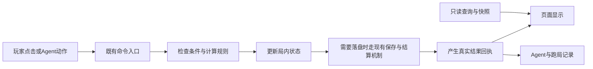

# 搜打撤：总体改造计划与分表

2026-10-02。此文给老板看方向、次序和取舍；工作簿用来筛选、派工、跟进，逐页与系统分表用来实际修改。本计划不是已实施声明，除已经修复的本地服务外，下面的游戏改造均未执行。

## 我建议先做什么

**先把一趟远征的“带入—使用—损失—带回”讲清并记对，再提升这一趟旅程的画面和反馈。** 当前最有辨识度的东西已经存在：卡牌既是战斗手段，也是会消耗、能带回的财产。现在的主要问题不是缺一批新卡，而是部分规则、图解、界面、声音和统计没有围绕同一份事实说话。

先保留三样东西：Vite主线；当前冬境角色与场景方向；已经形成的命令、查询、快照和存档恢复结构。暂不换引擎、换前端框架或全量重画素材。

第一批先拆成四个小修，不必等大架构改完：

| 小修 | 已有问题 | 怎么改 | 完成标准 |
| --- | --- | --- | --- |
| 首脑路线提示 | 打完四层首脑，日志却提示去“第五层” | 统一为实际终局层数；相关提示读同一规则或同一已核文案 | 首脑、终局点、结算和规则说明不再互相矛盾 |
| 消耗教学图解 | 两列都用初始攻击图片，却分别表示入口袋和直接消散 | 左列换真正可进入口袋的普通牌，如镭射；右列保留初始攻击；箭头与结论对应 | 不读长段说明，也能分清两种卡的去向 |
| 供给页安全区 | 口袋/带回预估条遮住标题 | 给顶部状态、标题、内容各留自己的位置；保留重要资源提示，不用调低层级把它藏掉 | 当前窗口正常开箱，标题完整，三张候选卡和领取按钮可读可点 |
| 危险操作层级 | 不可恢复的“确认清空”仍是最亮金按钮 | 危险动作使用明确危险名称与样式；取消保持安全默认；不要再加重复确认步骤 | 鼠标与键盘的默认方向一致，玩家不会把删除当作普通“下一步” |

这些修复不需要先建立一套大系统。涉及共享存档、结算回执、规则消费者的改动另按下方依赖顺序做。

## 总体顺序

| 阶段 | 这阶段解决什么 | 交付物 | 进入下一阶段的条件 |
| --- | --- | --- | --- |
| PH0 固定运行与证据 | 先保证看到的是正常运行画面，结论能追到具体版本和场景 | 已修后台服务入口、工作包证据与验收范围 | 服务及图片正常；故障截图不被当成美术缺陷；不重复已经有效的检查 |
| PH1 先把账与规则事实做实 | 重复安全移动经验、真正入库、保存失败、辅助局记录 | 有效探索经验规则、结算收据、恢复证据、干预履历 | 同一件事在界面、存档与Agent记录里一致；重试不多扣、多发 |
| PH2 做好一趟代表体验 | 整备、卡池、地图、战斗、领取、结算的读法与反馈 | 一套轻量共享外壳和卡牌信息层级；关键声音与动作时序；一条实页样板链 | 代表链完整成立；信息不遮挡；用牌与收益能解释；再扩展到同类页 |
| PH3 再调节奏与扩内容 | 何时值得继续/撤离、是否有编组选择、成长与剧情节奏 | 固定问题的小实验、对应数值或内容调整 | 有自然旅程和目标玩家证据；一次只改一个主要变量 |
| PH4 明确保留边界 | 防止把时间花在冻结线和未决定的新系统 | 研究所兼容说明、冻结项目清单 | 不因目录里有代码就恢复Godot/Unity/EXE或扩第二张地图 |

本地服务已修复，不应再次作为“新功能开发”排预算。系统包的硬前置与需要一起对齐的事项分开列；例如音效注册与战斗演出需要协作，但不应互相等待到无法开工。

## 工作包总表

下面是完整工作包的硬依赖顺序；上方四个小修可以先拆出来做，不必等待整包。详细源码落点、步骤、架构与验收见[系统分表](systems/SYSTEM-PLAN.md)。

| 顺序 | 工作包 | 玩家或制作者得到什么 | 具体方向 | 硬前置 | 规模 | 当前状态 |
| --- | --- | --- | --- | --- | --- | --- |
| 1 | SYS-15 运行服务与资源健康 | 验收先确认页面和图片真的来自正确服务，避免把服务失效当作设计缺陷返工。 | 将现有web-up和资源探测作为实页验收前置，保留修复证据；只在输入或服务身份变化后复核。 | 可独立开始 | 小：已修复；下轮只需定向健康核对，异常再估 | 已修复，保持 |
| 2 | SYS-16 QA、规则文档与交付证据 | 老板能清楚看到哪些已改、验到什么、还有什么未核；接手者不用重做有效验证。 | 用现有workflow verify和质量门按工作包留证；每个结论注明源码/实验/实页/试听/玩家观察哪一种。文档跟真源更新，不另建强制总账。 | 可独立开始 | 小中：贯穿各片，主要复用现有流程；不单开重做工具工程 | 待实施 |
| 3 | SYS-01 探索奖励与经济激励 | 玩家因有效冒险成长，安全绕路不会成为最优升级方式；正常回头搜路仍保留。 | 默认把探索XP绑定首次有效节点结算，行动步数继续用于统计；保留自由回头路。先明确有效结算名单，再修改一条奖励公式。 | 可独立开始 | 中：2–3个独立改动片，另加一次真实撤离验证；工期须实施前按归属排期 | 待实施 |
| 4 | SYS-10 存档、失败提示与恢复 | 保存失败会明确提示并可恢复，重试不会重复扣牌发奖；玩家知道实际检查点在哪里。 | 先在可丢弃档故障注入定位实际部分失败；补调用方提示和重试，再根据缺陷决定跨键协调。默认保留当前存储，不立刻迁移IndexedDB。 | 可独立开始 | 中大：故障表1片、按实际缺陷1–3片；换存储是另案 | 待实施 |
| 5 | SYS-02 结算真源与主图收束 | 玩家一眼知道是保本撤离还是击破首脑，以及真正带回和失去了什么；团队也能逐项对账。 | 先修错误层数，再让结算产生一份真实回执，供结算页、跑局记录与Agent共同读取。clear强调击破首脑和关键收获，extract强调保本返回。 | SYS-10 | 中大：3–4个改动片（回执、迁移/幂等、UI、记录消费） | 待实施 |
| 6 | SYS-11 Agent真源、干预履历与停止条件 | 每局成绩能区分真人、策略和辅助干预，代理停住时能说明原因；策略比较更可信。 | 先让记录诚实再谈策略优劣：驱动、调试干预、源码/数据/seed、初始资源、动作轨迹、终止原因都随局保存。合法动作来自现有场景真源，收益来自结算回执。 | SYS-02 | 中：3片（履历、回执消费、停滞诊断） | 待实施 |
| 7 | SYS-03 物资领取、消费与复原事务 | 满包、取消、买卖、献祭和复原的结果可预期；不会因为页面或代理误判把已领/未领搞混。 | 把高价值资源动作的顺序写清：校验→玩家确认→提交→回执→画面更新；优先复用grant/command返回值，仅在重复且易错的叶节点抽公用帮助函数。 | SYS-02；SYS-11 | 中大：按已证缺陷拆2–4片，未发现缺陷的分支仅验证 | 待实施 |
| 8 | SYS-08 战斗规则与牌效消费者 | 牌面承诺、预览和实际伤害/状态一致；复杂牌效出问题时更容易定位到具体规则。 | 每次只选一条有误差或拟修改的规则链，核触发→实际计算→状态改变→预览→反馈；让预览调用同一纯计算或明确unknown，不复制第二套战斗逻辑。 | SYS-03 | 中大：按缺陷/变更逐规则族切片，不承诺一次验完全部组合 | 待实施 |
| 9 | SYS-12 共享界面结构与信息层级 | 标题、卡牌、状态和主按钮不互相抢位置，相同动作跨页更容易辨认。 | 先立一个轻量场景布局约定：顶部状态、标题、主内容、主动作各有位置。优先改供给与整备的共享容器，保留地图条和照片收藏的纸质语义。 | 可独立开始 | 中大：先1片已证遮挡，再按组件组2–3片，不逐页重写 | 待实施 |
| 10 | SYS-06 出征整备与首次目标 | 出发前更容易选对牌、理解容量和损耗，失效预设不会造成困惑。 | 让出征页清楚回答带什么、容量还剩多少、初始牌为何不能入库、本局准备达成什么；小卡保留关键摘要，大卡承担全文。 | SYS-10；SYS-12 | 中：2个片（信息摘要、失效预设/出发反馈） | 待实施 |
| 11 | SYS-13 美术组件、映射与生成管线 | 角色、卡牌和场景在共同视觉语言下可辨认；改图可追溯来源，减少错映射和无效重画。 | 美术按角色/卡牌/场景/图标四类建锚点和变体；优先校正映射、裁切和信息语义，只针对已选缺口补图。沿用NovelAI当前脚本与人物圣经。 | SYS-12；SYS-15 | 中大：先小样1片；批量工作按确认缺口数量另估，不按271/272全重画 | 待实施 |
| 12 | SYS-14 声音cue注册、声景与播放时序 | 出发、搜寻、命中和撤离有准确且不过量的声音回应，静音与场景切换行为可靠。 | 以现有Sound作为唯一门面，把样本库/合成/声景注册对齐，先接已有声音再决定新增。定义场景进入退出和命中时序，并保留音量/静音偏好。 | SYS-12 | 中：入口/目录1片，接线1片，试听调节1片 | 待实施 |
| 13 | SYS-09 战斗信息、动作时序与反馈 | 玩家看得清敌方意图、确认自己的命中与击杀，快进或减少动态也不会卡住操作。 | 保住玩家读意图和选目标的时间；把规则完成、命中表现、声音和解除输入锁的顺序对齐。先验一条代表动作，再改相关层。 | SYS-08；SYS-12；SYS-14 | 中：一条标杆动作1片，再按同类机制有限扩展 | 待实施 |
| 14 | SYS-04 撤离节奏与首脑编组选择 | 用自然选择证明撤离与编组是否有意义，避免花时间改动其实有效的玩法。 | 默认维持四层和现有门槛；先观测首次想撤离、理解损耗、发现出口、编组放弃哪张。仅在目标问题成立后试一个变量。 | SYS-01；SYS-02；SYS-06；SYS-11 | 研究中、实现待定：先1份问题表+1–2条观察，规则方案另估 | 先验证 |
| 15 | SYS-05 基地成长、收藏与资源去向 | 玩家能看懂资源该花在哪里、能换来什么长期目标；升级和收藏不会只剩菜单数字。 | 先画清一张资源来源/消耗/上限表，明确每个按钮付出什么、永久得到什么；优先修真实账目或理解错配，再调节增长曲线。 | SYS-01；SYS-02；SYS-10 | 中大：先经济表，再按发现拆小片；不一口气改全部成长 | 先验证 |
| 16 | SYS-07 事件与主图叙事投放 | 首脑胜利有属于本次远征的收束，事件选择有清楚的代价与结果，跨局故事能可靠续接。 | 先补主图首脑胜利的一段短收束，再审查事件选择的代价/结果。继续用既有叙事编译与story命令，不迁移新叙事框架。 | SYS-02；SYS-10 | 中：短收束1片、事件链一致性1–2片；新章节另立范围 | 先验证 |
| 17 | SYS-17 内容编辑、导入与规则一致性 | 内容作者能在导入前看见错误与冲突，编辑后的卡能按实际运行规则被正确使用。 | 先让编辑结果通过现有schema与真实加载链，导入前给校验/冲突结果；只定位272/271差异，不拿数量当完成率。 | SYS-08；SYS-13 | 中：口径核对与校验消费1–2片 | 待实施 |
| 18 | SYS-18 反馈、留言与玩家研究入口 | 玩家反馈更容易定位和复现，团队能从真实理解障碍选择下一步改进。 | 保留轻量入口，反馈自动附场景/版本/当前动作上下文并让玩家写预期和实际；外发、招募和录制按明确授权另行处理。 | SYS-16 | 小：优先现有数据复用；确缺上下文时1片 | 待实施 |
| 19 | SYS-19 研究所边界与冻结平台 | 主图制作保持聚焦，研究所和冻结平台不会悄悄扩成另一轮开发。 | 列明边界并维持已有入口，不扩玩法、演出或引擎；共享依赖变更只验是否误伤。 | 可独立开始 | 本轮不实施；仅兼容回归 | 冻结，不排期 |

## 哪些地方应采用什么架构

这里的“架构”是责任怎么分，不是换一套流行框架。

| 部位 | 建议结构 | 为什么适合当前项目 | 不要做成什么 |
| --- | --- | --- | --- |
| 玩家/Agent动作 | 继续共用现有命令入口；画面只发操作意图 | 避免按钮成功而Agent走另一套规则，或两边重复扣资源 | 不让页面HTML直接改基地和存档对象 |
| 只读显示 | 用现有查询/快照提供页面需要的结果 | 页面不用到处猜状态，测试和截图可按同一输入复现 | 不把整份可写game对象随意传给所有新控件 |
| 结算 | 结算命令生成一份真实回执，界面和跑局记录读取它 | 本局真正入库20张，与原仓库2张、携出候选22条必须能区分 | 不再从标题、最终总数或所有ownedCards反推实收 |
| 存档 | 保留Base/Run和已有journal、幂等机制，先测失败调用方 | 现有保护有实际价值；没有证据支持立即换数据库 | 不承诺每回合恢复；不为赶图绕过pending提交；不随意裁剪重放收据 |
| 界面 | 统一颜色/字阶/间距变量，共享页框和组件，业务内容留在各自模块 | 110基本条目中大量共享骨架，不必各写一套按钮和安全区 | 不把所有页面硬改成一样的矩形后台；照片收藏保留其纸质语义 |
| 战斗 | 规则计算、状态变化、表现时序分层，保留现有门面与调度 | 伤害预览、实际扣血、特效和声音才能对齐同一次动作 | 不复制第二套伤害计算给UI；不按文件行数盲目拆分 |
| 声音 | 现有Sound作唯一入口，cue注册、采样/合成和场景声景清楚分工 | 当前已有声音资源，先修接线比继续下音效包更有价值 | 不再并存两套互不消费的注册表；不把开发诊断弹给玩家 |
| 美术资源 | 人设/风格锚点→原始素材→裁切与压缩→映射/清单→运行加载验证 | 防止同一人物或卡牌在列表、详情、战斗里变成不同对象 | 不直接把商业游戏参考截图放进本项目，也不手改cards-sync.json |
| Agent实验 | 规则版本、种子、初始资源、操作者与调试干预随局保存 | `human`不能掩盖控制台辅助，胜率才有解释空间 | 不把调试胜利、无来源的历史统计或fullrun.pass当自然通关 |

悬停、选中、翻页等纯展示变化留在界面内存；资源和存档变化遵守当前稳定节点与结算边界。上图不表示“每个按钮、每一帧都保存一次”。

## 每个界面到底怎么改

完整内容在[逐页分表](pages/UI-PAGE-PLAN.md)，工作簿按入口基地、探索事件、战斗结算、工具研究所四域分开。110基本页逐条列问题、保留项、3—6条改法、排版/颜色/材质、动效触发与结束、修改文件、资源工具和验收；55个内容变体引用共享模板，并补内容差异。

“为什么不高级”必须能落到具体对象，而不是一句“加质感”。几个典型改法如下：

| 页面 | 具体问题与影响 | 改法 |
| --- | --- | --- |
| 职业卡池/整备小卡 | 长规则、费用、稀有度和插画在小面积里争抢；不能靠不断缩字容纳全部内容 | 小卡只承担认牌和关键摘要；详情承担全文。固定费用、名称、效果、类型的位置；不同职业换内容，共用卡框与分页规范 |
| 供给与多箱 | 状态条压标题；三选一、全部收下和放弃的后果需要先被看懂 | 先排清“这是第几箱→能取几张→容量→选项→放弃后果”；主动作数量受控，禁止把所有按钮都染成同样的金色 |
| 战斗 | 已有敌方意图和卡牌展开。实测悬停有上抬、轻放大和说明展开，并非没有动效 | 保留展开；用长效果卡核其边界，避免遮敌方意图和生命。命中、数值、血条、状态标记各负责一层信息，结束后及时退场 |
| 消耗品教学 | 同一张初始攻击图片被用于两种相反去向，读图会产生歧义 | 用两张规则确实不同的卡示意；“入口袋/直接消散”颜色和图标区别；三栏同栅格，确认动作与内容宽度有明确关系 |
| 主图通关结算 | 实页能回基地且入库成功，但胜利和普通保本撤离共享主体，缺少本局重点 | 上方明确“击破首脑/保本撤离”，中部讲净收获和关键损失，下面再放详细列表；保留回基地/再出发，不急着做长过场 |
| 备注与导入导出 | 默认黑色输入框和零散按钮像临时开发面板；但它们本来就是工具，不值得大规模装饰 | 统一输入框和按钮栅格；保存/取消成组；删除单独处理。开发编号留在工具区，不塞进玩家主流程 |
| 保存失败页 | “终局安全提交服务不可用”属于实现术语，玩家不知道当前进度怎样 | 用人话说明进度是否保留、能做哪一步；重试保持安全。只有证明不会丢失待结算状态后，才能增加返回选项 |

对没有稳定实图的页面，表里写的是“风险假设、先验哪里、通过后改什么”，不是编造看过后的审美结论。冻结和未接入页面列为保留边界，不为了给它拍图而改正式数据或开启新系统。

## 素材去哪里找，工具怎么用

具体链接、许可证、本地拥有情况和系统对应关系见[资源工具分表](systems/RESOURCE-TOOLS.md)。它包含25项精选来源、12项工具和10个UI制作请求，不是要求全部接入。

| 需要 | 先用什么 | 使用方式 |
| --- | --- | --- |
| 角色、场景与冬境风格 | 项目现有人设、角色图与NovelAI制作流程 | 先选一个角色/一个场景做样板，统一光向、比例、裁切；审美通过后再扩，不先批量生成 |
| 控件与信息图标 | 现有图标＋Game-icons具体素材；Kenney UI作为候选 | 统一笔画、底板和状态语义；CC BY图标随文件保留归因，不把CC0误套到其他网站 |
| 点击、确认、错误声音 | 已有Sound/howler链路＋已下载Kenney CC0短音 | 先核cue有没有接到播放器，再试听音量与区别；文件存在不算可听验收 |
| 地图/风险/终局方法 | Brogue源码、FTL/ITB/Backpack Hero等原作者资料 | 借方法与边界；Brogue不是可随意粘贴进项目的MIT代码，也不照搬其饥饿和返程长度 |
| 卡牌反馈与对标 | STS官方截图及已看的短循环、Dicey官方画面 | 看清楚卡面层级、一次性特效与持续状态如何分工，不照搬卡牌循环规则或原素材 |
| 工程验证 | 既有Vitest、workflow verify、数据/类型/资源检查 | 按影响面选定向验证，公共状态或存档改动按项目质量门升级；不把全量测试当每次改字的固定仪式 |

图片、音效、字体和代码分别核许可。工具表明确“项目声明依赖”“本轮实际执行”“仅可选”，避免把安装列表当可用证明；本次计划没有安装任何新工具。

## 每批怎样验收才算改完

1. 先固定一个要解决的问题和相同的场景输入，保存修改前的可见结果。
2. 改动只落该批必要文件；已有正确的人设、规则与存档保护不顺手推翻。
3. 规则看前后状态与资源去向，界面看当前窗口，声音要实际试听，动态看触发—变化—结束—中断。
4. 保存/结算改动补失败、重试、刷新和幂等；调试场景与自然路径分开记。
5. 一个样板链成立后再扩到同模板页面；每批列通过项与实际未覆盖项。

“高级感”验收也要具体：主焦点是否明确；文字是否能读；同一对象身份是否连续；选中、禁用、危险是否分得清；素材与控件是否属于同一套主题；反馈是否告诉玩家发生了什么。装饰更多、动效更长、素材更大都不是验收标准。

## 需要老板决定的事项，放到真正需要时

完整决策表在系统计划中。主要是：哪些行为应给探索经验；是否要提前提供保本撤离；首脑编组要强调精简构筑还是总战力；是否新增世界观/长演出；是否承诺更细的恢复粒度。表内给了默认建议，这些未决项不应阻塞层数文案、教学示意、遮挡、注册接线和证据口径的修正。

建议老板先从“四个小修＋真实结算回执＋共享页面样板”中选第一批。其余按依赖推进，不建议一次并行重做所有页面和底层。
