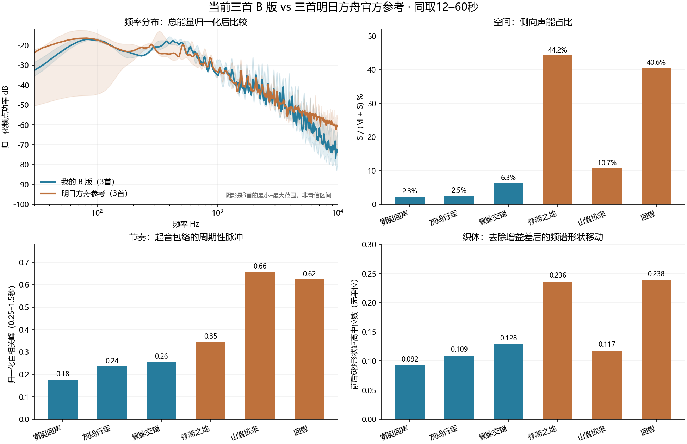
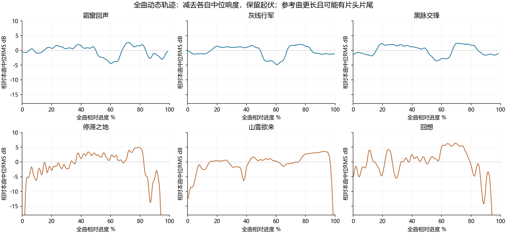

# 音乐量化差距分析 · 2026-10-05

对象：当前三首古典配器B版，与明日方舟官方《停滞之地》《山雪欲来》《回想》。只做分析，没有修改音乐或游戏。结论只覆盖这六份录音，不代表全部明日方舟BGM，也不把指标当审美评分。

**主要差距：我的声像展开很窄，周期性节奏支点较弱，两个参考案例有更多音色构成变化；更具体的问题是三首的强弱发展曲线仍几乎同形，沿用了统一段落模板。平均频谱亮度已经在参考范围内，单纯提亮不能解决这些问题。**

## 方法与输入

当前音频来自 `../2026-10-05-WF-music-identity/round-B/` 的24位WAV，三首实际长度103／90／93秒。参考源由[塞壬官方](https://monster-siren.hypergryph.com/music/)API返回：

- [停滞之地](https://monster-siren.hypergryph.com/music/125099)，195.43秒；
- [山雪欲来](https://monster-siren.hypergryph.com/music/306834)，125.25秒；
- [回想](https://monster-siren.hypergryph.com/music/697622)，152.97秒。

六份全曲统一解码48kHz立体声，参考PCM只在内存中处理，没有保存官方音频文件。频谱／节奏／声像／织体取相同的12–60秒；频谱进一步同口径重采样24kHz、FFT2048、hop256，使用两声道功率平均，避免宽声场在转单声道时互相抵消。每曲频谱按总能量归一化，比较的是音色分布，非原始音量。

全曲响度／LRA用[FFmpeg loudnorm](https://ffmpeg.org/ffmpeg-filters.html#loudnorm)的输入测量值；没有对原文件进行响度归一化。起音、速度及谱特征用[librosa 0.11](https://librosa.org/doc/0.11.0/feature.html)。comparison.json保存输入源、整段PCM SHA256、方法和六曲数据，summary.json为三曲组的中位数与范围。独立JSON及图表均可复核；不是用之前不同长度／不同算法的数字直接拼表。

## 六曲实测

下表除全曲响度与LRA外，均是12–60秒片段。频谱重心表示平均亮度，不是音符音高；起音指算法检出的瞬态，不等于音符数量。侧向比例为 S/(M+S)，其中M=(L+R)/2、S=(L−R)/2，按能量计算。

| 曲目 | 谱重心Hz | 250–500Hz声能% | 侧向声能% | 起音/秒 | 周期峰值 | 织体移动 | 全曲LUFS | 全曲LRA LU |
|---|---:|---:|---:|---:|---:|---:|---:|---:|
| 我的·霜窗回声 | 936 | 42.6 | 2.3 | 2.63 | 0.178 | 0.092 | −16.71 | 5.1 |
| 我的·灰线行军 | 1167 | 32.6 | 2.5 | 4.52 | 0.236 | 0.109 | −16.35 | 5.7 |
| 我的·黑脉交锋 | 1373 | 34.1 | 6.3 | 4.71 | 0.255 | 0.128 | −16.86 | 5.3 |
| 停滞之地 | 1429 | 65.9 | 44.2 | 2.40 | 0.346 | 0.236 | −12.91 | 8.8 |
| 山雪欲来 | 1120 | 10.5 | 10.7 | 6.67 | 0.658 | 0.117 | −13.80 | 6.7 |
| 回想 | 919 | 11.0 | 40.6 | 8.17 | 0.623 | 0.238 | −13.88 | 10.2 |

## 可确认的差异与解释边界

1. **声场展开差距很明确。**我的侧向声能只有2.3–6.3%，参考10.7–44.2%；左右相关系数我的0.878–0.964、参考0.117–0.786。我的录音更接近集中在中间的形态。这支持“层次空间展开不足”的诊断。侧向量更大并非自动更好，不能直接推出前后深度、混响质量或应把低频也拉宽。

2. **问题包含节奏支点，而非仅仅密度。**我的起音2.63–4.71次/秒，参考2.40–8.17；《停滞之地》起音更少，但周期峰0.346仍高于我的三首0.178–0.255。这里的周期峰是去均值起音包络在0.25–1.5秒延迟中的最大归一化自相关。它反映重复脉冲的明确程度，不是“律动好坏”分数；我的音符和打击散布较多，清晰节拍支点偏弱是一个有证据的改进方向。

3. **部分参考的织体变化更丰富。**去掉每个时间片的整体增益差后，比较前后约6秒的归一化谱形向量，移动中位数我的0.092–0.128。《停滞之地》《回想》为0.236／0.238，大约是我的2倍；《山雪欲来》0.117，已落在我的范围内。所以不能说参考“所有曲子都比我复杂”。这个指标可提示配器／音区／和声构成变化，不能识别具体乐器，也不能评判旋律优秀程度。

4. **频率差异不是简单的“我太暗”。**我的谱重心936–1373Hz、参考919–1429Hz，范围高度重合。我的三首250–500Hz都占32.6–42.6%，参考则10.5–65.9%，差异与曲目角色很大。应按场景分配音区与声部，不应把参考的中位频谱当EQ目标。高频与低频百分比本身不等于采样音质、细节或厚度，是否相互遮挡还需分轨频谱和试听。

5. **全曲动态较保守，但长度与片头片尾有影响。**我的LRA5.1–5.7LU，参考6.7–10.2LU；我的整曲响度约比参考低3dB。只看相同48秒，1秒RMS的P90−P10：我的4.8–6.4dB、参考4.2–9.6dB，范围有重叠，不能把全曲LRA差异都解释为演奏贫乏。原始响度更大也不证明音乐更好。

## 更大的问题：三首仍共用发展模板

将1秒RMS轻度平滑，再按各自时长对齐全曲10%–90%进度，计算曲目间相关性（排除片头片尾）：

| 我的曲目对 | 强弱轮廓相关 | 参考曲目对 | 强弱轮廓相关 |
|---|---:|---|---:|
| 霜窗／灰线 | 0.950 | 停滞／山雪 | −0.176 |
| 霜窗／黑脉 | 0.932 | 停滞／回想 | 0.579 |
| 灰线／黑脉 | 0.950 | 山雪／回想 | −0.402 |

这不是质量分数或旋律相似度，但确认了我三首强弱发展的高度同形：相近位置抬升、相近位置留白、再相近位置回归。原生工程也印证它们都采用48小节／六个8小节区块。旋律虽各自独立，段落发展的剧本仍过于统一。这是上一轮的具体制作问题，统一辨识度应来自少量共同音色／演奏特征，同时给标题、探索、战斗各自的发展逻辑。

工程审计还显示三首速度固定112／128／124 BPM，没有自动化片段；力度主要是音符velocity与固定轨道增益，缺少我主动控制的长音表情曲线和弦乐奏法切换。探索拨奏48个片段只有9种音高／节奏序列，战斗拨奏48个片段16种。循环材料本身合理，但当前发展变化更多依靠声部增减，持续演奏塑形不足。参考没有原生乐谱，不能编造其MIDI复杂度或断言其一定是真人演奏。

参考速度检测存在方法敏感性：同一《山雪欲来》先前线性频谱起音法估计约161.5BPM，本轮mel起音法估计119.7；因此节拍网格偏移只留诊断数据，不用它证明“参考更有人味”，也不拿BPM数字评判好坏。

## 下一轮应优先解决

1. 为三种场景分别写发展曲线：标题保留较长呼吸与小幅内声部生长；探索增加可持续推进与不同长度的回答；战斗安排压力累积、局部释放和明显但独立的回归。减少相同时间位置的统一升降模板。
2. 在保持低频与主线稳定的前提下，重新布置弦乐／木管／钢琴的横向位置和各自空间，检查单声道兼容；侧向比例作诊断，不机械追到参考的40%。
3. 按乐句写连续渐强／渐弱、弦乐长短奏衔接、内声部与反向运动，改善演奏控制；配器音区变化优先于再堆轨数。
4. 给低鼓、低弦乐或钢琴左手建立清楚但各曲独立的节奏锚点，再围绕锚点安排装饰与回应。

上述是分析后的建议，本轮未实施修改。源数据与曲线验证见 verification.json；首轮脚本在数据全部写完后的控制台打印使用了Python3.9字典运算，当前3.8环境报错。已修正兼容性和控制台编码，特征计算未变；已生成数据另经独立一致性／本地输入指纹核验，不将初次进程退出码记为通过。
