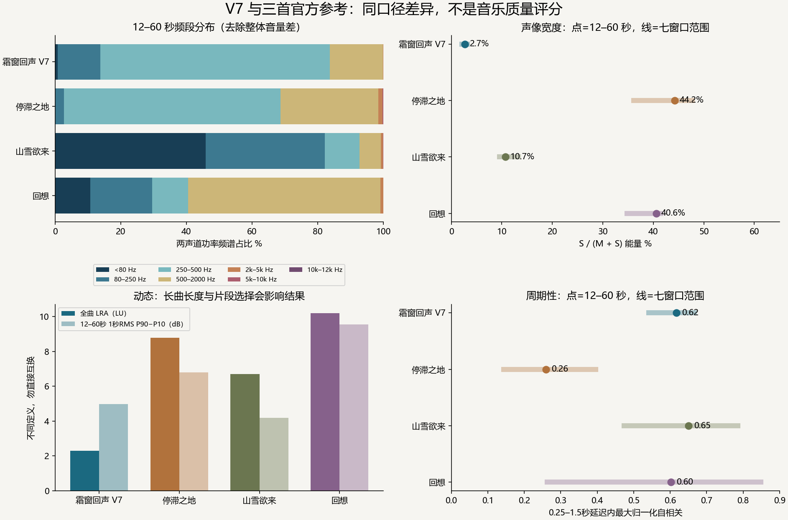
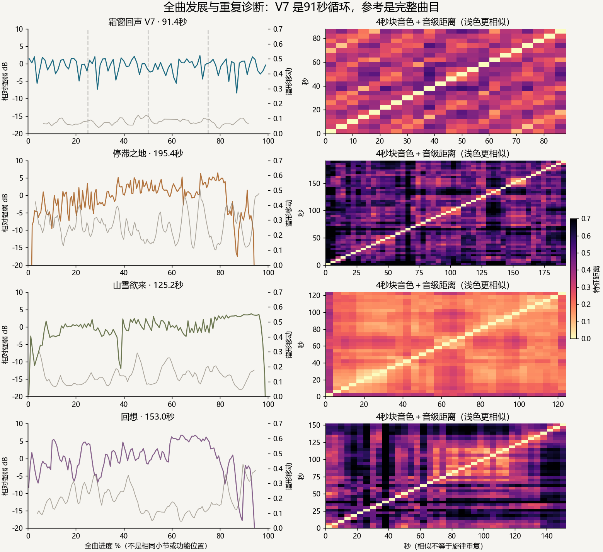

# 《霜窗回声》V7 独立复核 · 2026-10-05

老板，本次重算支持的主要差距是：**成品声场较窄，钢琴与伴奏的音色／音区发展较少；演奏塑形仍较简。V7 已有开场垫底、真实 MIDI 延音踏板和明确周期，继续以“缺垫音、没踏板、没节奏”解释它不成立。** 下一轮优先改声部分工、空间与乐句变化，再考虑音色替换；堆轨、加响或加亮不能单独解决这些差距。

只分析最新 `../2026-10-05-WF-music-title-v7/01-title-frostglass-v7.wav`，91.43 秒、32 小节、工程速度 84 BPM。探索／战斗曲按最新指示排除。旧 gap 报告的标题对象为 V3，其结论不代表 V7；旧文件均保留。本轮未人工试听，以下听感与制作建议是依据音频数据和自有工程的推断，旋律是否感人、音色是否合意仍属于审美判断。

## 对照对象与口径

官方来源是塞壬唱片的[《停滞之地》](https://monster-siren.hypergryph.com/music/125099)、[《山雪欲来》](https://monster-siren.hypergryph.com/music/306834)、[《回想》](https://monster-siren.hypergryph.com/music/697622)。本次重新请求官方 `/api/song/<cid>`，以响应内公开音源解码，保存响应及来源／PCM 指纹；没有落盘官方音频，也没有改任何曲子。官方签名 CDN URL 会轮换，复现时优先重新取 API；稳定媒体文件名及 PCM SHA256 用于核对。

保留这三个样本，是因为它们展示了不同的声场、频谱与脉冲组织；《停滞之地》《回想》主要作为空间和发展对照，《山雪欲来》作为另一种节奏／频率组织的参照。官方元数据没有标出游戏内用途，不能声称三首与标题曲用途相同，更不能据此要求标题曲达到其起音密度。三个样本不代表全部明日方舟 BGM。

全曲统一解码为 48kHz 双声道浮点 PCM。频谱重采样至 24kHz，Hann STFT 为 FFT2048／hop256，先平均两声道**功率**，避免转单声道时宽声场相消。频段占比按总功率归一化；谱重心与带宽分别为幅度谱的一阶均值与二阶离差，平均时排除相对峰值低于 −60dB 的帧。窄频段边界存在约 11.7Hz 的频率分辨率误差；这里的低频首档是 <80Hz，包含近直流，不与旧文档的 20–80Hz 名称混用。

所有曲目都测同一组七窗口：0–24、12–60、36–60、60–84秒，以及三个24秒窗口，起点为 `p×(全曲时长−24)`、p=10%/40%/70%。后者只是相对位置对照，不是同小节或同功能段落。12–60秒保留为旧分析复核点；开头、后段及等时长相对窗口用于检查结论是否换段后反转。全曲为 91.43／195.43／125.25／152.97秒，完整曲目的片头片尾与循环长度差异，特别影响 LRA。

响度只读取 [FFmpeg loudnorm](https://ffmpeg.org/ffmpeg-filters.html#loudnorm) 的 **input** LUFS、真峰值和 LRA；输出端数值不参与表格，不生成归一化成品。响度差不等于质量差。若下一轮做听觉 A/B，以 V7 的 −15.53LUFS 为基准，三个参考分别降低约 2.62／1.73／1.65dB，再对等用途片段判断。相对谱形、频段比例和声场比例不受固定增益影响，−6.02dB 探针已验证。

起音主口径为双声道功率 mel 谱的正向谱通量，另独立计算旧报告的单声道方法。用 [librosa onset_detect](https://librosa.org/doc/0.11.0/generated/librosa.onset.onset_detect.html) 的 delta=0.05/0.07/0.10 检查阈值敏感性，表格采用0.07。周期性是去均值起音包络在0.25–1.5秒延迟内的最大归一化自相关，不是律动评分或人味评分；BPM估计只留诊断数据。

## 可测差异

以下谱／声场／起音为12–60秒，全曲LRA另列；完整响度、峰值、七窗口明细在 [comparison.json](comparison.json)。

| 对象 | 谱重心／带宽 Hz | 250–500Hz功率占比 | 侧向声能占比 | 起音/秒 | 周期峰 | 全曲LRA LU |
|---|---:|---:|---:|---:|---:|---:|
| 霜窗回声 V7 | 776／1027 | 69.9% | 2.7% | 2.60 | 0.62 | 2.3 |
| 停滞之地 | 1429／1769 | 65.9% | 44.2% | 2.98 | 0.26 | 8.8 |
| 山雪欲来 | 1120／1666 | 10.5% | 10.7% | 6.81 | 0.65 | 6.7 |
| 回想 | 919／1076 | 11.0% | 40.6% | 7.04 | 0.60 | 10.2 |

**声场是最稳健的差异。** V7七窗口的侧向比例为2.1–3.1%；三个参考分别36.1–47.7%、9.5–13.3%、34.8–41.5%，没有重叠。12–60秒左右相关系数V7为0.973，参考为0.117／0.786／0.188。可确认V7的左右信息更相似、声能更集中于中间；不能由此直接判定前后深度、混响品质，或要求低音也变宽。参考40%的侧向量不是目标值，V7单声道折叠平均声能损失仅约0.12dB，参考《停滞》《回想》约2.54／2.26dB，展示了宽度与折叠表现的取舍。

**频率构成集中，但“偏暗”不是固定质量缺陷。** V7七窗口谱重心760–806Hz、250–500Hz占63.2–76.7%，同一曲不同段的亮度变化很小。它在12–60秒比三参考暗，不过《回想》不同窗口重心可降至546Hz；《停滞》自身250–500Hz可达76.0%。V7带宽与《回想》也接近。因此不能机械削掉70%的中低频，或把EQ追到参考平均曲线。数据提示音色／音区变化不足，比“所有频段都差”更可信。

**节奏已有稳定支点。** V7七窗口主口径周期峰0.54–0.67，12–60秒在1.429秒与0.715秒附近出现峰值，符合84BPM的一拍／两拍周期；旧单声道口径也得到0.60，而不是旧V3的0.178。V7周期强于本次《停滞》，与另外两首的主窗口接近。算法起音密度低于两首高密度参考，但标题曲不必靠更多瞬态成立。阈值一改，V7同一48秒检出71–207个起音，默认125；不能把起音等同乐谱音符数量。

速度误差同样明确：V7主口径估计约84，单声道12–60秒估计约117，即使它的周期峰仍准确指向0.715秒。参考在不同窗口也会给出不同速度／细分层级。故本次不计算“偏离拍点=人味”，不从BPM判断是否真人演奏。平整节拍可服务标题氛围，问题应定位到乐句表情与变化。

**全曲大动态较小，局部并非没有呼吸。** V7全曲−15.53LUFS，比参考低1.65–2.62LU，真峰值−3.30dBTP。LRA2.3LU低于三参考，但相同12–60秒，1秒RMS P90−P10为4.99dB，参考6.79／4.20／9.56dB：V7大于《山雪》。七窗口这一范围也与参考重叠，片头会大幅拉高《停滞》的短窗口范围，尾部静音不应解释成演奏表情。V7主窗口峰均比仍有14.46dB；低LRA不证明压缩器过重，更不能直接归因于没有力度变化。

## 工程与分轨：制作差距具体在哪里

独立解析V7原生XML，并追到V5乐谱／V6冻结钢琴和渲染事件，证据见 [native-audit.json](native-audit.json)。两条钢琴轨XML与V6一致，冻结WAV SHA256与V6记录相符；V5事件记录按原生48tick/拍量化后与XML吻合。V7的单个触发音符是整段冻结录音的播放入口，不能误数为“钢琴只写了一个音”。

钢琴每个交付循环实际为100个主旋律音、48个和声音。主旋律音区MIDI59–75，冻结渲染力度48–54；和声音区39–63，力度全部36。踏板真实通过FluidSynth发送CC64：每两拍一组，按下127，1.92拍时抬起0；主旋律有释放重叠。该证据证明踏板指令确已使用，不能保证声学钢琴的全部共鸣／半踏板细节，也不能证明听感自然。固定踏板周期、固定和声力度和窄幅旋律力度是可具体改进的控制方式；没有参考原谱，不能断言官方一定采用真人录制或更复杂的MIDI。

八条演奏轨中六条是伴奏：左右弦乐、大提琴、管弦垫、中提琴、低音提琴；左右弦乐和垫层都是SF2 program49。工程已有六条长音音量自动化，不能沿用旧V3“没有自动化”的判断。它们主要仍按两小节长音／重复和声支撑；轨数增加，音色角色与进入／退出逻辑没有同等增加。钢琴主旋律居中附近，和声偏左；左右弦乐虽已有约−39/+36的pan，成品仍很窄，说明“轨道画在两边”不等于主导声能已有充分展开。

现存总混音与静音钢琴后的原生伴奏导出，也重新读取了。独立复写线性后处理后，重建成品的相对RMS误差约−125.5dB（避开最后96个循环接缝样本），拟合增益24.72dB与原报告吻合。伴奏为真实已有导出；“钢琴”这里是总混音减伴奏的残差，包含独立渲染差异，不冒充纯干声钢琴。分离边界及指纹见 [stem-audit.json](stem-audit.json)。

开场0–2秒伴奏RMS为全曲同段的29.63%，独立复现了原交付报告；不是声能占29.63%，也不是质量分。12–60秒，伴奏在250–500Hz比钢琴残差低9.70dB，在500–2000Hz低8.19dB，而80–250Hz高8.14dB。钢琴和伴奏归一化功率谱重叠面积约0.38：同域有重叠，但不能由此确认听觉遮挡。**现有证据更支持中低频集中主要来自钢琴部分，而不是垫层把该频段淹没。** 伴奏在低频更强、与钢琴和声音区相交，是否浑浊或抢尾音须做等响分轨试听，当前不下定论。

**段落发展有明确的重复限制。** 32小节由四个8小节乐句构成。追溯冻结钢琴源，旋律和和声第1、2、4乐句的音高、起点、长度及冻结力度序列完全相同，第3乐句不同，即A+A+B+A。V7把伴奏放到开场后，这三次A的角色差异更依赖长音音量曲线；后续再重复A时缺少新的回答，是值得检查的编配选择。循环用重复材料合理，这不是要求每小节都换旋律。

消除1秒片块整体音量后的6秒谱形移动，在全曲10%–90%范围内中位数为V7 0.077、参考0.249／0.131／0.171。V7比三样本的音色构成移动少，但这不是“编曲丰富度评分”，也不能识别具体乐器。《山雪》特征距离图同样有大块相近区域，说明官方也可以大量维持同一织体。图右只比较4秒块的音色＋音级向量，相似不证明旋律重复；V7的A重复结论来自自有谱，不能从该图给官方曲子编造乐谱结构。图左按全曲百分比绘制，尾部低于−20dB的值超出展示范围，原数据保留。

## 旧结论复核与下一轮顺序

旧报告的三参考LUFS、谱重心、单声道起音率及周期峰均由重新解码独立复现，差异为零或浮点精度；旧参考数据本身可靠。旧标题版本却不适用：窄声场仍成立，V7已有踏板、自动化和开场伴奏；“周期支点弱”“平均亮度已在参考范围”“三首共用发展模板”不能直接搬到这首V7。此次不重算被取消的另两首，也不再下三曲整体结论。

建议次序属于制作推断与审美选择，本轮没有实施：

1. **先调整声部分工和空间。** 保留第一拍垫底与低音的稳定性，给主旋律、钢琴和声、长弦与垫层不同的音区／留白／空间职责。先做总混音、钢琴残差、伴奏的等响A/B与单声道折叠，定位听觉症状后再动EQ、pan或混响，不设40%侧向量目标。
2. **让第二次A和返回A有不同的回答。** 可以保留主题，改变内声部运动、句尾长度、钢琴和声布局或一条伴奏的进入方式；B段安排一处可感知的音区／织体转折。用8小节角色说明和等响试听检验差异，避免只加轨数或整体渐强。
3. **按和声与乐句塑形演奏。** 和声力度36应依据重音与句尾有目的地变化，踏板跟着和声／尾音而非机械每两拍；弦乐长音的音量曲线已有基础，再检查起音、接续、释放和必要的奏法变化。保持连贯，不为“人味”随机抖动时值。
4. **最后决定是否替换音色。** 当前使用GeneralUser GS与冻结钢琴属实；仅凭这些总频谱不能判定采样品质输给官方。先做同乐句、同响度候选对比，再判断共鸣、起音、长音接续是否符合老板的古典方向。提高响度、补高频放最后，避免掩盖前面的问题。

本次仅完成分析资料、复现脚本和图表。28项定向检查通过，图表已实际查看；未人工试听、没有官方谱或官方分轨，不宣称上述审美建议已验证。未修改曲子、游戏、音源或全局配置，未运行游戏全量／构建，未提交。

复现：现有环境中依次运行 `python docs/evidence/2026-10-05-WF-music-independent-review/analyze.py`、`plot.py`、`verify.py`（后两者同目录完整路径）。默认完整重算；`analyze.py --resume`只复用此次已完成窗口结果，用稳定媒体文件名核对轮换URL，保留原获取URL与PCM指纹，不适用于文件或方法已变的重算。`verification.json`记录了首次尾部静音与URL轮换造成的中断和修正，失败运行不计通过。所有音频／大件只列原路径、字节数、SHA256及来自既有渲染的获取方式，未新增音频二进制。
