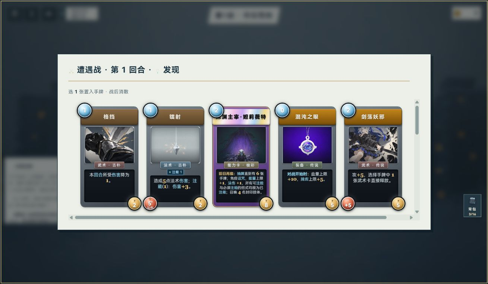
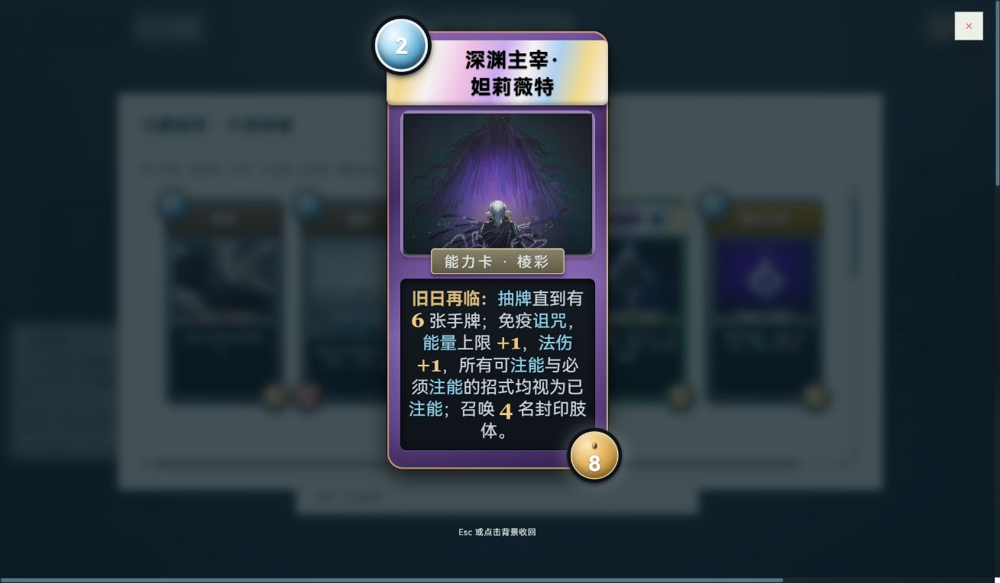
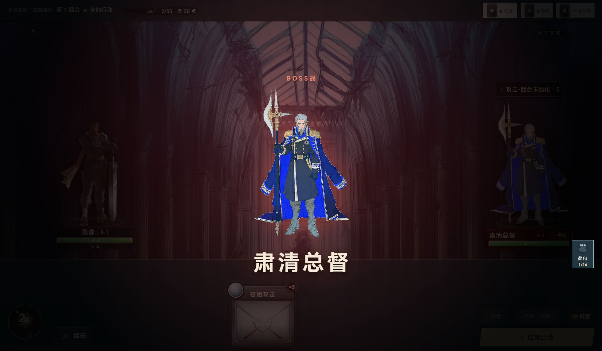
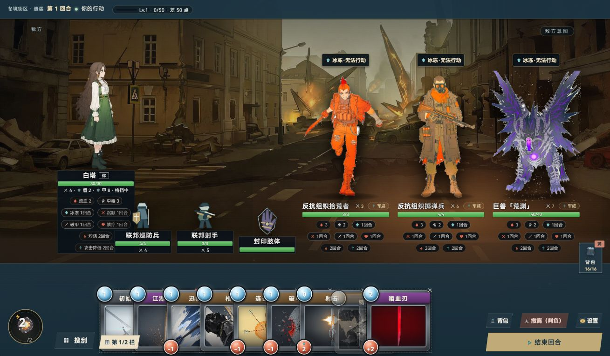

# 七阶段美术实施记录

老板授权实施，沿用当前窗口及明确排除项。原始问题见[首轮](../live/REVIEW.md)和[补检](../live-more/REVIEW.md)。

## 局部规则

| 对象 | 决定 | 材料 |
|---|---|---|
| 浅面文字 | 主字#1b3442、次字#526773；纸面#edf0e8、内容面#f7f7ef；字与底成对处理 | frontend-design、Impeccable typeset、Hobday规则 |
| 普通弹层 | 打开时地图底部操作台让位，关闭自然恢复；研究所与地图造型保留 | Impeccable layout、现有普通来源标记 |
| 撤离动作 | 右栏单列动作、完整损失文字；空态占所属区 | Backpack Hero分区、harden方法 |
| 卡牌 | 选择列表统一名称预算与同排高度，完整规则保留；现有职业框/稀有度/棱彩身份不变；材质只局部压高光 | 卡牌样板、typeset/polish |
| 状态 | 不可用/已售用形状和文字，条件与价格仍可读 | clarify、可读性指南 |
| 首脑 | 复用现有透明图，保持姓名与时长 | 现有cut立绘、Hades人物避让 |
| 友军 | 三种独立SVG轮廓，保持名牌与数值；未知与研究所保留通用图 | 现有矢量方式、单位身份 |

本轮无外部skills安装、无新增位图、无全局主题改造。只编辑实际落点，未修改八个备份目标中的其他文件。未测试完整流程/存档/整备拖拽/地图拖缩/全面键盘/性能/其他窗口尺寸；不build不提交。

## 实施结果与进度

七阶段已完成实施及限定范围复核；I06卡牌材质、I08友军图形等待老板目视评价，不宣称全游戏最终审美通过。实际只编辑4件：ordinary-polish.css及其cover-remaining导入，battle.view首脑透明图接入，battle.layers友军矢量映射。战场骨架、卡图/数据、照片与研究所外观未重做。

| 问题 | 状态 | 变化 / 证据 |
|---|---|---|
| I01 | 已证实 | 背包/侧栏/宝箱标题浅面深字；宝箱旧强制字色定向覆盖；[实图](02-bag-final.jpg) |
| I02 | 已证实 | 仓库详情与结算统计条成对调整承托和字色；[实图](03-egg.jpg) |
| I03 | 已证实 | 普通弹层/大图打开时地图操作台让位，关闭恢复；[实图](24-pouch-full.jpg) |
| I04 | 已证实 | 撤离单列动作、完整损失文字、空态占所属区，顺带恢复原标题与长说明；[实图](10-extract-final.jpg) |
| I05 | 已证实 | 禁用条件不整体淡化，已售标签独立承托；[实图](06-shop-sold.jpg) |
| I06 | 已实现，待用户审美 | 原选择列表统一名称预算/同排与最低卡高，保留完整规则；采用A最小材质精修，普通大图补长文/费用球避让；[实图](18-discovery.jpg) |
| I07 | 已证实 | 首脑登场复用现有透明立绘，原姓名与时长保留；[实图](07-boss-25.jpg) |
| I08 | 已实现，待用户审美 | 巡防兵/射手/封印肢体三种原创SVG轮廓；未知与研究所保留原通用图；[实图](09-allies-final.jpg) |

## 代表画面

## 验证与覆盖边界

- 当前1309×764 Codex内置窗口；未设viewport。首脑连续46帧为设备缩放下1964×1146像素，同一窗口，不代表多尺寸。只有原首脑节点测试/容器打开/详情收回/列表滚动使用真实输入；其他注明原模块受控状态。
- 撤离整理、成功页只复用原组件模板及显示数据，没有调用入库/回执记录/存档事务。宠物、材料、已售与密集战场是内存构造，未购买/孵化/使用/选牌，不宣称自然流程通过。活动档位一直观察为null。
- 卡牌A/B为原UI壳及cardHTML组件对照；B仅临时页内样式，已移除。最终采用A，随后补最低卡高和大图完整规则。原发现渲染器五卡的高度均约269.875px、名称区42.219px，原文逐一匹配；[几何记录](card-geometry.json)。没有截断原规则或改变卡面/职业/稀有度/棱彩身份。
- 旧夹具maxHp未归一化的09-allies图、初始加载/开合图、早期中间样板不作最终通过依据；有效替代已按问题表列出。初次fixture-init的Battle尚未懒加载，已移除仅用于摘要的getSnapshot读取后重建，不记游戏故障。
- [当前定向workflow报告](../../2026-10-05-WF-ui-art-implement/2026-10-05T10-08-37.592Z-1f897f9d.json)：7文件87测试通过，覆盖展示层、加载与契约边界。未跑全量/build、存档专测或被排除的实机流程。两件JS语法与新增CSS36条规则解析通过，4个真实编辑文件与实页副本SHA256一致。
- 不测完整流程/存档/整备拖拽/地图拖缩/全面键盘/性能/其他尺寸；不宣称性能改善。单独样式影响由所列当前画面证明，不用测试绿替代美术判断。
- 所有截图与脚本见[逐景记录](observations.json)、[浏览器边界](browser-summary.json)、[验证摘要](validation.json)与[SHA256清单](files.json)。备份只保留，不删除；没有改共享存档/产品配置，没有提交/推送。
- 自有5339/PID15056已身份核对后停止并复核端口无监听，自有内置页已关闭，临时构造随页清除；主线5200与他会话5348未启停。

## 材料采用结果

frontend-design用于局部规则，Impeccable typeset/layout/harden/clarify/polish用于对应问题，Hobday用于字与面/对齐，已有游戏参考用于分区和人物避让。首脑复用本机透明图，友军为代码内原创SVG；没有复制商业游戏素材，没有下载或安装外部技能。Pokémon闪卡效果未加入：本批优先阅读与稳定身份。

当前实施已交付；后续返修以老板具体画面反馈为依据，未把旧107项扩大为重做任务。
