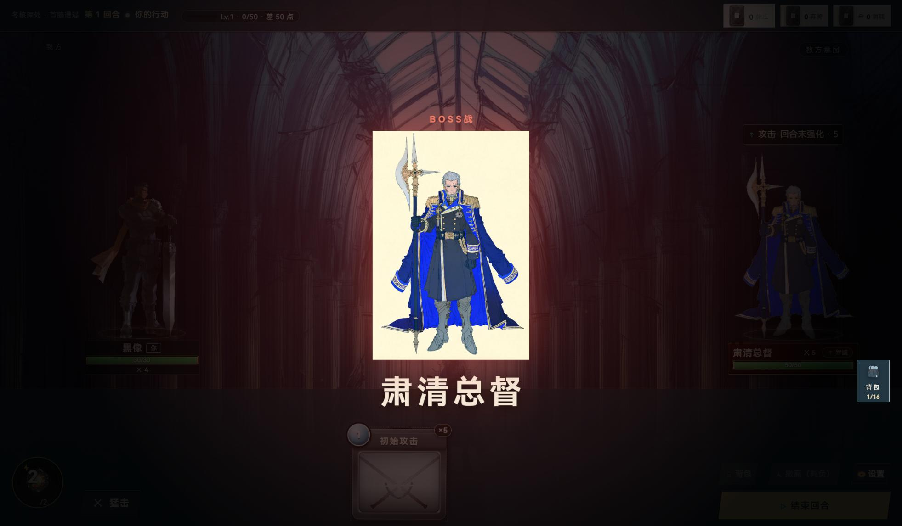
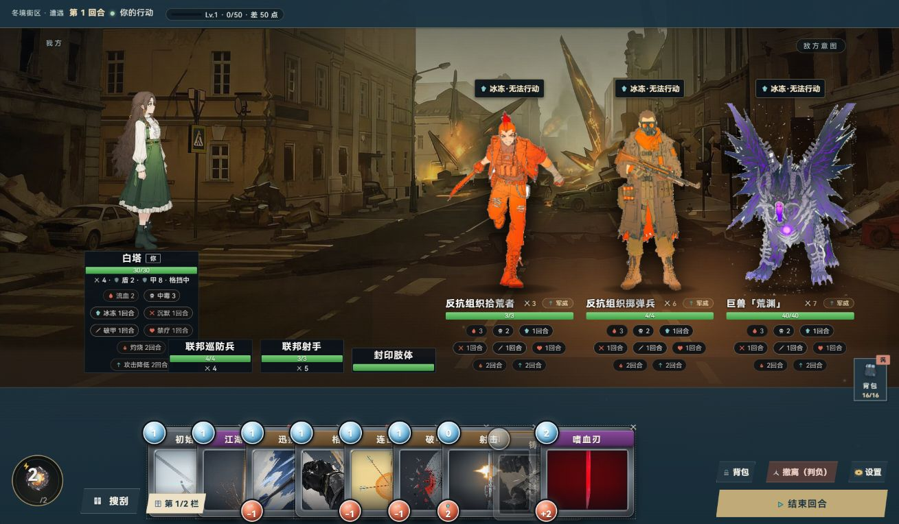

# 遗漏美术状态补检

2026-10-05，Friday / Codex。按老板最新范围完成美术补看；没有修改游戏代码、素材，没有提交。结论补充到[上一轮六组整改](../live/REVIEW.md)。

## 新增与复现

| 编号 / 优先级 | 看到的问题 | 建议改法与材料 | 完成标准 |
|---|---|---|---|
| I07 / P1 | 肃清总督登场中央立绘有显眼浅色矩形底，与深色战场不协调；标题和正常退场可读 | 优先核对原图及透明立绘映射，或设计明确的画面承托；不先改登场时长。现有怪物透明立绘、视觉设计规则、Impeccable polish | 立绘边缘与场景自然衔接，保留首脑姓名及登场焦点 |
| I08 / P2 精修候选 | 三种召唤友军只有小型同款runner图标及名牌，身份主要靠文字；与详细敌我立绘差距明显。原battle.layers渲染也统一使用runner | 按友军身份使用可区别的图形，先做小尺寸对照。现有图标/单位资源；Game-icons仅供缺口参考 | 巡防兵、射手、封印肢体能靠图形区分；不挤占状态和手牌。此项是审美判断，不是玩法错误 |
| I01 / I02 / I03 / I05 / I06 | 非空背包仍有浅底浅字；宠物蛋/材料内层暗字；满锦囊、珍珠盒、长牌库/墓地底部仍叠地图操作台；商店已售灰字配灰底；卡高/材质不齐仍在 | 沿上一轮限定范围精修，已售状态加入I05 | 原有完成标准继续适用；不因此扩为整页重做 |

## 已补看的范围

| 对象 | 有效画面 / 输入 | 视觉判断 |
|---|---|---|
| 首脑登场、开战装备 | 原标题节点测试实际进入首脑；boss-cinema完整47帧；首脑实际确认编组触发3件装备，equip-boss共59帧 | 登场确认I07；装备名字/卡面可看清并退场 |
| 非空口袋、安全格、锦囊、珍珠盒 | [非空背包](01-bag-populated.jpg)、[锦囊3/3](02-pouch-full.jpg)、[珍珠盒9/9](05-pearl-full.jpg)，真实点击打开 | 数量/容量明确，复现字色及I03 |
| 非空长牌库、墓地 | 原清单渲染器及真实注册24张卡；[牌库](09-deck-long-stable.jpg)/[底部](10-deck-bottom.jpg)、[墓地](11-grave-long-stable.jpg)/[底部](12-grave-bottom.jpg) | 清单可读；底部操作台叠层复现 |
| 其他四角色战场 | [无](13-battle-wu.jpg)、[常无欲](14-battle-changwuyu.jpg)、[白塔](15-battle-baita.jpg)、[星月](16-battle-xingyue.jpg) | 主体、名牌、意图、主动作可见，保留战场骨架 |
| 密集战场、满手牌 | 16种卡、3个长名敌人、3友军与多状态；[有效密集图](18-battle-dense-corrected.jpg)、真实切换[第二栏](19-hand-second-page.jpg) | 当前构造状态可容纳；新增I08候选；不外推玩法组合是否合法 |
| 商店与收购 | [有币](20-shop-affordable.jpg)、[已售](21-shop-sold.jpg)、[三种可卖卡](22-sell-populated.jpg)，只看未交易 | 已售低对比纳入I05，收购价格和合计可读 |
| 宠物蛋、拥有/全拥有、材料后态 | [可孵化](23-egg-ready.jpg)、[两宠物](25-pet-new-owned.jpg)、[全6宠物](26-pets-all-owned.jpg)/[下部](27-pets-all-bottom.jpg)、[不可孵化](28-egg-all-owned.jpg)、[材料后态](29-material-after.jpg) | 列表/满级状态可读；详情深底暗字复现I02 |
| 故事后续、失败提示 | 真实Ink第[2段](30-story-segment-2.jpg)/[3段](31-story-segment-3.jpg)数据加原节点组件；[记录失败提示](32-story-error-visual.jpg)按原分支文案/样式构造 | 长文、两结局选项、重试可见；未执行故事记录或存储故障 |
| 普通/传说获得、短过场 | 原演出入口；reward-motion60帧、legend-motion64帧、transition-motion26帧；[普通](reward-motion-20.jpg)、[传说](legend-motion-25.jpg)、[过场](transition-motion-09.jpg) | 进场、可读阶段、退场已看；获得浮层结束后消失；不做性能判断 |

原59项现在都有代表视觉依据，分类为精修25、保留34、重构0、证据不足0；**这不等于全部玩法变体验收**。I08是战场内的图形精修候选，战场骨架仍保留，不新增独立页面计数；牌库、墓地、锦囊、珍珠盒因非空态复现I03改列精修。原34项近期保护页和14项研究所/隐藏入口排除仍保留；保护页的代表后态补看不授权重做。

## 证据边界与未测项

- 只用Codex内置浏览器的当前1309×764窗口，没有设viewport或换尺寸。连续帧为原生截图，像素1964×1146来自设备缩放，不代表测试了另一窗口。
- 本轮使用上一轮固定源码副本和只读素材；重新启动5339/PID15444，结束后关闭自有页并确认端口释放。未启停主线5200和他会话5348；副本/证据保留。
- 没有加载已有档位，构造入口检查activeSlot为null。非空库存、宠物/材料后态、密集战场、已售货位是内存显示数据，经原模块渲染；不是自然游戏过程，也不是孵化/使用/购买事务结果。
- 故事补检使用真实Ink数据、原nodeShell和原故事模板文案/选项；失败提示按原分支构造，只证明组件外观，不能冒充真实故事记录或存储失败。与上一轮自然第一段输入证据分开记录。
- 明确未测：完整流程、存档、整备拖拽、地图拖动/缩放、全面键盘操作、性能、其他窗口尺寸。未跑游戏测试套件、lint、build，也未修改玩法。
- 开合中珍珠盒图、被首帧渲染覆盖的牌库图、遗漏maxHp的密集夹具、未触发装备的普通战序列均不作游戏故障/通过依据；有效替代见[覆盖与排除记录](coverage.json)。
- [逐景记录](observations.json)、原构造脚本、连续帧元数据和[SHA256清单](files.json)保留；源版本核对及文档引用验证见[validation.json](validation.json)。远端未刷新。

后续整改仍需另行实施；本轮只补视觉证据和精修清单。
