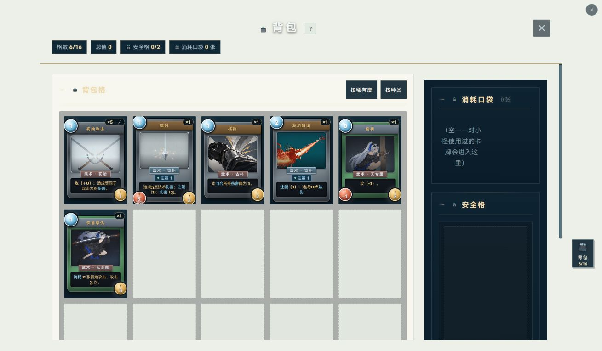
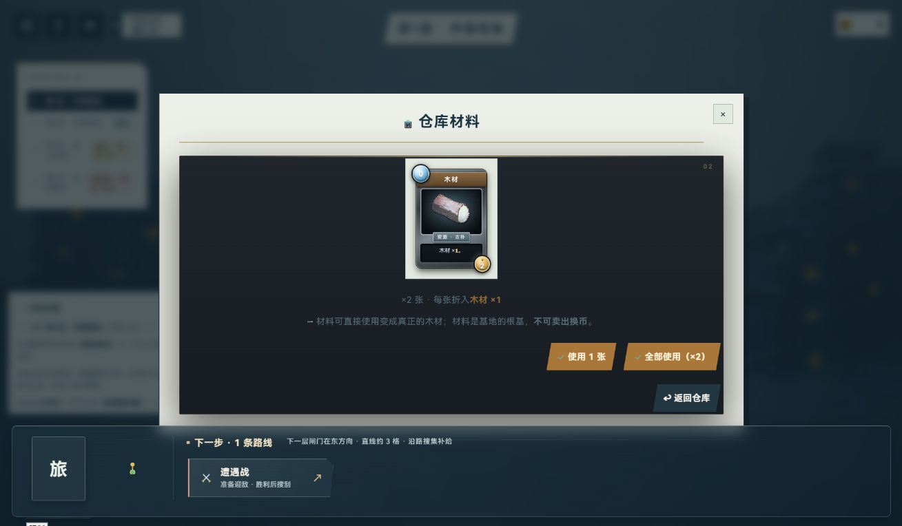
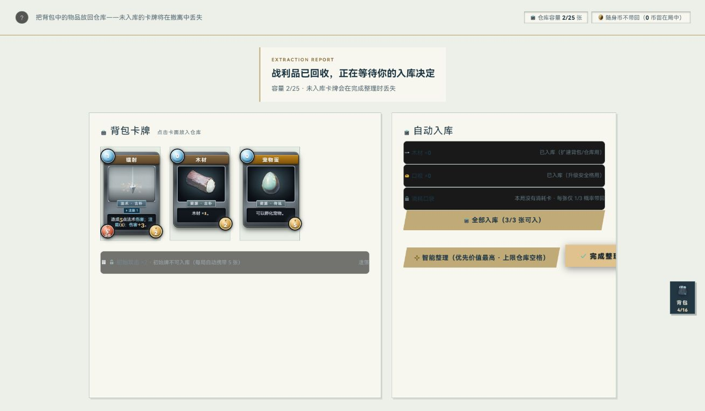
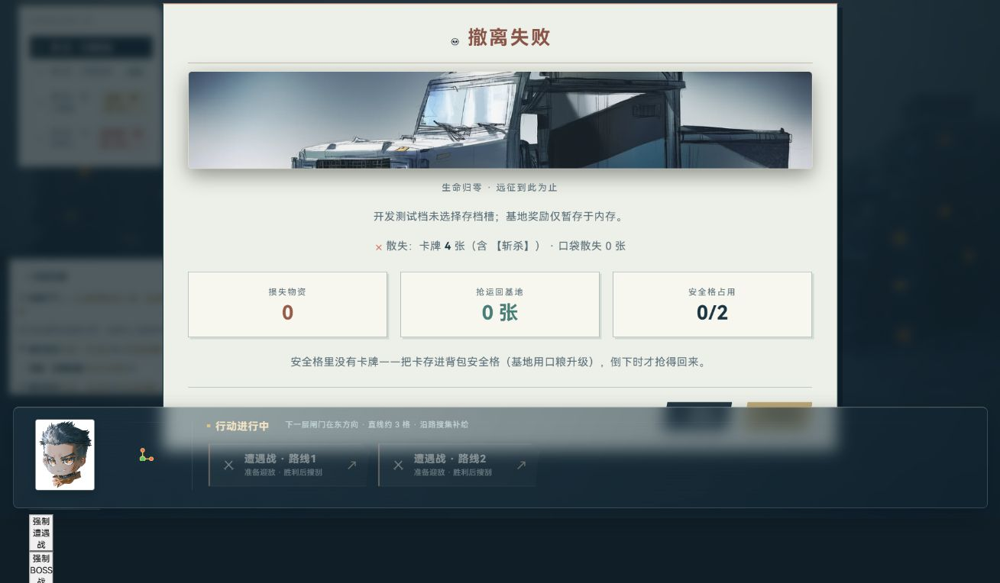

# 实机检查结果与整改清单

> 最新补检见[遗漏美术状态](../live-more/REVIEW.md)：首脑登场已捕获，新增I07及I08候选，已补非空/后态/长内容和完整演出。以下过程和未核说明保留为第一轮历史；当前分类以更新后的coverage.json为准。

2026-10-05，Friday / Codex。老板明确令“证据不足的就去实机检验”，覆盖原第一步的59项；本轮只检查和更新计划，没有修改游戏源文件或素材。

## 可以确定的整改

| 编号 / 优先级 | 界面与实际症状 | 建议处理 | 完成标准 / 对应材料 |
|---|---|---|---|
| I01 / P1 | 背包的“背包”“背包格”浅字配浅底；宝箱标题仍使用低对比浅灰/浅金 | 按实际承托面收敛标题和分区字色，保留稀有度及状态含义 | 当前窗口标题、名称清楚；不靠重阴影补字色。视觉设计规则、Impeccable typeset/polish |
| I02 / P1 | 仓库卡牌、宠物蛋、材料及木材说明内层仍是深底，数量、收购价、用途却是暗字；撤离整理自动入库条、成功结算统计条也有同类问题 | 成对修正文字与承托面；先解决阅读，再决定是否统一内外层材质 | 数量、成本、物资去向、入库合计完整可读。视觉设计规则、背包设计指南 |
| I03 / P1 | 地图玻璃操作台在多种弹层前仍可见；战利品、战斗背包、首脑编组和死亡结算的下部内容被叠层糊住 | 限定普通弹层打开时的地图HUD让位/层级；保留地图节点与操作台已定造型 | 弹层文字、卡面和动作不被操作台视觉覆盖。领取与完成按钮实际可以点击，不能把本问题夸大为全部操作失效。Impeccable layout、现有弹层规范 |
| I04 / P1 | 撤离整理的“完成整理”按钮越过右侧面板，文字被裁切；空背包提示还缩在很窄的格子里 | 动作组换行/重排并适配面板宽度；空态占所属内容区 | 完整按钮文字与边界可见，空态正常断行。实测按钮矩形右缘1178.84，动作父容器右缘1123.21，越界约55.64px；中心点仍能点击。背包指南、Impeccable harden/layout |
| I05 / P2 | 祭坛不可用选项与原因一起淡化；零币商店卡面也整体变淡 | 保留禁用识别，单独保住条件与价格的可读性 | 看得出不能操作，并能读懂为什么；本轮未宣称无障碍合规。游戏可读性指南 |
| I06 / P2 | 发现卡牌、复原等选择列表中，卡高随规则长度变化，名称/底边不齐；卡框与近期界面的材质协调仍是审美候选 | 先做同尺寸、同图的卡牌样板，确定缩略规则与完整详情分工；不批量换卡图 | 同一列表费用/名称位置、外形尺寸有秩序；稀有度和职业身份保留。Impeccable typeset、视觉设计规则；闪卡项目仅供局部材质参考 |

四项P1先于大规模换皮。当前普通战斗和首脑战的名字、意图、手牌选择、目标与主动作已有真实画面/输入依据，未重现旧的小窗口裁切结论；**保留战场骨架**。商店、一般事件、药摊、重编、资源投放、故事、帮助、备注工具、三类重试的主体结构也以保留和局部精修为主，不重复整页重做。

## 关键实图

背包浅色标题残留：

仓库材料内层暗字配深底：

撤离整理的统计条和右侧按钮：

死亡结算下部的地图操作台叠层：

## 检查方式与边界

- 仅Codex内置浏览器、当前1309×764窗口，未设viewport、未换外部浏览器、未做多尺寸。
- 首段复用5200：原127.0.0.1存档只查看选择页；转localhost:5200，在空档05新建专用档。因遇热更新回标题，随后转固定源码副本`.tmp/ui-art-live-20261005`的5339；不build，运行素材目录只读复用。
- 正常输入包括带卡、选人/启程、背包/详情/安全格、普通战斗三次初始攻击与回合、领取、仓库查看/取消卖出、商店不足与收购空态、祭坛献祭、故事第一段记录、拖出背包后的丢弃确认（未确认丢弃）。首脑战真实连续回合至生命归零，未用“直接胜利”。
- 游戏内节点测试属于辅助进入；特殊卡牌由测试控制台发放。后半段通过**同一内置浏览器的开发能力**调用原游戏模块/渲染入口，构造卡牌、容量、节点类型和事件池；它们是受控状态的实机图，不是自然掉落/自然走完四层。没有用自行拼出的HTML冒充游戏页面。事件固定池最后版本保留全部非事件卡；早期空药水池图不作正常供给结论。
- 三类重试通过临时基地读取故障或不可用服务触发原处理器。读取故障在取图前恢复；实际点击撤离重试回到整理页。未据此宣称真实持久化、刷新恢复或幂等全链通过。
- 为故事在5339空档05新建专用档，实际故事服务和Ink第一段已显示并记录。专用测试档保留，没有覆盖原5200档位或删除存档。重载/标签页结束清掉临时内存钩子；未修改产品配置文件。
- 自带extract剧本辅助到第三层后，因无手牌在战斗中耗满500步，报告为failed，不作撤离成功证据；其后受控入口配合真实献祭/入库点击补看撤离页。未扩大为玩法/策略修复。
- 原59项逐项有去向：[实机覆盖表](coverage.json)。58项有代表画面；首脑登场仅看到了相关DOM及过渡/战场帧，未捕获到可判定的登场标题阶段，保留为未核。普通短过场已捕获可读静帧；短动效、获得演出均未据单帧宣称整段动画通过。
- 代表页不覆盖全部人名/长文、全部宠物状态、全部故事章节、不同窗口或性能。部分AX文本是差分，不能单独用来扩大覆盖；以完整当窗图片、已记录输入和构造脚本共同判断。
- 检查开始HEAD425d039；期间他会话打包使收官HEAD变更，核心10个源码/样式与固定副本逐字相同，具体版本、指纹、未刷新远端差异见[覆盖表](coverage.json)。本会话没有提交/推送。部分早期证据已随他会话落库，本轮新报告和尾段证据仍有未提交增量。
- 扩展比较371份源码后发现5份差异：selftest、音频及照相馆common/门面/page。后3份已定向读diff：common新增关页取消函数、门面仅缩进、page导入并调用取消函数；没有改cardHTML、布局或字色，故不重复跑本轮视觉检查。音频未验，自检不属实页证据；不能写“全部源码与副本相同”。
- 5339/PID13032由本会话创建。续接时实核端口已无监听、旧PID不存在；无需再杀进程。5200未启停；副本与证据保留，不删除。

## 下一步的最小范围

第二步围绕I01–I04确定文字承托、动作分区、普通弹层HUD让位规则；第三步用I06做卡牌样板。I05在相关页面精修时一起处理。原34项近期保护与14项研究所/隐藏排除不被全局样式间接覆盖；修复共享层时限定普通来源，保持既定外观与玩法。

首脑登场的动态证据留作后续定向录像项，不据未捕获静帧定性为游戏故障。本轮不增加新流程规则、不安装外部skills、不生图、不改玩法。
