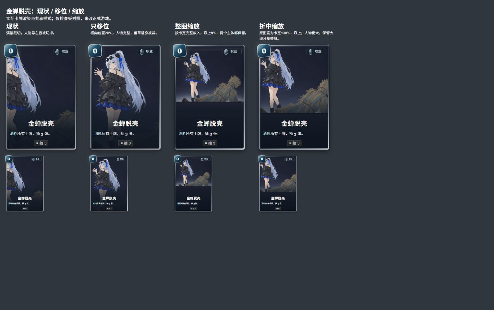
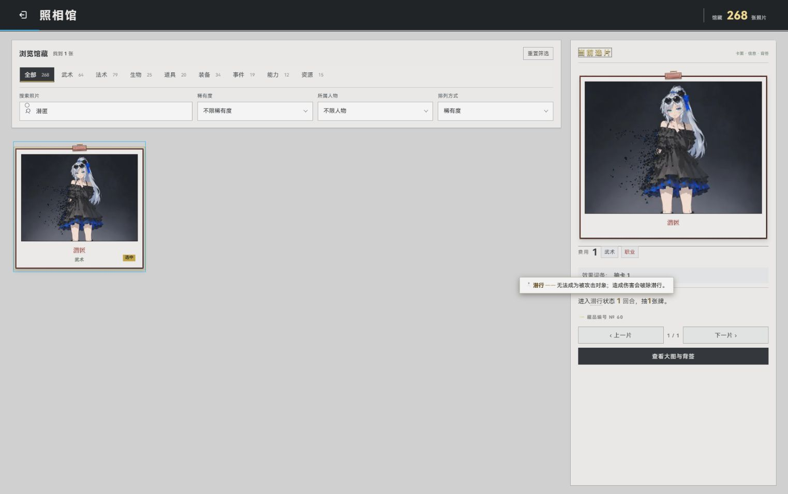
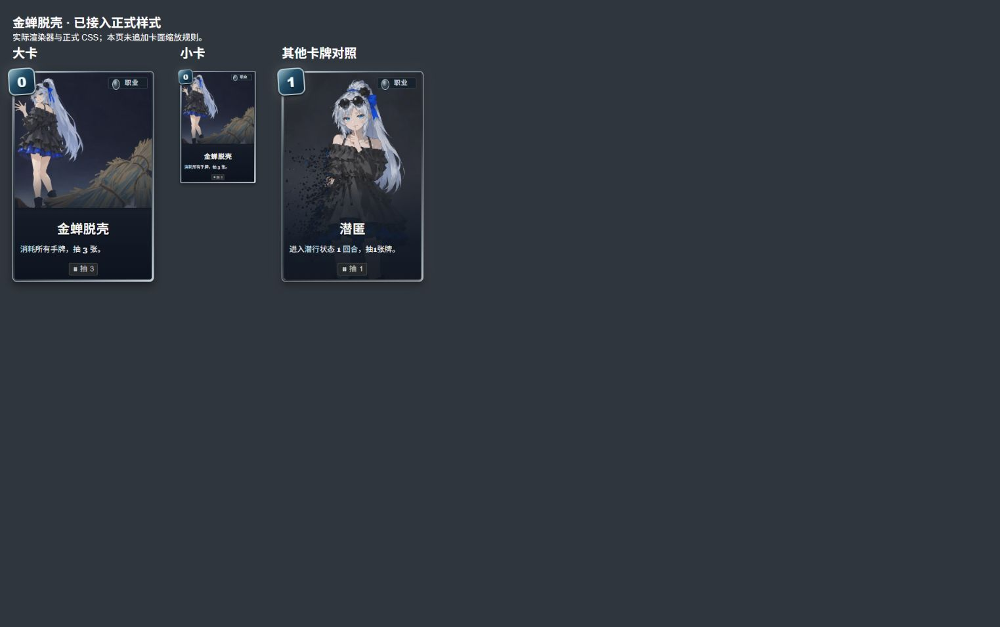

# 卡面比例位置检查与潜行词条

2026-10-10，Friday / Codex。金蝉脱壳可以先用缩放改善，不必立即重画。原图宽度为卡面内部宽度的 130%、靠上、居中裁去两边少量背景，人物和草替身仍可辨认。初次检查只制作对照；老板随后确认实装，现已接入共用卡面样式。

## 检查范围

复用主线 localhost:5200，使用 Codex 内置浏览器当前窗口。照相馆真实搜索核对金蝉脱壳原图；[检查板](framing.html)读取运行卡库、实际 cardHTML / Art 模块与共用 cards / card-v3 / card-layout-selected 样式，对照原图与竖卡。检查板不加载完整游戏 UI，不代表战斗、仓库交互路径验收。卡库 268 张，招式 143 张分八组、其余 125 张分七组，截图见 moves-1.png 至 moves-8.png、other-1.png 至 other-7.png。渐变占位图没有可评价的主体构图，不判为构图通过。

## 需要调整的重点

| 卡牌 / 稳定 ID | 观察 | 建议 |
| --- | --- | --- |
| 金蝉脱壳 / tt7-goldencicada | 人物头脸被左边裁切，草替身只剩部分；横幅 896×679 被竖卡 cover 截去约一半宽度 | 优先采用下方折中缩放；仅水平移位会丢失草替身 |
| 快意恩仇 / tt7-thundergrudge | 右侧人物头脸与挥剑动作被截断 | 先向右调整裁切窗口，动作仍不完整再缩放 |
| 扰敌 / tt7-provoke | 左侧人物头脸贴边并被裁，右侧手势也损失 | 缩放保住人物与手势，再调整水平位置 |
| 噬血术 / tt7-bloodpotion | 右侧人物面部被截去，左侧红色效果占据画面 | 向右调整窗口，必要时缩放 |
| 禁言术 / tt7-silence | 右侧人物头脸被裁，现状更像手部特写 | 若要保留人物身份，向右调整或缩放 |
| 浪掷风吟 / tt8-hero-priest | 右上人物面部被裁，飘带动作只剩部分 | 缩放并向右调整位置；原图正在其他会话重绘，最终须用新图再核对 |
| 二次爆炸 / cc-double-boom | 原图两处爆炸在左右边缘，中央竖裁后难以读出“两次” | 缩放保留两侧爆炸 |
| 江湖救急·改 / cmtn1wnhhym | 人物可读，右侧伸手与地图被裁 | 属于动作叙事损失，缩放能改善 |

中央单主体卡面大多能保持辨识；不能将这份重点清单理解为所有卡面已经逐张验收合格。事件横幅也会损失两侧环境，但本轮未扩展到事件重构。

## 金蝉脱壳缩放对照

[打开交互检查板](goldencicada-scale.html)。同一当前窗口展示大卡与小卡，依次为原裁切、水平位置 20%、按卡宽完整缩入、原图宽为卡宽 130%。最后一款原图显示高度约占卡面 65%，比完整缩入的人物更大，保留大部分草替身；底部深色区域承接卡名与说明。老板已确认最后一款并授权实装。

## 潜行独立词条：已完成未提交

老板明确授权本会话接手 cards.view.js 与 term-tips.js，仅补潜行词条。既有 stealth 说明不改，新增卡面“潜行”识别与 alias，使卡面描述可以触发独立自绘讲解：无法成为被攻击对象；造成伤害会破除潜行。

定向验证：stealth-term、contracts、architecture-boundaries 三文件 38 项通过。词条测试覆盖重复出现、高亮讲解、点击不触发卡牌、移至非词条后收起。照相馆真实搜索“潜匿”，真实 locator 点击未打开大图；内置浏览器 Input 鼠标移动触发悬停，讲解内容已核对，未使用合成 DOM 事件代替实页鼠标输入。

未运行全量、build，未提交。没有新增服务或修改原运行卡图。

## 金蝉脱壳缩放实装：已完成未提交

老板确认“可以，实装吧”后，在 game/css/card-layout-selected.css 添加仅命中金蝉脱壳 asset key 的逐卡规则：原图宽 130%、高度自适应、left -15%、top 0；插画容器深色底并裁去越界部分。仓库、战斗、发现和卡牌放大共用该样式。照相馆照片仍按其原照片样式展示。

Codex 内置浏览器当前窗口访问[正式样式检查页](installed.html)，页面调用实际 cardHTML / Art 渲染器，未增加缩放覆盖。大卡图片/容器宽度为 342/263（约 1.3004），小卡为 182/140（1.3），top 均为 0、object-fit 均为 contain；对照“潜匿”仍为 100% 与 cover。人物及草替身可辨，名称与说明完整，页面 error 零条。

真实点击进入城市→档位01→仓库，当前档位只有五张卡，没有金蝉脱壳；未改存档或注入卡牌。因此本次核实的是正式共用渲染与大小卡样式，未声称完成金蝉脱壳的仓库/战斗实际持有路径验收。CSS 定向视觉修改没有新写实现镜像测试，前轮潜行测试证据继续适用。现行卡牌显示文档已同步；docs:check 通过。

