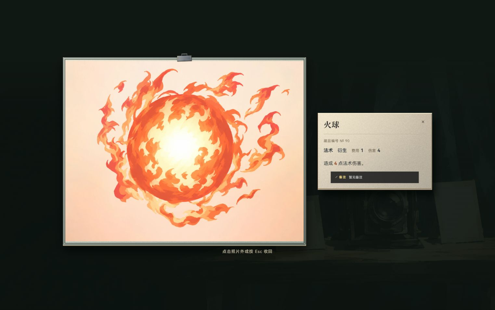
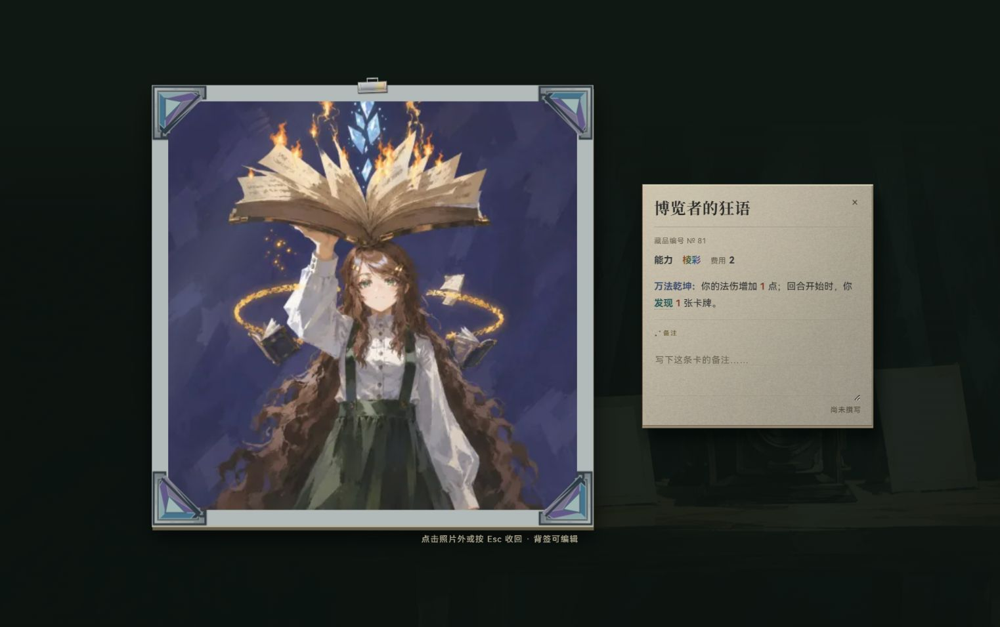

# 卡牌文案接手与关联大图修正

2026-10-11，Friday / WF-card-copy-1011，完成未提交。

已审阅现役 268 张卡，为其中 223 张统一展示文案，明确效果受益人、目标和条件归属。原卡库的描述、数值、费用与结构化规则保持接手快照的全字段一致。追加反馈中的棱彩字体与关联卡大图黑边已修正。

## 接手与归属

接手对话为《规划照相馆分页交互改版》（01a124be-a2bf-7933-85ed-3d8969194b20）。原会话导出 `catalog-before.json` 后中断，尚未修改卡牌描述；老板此前批准“仅接手描述展示接入”，本轮明确由本会话负责、释放原会话登记。

旧 WF-studio-total-1010 登记已移至近期已释放；完整原行保存在 [previous-ledger.md](previous-ledger.md)。既有未提交内容、证据和历史未核边界保留，本轮没有把旧任务所有检查重新标为通过。

## 改动

- `card-description-text.js` 按已审阅 id 和原始描述匹配展示文字。玩家改写的描述直接显示，转换结果不回写卡库、不参与效果解析。制作记录为 [build-copy.mjs](build-copy.mjs)，逐卡前后文案为 [changes.json](changes.json)。
- 共用卡面、照相馆详情、照片大图、关联卡名渲染与仓库文字特写接入同一文案入口；卡名保护、数字高亮、搜索命中保留。文本密度按展示文字长度计算。
- 伤害统一完整名称，攻击伤害明确攻击力公式；获取、施放、全体敌人及数字单位统一。坚盾说明失去护甲，高端研发说明所选牌降费，禁咒说明第一名存活敌人，冷冻射线说明本次伤害前的目标状态。
- 棱彩字体恢复多色渐变，覆盖照片小图印章、详情印章和大图信息。删除四处单紫色/背景清空覆盖，不改变其他稀有度。
- 关联卡大图没有 `opts.from` 缩略图时，旧代码固定以 1:1 布局。现在缩略图实际加载、原图解码完成时同步真实宽高比，并忽略关闭后的加载回调。横图和竖图均保持完整画面。

## 验证

- 原始 268 张卡与接手快照逐项深相等，包括描述、数值与规则。
- 六个定向测试文件 108 项通过：[verification.log](verification.log)。覆盖文案隔离、自定义卡回退、全卡共用渲染、引用保护、HTML 转义、战斗角标、照片比例及关闭生命周期，含原卡牌审计、契约和架构检查。
- 目标 ESLint、文档守卫通过。未 build、未提交、未推送；复用 5200，无本会话新服务。
- 附加 `premium-ui-pages.test.js` 中两条历史断言仍失败：期待已被旧会话移除的馆名门头和 `leather-archive-v1.png` 背景。其余相关追加检查通过；本轮没有回滚旧界面来满足过期断言，也没有将这两项记为通过。
- Codex 内置浏览器当前 1523×956 窗口，真实搜索、关联卡名点击与大图开关通过；控制台 error 0。高端研发、坚盾、冷冻射线、血毒双镖长文案、三重火球引用及新增措辞搜索已观察，见 [browser-results.json](browser-results.json)。
- 关联火球原图 1441×1092；修后布局比例 1.3196206，与原图比例 1.3195971 一致到约 0.002%，上下黑边消失。棱彩三处计算样式均为文字裁切的多色渐变、透明字形填充，见 [followup-browser-results.json](followup-browser-results.json)。

## 留白与覆盖边界

「天启剑」与「诛魔剑」的后半效果在原 [hosted 规格](../../cards/M-BATCH-HOSTED-DESIGN-2026-09-27.md) §2.13/2.14/五明确为设计留白；当前 `effect-verbs.js` 的 weaponCover 没有结算实现。展示明确“合成效果尚未定稿”，玩法定义归 PENDING 40；未自创替换武器或合成规则。

本轮没有真实开局逐张出牌，也没有逐张检查 268 张的各尺寸布局；机械效果依据原卡库不变及既有定向审计。没有多窗口/多尺寸验收。原会话的其他历史未核项沿其原登记。
