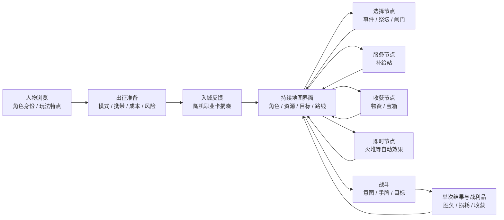

# 选人至地图节点：总体修改计划

日期：2026-10-11。状态：研究与框架提案完成；老板已授权GPT-6.1-sol子代理实施，首切片与属地见[派工记录](DISPATCH.md)。范围：人物选择、卡池、出征整备、地图、节点、普通战斗与结果；基地和照相馆只涉及入口与共享组件接口。

**建议先统一信息与交互骨架，再完成一条完整样板，最后逐层细化美术。** 框架采用三个长期复用的界面体系：人物浏览、出征准备、远征界面。远征内的节点按选择、服务、收获、即时结果四种任务组织。各体系保留自己的场景表现，共用对象身份、状态语义、返回规则和主操作位置。

依据分为本项目实测 E、商业游戏画面 R、公开方法/标准 G、老板已确认方向 L。每项动作都列来源；来源中的可见事实与本项目的改法分别表述。改法是根据证据提出的适配方案，具体比例、颜色值、材质强度和演出参数由样板验证。

## 1. 基线与参考

- **E1**：[本轮实际体验记录](../2026-10-11-selection-map-experience/README.md)及18张截图：真实走到第二层入口，包含五人选人、物资、火堆、首战胜利、商店、闸门。
- 表内 A01–A16 对应 E1 的问题编号。
- **L1**：[老板已确认美术方向](../../production/art/ART-DIRECTION-BRIEF.md)：完整轮廓、简略色块、硬边明暗、协调配色；M1 冬境氛围和无的选人立绘为锚点。
- **L2**：[现行视觉规范](../../production/art/VISUAL-BIBLE.md)：角色身份、状态色、对象位置、文字与按钮层级；白塔坐姿保留。
- **L3**：[当前等比缩放说明](../../development.md)：以1920×1080为设计基准，全体元素等比缩放。新方案沿用该约定，实际字号和命中区域在当前窗口检查。
- **R/G**：逐图观察、采用范围、原始来源与标准链接见 [参考对照板](REFERENCES.md)。实机/界面资料使用 R01、R02、R05、R07、R08、R09、R10、R11；未采用的设计稿 R03/R04 和宣传海报 R06 单列，不承担实机流程证据。

素材原始字节、获取方式、版本/时点与SHA256见 [reference-assets.json](reference-assets.json)。参考原图仅留本地，游戏资产接入需另行制作与核对。

## 2. 总体框架

| 体系 | 必须回答的问题 | 稳定区域 | 变化区域 | 框架依据 |
| --- | --- | --- | --- | --- |
| 人物浏览 | 我选谁、这个人怎么打？ | 角色选择条、返回、确认、身份信息 | 立绘、特点、代表卡、次级详情 | R01/R02/R10；G1/G2；E1-A07/A08 |
| 出征准备 | 这次实际带什么、投入什么、会损失什么？ | 当前角色/模式摘要、背包成本、出发操作区 | 仓库候选、携带数量、宠物贡献、风险说明 | R07；G1/G2；E1-A02/A03/A04 |
| 远征界面 | 我在哪、现有状态如何、下一步为什么去那里？ | 区域/目标、生命与资源、背包入口、返回语义 | 地图路线、节点内容、实际结果 | R08/R11；G1；E1-A10/A11/A12 |

战斗共享角色身份与区域主题，保留自己的能量、手牌和敌方意图布局。首脑战编牌与普通战斗规则不同，其具体布局列入补验，不直接套用普通战斗样板。

## 3. 增加、删除、合并、保留清单

“删除”在本计划中指移除重复展示、装饰或冗余交互层。具体文件删除清单在实施时核对，不由本计划自动执行。

| 编号 | 增加 | 删除或降级 | 合并 | 保留 | 依据 / 通过条件 |
| --- | --- | --- | --- | --- | --- |
| F01 人物选择 | 清楚的定位、机制关键词与代表卡入口；独立头肩头像 | 重复的生命加成区块；无含义的装饰编号 | 熟练成长为一组次级资料 | 五人身份、白塔坐姿、完整卡池、皮肤功能 | R01/R02/R10、G2、L1/L2、A07/A08；首屏能判断人物特点，头像能识别人脸 |
| F02 角色展示 | 分角色的脸部、主体、武器安全区和脚底锚点配置 | 为填满容器产生的无意义留白 | 选人、整备、地图头像的身份数据与裁切规则 | 已认可原画和姿态 | R01/R02、L1/L2、A07；五人切换时视觉重心稳定，坐姿不被机械拉高 |
| F03 人物卡池 | 代表机制的少量示例，完整档案仍可展开 | 首屏重复的卡池数量 | 卡片查看、详情、放大为同一套对象展示 | 卡面、类型筛选、分页和完整规则 | R10、G2、A08；角色比较不用反复读完整卡库，详情仍可到达 |
| F04 出征摘要 | 固定初始牌、随机职业牌数量、额外携带、容量、宠物实际贡献 | “本次背包”只展示一部分内容造成的歧义 | 数量与容量来自同一份实际配置 | 随机牌出发后揭晓、已有携带规则 | R07、G1、A02/A03；摘要与入城实际一致，不提前伪造随机结果 |
| F05 模式入口 | 在整备中核对模式及说明的入口 | 来回返回基地只为核对难度的路径 | 基地快捷模式显示与出征配置的唯一来源 | 模式本身与取消整备语义 | R07、G1/G2、E1；作为候选先验证改变/取消/返回时状态一致，再定入口归属 |
| F06 入城 | 地图内的区域介绍与职业卡揭晓反馈 | 单独的“获取并离开”强制中转页 | 启程补给与入城反馈 | 实际抽取时点、奖励和存档结算 | R08、G1/G3、A02/A14；反馈结束后能直接识别当前位置，关闭反馈不改变奖励 |
| F07 地图信息 | 当前目标、区域、资源名称、已知路线用途 | 默认展开的长日志；与主路线重复的小地图可降为按需工具 | 地图与路线列表的选中/已探索状态；目标说明集中到一个主位置 | 迷雾、相邻移动、回溯、层间单向深入 | R08/R11、G1/G2、A10/A11；深入与回程可辨，未知信息仍保持未知 |
| F08 节点类型 | 稳定的类型剪影；当前、可达、已探索状态标记 | 用同一个已探索圆点替代所有类型的表现 | 状态语义与路线列表反馈 | 节点名称、实际生成与结算规则 | R08、G1/G8、A12；去色后能以形状/文字辨类型和状态 |
| F09 选择节点 | 场景身份、上下文、已知成本与可能结果、明确选项 | 重复的大标题与无含义进度码 | 事件、祭坛、闸门的界面结构；业务规则仍各自维护 | 叙事差异、随机结果、条件限制 | R08、G1/G2、A16；在选择前能理解已知代价；祭坛/叙事细节需补真实实页后定稿 |
| F10 即时节点 | 生命、口袋等附近的短结果反馈，显示实际变化或无收益原因 | 只靠远处日志表达节点结果；名义回复量冒充实际增量 | 自动节点的结果条与资源更新 | 火堆自动结算 | G1/G3、A13；满血显示实际回复0或生命已满，复原数量准确 |
| F11 收获与结果 | 固定操作区；实际损耗、保留与新增的分组；金币和卡牌估值标注 | 挤走主按钮的重复场景横图；连续弹出多层结果 | 战斗胜利摘要与战利品收取为一次结果面板；非战斗物资复用收取结构 | 逐张收取、全部收取、容量检查、实际奖励来源 | R08、G1、A01/A14/A16；打开即能看到主动作，滚动内容不会挤走按钮 |
| F12 补给站 | 查看详情与购买分开的明确区域；价格、持有数量、可负担状态 | 把点击整个卡面同时作为查看与消费的歧义 | 局内商店的商品/价格/购买结果表达 | 快捷购买、余量、随机货品、收购功能 | R02、G1、A15；查看商品不扣币，购买能立即看见币和数量变化 |
| F13 战斗空间 | 对应区域的环境、地面、接触阴影与受光层次 | 把大面积黑网格作为最终街区场景 | 地图与战场的区域素材家族；敌我明暗与轮廓处理 | 上方敌我、下方操作、意图、目标高亮、卡牌抬起 | R09、G10、L1/L2、A05/A06；敌我同处一个空间，环境不影响意图和规则阅读 |
| F14 新手说明 | 首次投入/消耗前的简短规则提示；随时可重看的入口 | 首战后首次告知核心损耗规则的时机 | 首次整备提示与已有帮助；战后只回顾实际损耗 | 规则内容与非首次游玩的效率 | G1/G2、A04；首次出牌前能知道牌的去向，熟悉玩家无需重复确认 |
| F15 共用控件 | 返回、主/次/危险动作、资源条、卡片、状态反馈的组件规格 | 同类控件的多套孤立边框、字号与交互语义 | 结构与状态统一；页面材质以局部变体表达 | 既有语义色、字体栈、稀有度、页面题材 | G1、L2、A05/A16；跨页可预期，同一张卡身份保持一致 |
| F16 动效 | 起点—终点、触发—反馈、取消/快速切换规则；减少动态效果覆盖 | 换人/收牌时整层退场重播；无语义的持续闪动 | 同一种状态变化的动效语义 | 已有效的选牌、目标、购买反馈；角色缓慢待机 | G3/G4/G7、A09/A14；连续操作不空白、不串对象、不积累过渡，不恢复选人粒子特效 |

其中 F05、F06、F12 会改变操作路径，先作为交互候选在样板内验证。增加战斗预览、改变火堆选择、提前揭示随机内容、改变奖励或撤离概率属于玩法变化，不列入本轮框架实现默认项。

## 4. 节点模板边界

| 模板 | 对应节点 | 展示内容 | 主动作 | 结果方式 |
| --- | --- | --- | --- | --- |
| 选择 | 叙事事件、祭坛、闸门等 | 地点/人物身份、上下文、已知条件与选项 | 选择、进入或取消，按实际规则 | 结果直接回到当前场景，必要长叙事保留阅读空间 |
| 服务 | 局内补给站 | 商品、详情、价格、拥有与容量、购买变化 | 明确购买/服务、离开 | 原位刷新与就近资源反馈 |
| 收获 | 物资点、宝箱、战后战利品 | 来源、实际奖励、容量、保留/损耗摘要 | 收取、全部收取、离开 | 保持对象身份，回到地图当前位置 |
| 即时 | 火堆等自动结算节点 | 当前状态和实际变化 | 继续探索；默认不另加确认 | 短结果条与生命/口袋变化，日志作记录 |

模板统一布局和反馈，不合并不同节点的业务规则。图标、叙事插画和声景用于区别地点；共享的状态、文字和按钮用于减少学习成本。

## 5. 可检查标准

| 检查项 | 参考标准/方法 | 本项目检查办法 |
| --- | --- | --- |
| 信息与主动作 | G1/G2：状态可见、术语一致、错误预防、核心信息先显示 | 不借助长日志，能回答当前人物、实际携带、当前位置、下一步和实际收益；主动作始终可见 |
| 文字对比 | G6：重要标准字号文字至少4.5:1；大号文字按其条件3:1 | 按实际背景、透明度和叠层检查；不以CSS声明的颜色代替最终画面。禁用文字仍需可读 |
| 状态图形 | G8：识别控件及状态所必需的图形与相邻颜色至少3:1，有相应适用条件 | 检查焦点/选中/节点状态；同时用形状或文字，不能只靠红绿 |
| 文字大小 | G5：PC/VR在1080p以字形高度18px为默认参考；其度量是字形body height | 结合L3的整体缩放核对最终字形；现行CSS字号不能直接等同于这个度量。基准字号在样板中统一调整，不增加局部脱离比例的放大 |
| 点击区域 | G9：Web指针目标24×24 CSS px或满足标准的间距/等效等例外 | 测最终可点击区域和相邻间距，核对zoom后的坐标，返回/关闭/购买不互相抢占 |
| UI动效 | G3/G4：以反馈与状态关系为目的；普通UI动效常以100–500ms区间研究 | 局部反馈约100ms、面板约200–300ms作为试验起点，按移动距离与重复频率调整；不当作二游实测参数或全局定值 |
| 动态设置 | G7：提供减少/停止非必要背景运动的方式 | 复用现有减少动态机制；静态模式仍能表达状态。剧情与战斗核心动作分别检查 |
| 对象一致性 | R02/R10、L2 | 角色、卡名、卡面、数量、稀有度跨列表/详情/收取一致；飞行和放大保持来源关系 |
| 美术辨识与演出层级 | G10：保留主辨识特征与朝向，关注度与当前信息的重要性相符 | 角色马尾/帽/巨剑等主要身份锚点在实际尺寸下可辨；攻击指向、选中目标与状态一致；环境和装饰退后。用灰度/剪影辅助检查，最终仍看彩色实页 |

这些是本计划采用的检查依据和样板目标，不代表当前游戏已经达到标准。可读性检查也不能代替老板对构图、配色和画作的审阅。

## 6. 美术逐层迭代

| 层次 | 本层工作 | 依据 | 本层暂不定的内容 |
| --- | --- | --- | --- |
| 构图 | 主焦点、角色舞台、信息区、稳定操作区；稀疏地图的画面组织 | R01/R02/R08/R09/R11、L1 | 不先锁死全页比例或批量重画角色 |
| 光色 | 环境冷青灰、工具界面石墨/主题灰、局部暖光与重点强调；按场景分明度 | L1/L2、R05/R09 | 不把每页强行染成同一底色，色值待样板对照 |
| 材质 | 界面有功能承托，布/金属/环境各有响应；纸质仅用于确有档案/封签含义的部件 | L2、R05；R03/R04仅作层次学习 | 不复制1999的整套复古物件；未采用稿不能当实际流程范本 |
| 字体与图标 | 标题、对象、正文、数字、次级信息分层；节点剪影与状态外圈分工 | G5/G6/G8、R08、L2 | 不增加新字体依赖，先使用现有字体栈 |
| 插画与角色 | 五人裁切/锚点先校准；战场与敌人用已认可的块面画法做少量样本 | L1/L2、R09、G10 | 不改无的人设和白塔坐姿；先处理展示，重画需求逐张判断 |
| 动效与声音 | 同对象进退、就近状态变化、战斗节拍、区域声景和购买/收获反馈 | G3/G4/G7、E1 | 二游录屏未覆盖的具体时序与声音不作事实；地图音乐解码警告先定向复核 |

## 7. 分阶段交付

| 阶段 | 交付内容 | 本阶段完成标准 | 之后才进行 |
| --- | --- | --- | --- |
| P0 资料与框架（本轮） | 实机/图解对照、标准索引、增删合并矩阵、证据缺口 | 每项有来源、适用范围、动作和检查条件 | 正式游戏改动 |
| P1 信息与交互骨架 | 人物、整备、地图、节点模板线框；数量口径/固定按钮/教学时机方案 | 当前窗口能走完整流程；已知信息一致，操作路径清楚 | 材质和大量新资产 |
| P2 完整样板 | 无→整备→入城→物资→火堆→首战→结果→商店→闸门 | 一条链的布局、角色身份、反馈和返回成立；再用白塔坐姿验证展示适配 | 全角色/全节点推广 |
| P3 静态美术细化 | 构图、光色、字体、控件材质；少量敌人/战场样本 | 和L1/L2及对应参考逐项审阅；关键文字、状态、按钮达到检查目标 | 大批量重画 |
| P4 动效与音频细化 | 明确触发/反馈/取消的动效表与小样；BGM/SE衔接 | 快速切换、返回、重复收取、减少动态模式不破坏状态；实际试听与必要性能对比 | 全量演出扩展 |
| P5 扩展与验收 | 其余人物、节点、长文/容量满/不可用状态；首脑与撤离补验 | 对应真实场景有证据，未覆盖项明确，按质量门做定向检查 | 宣称整条链交付完成 |

每轮只验证一个主要假设：例如角色尺度、结果面板操作区、地图主次或敌我受光。通过后保留，下一轮在该基线上细化；失败时保留对照证据，不用持续增加描边/发光代替重新判断。

## 8. 文件与协作切片

| 切片 | 主要入口（实施前复核实际依赖） | 协作条件 |
| --- | --- | --- |
| 人物 / 卡池 | `game/src/run/game.run.altar.js`、`game/css/page-classes.css`、角色展示与裁切模块 | 保留既有选人资产；共用run文件仅动本切片 |
| 出征准备 | `game/src/hub/game.hub.depart.js`、`departure.view-updates.js`、`departure-cover.css` | 基地有既有完成未提交归属，实施前协调对应入口 |
| 地图 / 路线 | `game/src/run/expedition.view.js`、`game/css/expedition-map.css`与地图渲染入口 | 四层垂直切片有活跃占用，实施前协调 |
| 节点 / 奖励 / 局内商店 | `game.run.scenes.js`、`chests.js`、节点业务模块、相关expedition样式 | 本模板计划不接手基地独立交易所 |
| 战斗展示 | `game/src/battle/view/`与battle相关样式、区域/敌人素材 | 人物动作播放器有其他在途工作，先协调；不覆盖既有锚点与接线 |
| 共享视觉 | 现有base/winter/motion变量与共用控件 | 只收拢本条流程需要的结构和语义，照相馆保留独立材质 |

本轮 handoff 已确认地图与出征相关归属。后续属地变化时重新核对，按照[质量门](../../quality-gates.md)做对应定向验证和当前窗口内置浏览器复核。

## 9. 证据缺口与下轮选择

- 祭坛、叙事事件、首脑编牌、终层撤离：本轮只有模板归属建议，细布局需要补真实场景。
- 商业游戏的动态进退与声音：已找到官方录像入口，但Bilibili当前为30秒试看；没有把未观看部分写成时序结论。Steam参考页在当前浏览器有地区限制，没有通过该入口补出图。
- 参考时点分别为方舟2024图解、星铁版本未标注截图、1999的2023 CBT/2024游玩记录；此计划不把它们称为2026最新版。
- F05/F06/F12 的交互合并先由样板验证；外部作品提供依据，本项目的体验是否改善仍须真实操作确认。

下一轮优先交付P1的线框和交互结构，解决固定操作区、完整出征摘要、损耗教学、地图信息聚合；随后才进入P2/P3的完整样板与美术细化。
