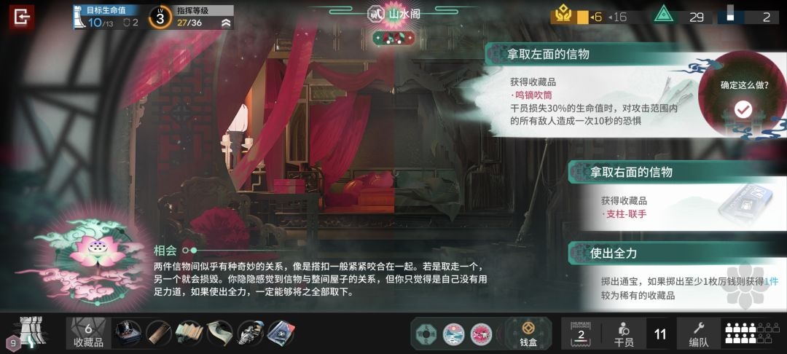
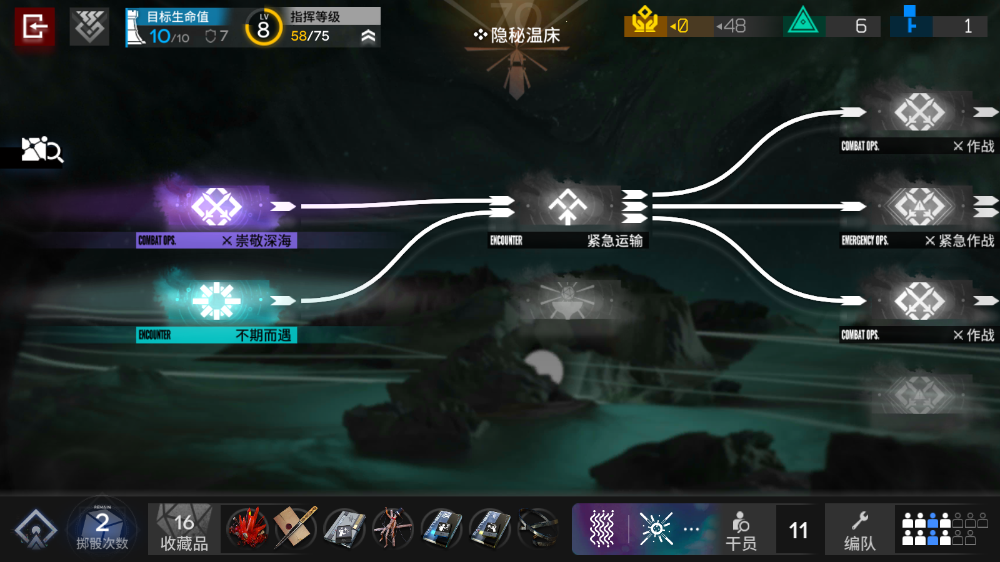

# 代号柒：明日方舟肉鸽 UI 与交互参考板

日期：2026-10-12。读者：后续负责设计、实现或评审的 AI。

**核心用途：用方舟可观察的界面结构，设计代号柒的新事件、奖励、地图、详情与商店呈现。正文是可直接读取的主入口；图片用于理解空间关系。以下替代方案是建议，尚未作为游戏实现或正式视觉规范落地。**

## 1. 授权与资料优先级

- 老板最新明确：对我方原有设计不满意，现有内容可删减、改掉。事件页、奖励页、窗口形式、按钮、详情、导航、地图呈现与店景均可重组。不得把旧布局或旧素材的存在解释为必须保留。
- 本轮产物是参考资料。未来执行游戏改造时，采用当轮授权范围；本板本身不代表已经实施。
- 采用当前已确认的冬日科幻城市、块面厚涂与安静的冷灰氛围作为设计起点。暖金/琥珀用于主要动作和价值，红/绿/紫等继续明确对应状态。色值与尺寸都是样板起点，可调整。
- 读取顺序：老板最新指令 → 当前产品与素材约束 → 本文建议 → 示意图。图上样例文案、数量与素材不能反过来定义业务规则。
- 实际物品、事件选项、条件、收益、容量和去向从当前内容与结果读取。本板只规定如何呈现和操作，不增加事件收益或新的背包规则。

## 2. 图源：每张图只借什么

| 编号 | 原图与出处 | 可观察内容 | 借鉴范围 |
| --- | --- | --- | --- |
| R1 事件 | [本地原图](refs/event.png) · [TapTap 出处](https://www.taptap.cn/moment/695668996837474839) | 大场景、左下标题与叙述、右侧选项、选项内确认提示、上下状态区 | 场景/叙事/行动分区；动作名与已知结果分层；当前对象附近表达选中与确认 |
| R2 地图 | [本地原图](refs/map.png) · [巴哈姆特出处](https://forum.gamer.com.tw/C.php?bsn=33651&snA=9019) | 图标与节点名、方向连线、分支汇合、顶部状态与底部物品摘要 | 关系可读；类别与状态分别编码；当前对象详情与主要动作有明确落点 |
| R3 商店 | [本地原图](refs/shop.png) · [IS Central 出处](https://is-central.github.io/is6-sui/is6-progression/) | 商人形象与商品区域分离、重复商品结构、同屏价格与资源 | 商品身份/价格/状态对齐；列表与详情协作；成本与去向同屏 |

原图版权归原作者。R3 红框属于出处作者的标注，不是游戏控件。三张图均为静态证据；它们不证明方舟实际点击次数、动画时长、批量领取或满包处理。

## 3. 精选原则：落实到具体设计动作

| 原则 | 我方落实方式 | 设计时避免的错误 |
| --- | --- | --- |
| 环境建立情绪，信息面承担阅读 | 场景保留完整大形；正文与选项用低纹理、不透明或足够遮蔽的底面 | 字直接贴到高反差纹理；为了展示插画把正文缩小 |
| 每个对象有清楚身份 | 名称贴图像；卡面、类别、等级和描述在不同入口保持对应 | 列表与详情换图或换名；选中高亮覆盖等级身份 |
| 预览与执行分开 | 地图/卡牌/商品点击先查看；进入、收下、购买各有明确动作 | 仅想看规则就意外领取或进入；靠悬停才能读完整信息 |
| 同一时刻突出一个主动作 | 随当前状态切换主要动作，其他动作降低强调 | 逐件领取、批量领取、离开全部同样亮；满包时仍强调不可用动作 |
| 结果必须有事实与去向 | 成功标记写对象、数量、实际位置；容量与待领数同步 | 用卡牌消失或飞行动画代替成功确认；把估值当成所得金币 |
| 稳定信息位置，允许局部变化 | 探索状态与背包入口位置稳定；选中详情局部刷新 | 选一项就重排全页；打开/关闭详情丢失选择与滚动位置 |
| 装饰从属于职责 | 冷灰底、近直角信息面、细边；主题变化在场景、图形与局部材质中表达 | 借方舟就堆英文、编号、斜切、金边、发光；照搬古堡/园林题材 |

“稳定”指新方案建立后跨同类页面一致，不是要求保留当前旧界面。

## 4. 事件页：空间与阅读顺序

**推荐方案：大场景 + 左下故事区 + 右侧选项列 + 固定状态/工具区。**可以整体替换旧事件窗口。

1. 顶部只放会影响当前判断的探索状态，例如区域、生命、货币、容量。低频记录不占正文面积。
2. 场景负责地点和情绪；主体、人物脸与关键道具避开正文和选项。
3. 左下将事件名与短故事作为一个阅读组。故事长时，仅在故事区展开或滚动。
4. 右侧逐项排列选择。每项先给动作，再给已知代价、结果或条件；未知结果仍保持未知。
5. 选中时显示窄色条、轮廓或标记。确认按钮在选项区域内固定，不再叠通用确认弹窗。
6. 底部保留当前携带物品摘要与背包入口；已有物品与这个事件可能给出的物品分开。

布局起点：场景/故事约 60%，选项约 40%，组间距离 24–32 px。标题 24–28 px；正文 16–18 px，行高约 1.5–1.65；说明 14–16 px。具体比例按内容与当前窗口调整，不能为了守比例压缩文字。

### 事件状态与动作

| 状态 | 可见内容 | 主动作 | 完成后 |
| --- | --- | --- | --- |
| 尚未选择 | 全部可读选项；每项自己的可用条件 | 未选时显示“先选择一个选项” | 点击可用选项只选中并显示相关说明 |
| 已选择 | 选中对象、已知后果；其他选项仍可比较 | “确认选择”或更明确的对应动词 | 执行对应事件选项 |
| 选择受限 | 选项仍可读，具体原因就在该项附近 | 该项不可确认；其他可用项可选 | 条件变化后更新可用状态 |
| 正在执行 | 保留选中对象，防止重复确认 | 当前确认短暂受限 | 依据实际结果进入成功/失败状态 |
| 结果成功 | 原场景和事件名；结果卡列出获得/损失对象、数量、实际去向 | “返回地图”或对应继续动作 | 收束到下一步 |
| 执行失败 | 明确原因；保留当前事件与选择 | 对应的可恢复动作 | 不展示虚假的获得结果 |

动作/说明采用内容数据。示意图里的“显示已知结果”“完整规则”等属于结构注释，不能作为玩家看到的文案。

## 5. 奖励页：普通领取的完整方案

**推荐方案：场景退后，前景用较宽的奖励面板；左中是待领对象，右侧是选中详情，底部固定容量与动作。**窗口形式、大小和排布可替换旧方案。

阅读顺序：结果 → 来源 → 待领取物品 → 选中物品规则与去向 → 容量与动作。

- 标题区区分结果和来源，如“搜刮完成”与对应宝箱/遭遇/战斗名称。
- 待领取区给每个对象独立图像、名称、数量与必要身份标签；点击对象只查看。
- 详情区显示真实完整描述、成本或估值、实际放置位置，以及“收下这张”等动作。
- 实际货币奖励独立显示。物品估值必须写“估值”，不得画成已经获得的金币数。
- 底部容量随成功领取更新。已有物品可以摘要显示或通过背包查看，不混入待领列表。
- 多件奖励只滚动对象区；底部与详情动作保持可见。详情长文在自身区域滚动。

布局起点：对象区约 68%、详情约 32%；动作区高约 64–80 px。这些是设计起点，不是固定像素契约。

### 普通奖励状态与主动作

| 状态 | 对象/详情表现 | 主动作与其他动作 |
| --- | --- | --- |
| 未选对象 | 待领列表可查看，详情提示选择物品 | 可采用“全部收下”为主；离开为次要动作 |
| 已选且可容纳 | 选中轮廓与真实规则；去向和容量可读 | “收下这张”为主，“全部收下”为次要动作 |
| 正在领取 | 保留对象；仅本次执行动作受限 | 阻止重复执行，不把所有阅读动作都锁住 |
| 领取成功 | 对象原位标“已入背包”或真实去向；更新待领数、容量 | 已收对象仍可查看但不能再领取；继续处理剩余对象 |
| 领取失败 | 对象仍未领，显示真实原因 | 不提前标“已收”；提供与原因对应的恢复动作 |
| 部分领取 | 已收与待领状态同时明确，顺序不跳 | 当前对象的可用动作优先；退出写清剩余内容 |
| 全部已领 | 待领取数为 0，保留本次收获摘要 | 只保留显著的“继续探索”，移除失效领取/放弃动作 |

成功反馈先由实际结果确定，再显示静态标记；随后可以从卡牌位置到背包入口做短距离反馈。动画不是领取成功的唯一证据，也不能延迟继续操作。

## 6. 三选一、满包、批量与离开

### 三选一

- 顶部明确显示“选择 1 张带走”或真实选择数量。
- 点击卡牌只选中；可换选；详情给完整规则与去向。
- “收下这张”确认这次选择。确认成功后，其他候选按对应规则结束，不继续显示为普通奖励的“待领取”。
- 三选一不出现“全部收下”。离开仍要明确表达是否放弃卡牌。

### 这张放不下

- 显示这张的可容纳结果及具体原因。不能只用总格数推断；同名合并、专用容量等以实际判定为准。
- 奖励保留，收下动作受限，“整理背包”成为主动作。
- 整理页面替换当前前景内容，避免再叠多个详情/弹窗。
- 返回后恢复同一奖励列表、已收标记、选中对象与滚动位置；重新计算容量。

### 批量领取

- 领取前说明实际可收与留在原处的数量。
- 若操作会让未收内容散落，按钮及确认必须体现对象/数量；不能使用模糊的“全部收下”掩盖部分损失。
- 是否继续领取、何时发放货币、哪些对象会散落，读取实际处理规则；本板不改结算时点。

### 有剩余物品时离开

- 确认列出实际未收对象与数量，说明已收对象的保留状态。
- 次要动作：“返回继续领取”。风险动作示例：“放弃这 2 张并离开”；数量必须来自实际剩余集合。
- 取消后恢复原奖励状态。没有未收对象时直接继续，不再弹放弃确认。

## 7. 地图：借关系表达，不锁定旧排布

- 地图外观、节点图形、信息区与窗口均可重做。路线与可前往关系来自当前地图内容，不能因参考图是横向就擅自改成方舟路线规则。
- 节点图标/名称表达类别；边缘、标记、明暗与文字表达当前状态。类别与状态不要共用一个难以辨认的颜色变化。
- 连线在背景上可读；当前相关关系获得局部强调，避免全部连线同时发光。
- 老板随后否决“下一步·路线列表”。点击节点只出现下沿的紧凑单节点预览，包含地点名、类别、可用状态与已有预览内容；单独的“进入…”动作执行。不得创建或恢复路线目录。
- 关闭预览保持地图位置与当前对象。视觉位置可以重排，但连接关系必须仍然准确可读。

## 8. 商店与共用详情

- 商店场景、人物位置与商品排布均可重做。让场景建立地点身份，让比较区保持信息秩序。
- 商品条目在同一位置放名称、图像、真实价格和可购买状态。余额与详情同屏可见。
- 点击商品先查看；详情显示完整规则、成本、实际去向与购买动作。
- 购买成功后原位标状态，余额同步更新；售罄与可重复购买按当前商品事实区分。
- 余额不足、容量受限分别说明原因；不要全部使用同一句“无法购买”。
- 共用详情按“对象身份 → 描述 → 成本/估值 → 去向 → 动作”组织。列表/场景只展开一层详情；长规则在同一详情内展开，不堆叠新的规则弹窗。
- 共用的是阅读结构，动作随上下文改变。奖励是收下、商店是购买、背包是实际支持的整理动作。

## 9. 美术、层级、尺寸与反馈

从后向前分工：环境 → 氛围 → 稳定结构 → 当前对象 → 文字 → 状态反馈。这是视觉层职责，不是要求实现六个固定 z-index。

| 项目 | 样板起点 | 调整依据 |
| --- | --- | --- |
| 环境 | 冬日科幻城市、清楚大形、冷天光与少量暖光 | 当前主题及已确认画风；留主体和文字安全区 |
| 信息面 | 低纹理、不透明或足够遮蔽、近直角、克制细边 | 正文在实际背景上的可读性 |
| 标题 | 24–28 px | 层级与对象名长度 |
| 正文 | 16–18 px；行高 1.5–1.65 | 完整规则与长故事可读；不靠缩字号塞入 |
| 标签 | 12–14 px；不承担唯一关键解释 | 与主体信息的明度/字号差异 |
| 操作 | 44–48 px 高作为起点 | 实际输入方式、点击区域与当前窗口 |
| 选中反馈 | 约 120–180 ms | 连续操作速度；静态选中标记始终成立 |
| 结果强调 | 约 180–260 ms | 实际结果已明确后显示；继续不依赖动画结束 |

暖金/琥珀用于主动作与价值；冷青灰用于环境和辅助定位；红色用于危险/损失；绿色用于已完成/治疗等正向状态；紫色用于诅咒/异能。颜色同时配文字或图形。具体色值可重做。

## 10. 给执行 AI 的落实顺序

老板已于 2026-10-12 授权三代理远征改造，并随后否决首轮战斗外观与“下一步·路线列表”。战斗改以独立 [杀戮尖塔战斗参考板](../2026-10-12-WF-battle-ui-overhaul/sts-reference/reference-board.md) 为准；地图不恢复路线目录。下列顺序用于事件/奖励等页面，不要求先做它们才能改战斗。

1. 先做事件样板：长/短故事、未选、已选、受限、结果、失败。先定分区与正文可读性，再加主题装饰。
2. 做普通奖励样板：未选、预览、领取中、成功、失败、部分已领、全部已领。每个状态写清主动作与去向。
3. 做三选一、放不下、整理返回、批量部分容纳和离开确认。避免普通奖励与选择奖励共用错误的剩余状态。
4. 把详情阅读结构复用到地图、商店与背包；保持同一对象的身份连续。
5. 再统一场景、信息面、状态色、按钮层级与反馈节奏。

参考图中的布局比例、物品、数量、城市场景与文字均为示意。**采用原则与状态分工，不逐像素照抄；旧界面可被完整替换，图内结构注释不能进入玩家页面。**

## 11. 本次内容校订

- 增加可直接读取的主正文，避免只向 AI 提供文字烘焙在图片里的板。
- 删除“保留店景”“保留旧地图呈现”的隐含限制；落实老板可删减改造的最新指令。
- 把静态来源观察与我方建议点击流程明确分开；不从单张截图推定方舟操作次数。
- 将示意图中的制作说明标为结构注释；最终产品文案从真实内容读取。
- 补齐领取中/失败、三选一结束、部分批量容纳、全部已领、取消离开与整理返回。
- 明确单件/批量的主次，区分实际金币、估值和容量，避免状态冲突。
- 尺寸、时长与视觉层次均为设计起点，不作为未经实际样板确认的硬规范。
- 本轮按老板要求只做内容审读与修订，未追加游戏测试或实页验收。

原图地址、文件 SHA256 与输出记录见 [sources.json](sources.json)。图文总览见 [reference-board.html](reference-board.html)；图版是辅助示意，本文是后续 AI 的主要阅读入口。
