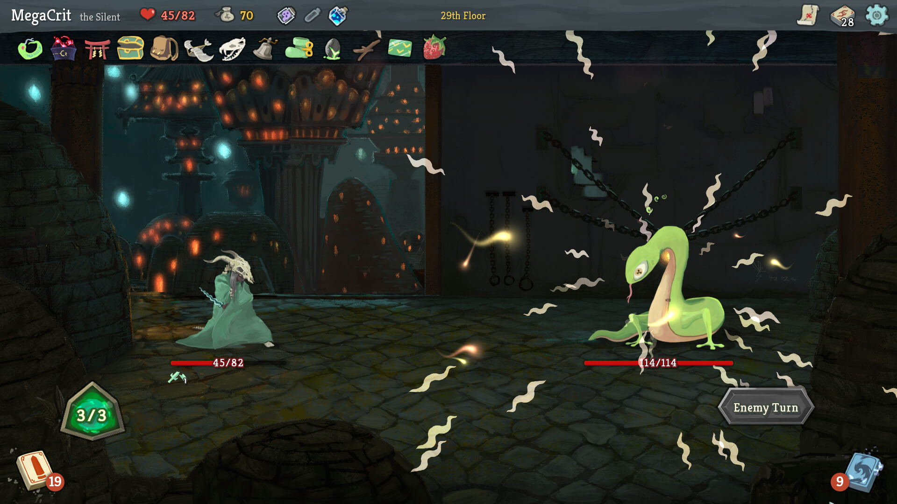
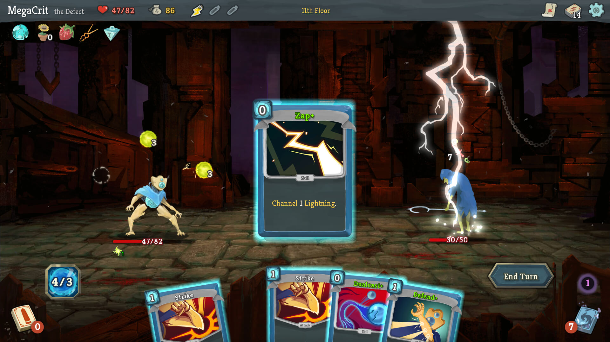
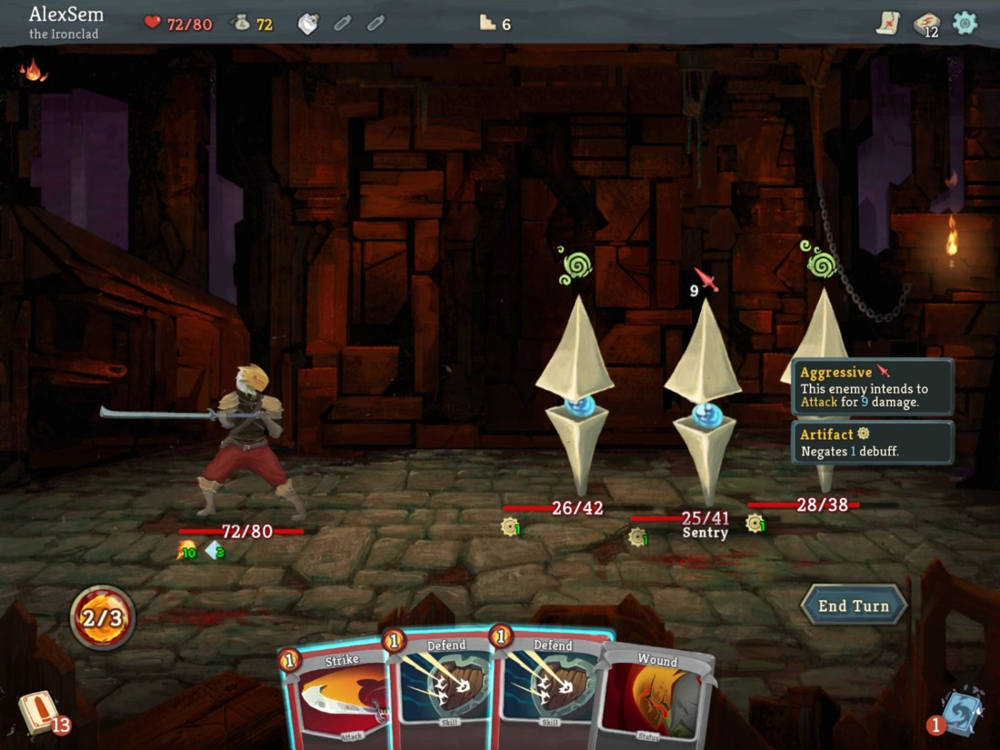

# 杀戮尖塔战斗参考板：用于代号柒战斗重做

2026-10-12。给负责实际改造的 AI 阅读：先看三个原始截图，再读本板的转译要求。

**老板已否决当前 v13 战斗外观。本轮以《杀戮尖塔》的一体战场、悬浮控件、手牌主导和对象邻接信息为主要参考，重做战斗布局与控件形态。**冬日科幻城市、人物人设、块面厚涂及已确认卡框作为项目素材基准；不把尖塔地牢、英文名称或规则移入游戏。

老板同时否决附件中的“下一步·路线列表”。它不得恢复；本板也不包含路线列表。事件、奖励和商店继续依据独立的方舟参考板，本板覆盖之前战斗方案的冲突外观要求。

## R1 完整战场与少量悬浮控件



来源：[Mega Crit 发布的 Steam 商店截图](https://store.steampowered.com/app/646570/Slay_the_Spire/)。这张图显示敌方行动，手牌区当时为空；不能据此理解为常态没有手牌。

可观察的结构：

- 背景覆盖整个战斗空间，角色站在同一块地面上；没有把下方切成占整屏宽的大型控制台。
- 战斗双方位于左、右，生命条贴着对应单位脚下。能量是左下一个独立而显著的物件。
- 回合动作位于右下；抽牌/弃牌等以角落小对象承载计数。
- 顶部将长期状态与系统入口收在薄条里，不把每项信息做成大面板。

对我们的转译：战场保持一个完整空间。去掉当前成片黑色/蓝灰下操作台、单位的大矩形黑色信息块与重复说明；必要信息贴回单位与动作。底部只用局部接触阴影/渐暗帮助读牌，不画新的整宽实心台面。

## R2 卡牌是操作主体，查看时可以拿近



来源同上。中央卡牌处于被突出展示的状态；这张静态图不证明它由悬停、选中还是施放演出触发。本板的查看行为是我方实施要求。

可观察的结构：

- 手牌在屏幕下沿形成松弛的扇面；卡牌作为具体物体出现，而不是包在一个列表框里。
- 费用在卡牌左上，名称在上部，图像与规则正文属于同一张牌；拿近后能完整阅读。
- 能量和结束回合分居手牌两侧，玩家视线自然围绕手牌进行判断。
- 被强调的卡牌具有更大尺寸与前景层级，其他对象仍保留位置关系。

对我们的转译：保留当前厚涂卡面与框体身份，重新做扇面、尺寸、间隔、上提和规则查看。卡名/费用在默认态就可读；完整规则通过放大卡或单层阅读面获得。少量牌时不要挤成窄团；多牌时可以有轻微搭接，但不能遮住卡名、费用和规则入口。

## R3 多敌战斗：意图在上，生命与状态在下



来源：[MiniReview 评测截图](https://minireview.io/deck-building/slay-the-spire)。这张图的悬浮说明和状态位置可见，不能用它证明所有操作链路。

可观察的结构：

- 每个敌人独立拥有头顶意图和脚下生命/状态，不用一块大表格汇总。
- 图标与关键数字直接表达当前需要的判断；完整解释在对象附近展开。
- 意图、生命条与状态图标之间有明确的上下关系，三名敌人仍可分别识别。
- 人物、敌人和卡牌各有画面位置；说明浮层是局部出现的，不吞掉整个战场。

对我们的转译：意图优先呈现类型图标、数值/次数和简短名称，悬停/点击再读完整说明。未知、冰冻、非攻击与复合意图使用真实数据，不补造伤害。敌人名字可短而清楚地贴生命条，复合项分开排列；不把“攻击·3”画成每个敌人头顶的长横条。

## 我方战斗空间：落实到位置与形态

```text
┌──────────────────────────────────────────────────────────────┐
│ 薄状态带：区域 / 回合 / 阶段                 低频系统入口       │
│                                                              │
│                   完整的冬日科幻城市场景                      │
│                                                              │
│      己方角色                         敌人1   敌人2   敌人3    │
│                                   各自头顶：意图图标/数值     │
│      生命/格挡/状态                各自脚下：生命/状态         │
│                                                              │
│  能量物件        下沿手牌：松弛扇面，可上提读牌      结束回合   │
│  低频牌堆/背包摘要                         其他次要动作         │
└──────────────────────────────────────────────────────────────┘
```

这张图说明职责与空间关系，不是要求固定像素或照抄尖塔美术。

### 战场与人物

1. 画面首先是角色对抗，城市景色支持这一焦点。调整场景取景、地面位置与角色容器，减少当前上半屏巨大空景、下半屏拥挤的割裂。
2. 己方与敌人站在同一条可感知的地面上。角色尺寸和足底锚点协调；不得为重排容器破坏已接入的序列帧站位/攻击/受击。
3. 名称、生命、格挡、状态压缩成局部信息组；移除当前单位下方整块大黑面板。数字清楚，文字在复杂背景上用少量阴影或小底面承托。
4. 一、二、三、更多敌人仍要有独立对象与状态位置；不依靠固定两敌宽度写死布局。
5. 不把全部单位同时加金框。可选对象、当前目标与普通状态分别表达。

### 手牌、能量与回合动作

1. 手牌以自身图像与框体成为画面下沿的主对象。能量在左下独立表达；结束回合在右侧稳定可见，两者不能被手牌或放大牌盖住。
2. 卡牌自然扇开，只有小角度和少量上下错落；不做夸张弧形或将每张牌旋转到名称难读。
3. 悬停/键盘焦点/规则按钮拿近同一对象，完整阅读时降低倾斜。放大/返回保留来源位置，不能让所有牌一起跳位。
4. 受限牌仍能查看规则，原因出现在对应牌的阅读状态；不要把每张受限牌都长期罩一整段灰字遮住卡面。
5. 手牌上的“规则”入口应轻量；可读可触，不形成每张牌底部一排大的表单按钮。
6. 能量数与费用数明确区分。详情写“费用 N 能量”，不写容易误认为玩家余量的“当前 N 能量”。
7. 背包、牌堆、设置、撤离等按频率组织为角落或一组轻量入口，不排成右侧满高按钮墙。结束回合是主要回合动作，撤离仍清楚说明真实后果。

### 选择与反馈

| 状态 | 需要看见什么 | 操作结果 |
| --- | --- | --- |
| 普通行动 | 能量、手牌身份、敌方意图 | 可查看或选牌 |
| 查看规则 | 同一张牌拿近，费用和完整规则清楚 | 关闭只返回，不出牌 |
| 已选目标牌 | 被选牌、合法目标、当前指向关系 | 点击目标执行；Esc/空处取消回原牌 |
| 能量不足或规则受限 | 对应牌的原因仍可读 | 不执行，规则查看仍可用 |
| 注能/选牌/发现 | 当前选择任务与进度明确 | 沿真实命令完成或取消，不新增通用确认 |
| 结算/敌方行动 | 阶段明确；反馈贴实际单位 | 无重复执行，真实数值更新后恢复操作 |

- 点击出牌/选目标与拖拽路径保留。不要因“先看再决定”的参考原则，额外为每次出牌增加确认弹窗。
- 指向箭头和目标反馈只在当前选择出现；非目标退后但身份不消失。
- 伤害、治疗、格挡等短反馈贴实际对象。多段数字错开；避免全场色闪和常驻发光。
- 数值与状态由实际结算决定。动画不增加规则等待、不改倍速与队列；场次失效/取消/减少动态路径仍有效。

## 明确替换掉的 v13 外观

| 当前问题/被否决内容 | 新处理 |
| --- | --- |
| 战场与整宽黑色操作台硬切成上下两块 | 完整战场，控件浮在角落/下沿，只有局部承托 |
| 己方与敌人脚下大黑信息卡 | 紧贴对象的生命条、名称与小状态图标 |
| 每个敌人一根过宽意图横条 | 头顶紧凑图标/数字，完整说明按需展开 |
| 手牌聚成窄团，读牌辅助控件与大面板争注意力 | 松弛扇面，拿近当前对象，读牌面只在需要时出现 |
| 高对比灰框、多个同亮按钮堆成控制台 | 单一主要回合动作，其余入口降低体量与强调 |
| “下一步·路线列表”面板 | 撤除，禁止恢复；地图由 A 维持无路线目录的呈现 |

## 执行者与准确属地

B 子代理统一接管本轮战斗呈现，不与 A/C 分别追加外观稿。A 已释放战斗文件并只纠正地图；C 已释放战斗反馈文件并只收尾奖励/商店。

允许修改：

- `game/src/battle/view/battle.view.js`、`battle.layers.js`。
- `battle.aim.js`、`battle.hover.js`、`battle.preview.js`、`battle.overlays.js`、`battle.piles.view.js`。
- `battle.intent.view.js`、`battle.vfx.js`、`battle.attack-cues.js`、`battle.anim.view.js`，仅新外观与状态反馈确实需要时。
- `game/css/expedition-battle.css`、`battle-hand-overhaul.css`、`combat-feedback.css`。
- 对应必要定向测试与本目录实施记录。若需要独立战斗样式文件，先向主会话报具体路径，不自己改全局入口。

不能改：core/effects/runtime、卡效/数值/存档、卡库/卡框/图像资产、`battle.frames.js` 与 frame-catalog/动画制作属地、全局 CSS/index/main、A 地图文件、C 奖励/商店文件。

保留先前工作的功能成果，例如完整规则不出牌、取消、对象身份、局部更新与多段反馈守卫；v13 外观已被否决，不作为审美保留项。整理冲突战斗规则，避免在旧 v13 活规则上再叠一套新活外观。

## 完成标准

1. 实页可观察到完整战场 + 悬浮能量/回合控件 + 手持牌感，已替换 v13 控制台形态。
2. 一/多敌人的身份、生命、意图不互盖；场景前景不遮目标/文字/箭头。
3. 默认态卡名和费用可读；拿近能读完整规则；受限牌也能读；关闭不出牌。
4. 点击选牌→目标→取消/执行、拖拽→空处返回、结束回合与当前支持的选牌/发现保持真实命令。
5. 不恢复路线列表，不动基地/事件/奖励/商店已授权他线成果。
6. 相关定向检查和主会话当前窗口内置浏览器观察分别记录；未验证项明确，不把测试数当成美术认可。

图源与 SHA256 在 [sources.json](sources.json)。本文只选用了 R1/R2/多敌战斗图；获取时同批的 Neow 与事件图未作为战斗依据。
