# 四角色十二款皮肤 · 第一批候选

当前最新候选为黑像雪境军官背景重组v2：衣装参考赫拉格歧路幻影，背景构图参考[阿贝多雪山同人壁纸](https://wall.alphacoders.com/big.php?i=1210593)，删除士兵、废墟、旗帜与碎雪杂物。未获认可或接入。[实际提示词与来源](commander-and-recent-candidates.json)

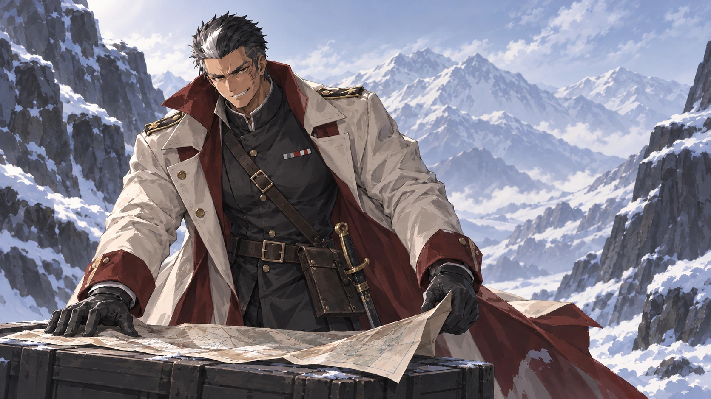

当前最新候选：黑像雪夜猎宴v6，定向景深与亮度修订，未接入。[来源与提示词](heixiang-hunt-v6.json)

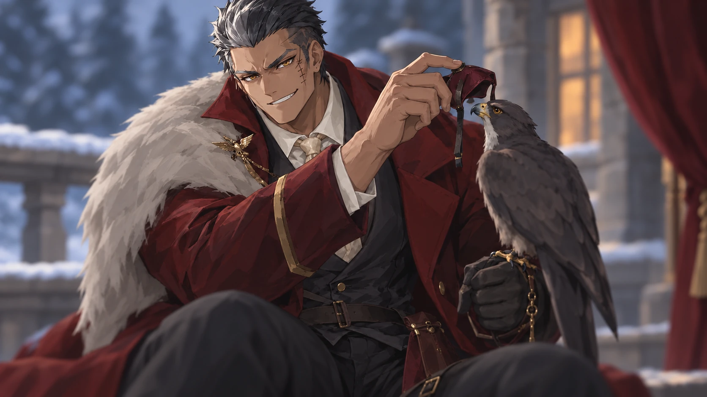

当前最新候选为黑像雪夜猎宴v5：改为解下猎鹰眼罩的近景，重组服饰与主次。仍待老板审阅、未接入；[提示词与来源](heixiang-hunt-v5.json)。

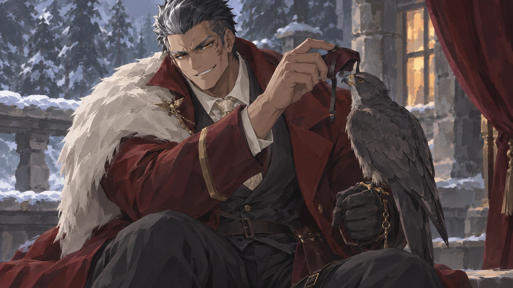

最新修订：黑像雪夜猎宴 v4，修正脸与画法，礼服及构图保留；仍为待审阅候选。源图与两轮实际提示词见 [修订记录](heixiang-hunt-face-style-v4.json)。毛领和部分背景仍有碎面，未声称达到画风验收。

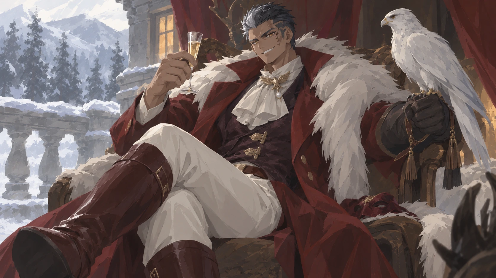

> 当前状态：首批12张已被老板否决并停用；仅保留历史。当前最新候选为黑像雪夜猎宴v2，未认可、未接入。

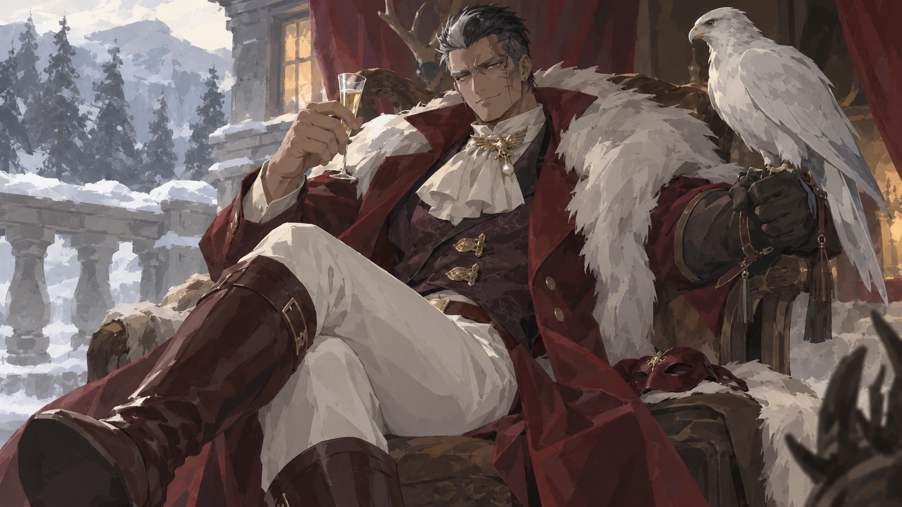

[本张提示词与来源](heixiang-hunt-v2.json)
2026-10-12，内置 image_gen，每款独立调用。12/12 已保存、逐张展示；全部待老板审阅，未接入游戏。

## 研究依据

[星极「寻耀」真实皮肤图](https://www.9game.cn/news/4513244.html)：礼服、望远镜、星图围绕观星动作组织，服饰与道具共同表达主题。
[赫拉格皮肤图与分析](https://hyldagarde.wordpress.com/2021/04/12/in-depth-analysis-of-hellagurs-new-skin/)：观察长外套、内层和装备层级；不采用文章中未经官方确认的剧情推测。
[明日方舟官方皮肤系列公告](https://arknights.global/news/282)：核对 EPOQUE、Bloodline of Combat 等真实系列。

画风使用 artifact-template-anime-block-brush 正式提示词，人物身份以四人当前运行立绘为准；无与 source-5/8/1 仅作画法参考。实际提示词、参考顺序、源PNG相对路径与SHA256见 [generated-manifest.json](generated-manifest.json)。源PNG保留在 .codex/generated_images；本目录仅保存等比例WebP预览，每张小于1MB。

## 已看图的结果与待审阅项

四人的发型、眼色、脸部身份特征连续；动作、主题、场景和主要道具可区别。当前候选仍有石面、背景及部分衣褶笔触偏碎的情况，服饰轮廓的差异尚可加强；未获老板认可，不能作为稳定画风或已采用资产。

只做生成画作目检及文件尺寸/哈希核对；未测试、素材审计、workflow verify、build、游戏实页、提交或推送。未修改源码或运行引用，未启动服务。

## 01 · 深夜咖啡末班（heixiang）

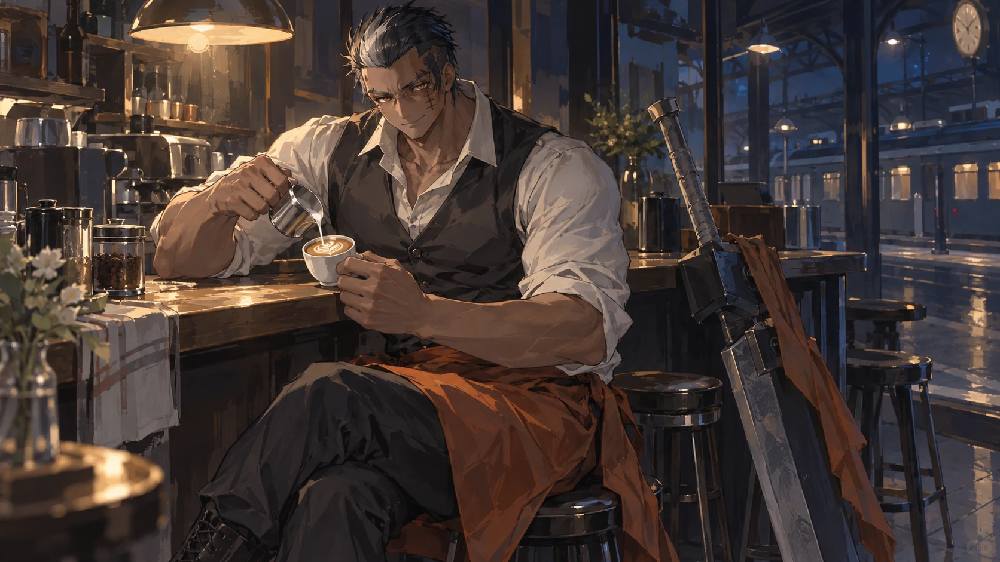

## 02 · 风沙遗迹护送（heixiang）

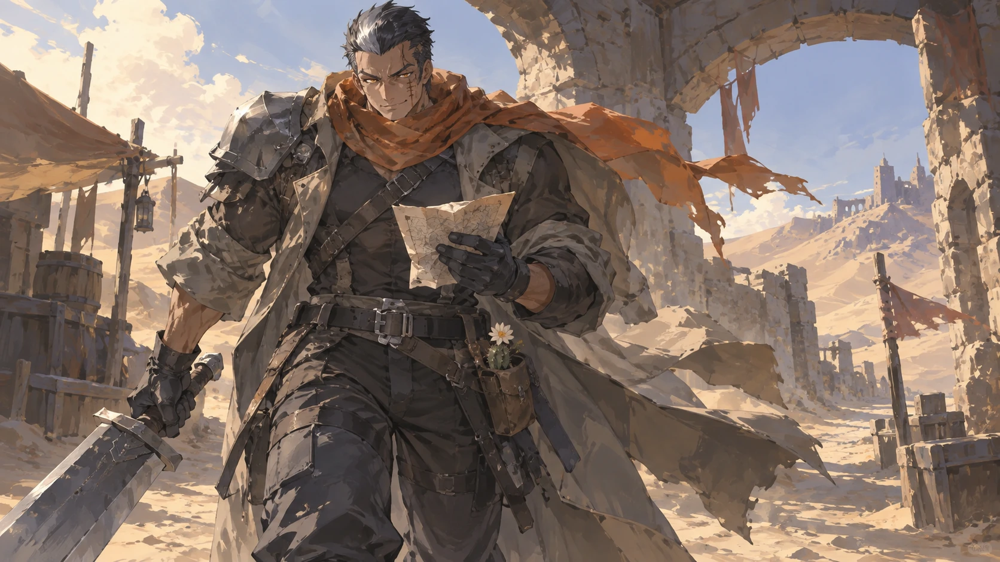

## 03 · 港湾旧唱片（heixiang）

## 04 · 潮汐观测（xingyue）

## 05 · 雪路寄信（xingyue）

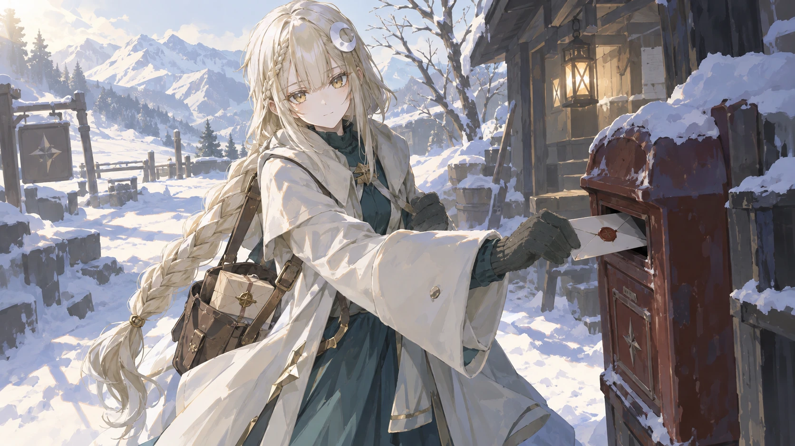

## 06 · 温室晨祷（xingyue）

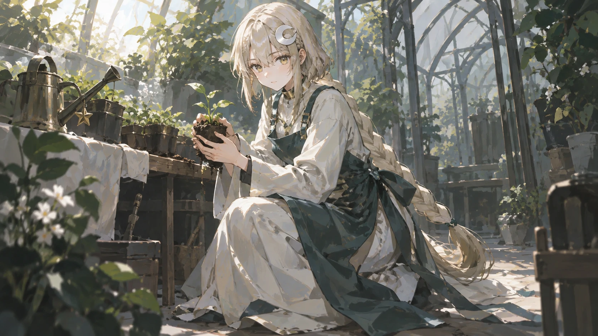

## 07 · 雨日书车（baita）

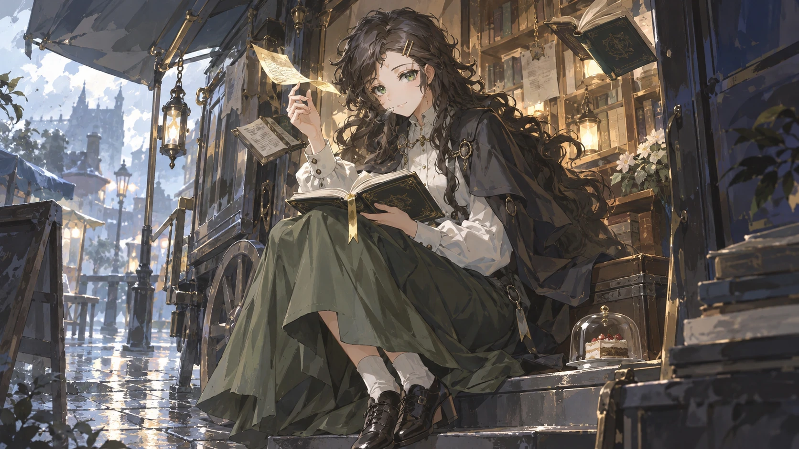

## 08 · 甜点炼金（baita）

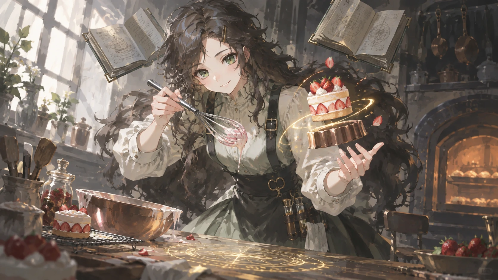

## 09 · 遗迹拓印（baita）

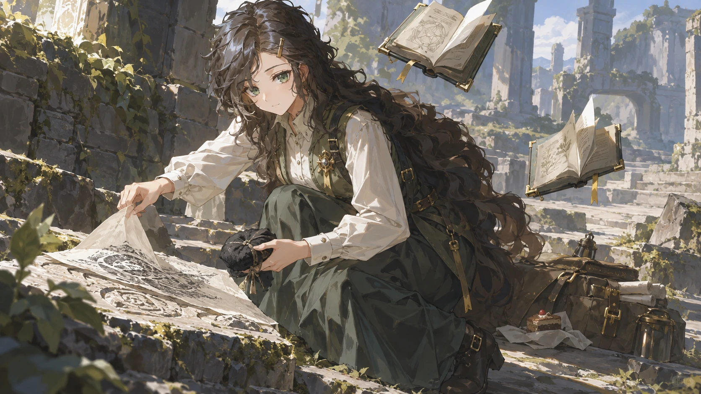

## 10 · 夜航检票（changwuyu）

## 11 · 日蚀茶会（changwuyu）

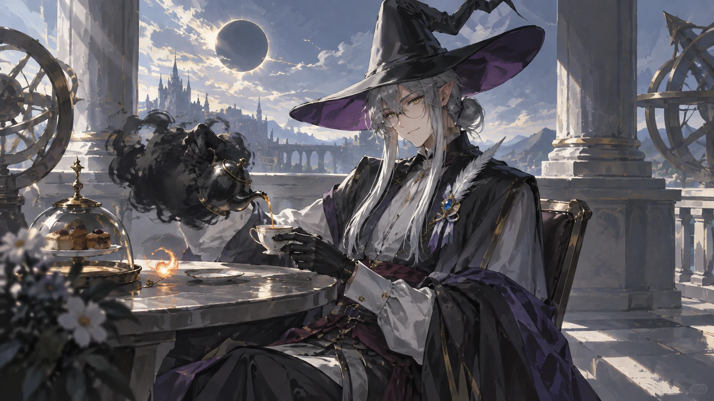

## 12 · 剧场谢幕（changwuyu）

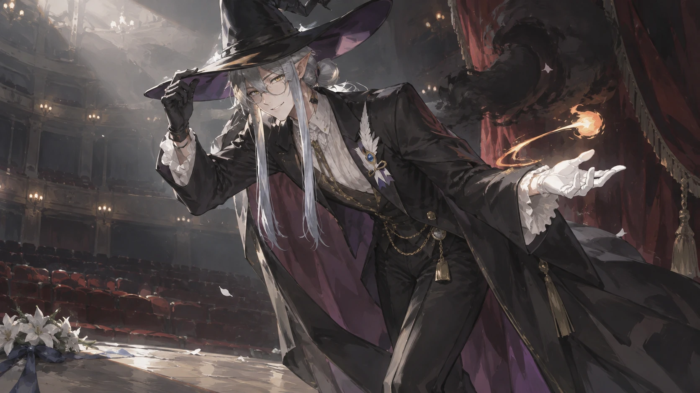
