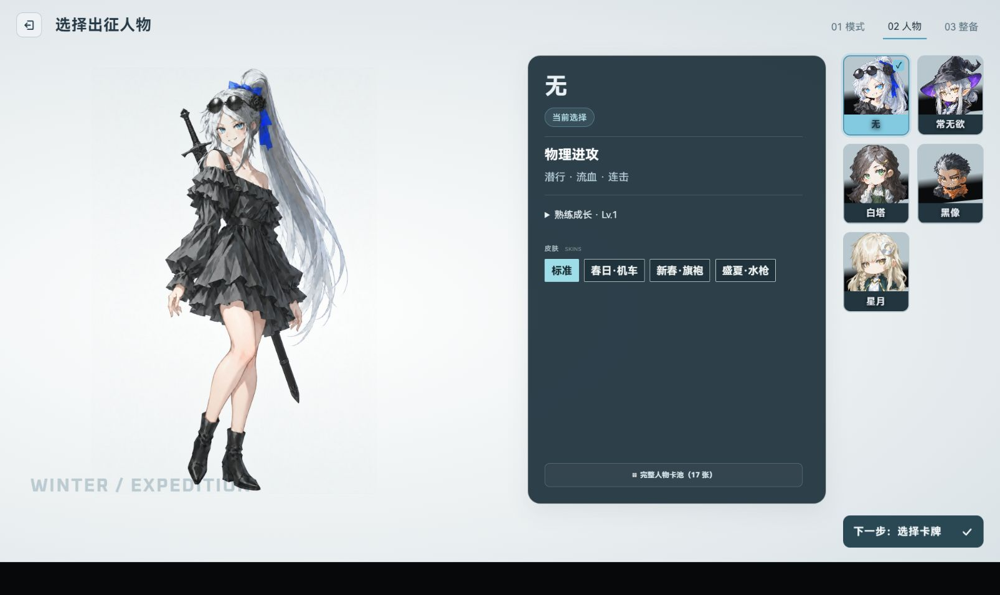
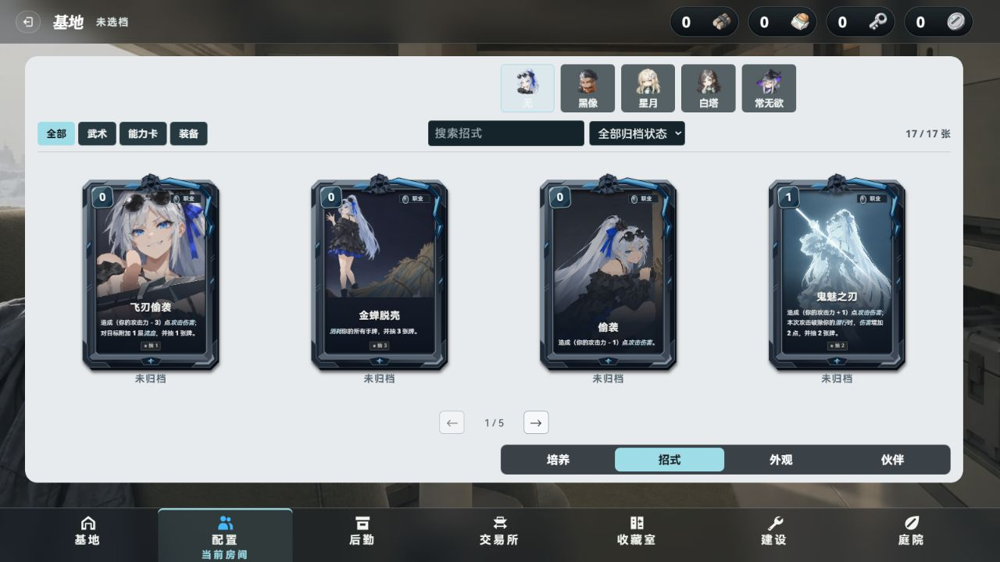
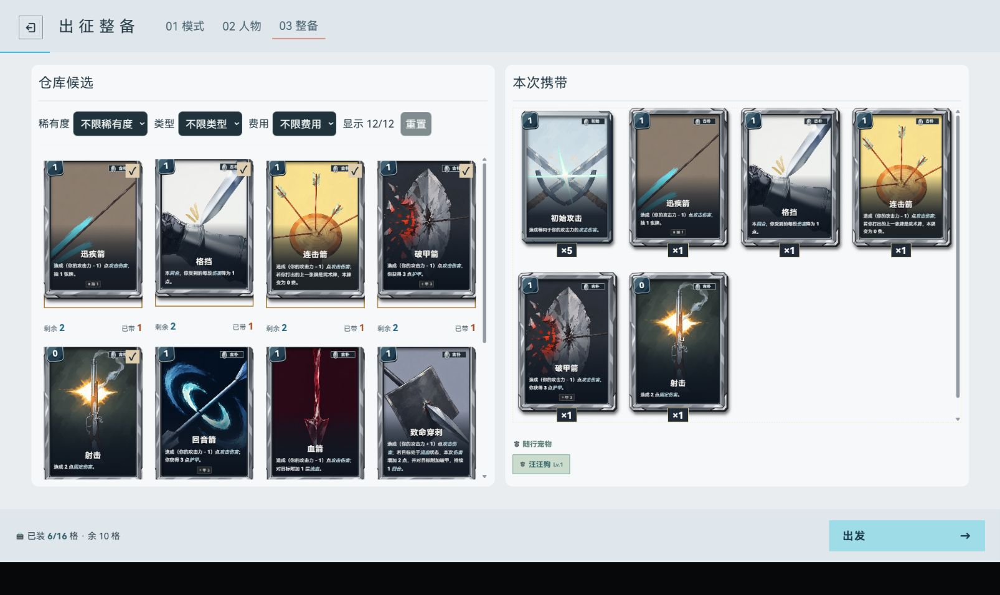
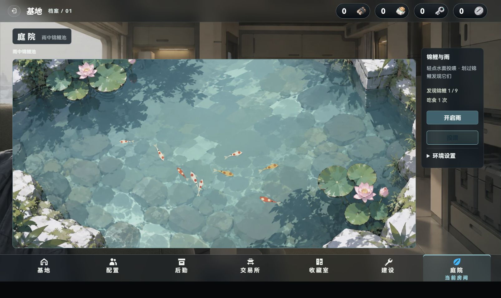
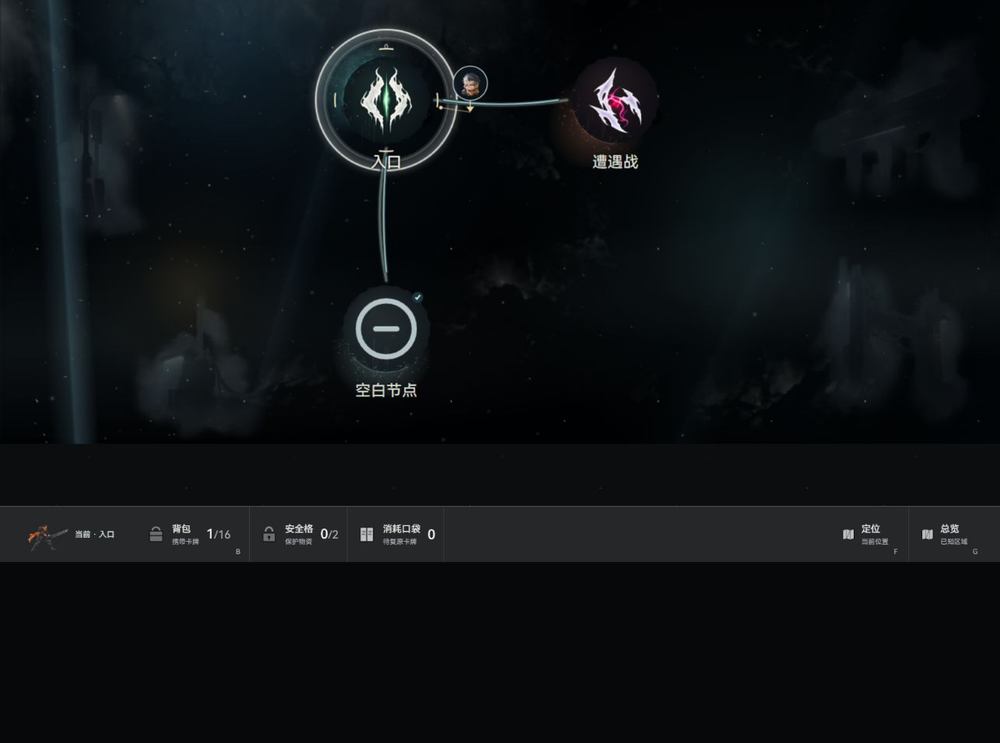

# 留言与追加调整交付

本轮27条未完成留言及老板随后追加的调整已接入，保留此前完成未提交成果。标题页三条和卡牌库一条按老板确认排除；未修改原始Downloads留言文件。无构建、提交、推送或新服务，复用既有5200。

## 改动

- 人物：当前导航图标变蓝；五人同位置同尺寸白底与白边；招式固定每页四张、缩小并为卡框外伸留余量、去掉纵向滚动按钮；培养/招式操作栏位置相同；伙伴缩略图下方重复文字移除。
- 商店与收藏：选卡只更新同页交易台，卡面不再打开大图；切卡不播放整区域位移动画；前往仓库按钮文字居中。
- 选人：按现有绝区零人物参考板重做为大立绘、身份栏、右侧肖像阵列和独立确认按钮；完整人物卡池左侧重复说明移除。
- 整备：仓库和携带各占一半，移除大立绘与重复说明；按老板最新反馈改为四列、24px列间距、卡面留卡框余量；浅色底、数字异色；大图不输出底部操作行；拖牌改不透明实体，可拖入和拖回。
- 庭院：锦鲤与雨合并；独立关雨按钮；关闭雨后鱼仍游动和吃食，雨声关闭；指针水纹、鱼群避让、水光、发现九条锦鲤和实际吃食计数。沿[已接入MIT上游](https://github.com/rzrabbi/interactive-koi-pond)，页面内小玩法不写入基地经济。
- 地图/事件：新图首战前不可到火堆；节点首点右侧半透明信息、再次点同节点确认；事件三项资源摘要移除；地图返回键透明；攻击/金币SVG重绘；底栏接入当前角色小人；已消耗内容节点用空心圆短横专属图标，预览/悬停说明同步，仍可通行。
- 战斗/奖励：自由拖牌直接跟随；能量区上移放大；刺击专用SVG与清楚的费用行；技能成功扣费后每回合限一次，取消不占次数；搜刮卡面保持272/406比例并解除最小高度拉伸。
- 贴纸根因：三张SVG注释内含非法双连字符，HTTP200仍无法解码；仅修注释，几何颜色不变，并精确新增三个清单条目。
- 全部内部测试页静音，庭院环境声保持关闭；偏好已写个人MEMORY.md及memory_summary.md，并检索命中。

## 验证与输入范围

- [最终定向报告](targeted-tests.json)：18文件142项通过，包含架构/契约哨兵。另地图启动链定向5项通过（[地图记录](map-events-verification.md)），其余boot用例不算覆盖。
- 浏览器均为Codex内置浏览器、当时当前窗口；没有设置viewport或另开外部浏览器。窗口随宿主布局变化，相关JSON和截图分别反映当时条件，不宣称多尺寸验收。
- 真实鼠标/按钮输入：基地进入、五人切换、培养/招式切换、商店选卡、收藏按钮、庭院关/开雨和投喂、选人确认、整备实体拖入与拖回、卡面大图关闭、正常入城、节点两次点击、刺击与初始攻击拖到敌人。
- 整备12种候选卡只在内存中构造；后续测试页拦截Storage写入到当前页内存，不覆盖已有档位。截图滚动位置曾用开发接口回到首屏；不把这次滚动算作真实输入。
- [战斗剧本](browser-battle-scene.json)：既有Agent命令自动驱动的测试战斗通过，非普通玩家鼠标通关证据。修后击杀boom在实际战场DOM内创建且loaded=true；[三张SVG浏览器解码](browser-svg-decode.json)全部通过。原生拖牌/刺击前后的数量、费用和敌人状态另以真实输入确认。
- [空白节点实页](map-empty-node.png)：只在隔离页给当前相邻战斗节点构造已访问状态；原类型、坐标和位置不改。真实点选后预览写明已消耗，进入按钮仍可用；不能据此宣称自然跑局已完成该节点。
- [招式最终](personnel-pool-final.png)：卡框顶部、底部装饰完整；四张横排，操作栏不跳位（[DOM记录](personnel-pool-final.json)只量本体，外伸装饰以截图核对）。
- [交易切卡记录](trade-switch-final.json)：从物资切到装备，名称和交易台对应，无放大层，商品区没有位移动画；未做购买/出售经济操作。
- [技能排版](battle-skill-layout.json)：既有战斗场景中的费用行在按钮内；截图只核对技能区域，角色纹理可能仍在载入，不作为角色美术验收。
- `classselect-shared-entry.png` 是额外开发入口构造时被标题层覆盖的截图，不作为选人实页通过证据；正常基地出征入口的通过证据为 `classselect-v2.png`。
- [三资产定向检查](sticker-scoped-audit.json)无问题；[来源/字节/哈希](sticker-asset-receipt.json)已登记，清单其他1165条逐项保持。

## 覆盖边界

新图火堆约束不重生成旧局地图。未执行全量游戏测试或构建；当前共享树全库资产门有400项范围外错误、623条历史警告，本轮三个贴纸条目无问题；整套boot测试另有两个照相馆用例失败（动态载入状态、jsdom缺少scrollIntoView），未修改已排除的照相馆。无远端CI覆盖本轮未提交改动。没有性能前后基线，不宣称性能提升。

子代理分域与明细见[派工](dispatch.md)、[鱼塘](pond-increment.md)、[战斗补修](combat-followup.md)、[空白节点](map-empty-nodes.md)。所有实现保持完成未提交，原有成果归属保留；临时脚本在.tmp不纳入交付源码。

