# 《绝区零》美术、UI 与交互参考——代号柒基地改造

日期：2026-10-12。主交付：[图文参考板](reference-board.html)。仅研究表现与交互，不提出玩法机制变更。

## 阅读口径

观察来自公开历史截图，原则为设计判断，基地方案为建议。未亲玩或动态测量绝区零；原图红色数字箭头属于图源作者。后续实施须再核对当前游戏界面和命令返回，不能把本板建议写成已实现。

## 01 基地先是一处有人生活的空间，再承载功能

最值得借鉴的是“功能有真实的载体”：玩家看到柜台、设备、房间和人物，就能理解这里可以做什么。

### 截图与观察

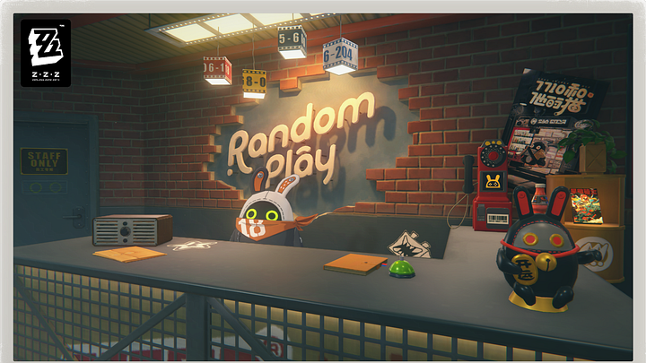

[Random Play：生活空间与功能设施图源](https://www.dbltap.com/guides/zenless-zone-zero-video-store-guide-how-to-manage-random-play) · 2025-06-06

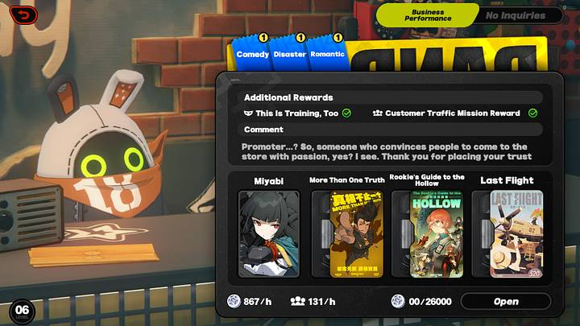

[Random Play：经营配置界面图源](https://www.dbltap.com/guides/zenless-zone-zero-video-store-guide-how-to-manage-random-play) · 2025-06-06

Random Play 的图中，柜台、店招、货架、工作人员共同构成一处具体的生活空间。经营配置以深色面板叠在这处空间上，背后仍能看见柜台和工作人员。空间承担气氛和身份，面板承担清晰操作。这里的亲近感来自日常物件、人的姿态和室内光，而不是满屏发光线。

### 原则

美术负责回答“我在哪里、这里是谁的地方”；UI 负责回答“我能做什么、现在该处理哪件事”。两者共享同一场景身份，信息密度可以不同。界面不能要求玩家从一张复杂插画里猜全部功能，也不必把场景彻底盖住才能读清文字。

### 基地建议

我们的基地保留冬日科幻城市、现代合成材料与块面厚涂。可以把配置对应人物与整备区、后勤对应储物与货架、交易所对应柜台、建设对应设施终端、收藏室对应档案陈列、庭院对应休息空间、照相馆对应展示装裱。它们是现有功能的视觉解释，不新增经营、作息或生产机制。

### 具体细节

- 先定一个空间焦点：人物、柜台或设施主物件。让顶灯、窗光与接触阴影支撑焦点；远处陈设降低对比，避免所有物件都一样清楚。
- 门牌、贴纸、编号、旧标签可以给世界增加生活痕迹，但集中在场景物件和标题边缘；正文、价格和材料数字放在低纹理面上。
- 一间房间选一组主要物件语言。例如后勤用模块货架和箱体，收藏室用目录与展示架；不把胶片、铆钉、玻璃、铭牌全部堆进每个按钮。
- 用同一城市的材料、同一光照逻辑和相近的相机高度串起各房间。背景题材连续比每页贴同一种边框更能建立统一感。
- “有人在使用”可以由已有立绘、椅子方向、开着的显示器、收好的工具表现。没有合适动态素材时，静态布置也能表达生活感。

## 02 基地首页：背景大，导航稳，事务小而醒目

首页要同时提供停留的气氛和明确的入口；主要内容不应该被七块同等醒目的菜单遮满。

### 截图与观察

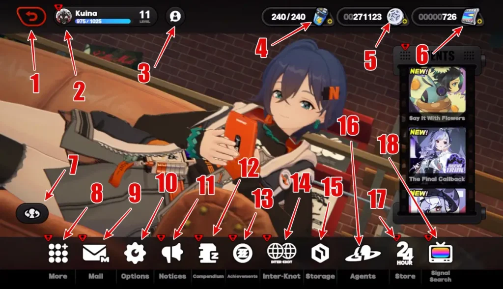

[主菜单：人物场景与边缘导航图源](https://techwiser.com/all-zenless-zone-zero-icons-and-symbols-meaning-complete-guide/) · 2025-05-07

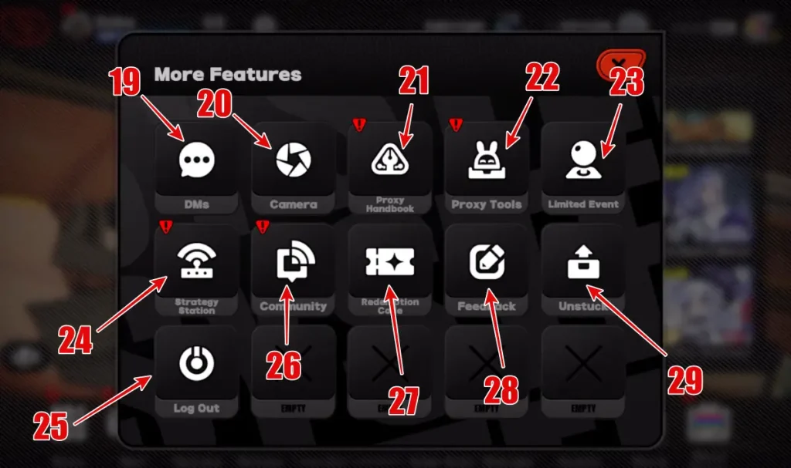

[更多菜单：低频功能收纳图源](https://techwiser.com/all-zenless-zone-zero-icons-and-symbols-meaning-complete-guide/) · 2025-05-07

主菜单样本把大面积人物与室内场景留在中部，账号和资源靠上，主要入口沿底边排布，活动预览聚在右侧。“更多”展开为独立功能面板，将低频功能从常驻区域收起。截图中的位置分工很清楚：中心给世界，边缘给系统。

### 原则

首页的信息按使用频率和当前可操作性分级。永久入口的位置稳定；临时事务只在确有内容时出现；一个主动作明显强于其他入口。玩家不用重新扫描整页，便能找到常用房间和未处理事项。

### 基地建议

现有底部七入口“基地、配置、后勤、交易所、收藏室、建设、庭院”保留固定顺序。现有“出征整备／继续整备”保留主动作地位，基地事务沿用可扩建、可孵化和待领取。首页事务区不改成活动营销栏，也不为凑版面新增每日签到。

### 具体细节

- 顶部只常驻身份、当前房间和必要资源。与当前动作无关的材料不全部铺在首页；进入建设或交易页后，再显示对应资源与需求。
- 事务区用紧凑的整行入口：图标、事务名称、对象或数量、右向箭头。例：“待领取 3项｜收藏与成就奖励”，整行可点。
- 中央场景保留连续的大块可视区域。人物脸、主要手势、重要设备不被事务列表、底栏或浮动标签切开。
- 底栏每个入口同时有图标与中文名。选中入口用背景或短色条表达，其余入口安静；不要让所有入口常态都发光。
- 主动作放在可预测的独立区，事务列表增减不推动它跳位。整备已有草稿时，按钮上方可以沿现有实现显示人物与卡牌数量。
- 低频设置、说明和辅助操作可放在现有合适的次级入口。收纳的目的只是降低首屏密度，不能让重要功能藏到多层菜单里。

## 03 五层视觉秩序：景、导航、内容、动作、反馈

统一基地的第一步，是给每一种信息确定层级，而不是给所有页面换同一张玻璃皮。

### 截图与观察

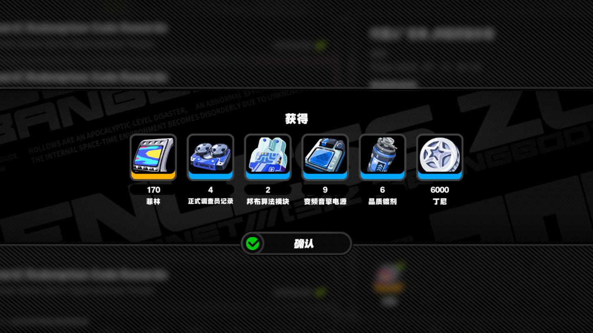

[获得弹层与确认动作图源](https://www.hoyolab.com/article/30950635) · 2024-07-12

“获得”截图中，原页面被整体压暗与模糊，中部奖励带清楚突出，标题、物品和确认按钮形成一个独立的读取单元。遮罩改变了前后关系，让玩家知道此刻应处理上层内容。

### 原则

视觉层与交互层应一致。背景越后退，前景越明确；最上层只能有一个需要响应的焦点。看起来已被遮住的底层，不能继续响应点击。

### 基地建议

建议基地统一为五层：①场景底图；②固定导航和资源；③当前房间内容；④当前主要动作；⑤详情、确认和结果反馈。第⑤层临时接管焦点，关闭后回到第③层的原选择。这个层级可以保留我们现有灰冷场景与暖金动作色。

### 具体细节

- 场景层承载大面积色彩和照明；内容层使用稳定的石墨色阅读面，重要数字与正文不依赖背景模糊来勉强可读。
- 导航层比内容标题小，但位置与状态持续稳定。它说明“我在建设”；内容标题说明“我正在看基地仓库”。
- 动作层集中在当前对象附近或固定详情底部。一个对象的主按钮只出现一次，避免列表、详情和页脚同时摆三枚同色主按钮。
- 详情弹层与领取结果分开：前者解释对象，后者告知动作已完成。结果不是另一张需要重新选择物品的列表。
- 只让当前弹层抢焦点。二级详情关闭回到一级面板，一级面板关闭回房间；鼠标、键盘和返回按钮使用同一顺序。

## 04 图形语言：硬轮廓、厚重标题、局部街头味

可以借鉴绝区零的轮廓力度和编排节奏；我们的主体仍然是冷静的冬日基地。

### 截图与观察

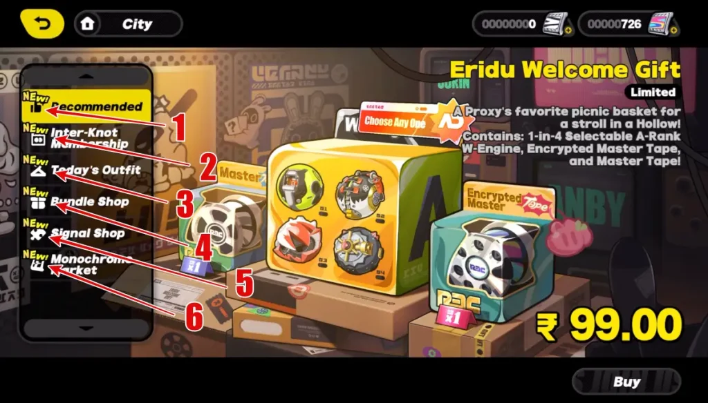

[商店：分类与商品陈列图源](https://techwiser.com/all-zenless-zone-zero-icons-and-symbols-meaning-complete-guide/) · 2025-05-07

[主菜单：人物场景与边缘导航图源](https://techwiser.com/all-zenless-zone-zero-icons-and-symbols-meaning-complete-guide/) · 2025-05-07

所选截图可见大标题、厚图标、深色阅读面、圆角或胶囊控件，以及局部倾斜图形、贴纸感和高亮色块。强装饰多出现在背景、主题画面与标题附近；实用信息仍有明确的排布和对比。

### 原则

风格由少数重复特征组成：轮廓粗细、字重、色块、留白与状态表现。装饰应帮助辨认页面身份，而不是竞争阅读。文字需要先读得清，再表现个性。

### 基地建议

把借鉴重点转成我们的语言：石墨深底、浅灰文字、冷青局部身份色、暖金主要动作、少量现代标贴。保留近直角的主体面板；可以让通知、返回与确认控件有圆滑轮廓，不必把整个项目改成荧光绿与黑黄斜纹。

### 具体细节

- 一级标题可以更厚、更短，二级标题保持清楚的无衬线字形。英文副标题仅作环境身份，不重复占据中文标题的主层级。
- 同一家族图标使用相近的笔画厚度和填充比例。主导航强调识别，操作小图标强调动作方向；不要把细线系统图标和厚剪影随意混在同一排。
- 贴纸、章印、斜切、胶片边等最多选一两种作为基地共同语汇，优先用在标题和物件上。信息行不逐行贴装饰。
- 当前选中使用亮底或明确轮廓，悬停只小幅提亮。稀有度、选中与可领取用不同标记，不共用一圈金框。
- 主动作色只留给当前可执行动作。普通导航、类别标签与静态数字不要全部暖金，才能让“领取”“确认扩建”真正被看见。

## 05 文字与密度：先读对象，再读状态，最后看细节

文字多的基地页面仍要让玩家一眼识别对象与下一步；靠层级和分区降低负担。

### 截图与观察

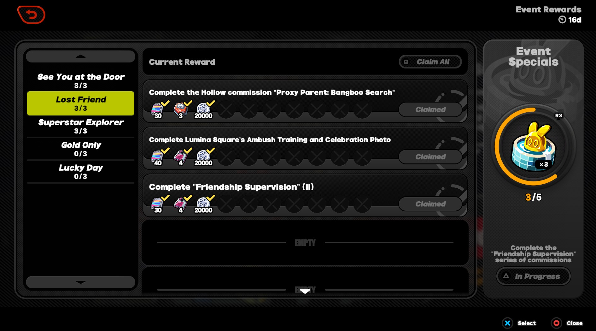

[活动奖励清单与已领取状态图源](https://www.icy-veins.com/zenless-zone-zero/friendship-supervision-event) · 2024年活动样本

奖励列表样本中，左栏是分组名称与计数，中间每行是目标名称、奖励图标和领取状态，右栏是阶段奖励。名称、物品与状态各有稳定的位置，信息再多也不需要逐行寻找按钮。

### 原则

同类信息在同一轴线上对齐；主要对象名称先于说明，当前状态先于长期背景。长文本进入有明确标题的详情区，不用缩小整页字号来塞入。

### 基地建议

沿现行视觉规范的样板起点：页面标题20–24px、对象名16–18px、正文与主要数值14–16px、次级标签至少12px。这里是候选排版范围，不是测得的绝区零字号。最终用基地当前窗口核对。

### 具体细节

- 一个对象控制在三层文字：名称／当前状态／必要说明。日期、来源和标签退到次级行；重要缺失材料不能被当作灰色脚注。
- 金额、数量、进度用稳定对齐和等宽数字。物品名称换行可以改变该行高度，动作栏的位置仍维持一致。
- 图标旁给中文名；只有玩家反复使用、能独立识别的次要控件才考虑只留图标，并保留可访问名称。
- 一屏先支持浏览与选择，完整介绍在侧栏或详情。历史日志、长说明、故事正文各有入口，不与价格和按钮同处一个密集段落。
- 适度使用“当前／完成后”“持有／需要”等短标签，替代无法辨别的成串数字。例：“木材 8 / 12”必须同时说明这是持有与需要。

## 06 三套布局模板足够覆盖基地大多数页面

统一分区逻辑，让每个房间围绕其对象变化；不要求每页长得完全一样。

### 截图与观察

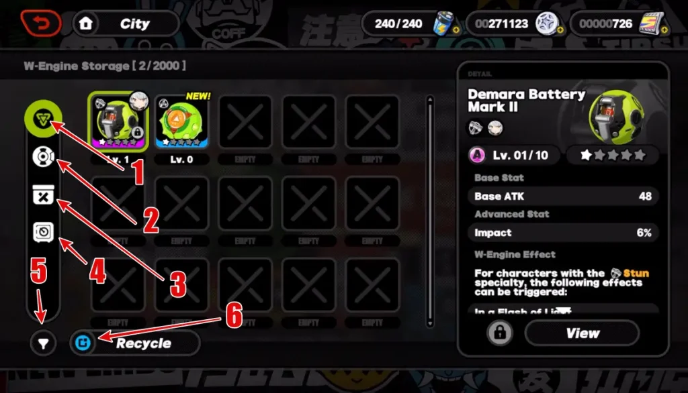

[仓库：物品网格与详情图源](https://techwiser.com/all-zenless-zone-zero-icons-and-symbols-meaning-complete-guide/) · 2025-05-07

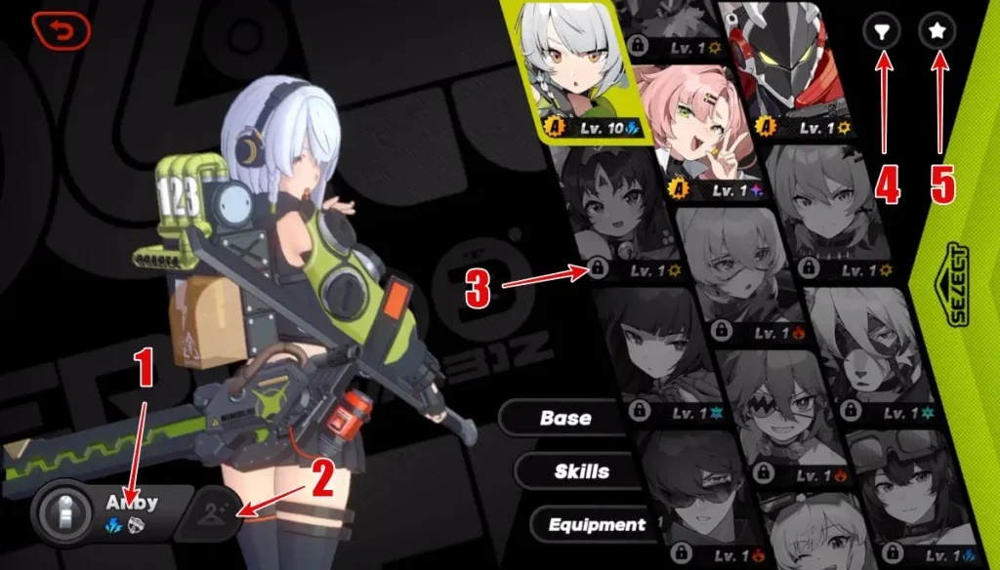

[人物：身份图像与浏览选择图源](https://techwiser.com/all-zenless-zone-zero-icons-and-symbols-meaning-complete-guide/) · 2025-05-07

[Random Play：经营配置界面图源](https://www.dbltap.com/guides/zenless-zone-zero-video-store-guide-how-to-manage-random-play) · 2025-06-06

仓库、人物与经营配置三个样本分别突出物品列表、人物形象和配置内容。它们的画面中心不同，但都把浏览选择与当前对象的操作组织在可理解的区域。

### 原则

页面布局由任务主语决定：看一位人物、挑一件物品、处理一项事务，分别需要不同的主视觉。相同的导航、状态与返回规则让这些页面仍属于同一套基地。

### 基地建议

建议保留三套模板：A 场景＋事务用于首页与庭院；B 浏览区＋详情区用于后勤、交易所、建设、收藏；C 主形象＋信息栏用于人物与照相馆。不要把庭院塞成物品商城，也不要把材料清单拉成大立绘海报。

### 具体细节

- A 模板让空间占多数，事务占较窄侧栏，主动作独立；无事务时可以自然留白。
- B 模板先放分类和对象列表，再放可读详情与固定动作。可作为当前窗口起点的宽度关系为约60%浏览、40%详情，依据实际内容调整。
- C 模板给人物或作品最大的完整展示区，信息栏收住名称、身份、当前状态和动作；缩略图只承担切换，不能比主图更抢眼。
- 列表滚动、详情滚动与主按钮分开；长清单的滚动不挤走“领取”“购买”或“应用”。
- 各房间保留自己的物件、色调和标题语气；分栏边界、间距基准、返回与确认位置保持同家族。

## 07 事件长什么样：先区分事务、会话和主题页

基地事件不必全做成巨型海报；事件的体量应与需要玩家投入的注意力相称。

### 截图与观察

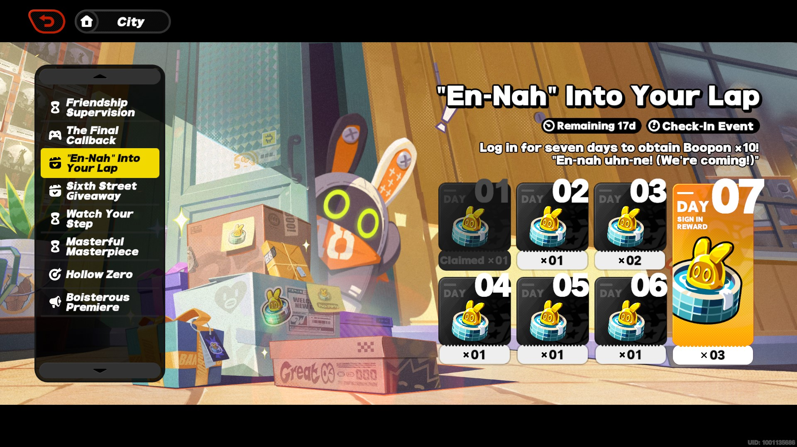

[活动入口与奖励预览图源](https://store.epicgames.com/en-US/news/zenless-zone-zero-guide-how-to-get-every-free-pull-for-gacha-banners) · 2024-07-31

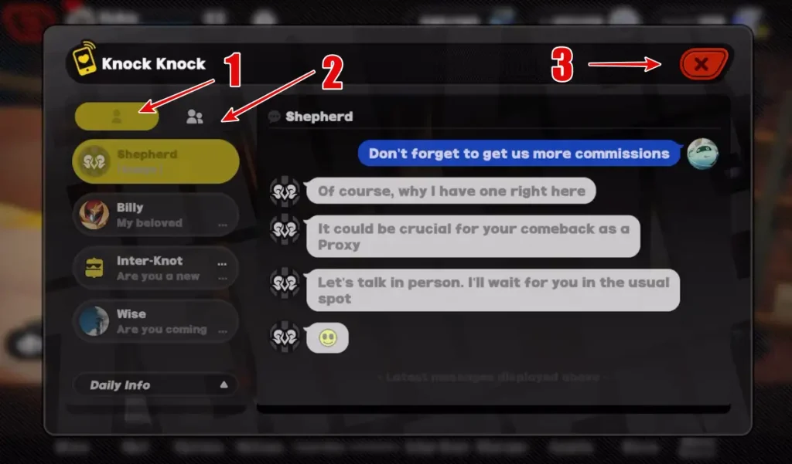

[消息：联系人与会话两栏图源](https://techwiser.com/all-zenless-zone-zero-icons-and-symbols-meaning-complete-guide/) · 2025-05-07

活动样本把事件列表放在左侧、主题插画和详情放在右侧，并在图内露出奖励与时间信息；消息样本则用联系人与会话两栏承载人物交流。两种容器分别服务“找一项活动”和“回应一个人”。

### 原则

事件入口先给身份和状态：谁发起、发生在哪里、当前能做什么。装饰与主题图表达事件气氛，状态与操作表达下一步。事件标题不能替代入口动词。

### 基地建议

现有“可扩建、可孵化、待领取”继续使用紧凑事务行。若以后已有基地人物事件，可以采用会话卡；若已有多步骤故事或主题内容，再用主题详情页。后两者仅是呈现方式备选，本轮不提出新增基地事件机制。

### 具体细节

- 事务行：小图标＋“待领取 3项”＋“收藏与成就奖励”＋箭头。点后直接进入对应分类或详情，而不是先看一张中转广告。
- 人物事件卡：头像或小立绘＋人物名＋地点／一句短摘要＋“查看来意”。人物表情与标题是焦点，状态标签退到角落。
- 主题详情页：左侧同级事件列表，右侧主题画面与简短摘要，底部预览内容与唯一主要入口。没有实际截止时间的内容不放倒计时。
- 未读、进行中、可领取、已完成用文字与标记区分。读过事件不等于领过奖励；未读点与可领取数字采用不同含义。
- 事件图只画主题，标题、状态和操作用真实文字覆盖，避免美术图烘焙文案导致之后无法更新。
- 首页只露出需要处理的少量事务。更多事件在所属房间或现有内容入口查看，不把首页变成无限滚动的任务中心。

## 08 事件详情：人物与叙述一侧，选择与结果另一侧

一眼看清“谁在说话、正在发生什么、我有哪些选择”，比把对白和选项混成一大段更重要。

### 截图与观察

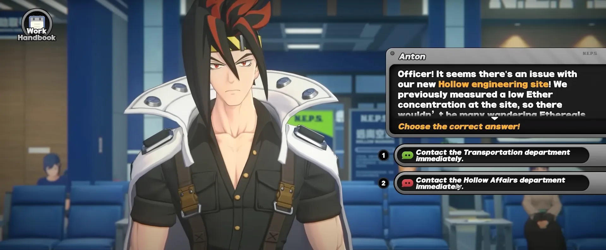

[事件对白与右侧选择图源](https://www.gameleap.com/articles/zenless-zone-zero-daily-life-of-a-pubsec-officer-event-details) · 历史活动样本，截图日期未确认

[Random Play：经营配置界面图源](https://www.dbltap.com/guides/zenless-zone-zero-video-store-guide-how-to-manage-random-play) · 2025-06-06

对白截图中，人物占据大面积场景，右侧独立面板先显示说话者和事件文字，再列出两条选择。人物提供情绪，面板提供需要阅读与选择的信息；选择框各自完整，不与正文混排。

### 原则

阅读与决策分区，选择动词直接、触发后有结果。事件的表现形式可以有戏剧性，操作位置应安定。用户要先看到内容，再决定行动，不因鼠标落点就误选。

### 基地建议

基地人物事件的候选详情：左侧人物或地点物件，右侧“人物名／事件名→正文→选项”，底部保留返回。只借鉴呈现与信息顺序；选项数量、后果和内容完全服从已有事件设计。下方交接单仅是交互示例，不是现行事件。

### 具体细节

- 事件标题解释当下情境，人物名说明说话者。来源地点放为次级标签，例如“庭院·来访”，不与大标题竞争。
- 正文区域留足连续阅读宽度，一段只表达一个信息。长内容可滚动，最后一条选择和返回仍可见。
- 选项使用一条完整的点击区域，主文案是行动，如“查看交接单”“稍后处理”。已有成本或结果提示放在次级行，与对应选择邻接。
- 悬停只提示可以点击，选中与正式执行分开。多条对等选择使用同等级样式，不用主色暗示未被设计确认的“正确答案”。
- 选择后显示新的对白、结果摘要或现有奖励；不要直接无声关闭。结果页说明“已处理／仍待处理”，关闭后保留这个状态。
- 再次打开事件时，根据已有状态展示当前阶段；若内容允许重读，重读和重新执行必须有不同入口与清楚标签。

## 09 领奖前：预览奖励、读懂状态、准确找到按钮

奖励界面先告诉玩家“哪一项现在可以领、能得到什么、领取后到哪里”。

### 截图与观察

[活动奖励清单与已领取状态图源](https://www.icy-veins.com/zenless-zone-zero/friendship-supervision-event) · 2024年活动样本

[活动入口与奖励预览图源](https://store.epicgames.com/en-US/news/zenless-zone-zero-guide-how-to-get-every-free-pull-for-gacha-banners) · 2024-07-31

所选活动奖励页采用左侧分组、中间逐行目标与奖励、右侧阶段奖励的结构。已领取行保留物品并加勾，按钮变为 Claimed；顶部还能看见 Claim All 控件。截图证实这些静态状态，不证明一键领取时的失败顺序或保存逻辑。

### 原则

预览、操作与已完成记录分别有清楚身份。列表保持稳定，玩家领取一项后仍能找到刚才那一行。批量操作只有在现有能力支持时才出现。

### 基地建议

收藏室已经有全部、可领取、未达成、已领取的筛选。首页“待领取”应直接定位可领取内容；收藏与成就的来源保留分组。先提升单项领取的清晰度；一键领取只作为候选便利操作，不能从参考截图推定我们已经支持。

### 具体细节

- 每行顺序：对象或目标名→达成状态→奖励图标、数量与必要名称→领取按钮。数量贴着所属物品，不放在整行另一端让人猜。
- 未达成行显示已有进度与条件，按钮写“未达成”或提供已有定位入口；不要仍写“领取”再靠暗色让玩家判断。
- 可领取行加“可领取”文字和局部强调，按钮明确写“领取奖励”。行本身的选中态不取代按钮。
- 已领取行保留记录，显示勾和“已领取”；主体适度降强调，但文字仍可读。当前筛选若只显示可领取，移出前先给成功反馈。
- 奖励类型多时，优先列完整小图与数值；点物品打开详情，关掉回到原奖励行。缩略图不藏唯一可获取的名称。
- 页头待领取计数、底栏角标、首页事务数字应表达同一未领取集合。查看详情不能减少这组数字。

## 10 领奖怎么领：一个动作完成领取，一个反馈说明去向

点击“领取奖励”后，成功反馈应告诉玩家奖励已经领取；之后的“确认”只是关闭反馈。

### 截图与观察

[获得弹层与确认动作图源](https://www.hoyolab.com/article/30950635) · 2024-07-12

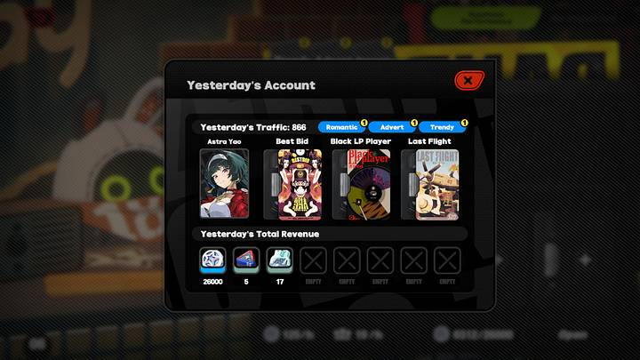

[Random Play：结果与收益面板图源](https://www.dbltap.com/guides/zenless-zone-zero-video-store-guide-how-to-manage-random-play) · 2025-06-06

“获得”样本用中部横向物品带、数量与名称展示奖励，下方只有一个确认动作；背景被压暗。Random Play 的收益弹窗把来源与收益分开，能看见物品行和关闭控件。它们都把“收到什么”集中为独立阅读单元。

### 原则

视觉成功只能在动作成功后出现。浏览预览不执行，执行失败不显示已获得；成功后提供明确去向。关闭成功反馈不应让玩家误以为还需再次领取。

### 基地建议

建议基地单项领取路径为“可领取→点领取→处理反馈→成功获得层→确认／关闭→原行已领取”。目前代码已存在仓库空间不足时拒绝整单领取的返回信息，参考板将它映射为清晰的失败提示，不改容量规则。保存成功时机仍要由后续实施核对现有命令返回。

### 具体细节

- 领取前看得到奖励预览与来源；无需重复弹出内容完全相同的“是否确认领取”再让玩家点一次。存在实际冲突时再显示对应说明。
- 点击后当前按钮暂时不可重复执行，状态写“领取中…”；只在动作真的有等待时显示处理态，立即完成的操作不人为拖长。
- 成功层先显示“已领取”，再显示物品、数量和去向。例如金币进入基地资源，卡牌进入后勤仓库，外观进入对应收藏。文案服从实际结果。
- “确认”只关闭成功层。关闭按钮或 Esc 同样返回原房间；已领取状态与计数在此之前应已与成功结果同步。
- 仓库不足时原奖励继续可领取，说明“仓库空间不足，奖励尚未领取”，给“查看后勤”或已有扩建入口；不要把物品弹成获得后再提示失败。
- 批量领取若以后被授权，只能按现有事务语义显示结果；部分成功时分别列已领取和未领取，不能用一个总成功标题遮住失败。
- 连续领多项时用一份清楚的汇总或轻反馈，避免每一项都打断浏览。奖励数量、来源与去向仍可查询。

## 11 六种领奖状态：同一行里让含义持续明确

状态样式应成为一套稳定词汇，玩家不用靠按钮亮度推理。

### 截图与观察

奖励截图可直接观察到未完成分组与已领取行；其余处理、失败和空态为我们的交互建议，未对绝区零动态实测。

### 原则

一个状态至少由文字＋一种视觉特征表达。色彩负责提高发现速度，文字负责消除歧义。状态变化改变操作能力，也应改变明确的提示。

### 基地建议

下表用于约束基地后续样板，不作为当前已实现清单。普通浏览、收款与不可逆的花费操作分别沿各自现有流程执行。

| 状态 | 玩家看到什么 | 动作与反馈 |
| --- | --- | --- |
| 未达成 | 目标、进度、奖励预览；“未达成”文字 | 不可领取；已有条件定位入口可用 |
| 可领取 | “可领取”＋局部强调；清楚的奖励数量 | 点击“领取奖励”执行，查看物品只预览 |
| 处理中 | “领取中…”；保留原行和奖励 | 当前动作防重复；以真实处理时间为准 |
| 已领取 | 勾＋“已领取”；保留来源与奖励记录 | 成功层已说明去向；不再执行同一奖励 |
| 领取失败 | 明确原因＋“尚未领取” | 奖励保留；提供现有处理入口或重试 |
| 当前无待领 | “当前没有待领取奖励” | 查看全部目标；不强制返回基地 |

### 具体细节

- 未达成与暂时领取失败不同：前者尚不满足条件；后者已经达成、奖励仍保留。两者不能共用一个“锁定”文案。
- 成功反馈出现时，原行与首页角标应同步。不要只更新弹窗，让玩家回来仍看见“待领取”。
- 可领取列表为空要说明“当前没有待领取奖励”，提供查看全部目标的已有入口；它是正常状态，不使用报错图形。
- 可领取列表里领取完最后一项后，保持所在收藏室，不强制跳回基地。给完成感，同时保留用户接下来浏览的自由。

## 12 收藏室：陈列感与目标清单各司其职

收藏室可以有珍藏的气氛，但“看已拥有的东西”和“找待领取奖励”要清楚分开。

### 截图与观察

[活动奖励清单与已领取状态图源](https://www.icy-veins.com/zenless-zone-zero/friendship-supervision-event) · 2024年活动样本

奖励页的类别、逐行目标与阶段展示各占一块区域，读者能区分记录列表与特殊展示。整页并不是把每个物品都放成相同大小的海报。

### 原则

展示类内容需要主物件与留白；完成目标需要密度适中的清单。共用房间入口，不代表共用完全相同的内容排布。

### 基地建议

沿现有收藏、成就、卡背、故事等内容分类：目标奖励使用清单；卡背使用网格与大预览；故事使用目录与正文。待领奖从首页定位，外观应用在详情区明确执行。

### 具体细节

- 目标行先给目标名与当前进度，奖励行紧随其后，动作在固定一端。不要把目标条件埋进鼠标悬停提示。
- 卡背缩略图表达外观与状态，详情展示完整图、名称、来源以及“应用卡背”。点缩略图只是预览，不立即更换当前使用项。
- 使用中、已解锁、未解锁三种状态持续可读；选中是浏览焦点，使用中是实际应用结果，两者分开。
- 未解锁外观仍可预览；详情显示现有条件和对应目标入口。不能只盖一把锁让玩家无从了解。
- 故事目录用章节名、摘要或阅读状态帮助定位；正文使用低纹理阅读面，结束后返回同一章的位置。
- 陈列背景、展柜与灯光在物件后面服务气氛；不要给每条成就清单做复杂金属框与反光玻璃。

## 13 后勤仓库：密集浏览，安静详情，动作靠近对象

仓库的效率来自“快速扫一组、稳定看一件”；不是把所有物品描述铺在网格下面。

### 截图与观察

[仓库：物品网格与详情图源](https://techwiser.com/all-zenless-zone-zero-icons-and-symbols-meaning-complete-guide/) · 2025-05-07

仓库样本将类别图标放在一侧，物品网格占主要浏览区，右侧详情包含名称、等级或属性和查看动作；顶栏显示资源，底部另有工具。选中对象与其他格子有明显差别。

### 原则

密度与深度分开：列表负责识别、数量与状态，详情负责说明与操作。选择只改变详情，不顺带使用、出售或搬动物品。

### 基地建议

后勤沿现有分类和大图能力组织：分类与工具保持稳定，中部卡牌或物品行承担浏览，详情只展示当前对象。当前新增大卡单排与仓库放大等他会话工作不在本轮调整范围，参考建议可供它们之后合并判断。

### 具体细节

- 每个浏览项最少保留图像、名称、数量、必要身份标签。卡牌费用、等级和选中标记分处不同位置，不让它们相互遮盖。
- 当前选中有明确边界或底色，悬停是轻强调，稀有度仍由原标记表达。多选如果现有功能支持，应另用勾选标记。
- 名称与数量在相同位置，长名合理换行；不要缩整张卡直到文字无法读。空格可以作为容量语义，但不能让大量装饰空格吞掉首屏。
- 详情顶部是名称与主图，接着是用途／实际说明，底部是当前可用动作。相关资源与条件放在动作附近。
- 大图预览是上层阅读体验，退出回到原对象、原分类与原滚动位置。预览里的关闭按钮不与房间返回混用。
- 筛选后没有结果说明当前筛选为空，给重置；仓库本来为空说明尚无物品。两个空态使用不同文案。
- 卖出、转移、消耗等操作沿现有规则确认和反馈；界面优化不能隐式改变批量数量、默认出售或物品去向。

## 14 交易所：商品有陈列感，交易有清楚账面

商店需要吸引人看物品，但价格、数量与确认结果要比装饰更明确。

### 截图与观察

[商店：分类与商品陈列图源](https://techwiser.com/all-zenless-zone-zero-icons-and-symbols-meaning-complete-guide/) · 2025-05-07

[Random Play：经营配置界面图源](https://www.dbltap.com/guides/zenless-zone-zero-video-store-guide-how-to-manage-random-play) · 2025-06-06

商店截图以左侧分类、右侧主题商品画面组织内容，商品标题和大价格出现在展示区，购买入口在下方；经营配置截图把工作人员、陈列对象与开启动作放在同一个操作面板中。

### 原则

商品图负责解释价值与身份，操作面负责解释交易。预览商品不扣资源；数量与总价必须在同一阅读范围内。

### 基地建议

保留已确认的商店背景。交易所的购买、出售与补给沿现有功能组织，不引入月卡、付费礼包、抽取或新的经济规则。参考只用于商品焦点、分类、价格与操作的编排。

### 具体细节

- 先显示买／卖的当前模式，再显示分类和商品。两种模式的标题与主按钮动词不同，避免玩家靠价格颜色猜。
- 选中商品后，详情展示完整图、名称、实际说明、库存或限购信息、单价、数量、总价和当前余额；其中不存在的字段不生造。
- 数量调节控件靠近总价，修改后总价立即变化。总价与持有资源用同一单位名称，不只摆两种无名图标。
- 余额不足时直接说明缺少哪种资源，购买按钮不可执行；已有获取入口可在附近出现，不跳出另一个无关推荐商品。
- 确认成功后同时反馈物品变化与资源变化。普通购买可用轻提示，实际结果不能仅靠一段粒子动画表达。
- 若需要确认弹窗，摘要只保留商品、数量、总花费和实际动作；主按钮写“确认购买”或“确认出售”，不写无信息的“确定”。

## 15 建设：把当前、变化和材料放进同一条视线

设施页让玩家先看见对象与升级后的变化，再判断条件是否满足。

### 截图与观察

[Random Play：经营配置界面图源](https://www.dbltap.com/guides/zenless-zone-zero-video-store-guide-how-to-manage-random-play) · 2025-06-06

经营配置样本把当前对象、附加结果和操作放在一个有秩序的面板上；背景仍保持地点连续。可以借鉴它把“正在配置什么”和“执行入口”收在同一处的组织方式。

### 原则

有前后变化的操作，需要明确的对照。材料条件服务当前对象，不能让玩家在顶部资源串与底部按钮之间来回算。

### 基地建议

现有建设页已有设施选择、当前与扩建后容量、所需材料、不可操作原因和补充材料入口。后续重点是提升它们的视觉联系与阅读顺序，不新增设施数值、工期或生产逻辑。

### 具体细节

- 左侧设施列表用名称、小示意图与当前状态；选中一个后右侧只处理该设施。未选中设施的数值不占当前详情的主要层级。
- 详情首部展示设施身份，接着用“当前 → 扩建后”做紧邻对照；改变的数值有标签和单位，箭头只表达变化。
- 材料行同时列名称、持有和需要；不足项附“缺少…”文字，足够项保持安静。不能只把不足数字变红。
- 主按钮固定在详情底部，写“确认扩建”；条件不够时显示实际缺口，达到上限时显示“建设完成”。
- 扩建成功后优先更新当前容量与材料余额，再播放克制的完成反馈；保留当前设施，便于玩家继续查看。
- 设施图使用我们现代模块化基地语言，可借用已有素材或示意图。禁止为表现建设把房间改成中世纪木门、石柱或城堡。

## 16 人物配置：形象完整，身份稳定，浏览与应用分开

人物页的主角是人；文字与按钮应围绕轮廓留位，而不是把人物当装饰背景。

### 截图与观察

[人物：身份图像与浏览选择图源](https://techwiser.com/all-zenless-zone-zero-icons-and-symbols-meaning-complete-guide/) · 2025-05-07

人物样本左侧展示大人物形象，右侧用肖像阵列切换对象；名称与身份信息靠近人物，局部信息入口较小。被选中的肖像清楚突出，未拥有对象仍以不同状态保留在列表里。

### 原则

人物识别依赖完整的脸、发型、服装轮廓与关键道具。人物色属于身份，不替代全局的按钮与成功颜色。浏览、预览与实际应用分别有明确状态。

### 基地建议

配置页沿五位人物的既有形象和比例。无当前立绘与块面厚涂画法是我们的人物基准；不借绝区零立绘修改人设。人物、伙伴、外观等现有内容可以共享选择与详情逻辑，展示主体仍分别处理。

### 具体细节

- 主图给脸、发束、手势和武器安全区。按源图实际横竖比例选择裁切方式，不把所有人物硬塞进同一等高窄竖框。
- 人物名与当前身份放在安静面上，避免穿过头发、手指或武器。人物亮部与正文亮部之间保留清楚边界。
- 肖像列表只负责切换当前浏览人物；实际出征人物或外观应用有单独状态和动作。浏览选中不等于自动更换。
- 外观预览说明“预览中／当前使用／未解锁”，应用成功再改变使用标记。把锁与条件一起呈现，不只遮住图像。
- 人物身份色局部出现在名字签、肖像边或小标记，全页的操作语义仍一致。不要每换一个人物就把购买与领取主色全部换掉。
- 人物页的动效以焦点切换和已有待机素材为主；没有正式素材时，不为了参考效果强加晃动的分件动画。

## 17 照相馆与庭院：让作品和空间成为阅读中心

展示与休息页面可以少一点信息密度；必要工具清楚可用，就不必再填一层事务卡。

### 截图与观察

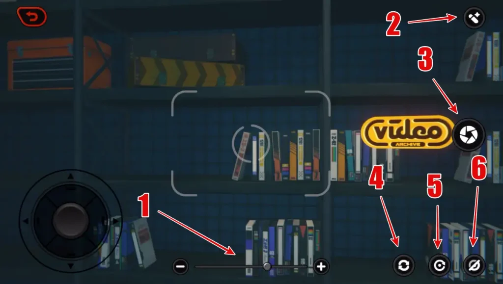

[摄影：视景中心与边缘工具图源](https://techwiser.com/all-zenless-zone-zero-icons-and-symbols-meaning-complete-guide/) · 2025-05-07

[Random Play：生活空间与功能设施图源](https://www.dbltap.com/guides/zenless-zone-zero-video-store-guide-how-to-manage-random-play) · 2025-06-06

摄影样本把取景中心留给场景，变焦、拍摄、滤镜等控件位于边缘；Random Play 的空间图则由环境与物件本身提供观看内容。画面没有被同等重要的文字块切成均匀格子。

### 原则

工具沿边缘组织，中心留给被观看对象；状态只解释当前选择。页面可以有气氛与留白，不需要每一处都放指标或操作。

### 基地建议

照相馆保留作品大图、装裱和已有浏览能力；庭院保留已有空间与对象互动。我们不是把照相馆改为绝区零拍照玩法，而是借鉴中心展示和边缘工具的关系。

### 具体细节

- 作品保持原比例与构图焦点，缩略图负责切换，装裱只围绕作品边缘。名称、来源和应用状态在旁侧可读，不烘焙在作品里。
- 放大时减少房间装饰与多余操作，只保留当前作品、名称和关闭；退出回到原缩略图位置。
- 工具分组为浏览、展示或现有应用功能，各组有短中文标签。已有单一功能不额外加无意义下拉框。
- 庭院可互动对象在靠近或选中时出现短标签与动词；基础入口仍明确，不能只有发现式悬停才知道可以操作。
- 静态庭院与慢环境动效控制在背景层。重要提示出现时环境后退，不用持续闪烁吸引玩家。
- 已确认的素材和其他会话的装饰整改不在本轮改动；这一页只给之后做取舍的视觉原则。

## 18 返回逻辑：关最近一层，回到刚才那一件

基地用起来顺不顺，常常取决于返回之后是否仍在原对象、原分类、原滚动位置。

### 截图与观察

[更多菜单：低频功能收纳图源](https://techwiser.com/all-zenless-zone-zero-icons-and-symbols-meaning-complete-guide/) · 2025-05-07

[消息：联系人与会话两栏图源](https://techwiser.com/all-zenless-zone-zero-icons-and-symbols-meaning-complete-guide/) · 2025-05-07

更多与消息截图都以覆盖面板承载局部任务，消息面板右上可见关闭控件。截图只能说明关闭入口存在，不能证明实际 Esc 顺序或滚动恢复；以下返回契约是我们应采用的建议。

### 原则

空间导航、内容切换与弹层关闭是三种层级不同的动作。用户的浏览位置属于任务上下文，应在短暂离开后保留。

### 基地建议

底栏跨房间切换；页内分类在当前房间切换；大图、物品详情和确认弹窗逐层返回。来自首页待领奖的定位，与用户普通进入收藏室的默认位置分别处理。

### 具体细节

- 点击关闭或 Esc 先关闭最上层：奖励详情→奖励列表→房间。不得一次退到基地首页，丢掉刚才的目标。
- 顶栏“返回”与弹层“关闭”标签不同。所在房间和当前对象一直可识别，面包屑只在确实有深层结构时使用。
- 详情返回恢复分类、筛选、选中项与滚动；键盘焦点返回触发详情的控件。领取状态发生变化时，优先给用户可理解的邻近位置。
- 同一房间的工具不放到底栏，房间导航不混进物品详情的按钮组。导航说明去哪里，工具说明对当前对象做什么。
- 直接浏览不额外确认；存在未保存编辑时按现有编辑规则提示。确认提示必须指出哪一项会丢失，不使用泛化“操作可能有风险”。
- 重要成功结果关闭后仍有记录；普通导航不弹出“是否离开”反复阻拦。

## 19 动效：用移动解释关系，用短反馈确认动作

动作要让玩家看懂“从哪里来、变成什么、现在可以继续做什么”。

### 截图与观察

本参考板没有亲玩或逐帧录制绝区零；截图无法证明其动画时长、缓动曲线、音效和动态返回行为。下面的编排与时间范围全部是我们的候选起点。

### 原则

信息先可读，反馈后完成；局部选择用局部变化，房间切换保留空间关系。动效不能延长规则锁或遮住本应已经可用的动作。

### 基地建议

沿基地现有动效实现，之后可统一状态编排：选中对象→详情变化→主动作状态更新；领取执行成功→奖励可读→原行与角标更新；跨房间切换→新房间标题与焦点到位。

### 具体细节

- 选择反馈候选80–140ms；局部面板切换160–240ms；奖励呈现180–300ms。它们是样板建议，需按当前窗口和现有实现调整，不是参考游戏测量值。
- 选择一个物品只改变其轮廓与详情，不让整页缩放。进入详情可由对象附近展开，退出沿同方向收回，帮助保留位置感。
- 跨房间变化保留底栏和顶栏的稳定；新背景就绪后再让主体内容进入，避免先露空白或旧房间内容。
- 奖励物品可轻微错开出现，但标题和动作先有清楚位置；大量奖励不逐个拖长播放，用户可以及时关闭。
- 环境待机、粒子、反光和人物动作从属于主任务。打开阅读或确认层时降低干扰，不让背景持续在文字后高对比运动。
- 操作音可以区分选择、执行成功和拒绝；普通悬停不必每次响。这里是声画配合建议，不描述绝区零实际音效。
- 减少动态偏好下取消大幅移动、摇晃和闪烁，保留文字、选中状态和成功反馈。所有重要含义无需等待动画结束才能理解。

## 20 可复用的组件细节：状态、按钮、提示与空态

先统一高频组件的语义，再给每间房间增加自己的美术身份。

### 截图与观察

所选截图反复出现清楚的返回、分类选择、对象列表、独立详情、状态文字和确认动作。具体实现方式与当前游戏是否完全一致，需要实施阶段查现有组件。

### 原则

同样的动作使用同样的语义和位置；不同的动作不要只用颜色区别。完整的空态、禁用原因和错误反馈也是界面设计的一部分。

### 基地建议

优先统一事务行、分类导航、对象详情、领取状态、购买摘要、材料行、空态与结果层。颜色与尺寸采用我们的候选范围，保留已有正式卡框、立绘和规则。

| 组件 | 建议规格／候选起点 | 语义 |
| --- | --- | --- |
| 主要按钮 | 暖金填充，深色文字；主标签14–16px | 当前主要执行动作；一组一个 |
| 次级按钮 | 石墨或透明底，浅灰文字与清楚边界 | 取消、查看、返回和低频操作 |
| 对象选中 | 清楚边界或低面积底色＋选中标记 | 表示当前浏览对象，不表示已应用 |
| 身份／稀有度 | 既有图标、角标与局部身份色 | 与可领取、成功、选中分开 |
| 事务行 | 图标、短标题、对象/计数、箭头 | 整行进入现有对应内容 |
| 材料行 | 名称｜持有｜需要｜不足说明 | 阻止执行的原因在动作附近 |
| 成功层 | 标题、物品、数量、去向、一个关闭动作 | 成功发生后展示；确认只关闭 |
| 空态 | 准确标题、短原因、一个有关入口 | 区分无内容、无筛选结果、无待领 |
| 候选色板 | 石墨#171D24、文字#E9EDF1、次字#ACB5BF、冷青#7EADB8、暖金#D6B071 | 用于我们的样板；非绝区零官方色值 |
| 状态补色 | 成功#75B59A、错误#D28D86；同时给文字与图标 | 不用红绿承担唯一信息 |

### 具体细节

- 一组操作只有一个主要动作，其余使用次级或文字按钮。“关闭”和“返回”通常低于“领取”“购买”“应用”的强调度。
- 按钮写具体动词＋对象：“领取奖励”“确认扩建”“应用卡背”“查看后勤”；成功后改成具体状态：“已领取”“当前使用”。
- 普通提示靠近触发位置；阻止执行的原因靠近主按钮；跨页通知才进入首页事务。避免同一消息同时弹横幅、弹窗与角标。
- 正文的阅读面不透明或足够稳定；模糊作为前后层分隔，不能把价格和规则放在高亮图案后再靠描边补救。
- 鼠标、触摸与键盘都能找到操作。关键控件有中文标签，焦点可见，触摸目标可作为44px左右的样板起点。
- 新内容只表示首次出现，待领取只表示可执行且尚未领取。看到新物品和领取奖励分别清除各自标记。

## 21 基地改造的借鉴顺序与验收标准

最先借鉴首页秩序、浏览与详情分区、领奖闭环；再完善事件容器与各房间的美术身份。

### 截图与观察

十四张样本用于说明视觉组织与静态状态；它们来自不同年份和页面，不构成2026年当前版本的完整复原。原图里已有的红色数字箭头属于图源作者标注。

### 原则

按使用价值筛选，不按参考游戏系统数量复制。每项借鉴都要能回答它改善哪一个现有基地动作，并有可见的完成标准。

### 基地建议

本轮交付是参考资料与局部交互演示，未改游戏。候选方案应在后续明确实施范围后核对当前界面和他人属地，再进入样板与正式接入。

| 基地入口／内容 | 可借鉴部分 | 验收问题 |
| --- | --- | --- |
| 基地首页 | 大场景、边缘导航、紧凑事务、单一主动作 | 事务增减时入口与整备按钮是否仍稳定？ |
| 配置／人物 | 完整形象、身份签、浏览与应用分开 | 脸、手和道具是否被挡？预览会否误应用？ |
| 后勤 | 分类、浏览网格/行、稳定详情、返回恢复 | 长清单是否挤走动作？关闭大图回哪件？ |
| 交易所 | 商品焦点、价格数量总价、明确确认摘要 | 玩家是否一眼知道买还是卖、花费多少？ |
| 收藏室 | 目标清单、外观陈列、领取状态与结果层 | 可领取、已领取、使用中是否彼此分开？ |
| 建设 | 设施选择、前后对照、材料与按钮邻接 | 缺少何物、为什么不可扩建是否清楚？ |
| 庭院 | 空间留白、生活物件、局部互动提示 | 不互动时也好看，想互动时入口明确吗？ |
| 照相馆 | 中心作品、边缘工具、完整比例、大图回原位 | 装饰是否抢作品？放大关闭是否丢位置？ |
| 已有基地事件 | 事务行／会话卡／主题页的体量选择 | 是谁、在哪里、现在能做什么是否清楚？ |

### 具体细节

- 第一批：首页七入口位置稳定；事务与主动作分层；后勤、交易、建设和收藏使用稳定浏览与详情分区。
- 第二批：收藏和成就的单项领取闭环；仓库不足说明；详情关闭后的原位置恢复；计数与已领取状态一致。
- 第三批：已有人物事件与主题内容按体量选容器；人物与照相馆的形象安全区；庭院和各房间的生活感与材料统一。
- 视觉验收：当前窗口能读清名称、价格、数量与缺口；人物和作品焦点完整；每页能立即定位主动作。
- 交互验收：选中不误执行；取消不改变结果；成功有去向；失败保留未领取；返回不丢失上下文；各处同一计数同步。
- 动态验收：内容先可读；常用操作不被装饰性过场锁住；大图关闭回原对象；减少动态模式仍有完整状态反馈。
- 范围控制：不借鉴抽取、付费礼包、每日任务压力、战斗与养成数值、3D城市移动等机制；不把荧光色、涂鸦和故障屏无差别铺满基地。

## 图源与当前依据

图源、原始图片路径、尺寸、字节和SHA256见 [sources.json](sources.json)。当前基地核对与交付验证见 [README](README.md)。局部事件和领奖演示位于图文板，只影响演示变量。
