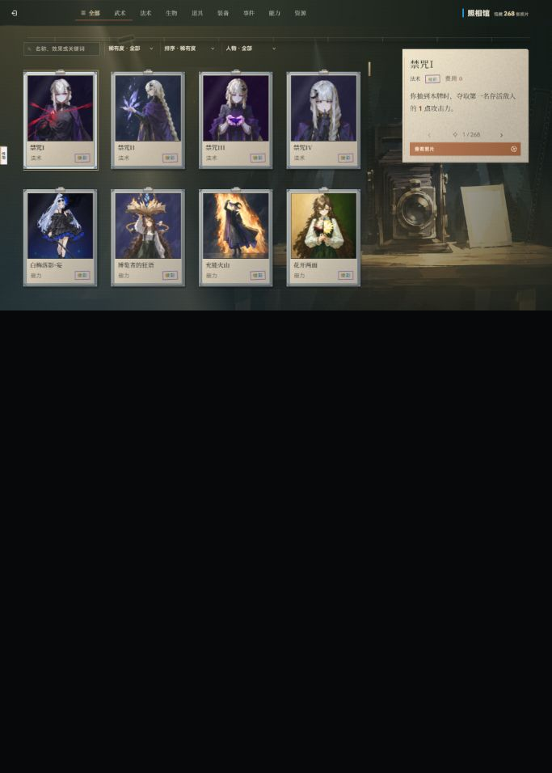

# 照相馆布局读取优化与同窗口对照

本轮已减少照相馆打开与分类切换的同步布局读取，保留页面排版、卡面、分类标记和网格入场动画。最终同条件样本中，打开页面的中位响应耗时下降 22.7%，两个方向分类切换下降 13.7% / 12.9%；样本波动较大，长任务次数未稳定下降，不宣称帧率提升或每次都达到这个比例。

## 实现

- `game.cardslib.page.js` 在更换网格 DOM 和样式前读取宽度并准备离场快照；入场动画复用该宽度，保留原有 clamp 距离、opacity、时长与缓动。
- 分类标记同一帧合并更新，先读所有尺寸再写标记；换选复用已测标签几何，ResizeObserver、窗口 resize 或新节点出现时重新测量。页面关闭取消排队任务并释放几何缓存，旧回调不能修改已释放页面。
- 当前库无 `.bump` 样式，旧计数状态只产生强制 offsetWidth 读取；去掉该状态重启和读取，继续同步数量文本。没有新增数字动画。
- `_checkPageBg` 读到的照相馆首个 data-asset-key 是背景为 none 的卡牌 IMG；仅该页面的 IMG 提前返回，卡牌加载继续由原美术队列负责。房间 CSS 背景的加载、失败和取消检测保留。
- 本轮四个游戏模块、三个测试文件和 performance 文档为自有修改。`expedition-library.css` 有其他会话未提交修改，本轮未编辑；其中旧 .bump 说明不代表现行样式存在。

## 同条件结果

| 操作 | 旧版中位 ms（10次） | 新版中位 ms（5次） | 本组下降 |
| --- | ---: | ---: | ---: |
| 从标题打开照相馆 | 198.2 | 153.3 | 22.7% |
| 全部 → 武术 | 122.9 | 106.1 | 13.7% |
| 武术 → 全部 | 144.9 | 126.2 | 12.9% |

指标是**真实按钮输入 → DOM 更新后的两个 rAF 回调**，不是屏幕实际呈现时刻、动画全部结束时间或 FPS。每轮打开后进行两方向切换再关闭；先预热模块、两种分类和当前图片解码，再各做五轮。最终顺序为旧版五轮、新版五轮、旧版回测五轮，全部有效旧版轮次合并，不挑选最快数据；不是随机交错实验或统计显著性证明。

当前同一个 Codex 内置浏览器标签页、当前窗口 CSS 683×956、DPR 1.25；导航默认 DPR 曾改变，因此最终用支持的 CDP 仅固定当前尺寸和 DPR。每次输入分别记录这三项，汇总脚本按 1e-6 精度验证全部一致。没有测试第二个窗口尺寸。

前两组数据出现 DPR 1.25/1.5 不一致，保留原始文件但排除；`after-fixed` 是中间实现诊断样本，未用于最终结果。修改前端点 5307 用 Vite load 插件返回事先保存的四个旧模块原文，其他源码/CSS/数据/资源/配置仍来自相同工作树；优化版为 5200。旧版实际请求代码包含原始同步读取，未回滚共享源码。端口不同造成 HTTP/模块缓存入口不同，预热降低此差异，不能将结果当作受控实验室结论。

打开耗时旧版范围 113.6–278.8 ms、新版 129.7–242.4 ms；全部→武术旧版 69.8–152.6 ms、新版 93.8–126.8 ms；武术→全部旧版 80.8–276.4 ms、新版 101.0–168.7 ms。范围重叠且有系统波动，应以原始数据和后续实际体验一起判断收益。

新版分类切换不再记录超过 1 ms 的旧计数 offsetWidth、入场 clientWidth 或 marker offsetWidth；仅一次瓦片占位高度读取为 1.1 ms。背景检查也降到约 0–0.1 ms。打开时仍需读取瓦片高度以保持 content-visibility 占位准确，本次保留。

长任务观察覆盖整个批次：旧版 30 次动作记录 40 条、新版 15 次动作记录 24 条，含动作之间的动画/其他页面任务，数量没有改善。不能把局部同步读减少等同于消除所有主线程长任务。

## 视觉与交互

前后截屏人工核对：当前窗口的卡格、人物图片、分类栏和选片栏布局保持一致；环境动效相位不同，未声称像素逐点相同。采集的网格 WAAPI 参数完全匹配：从 -160 px 淡入至 0，duration 360 ms，easing cubic-bezier(.22,1,.36,1)，fill backwards。本窗口 clamp 达到 160 px；单测另检查 500 px 网格仍为原来的 90 px 入场距离。

实际键盘 ArrowRight 从全部切到武术，标记 x=352、y=69、width=106，与当前标签测量一致，仅一个 aria-selected=true；Home 返回全部。大图与背签打开、Esc 收回已核对。搜索与关闭结果另记 browser-checks.json。

## 验证与现场

- 第一版相关 17 套 / 187 项通过；最后尺寸缓存调整后，相关 8 套 / 73 项重新通过（包含新增缓存刷新契约），其他模块输入未再改动。
- 全项目语法检查 408 文件通过；项目所有 typecheck 配置通过；本轮七个源码/测试文件 ESLint 通过；自有 diff whitespace 检查通过。
- 新测试覆盖同帧合并、最新选中态、尺寸变化刷新、关闭取消及迟到回调、保持动画参数且不读重绘后宽度、照相馆 IMG 跳过背景样式读取与真实房间背景检测保留。
- 没有 build、全量测试、提交或推送，不据定向结果宣称全场通过。
- 缓存包含旧模块原文、测量脚本与原始数据。证据清单记录相对路径与 SHA256；超过 1 MB 的文件仅保留缓存并登记。本次新建基线服务曾以 PID26812 启动，确认身份后换成独立 Vite 缓存重启为 PID20588；收官状态见 cleanup.json。主线 5200 未由本会话停止。
- 初次重载在就绪前点击未打开页面，未进入样本；大图收回后的搜索首次输入遭浏览器工具焦点校验拒绝，按新的页面状态重试。这些工具失败不算性能样本。

任务开始于 2026-10-14、收尾于 2026-10-15。原始批次/截图/测试日志/最终源码指纹见 artifact-manifest.json。完成未提交，后续若需要确认生产包、其他设备/窗口或更大样本需另做验证。
