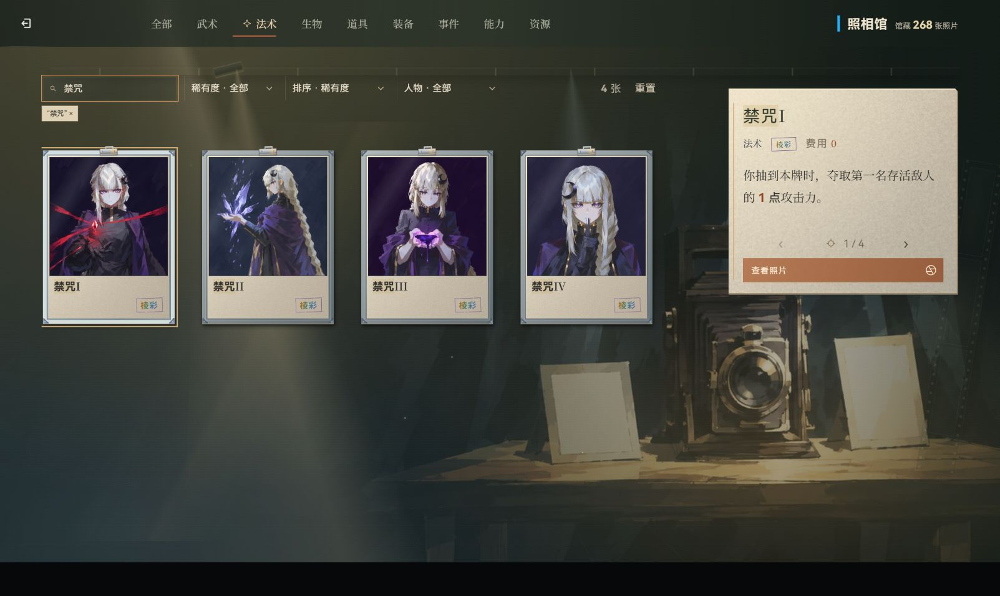

# 公共渲染性能优化（2026-10-16）

本轮减少全局图标转换、DOM 扫描和图片重复解码的开销，并清理 8 个样式文件的退役浮动背包按钮与同文件失效声明。玩法与美术设计未更改；没有物理删除文件、增加依赖、构建或提交。既有未提交改动保留。

## 改动和量化结果

| 路径 | 实现与证据 |
| --- | --- |
| `game/src/core/icons-bitmap.js`、`icon-hydration.js` | 无图标字符串直接返回；标签变动只清理目标元素；普通数字文本不扫描；批量子树按祖先关系合并，取消两两 `contains` 比较 |
| `game/src/core/art.js`、`image-decode.js` | 同一图片/源只登记一次加载、解码和补绘；换源淘汰旧回调；失败和脱离文档可重试；补绘恢复原内联 visibility 和优先级 |
| `game/css/` 下 8 文件 | 移除退役 `#bagBtnFloat` 的选择器、满载动画和 11 条被后续同选择器覆盖的声明；保留同规则浏览器兼容回退与独立宿主仍用的基础 CSS。精确路径、删除文本、前后 SHA 见 [CSS 清单](css-cleanup.json) |
| `scripts/css-redundancy-audit.mjs` | 复用 Vite 自带 PostCSS，只读扫描 130 个 CSS 文件；`--entry` 按入口加载顺序列出跨文件候选，须另核对条件/宿主/支持情况后处理 |

当前 Codex 内置浏览器的合成微基准：每轮 15,000 次无图标富文本转换，旧/新交替 7 轮，中位 **53.1ms → 9.1ms，减少 82.9%**。同一真实图片重复请求解码 20 次，实际解码 1 次，图标新增转换与标签清理通过。数据见 [浏览器微基准](browser-benchmark.json)，可用本目录 `browser-benchmark.html` 从 Vite 的 `/@fs/` 入口复现。该独立基准页使用工具自动分配的 1280×720、DPR 1.5，未设置尺寸覆盖。

Node/vm + jsdom 同条件对照中，400 个兄弟子树的两两 contains 从 159,600 次变为 0；400 个普通文字更新或属性更新的文本遍历从 400 次变为 0。7 轮字符串基准中位 64.50ms → 13.33ms，减少 79.3%。[原始报告](benchmark.json)由 `node docs/evidence/2026-10-16-runtime-perf/benchmark-runtime.mjs` 复现。基线固定为 `a330d25f47`，本轮接手时两核心文件相对该版本无差异；报告保存源码 SHA。

以上数字只说明这些入口的局部 CPU 和重复工作变化，不代表整局 FPS、首屏加载或完整构建包体的提升。

## 验证

- 最终定向 Vitest：10 文件、116 项通过，详见 [机器报告](tests.json)。覆盖图标安全转义与批量新增、解码生命周期、现有美术预热、照相馆队列、战斗手牌、远征视图及契约/架构边界。
- 419 个源码文件语法检查、8 套类型配置检查、修改源码/脚本/测试定向 ESLint、自有 diff 检查通过。最终文档检查通过（469 个链接）；台账现有一处规则复述提示非阻断，本轮未改该他属条目。
- [内置浏览器实页](browser-verification.json)：当前窗口 1603×956；真实打开照相馆、切到法术、搜索“禁咒”，结果 4 张，4 张 448px 缩略图均 complete 且 naturalWidth > 0，游戏 error 日志为空。图片见下方。
- [声明支持检查](css-supports.json)：11 条保留声明全部被当前浏览器支持。同文件无条件、相同选择器/属性/优先级的后置声明胜出；条件块未自动合并。
- [首页计算样式](title-style-comparison.json)：24 个元素的颜色、字体、显示方式、定位与圆角一致；宽高存在最大 0.033 CSS px 舍入差。采样期间工具自动 DPR 从 1.25 变为 1.5，因此不作为严格同 DPR 像素 A/B，通过结论限于上述属性及实页观感。未主动设置视口或做多尺寸测试。

## 未核项与交接

扩展运行 `tests/battle-entry-view.test.js` 有 4 项失败：三处期望背景 world 中有 3 个图层，当前战斗实装为 2 个；一处期望旧失败提示 warning，当前未触发。该测试第 25 行将 `Art.decodeIn`、`Icons.rich` 用空桩/独立函数替换，不执行本轮优化实现。战斗源码由活跃任务维护，本轮未改测试预期或相关源码；这些失败不计入通过项，交由战斗任务协调。

未运行混树生产构建、游戏全量测试、战斗真实开局、奖励领取实玩或远端 CI。跨 CSS 文件的其余覆盖候选与战斗活跃样式保持原状；`#bagBtn` 仍被 `game/dev.html` 使用，未清理。启动预取全量美术的既定策略保留，未承诺减少下载量。

本轮仅复用已有 5200 服务，未创建/终止服务；自建两个浏览器验证标签页已关闭。没有暂存、提交、推送或改写他人工作。完成源码指纹见 [清单](source-fingerprints.json)；已释放编辑占用，提交者应按实时树和现行门禁重新核对。`cleanup-css.mjs` 是本次操作记录，已有清单时拒绝再次执行，避免重写证据。
