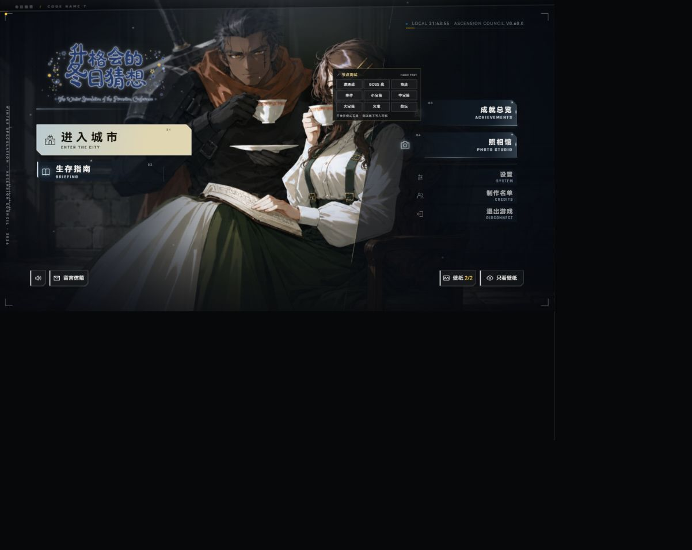

# 首页音量与留言入口

2026-10-18，Friday / 01a14f3b。老板最终要求恢复原版，只增加玻璃模糊。

最终实现限定在 `game/css/home-polish.css`：只将音量与留言入口填充层的背景模糊从8px提高至18px，原饱和度.75不变。首轮尺寸、间距、圆角、配色、描边与悬停修改全部撤回；原版侧条、切角、图标和行为恢复。

最终验证：`npm run test:target -- tests/css-asset-minification.test.js` 7项通过，目标diff检查通过。Codex内置浏览器 `http://localhost:5200/` 当前1202×956窗口实页核对：56设计px高度、0圆角、原白侧条与深底、填充伪元素恢复，背景模糊为18px。首轮真实静音切换与信箱打开/返回通过；最终仅CSS模糊属性变化，未重复交互。没有改窗口尺寸，未用构造事件。

首轮被否定的外观截图 `home.png` 仅作历史保留。

验证范围为两入口样式与原交互；未运行全量测试或构建，未提交。没有新服务，既有5200保留。
