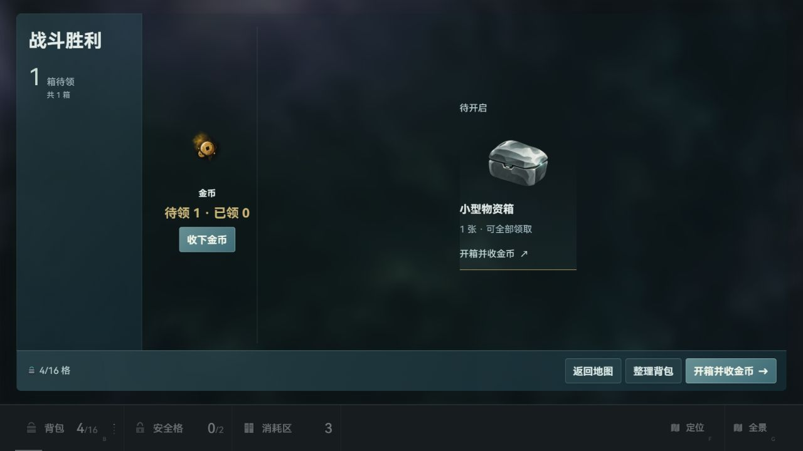
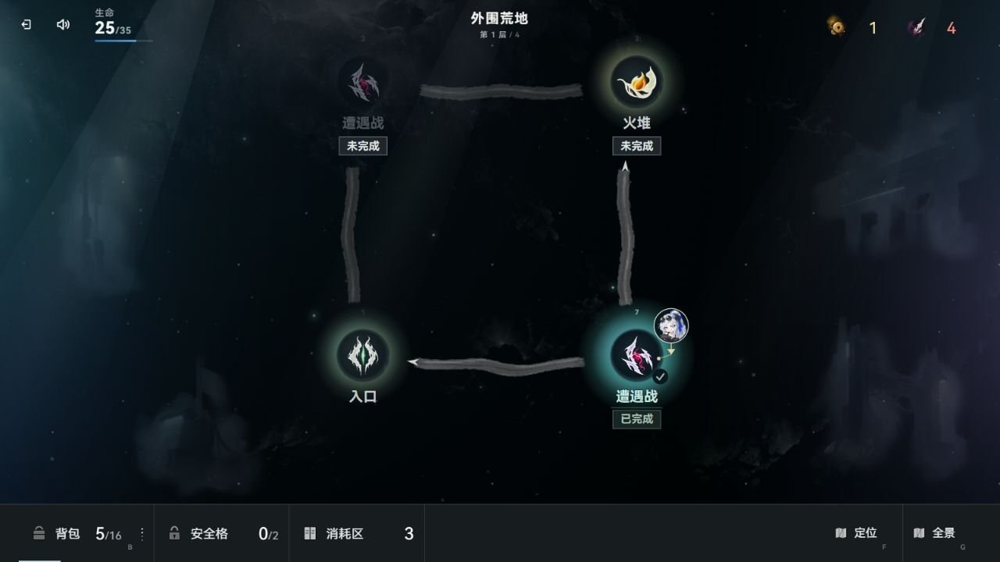

# 卡牌、状态效果与战斗时点统一

本轮范围已完成，代码保留为完成未提交。现有支持路径统一为结构化声明优先、旧文本按尚未迁移的域兼容、同一效果只执行一次、状态与伤害共用边界。相关 18 文件 313 项测试通过；最终全量 7034 项通过、4 项既有美术指纹失败、37 项跳过，未标记为全量通过。

未增加卡牌、状态类型、数值或存档版本；尚未支持的参数组合继续在执行前拒绝。

## 实现覆盖

| 范围 | 当前实现 |
| --- | --- |
| 公共声明 | `cards/card-trigger-contract.js` 统一 11 个触发时点及声明存在性；执行、schema、能力检查共用 |
| 打出效果 | 结构化操作按声明顺序执行；显式空 onPlay、关闭 keepInHand、replay 等不回放冲突旧描述 |
| 获取 / 抽到 / 消耗 | 当事卡直调；空声明有权威；获取递归保护只占当前调用栈，不污染实体；临时牌与入库使用同一获取入口 |
| 回合开始 / 结束 | runner 登记与普通、额外回合接线；延迟任务使用固定批次，执行期间新增任务不丢失、不提前兑现 |
| 开战 / 装备 | 装备开战、穿戴、主动技能、被动分别拥有各自字段域；合成执行视图与全卡预检共用规则 |
| 击杀 / 受伤 / 打牌 / 冰冻 | 同一 runner 派发；持续次数执行前预留，同点嵌套不重复领取；冰冻只广播实际敌人；随从及毒杀末敌先兑现本次收益 |
| 沉默 | 旧文本抽到、消耗、延迟、被注能触发使用同一门；前置条件仍检查，仅伤害步骤可执行；既定神秘药水延迟产卡例外保留 |
| 伤害边界 | 文本及结构化共用庇护、元素庇幕、心数换算与伤害记录；准备数值不重复加成，敌人互殴保留敌方身份 |
| 状态边界 | 负伤害不反增防御；零层中毒翻倍仍为零；旧神秘药水回复遵守禁疗；随从计时状态到期且真实造成伤害破自身潜行 |
| 生命周期 | 固定事件快照、持续次数、取消与换局失效、开战清零；正式存档仍恢复入场检查点 |
| 玩家说明 | 开战装备说明遵守显式空规则；闪避解释与四类伤害公式一致 |
| 卡库同步工具 | 源码沙箱按依赖先加载公共触发契约，schema 与能力检查可复用新公共声明 |

## 验证记录

前一阶段的 `trigger-regression.log`、`structured-regression.log`、`types.log`、`static.log` 只证明首批修复，不能覆盖本次整体改造。老板要求整体实施完成后集中测试；本次新增测试在实现阶段只编写、未执行。

| 检查 | 结果与证据 |
| --- | --- |
| 语法、数据与类型 | 512 个项目文件语法通过；数据校验通过；8 项类型配置通过，见 `unified-static-final.log` |
| ESLint 与空白 | 本轮源码、同步脚本及新增/调整测试定向 lint 通过；最后两份夹具补丁另补 lint，通过；相关 diff 空白检查通过 |
| 定向集中回归 | 18 文件、313 项全部通过，见 [定向报告](2026-10-20T10-40-54.126Z-17af194b.json) |
| 最终完整 Vitest | 684 文件中 682 通过、2 失败；7075 项中 7034 通过、4 失败、37 跳过，见 [全量报告](2026-10-20T10-41-21.127Z-3445ea7c.json)；完整套件不包含静态门，静态结果另列 |
| 文档 | 收官登记后 `docs:check` 通过，637 条相对链接无发现，见 `docs-check-final.log` |
| 当前窗口实页 | Codex 内置浏览器 1280×720、真实 UI 输入完成首战、领奖、返回地图；后续恢复测试档成功；页面 error 日志为空，见 [实页记录](browser-observations.json) |

首轮完整套件为 16 文件失败、57 项失败。已修复本轮暴露的正午决战延迟四枪重复结算、火焰形态辅助登记遗漏、搜索大宝箱既定牌库底行为丢失及同步沙箱依赖缺失；新增测试初始化和夹具随实际契约修正。装备非法规则如今在动作入队前同步拒绝，测试保留具体字段诊断、零入队、零效果、零次数消耗断言。

定向通过报告与最终全量报告的代码指纹均为 `7cc48756f0a6e15a3f9388b6dce96db851336817c59ae353e3a7521b7dfdd8dd`；两轮运行期间代码均未变化。

### 仍失败的范围外检查

`retired-scenes-publication.test.js` 的 1 项与 `runtime-asset-redundancy.test.js` 的 3 项共同依赖既有 `game/data/art-mapping.json` 指纹。审查脚本预期 `7d58a3687c73d138279b086d7697e4c59047c89b735dad77acd06b003acb0f99`，现场为 `adf66b658d5d7af8568d62b6c20c59cf046c75ea2e7a97999371e1941e98a17f`，因此资源审查按设计保留对应素材，数量及排除断言随之失败。

只读复核确认：该映射在开场已经修改，diff 为其他属地的 13 张 TT13 卡图引用及版本；首轮检查前后映射与审查脚本指纹一致，最终失败中的实际映射指纹也相同。本轮两个说明文件不在该指纹依赖中，未出现新增资源消费者告警。本任务未改写美术映射、资源审查基线或这两份测试。

### 覆盖边界

本轮完成项目现有支持机制的整理，不是把所有旧卡内容批量迁成 DSL。`transform`、容器类操作及未定义的部分参数组合仍显式拒绝；没有通过新增猜测行为扩大支持范围。

37 项跳过不算通过。实页只覆盖当前窗口的代表流程，其余边界依据自动回归；未声明逐卡、全部时点实玩覆盖。未对混合工作树执行 build，未运行远端 CI。

## 工作区与资源

主会话 Friday 统一登记，两个实施子代理按触发调度与结构化执行分工，第三子代理只读交叉复核。既有奖励、背包、美术及流程工具改动保持各自归属，不纳入本任务。

实页使用本会话创建的独立 Vite 服务：工作目录 `D:/素材/代号柒/搜打撤`，端口 `5317`，创建时 PID `14352`。原 `5200` 服务及 `5317` 来源已有档位 01、05 未作验收写入；通过真实界面在原空档位 02 建立本轮测试档，完成后保留该档。自建服务已核对命令身份后停止，随后确认进程与 5317 监听均不存在，原 5200/PID492 仍在，见 [释放记录](service-close.json)。

未构建、未提交、未推送；其他属地的完成未提交改动保持现场。
