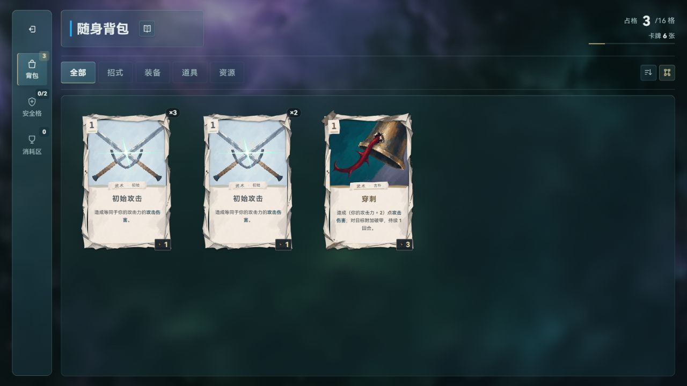

# 框架修复与优化

本轮修复出征扣仓与首次对局保存之间的损失窗口，统一生产启动入口，收敛战斗服务依赖、后备能源执行来源与页面动效归属。老板授权三个子代理并行，Friday 集成；保留开场未提交内容，未提交、推送或构建。

## 已交付行为

- `newRun()` 统一返回 Promise，持久档位在同槽 Web Lock 内提交扣仓后的 Base 与首份 Run。先隔离规划，完成持久提交后才发布新局、音效和页面。失败返回 false，原内存和随机流保留；已开始的 journal 可重试或重新选档恢复同一次出征，不重复扣卡。
- 写 journal 前复核 Base/Run 原串。等待锁期间取消、换档或上下文失效会拒绝请求；双击复用一次出征。无 slot 开发测试局只做纯计划，不扣此前加载的持久基地。新探索恢复后清理其他探索的 prev。
- HTML 只加载 main，原四个独立页面模块按原顺序并入 BOOT_ORDER。启动集成沿真实装配运行，覆盖房间页同步解绑与延后隐藏；修复照相馆冷入口取消后首页导航仍被拦截。
- `battle.engine.factory.js` 显式接收卡库、规则、音效、符文端口；兼容壳保留稳定转发，未配置明确失败，活动战斗或队列未排空拒绝重配。新增工厂受精确运行态属地与浏览器隔离守卫保护。
- 后备能源改为结构化 `draw → refillEnergy`，保留无目标直接出牌、消耗区折费及旧档自定义内容。精确合同拒绝费用、抽牌数、目标、顺序与额外效果漂移；未手改 cards-sync.json。
- 新界面控制器安装后旧闸门不再装载观察器或启动转场。基地由 profile 声明内容动效归属，外壳保持静止；取消三重 #overlay 与通用导演覆盖基地动画的补丁。
- 真实 main 测试统一取消页面入口、等待动态导入及 Renderer.prepare 的原 Promise，旧异步 finally 完成后再销毁页面。新增可控准备任务回归，未吞异常或用长 sleep 掩盖残留。

## 验证

| 检查 | 结果与覆盖 |
|---|---|
| 语法、数据、10 组类型、全仓 ESLint、文档、自测 | 六项入口全部退出 0，见 [静态结果](static-checks.json) |
| 全量首轮 | 722 文件；7390 通过、11 失败、38 跳过，另 1 个销毁期未捕获错误。前后输入无漂移；见 [原始汇总](full-suite.json) |
| 失败修复与集中集成 | 23 文件、187 通过、1 原有生成用例跳过，退出 0，无未捕获错误；见 [结果](integration-tests.json)与[日志](integration-tests.log) |
| 出征专项 | 新增 12 条故障/并发回归；独立代理另复核 3 组 17 项，发现并修复规划后原串变化会提前留下 journal 的问题 |
| 当前窗口实页 | Codex 内置浏览器，当前 1280×720，未改尺寸；设置打开/返回/再进入、基地切页、带卡出征、刷新继续、真实首战、胜利返回地图通过；error 日志为空 |

全量首轮的后备能源旧迁移合同、engine 门面清单和节点测试销毁残留已修复并纳入集中复验。`page-perf-shared` 的新描述函数 VM 注入由 WF-sts2-code-learning-1020 修复，集中复验保留原性能断言。全量最终版本未再次整套重跑；另有两项 `runtime-asset-redundancy` 失败仍保留，原因是并行呈现线 `battle.layers.js`、`battle.vfx.js` 的动态素材消费者指纹尚未完成审查，本轮未改该基线。已在[协调回执](../2026-10-20-WF-battle-flow-1020/coordination-framework.md)通知其属地。

实页使用独立冻结副本 `.tmp/framework-1020/preview`，2886 项输入约 288.6 MB；清单见 [浏览器输入](browser-inputs.json)，观察与输入范围见 [实页记录](browser-checks.json)。使用原为空的 05 档带入一张穿刺；01 档未修改。截图分别证明出征背包、刷新恢复与首战胜利，存储失败注入由模块测试覆盖。

## 覆盖边界与交接

- 工厂继续使用唯一共享 runtime；lifecycle、exec-play 等适配模块仍有浏览器依赖，其余旧卡仍保留文本兼容路径。本轮不宣称整场战斗可裸 Node 导入或多实例并行。
- 出征使用可恢复的双键协议。旧 Base.save 尚未全部接入异步锁；journal 开始后若出现日志前后值之外的新存档，保留现场并拒绝覆盖。
- 同期另一聊天按老板新指令实施普通战 99 张初始攻击抽牌库。框架线已冻结并交出 factory 中普通战牌库底与元素符印抽牌两处；该玩法由 WF-battle-flow-1020 另行验证，不属于本轮冻结实页证据。
- 回放线通过 BattleSession 只读诊断接口访问状态，保留本轮 core 装配段，未放宽 Agent 访问 runtime 的边界；架构现行说明保留双方各自条目。
- 自建 live 5327/PID34244 和冻结 5327/PID18408 均核身份停止，最终端口无监听，临时内置页已关闭；见 [服务记录](service.json)。冻结副本和原始全量日志留 .tmp，不进提交；原始日志 SHA256 见 full-suite.json。

现行接口见 [架构说明](../../architecture.md)、[存档契约](../../save-format.md)和[源码说明](../../../game/src/README.md)。实际文件指纹见 [改动范围](changes.json)；共享文件的指纹代表所列时点整文件，不把他人段落归入本轮改动。
