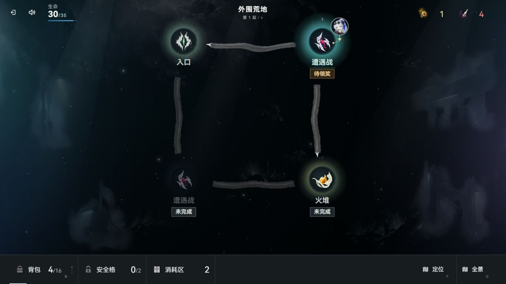

# 框架剩余目标收口

四项目标已完成，最终全量 748 文件、7654 项通过、0 失败、38 项既有跳过，3760 个输入前后指纹一致。Friday 集成三个子代理；本任务改动保留为未提交状态，未 build、提交、推送或发布。

## 已实现

- Base 单键、备份、重置、删除、旧档迁移及双键 journal 写入共用 `slot-write-lock.js` 的同槽 Web Lock。lease 只在对应同步锁回调内有效，拒绝伪造、跨槽及过期使用。公开写 API 返回 Promise，真实调用消费成功或失败结果；缺少锁服务时明确失败。
- 时长、成长和宠物蛋保底立即更新内存并排队持久化。旧准备事务遇到新 checkpoint 会先保存新进度，再以 `STALE_REVISION` 拒绝旧结果。`saveGame()` 保持同步 Run 保存；保存退出用 `saveSession()` 等待 Base 和 Run，选档等待 `loadGame().pendingPersistence`。
- 基地购买、出售、升级、孵化、收藏、整备、选档及保存退出等待异步回执。忙碌期阻止重复请求，换档、重绘、关闭动画或来源页面失效后，旧结果不再导航或显示成功。孵化锁覆盖成就检查；整备等待期拒绝重复应用。
- 战斗通过 runtime、Combat、summary、随机、队列、取消和表现端口创建独立实例。共同领域工厂执行真实开战、出牌、敌方回合和结束；裸 Node 可导入运行。旧浏览器接口绑定默认实例的 ESM 活绑定，保留公开面。
- 支付前取消返回 `cancelled`；源牌扣费移出手牌即提交，后续取消保留 `committed`。双实例测试分别验证两个时点，另有[独立取消复核](cancellation-review.json)验证真实 `preparePresentation` 支付前屏障。
- 282 张生产卡中的 223 张可执行内建卡均显式拥有执行域，70 张旧宿主特例迁为声明，生产宿主声明为 0。71 份精确旧声明迁移使用独立批准 fixture 验证；旧 Run 在入口归一化，自定义显式规则保留。223 张牌改文案、保存重载后全部数值字段不变，零基础伤害的真实战斗与 RNG 对照通过。
- 伤害、抉择、随机获得、延迟、手牌操作、装备被动及容器参数由声明驱动。神秘药水用显式沉默豁免政策；普通治疗道具遵守沉默。自定义及未识别历史卡保留文本兼容边界。公共背包、锦囊、珍珠盒和出征汇总读取同一容量/类型声明。
- 架构守卫保护纯工厂和领域模块的浏览器/单例依赖边界。结构化操作守卫覆盖实际委派分支及抉择、延迟任务的嵌套操作。素材动态消费者的三处审查指纹已核验更新。

## 验证

下列定向批次存在重合，不累加为总断言数。最终全量以独立报告为准。

| 检查 | 结果 |
|---|---|
| 剧情编译、语法、数据、10 组类型、全库 ESLint、现行文档链接 | 均退出 0，见 [静态结果](static-checks.json) |
| Base 与界面联合 | 16 文件，308 通过、1 既有跳过 |
| 卡牌主体联合 | 27 文件，464 通过；随机获得补验 4 文件 33 通过；沉默/后备能源补验 6 文件 95 通过 |
| 战斗主体联合 | 20 文件，326 通过；完整 boot、Node 双实例、兼容及沉默补验 7 文件 107 通过 |
| 稳定输入首轮 | 748 文件，7644 通过、8 失败、38 跳过；3760 输入前后指纹相同。8 失败已修复并定向回绿，见 [首轮记录](stable-integration-first.json) |
| 最终全量第二轮 | 748 文件、7692 项；7654 通过、0 失败、38 既有跳过。3760 输入无漂移，见 [结果及原始报告指纹](full-suite.json)和[输入清单](full-inputs.json) |
| 当前窗口实页 | Codex 内置浏览器，1280×720、DPR 1.25，未改尺寸；真实输入主流程与最终源码恢复通过，error 日志为空 |

定向原始报告与指纹见 [定向汇总](targeted-checks.json)。原始大报告、冻结副本留在 `.tmp/framework-closeout-1020/`，不进入 Git；正式汇总记录相对路径、SHA256 和输入指纹。

## 实页与覆盖边界

使用原为空的 04 档；已有 05 档未操作。真实输入完成建档、难度切换并刷新恢复、带连射出征、保存退出再继续、领取人物补给、地图首战、连射确认目标、敌方回合、初始攻击胜利、领取金币及战后保存。

首战连射消灭一名敌人并进入消耗牌堆；结束回合后生命从 35 降到 30，第二回合牌库仍为 99，能量恢复为 2。胜利并保存后，最终源码重新装载并继续，生命 30/35、金币 1、背包 4 格、消耗区 2 张与保存前一致。

主流程与最终源码恢复的内置浏览器快照分别通过 `workflow browser import` 登记，来源、动作、版本差异和截图指纹见 [实页记录](browser-checks.json)。模块故障注入、锁竞争、卡牌执行合同与代表组合效果由自动化测试覆盖；实页覆盖上述代表流程，不宣称逐张卡、全部界面或多窗口均已实测。

共享工作树含其他任务未提交改动，按项目约束未 build；未提交、推送，远端 CI 未验证。自建冻结服务 5339/PID624/session95981 已核身份停止，端口空闲，临时内置页已关闭，见 [服务记录](service.json)。测试档案保留，未执行删除或清理。

现行接口见 [架构说明](../../architecture.md)、[存档格式](../../save-format.md)与[源码导航](../../../game/src/README.md)。同期普通战 99 库和唯一消耗牌堆的玩法实现另见 WF-sts2-contracts-1020 与 WF-battle-flow-1020 的各自证据；本轮负责其框架接入与集成回归。
