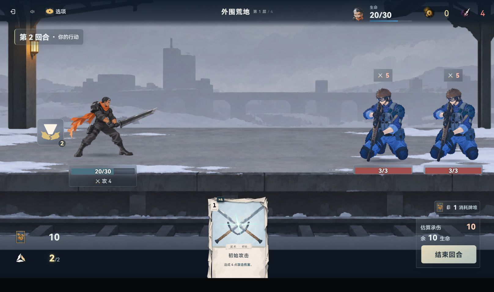

# 项目代码减负：当前状态与分批证据

**当前状态：第二批完成后按老板要求暂停，10% 目标未达。** 游戏累计保守结构净减 **469,692 字节（7.18%）**；本轮确认纳入测试夹具后，完整基线为 **13,672,248**，扣回全部新增正式辅助代码和专测成本，累计净减 **481,756 字节（3.52%）**。本批增加净减 **51,534 字节**；改动、验证、旧失败与暂停现场见 [第二批报告](round2/README.md)。未构建、提交或推送。

以下保留第一批的冻结结果及当时口径；第一批尚未纳入测试源码。

本轮保留全部现有功能，按开始时游戏运行 JS＋CSS 的 6,542,503 个 LF 规范字节为分母。运行源码现为 6,104,715 字节，净减 437,788 字节（6.69%）；再扣回新增工程公共代码 7,132 字节，排除纯格式差 144 字节和废弃注释引用清理 290 字节，**保守结构净减 430,222 字节，即 6.58%**。距离 10% 尚差 224,029 字节，不能视为第一阶段完成。

第一批已冻结、完成未提交；未构建、提交或推送。逐文件前后字节与 SHA 见 [source-manifest.json](source-manifest.json)，验证及未完成项见 [verification.json](verification.json)。该批新增运行 helper 已计入实际运行总量，测试、文档、图片及证据当时不计作删减收益。

## 已完成改动

| 范围 | 本轮实际结果 |
| --- | --- |
| 老板逐路径批准的21个文件 | 删除19份无现行消费者的旧CSS及2份旧雨效实现，净减208,320规范字节；现用庭院雨效、许可证与来源审核副本保留。见[批准清单](deletion-proposal.md)及[批准记录](deletion-proposal.json) |
| CSS结构 | 124份样式使用单父组件作用域，净减199,353规范字节，其中199,209为结构收益；6,969个selector分支权重一致，实际展开后声明、注释、条件与规则顺序一致。见[首批](scopes/README.md)与[第二批](scopes/batch2/README.md) |
| CSS兼容 | Vite PostCSS及独立CSS资产在压缩选择之前统一展开本轮语法；关闭压缩、源码映射及动态CSS通道保留，已有未知native语法沿原链处理。见[兼容实现](compat/README.md) |
| 清单及音效表 | 1,295条素材路径同序同值，106个音效配置及各cue对象/数组独立性保持，运行源码净减17,624规范字节。见[数据差分](asset-tables/README.md) |
| 战斗状态与引擎门面 | 91个getter、66个setter及惰性转发归一；190个运行态公开键、84个引擎出口、描述符、函数元数据、可重入通知及实例切换差分一致。扣回新运行helper后净减12,201规范字节、2,191个非注释token。见[运行态说明](runtime-bindings/README.md) |

上述源码减量另含290字节废弃EXP注释引用清理，已从保守结构成果剔除。[工程成本](engineering-cost.json)单列编译器、序列化器与接线成本。全运行JS非注释token净减10,237，物理行净减2,186；它们与源码体积是不同指标，未套用同一百分比。

旧会话原增量均保留。本轮52份精确授权样式中6份也属于此前暂停分片；它们的原文在本地before缓存，展开规则严格相同，没有恢复HEAD或覆盖旧逻辑。其余明确排除的暂停样式保持原文。

## 验证结果

| 验证 | 结果及边界 |
| --- | --- |
| 删除引用、架构与随机数守卫 | 3文件67项通过；随机数全树守卫移除已删雨源码的历史例外，断言保留 |
| CSS编译及独立资产兼容 | 2文件40项通过，含开发PostCSS接线、压缩关闭、隐藏map、字节map及不同map文件名 |
| 124份CSS | 两批实际编译器展开等价及权重检查全部通过；测试仅适配展开视图，原预期/注册/skip保持 |
| CSS第一批相关测试 | 395通过、9失败；冻结修改前游戏与测试原文复现同名同诊断的9项。见[基线对照](scopes/css-test-baseline-comparison.json) |
| CSS第二批相关测试 | 243通过、1失败；该JS原文断言在冻结基线同样失败。见[第二批](scopes/batch2/README.md) |
| 较广战斗集成 | 156文件，1,816通过、24失败、0跳过。13个失败文件以完整旧游戏输入复跑127项，103通过、24失败；全部名称/状态及失败首诊断一致，0不匹配。实际内存加载417个原游戏模块，没有覆盖共享源。见[最终回归](final-battle-summary.json)及[原文对照](runtime-bindings/integration-baseline-summary.json) |
| 最终资源及兼容回归 | 114通过、3项既有资源守卫失败；修改前相同排除集合与警告已核对，未刷新无关旧指纹或降低门。见[结果](final-assets-compat-summary.json)与[原文对照](asset-tables/asset-guard-baseline.json) |
| 既有页面性能夹具 | `page-perf-shared` 的卡面VM抽取缺少 `liveCardOptions`，冻结原文与当前原文完全相同并复现同一ReferenceError；未改源或断言。见[对照](page-perf-baseline.json) |
| 类型、语法、文档 | 11配置类型检查通过，622/622实现实际覆盖；685份项目文件语法通过；目标ESLint与文档检查通过 |

各组测试有重叠，不相加作为独立用例总数。失败保持原状，不计通过；本轮没有全量游戏测试、生产构建或CI结论。正式新增测试自包含，不依赖本机before缓存。

## 第一批当前窗口实页

Codex IAB、现有5200服务、1618×956当前窗口；未设置其他尺寸。实际点击验证设置/音频、开发测试局遭遇战、选牌与敌人目标、消耗牌堆及返回、结束回合：能量2→1、手牌5→4、消耗0→1、敌人3→2；敌方行动后第2回合生命30→20、能量回到2，玩家操作恢复。控制台error为空。见[browser.json](browser.json)。

没有页面求值写入状态；测试入口由游戏自身提供。中间加载页及把AX描述误作名称的失败定位未计作成功输入。未证明正常存档完整通关或每个页面。只使用已有5200服务，没有创建、停止或认领其他会话的服务。

## 第一批未完成与当时审计边界

**10%目标仍未完成。** 当前缺口需要新的完整结构替代方案。只读审计没有发现足以补齐缺口的剩余机械克隆或类型重复；库存分组的身份/排序语义不同，现有卡牌校验已经表驱动，通用Agent懒加载和动效所有者方案的新增成本会抵消多数收益。未新增这些低收益框架，也未移除自动代玩、LLM、回放、固定剧本、试听、设计预览或旧家具兼容功能。

完整原文仅保留在本地忽略缓存 `node_modules/.cache/project-lean10-1024/before/`，各分片另有缓存；原始Vitest JSON位于同一`.cache`目录。输入SHA、获取方式和对照方法见各分片记录；这些本地缓存不作为CI依赖或新增重复源码落库。
