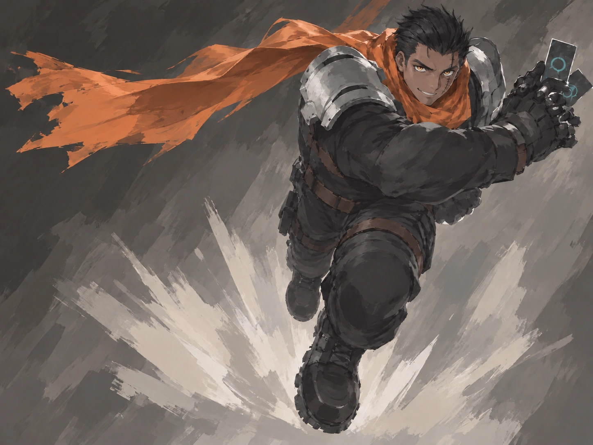
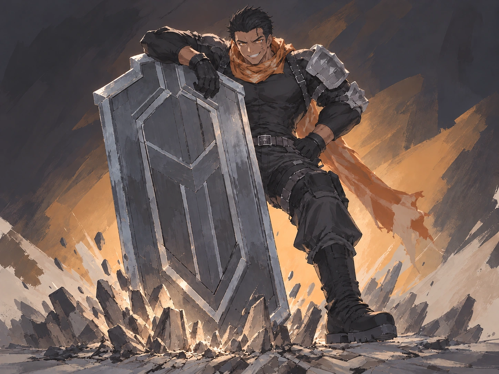
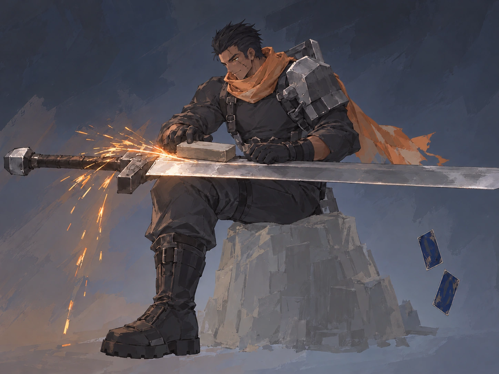
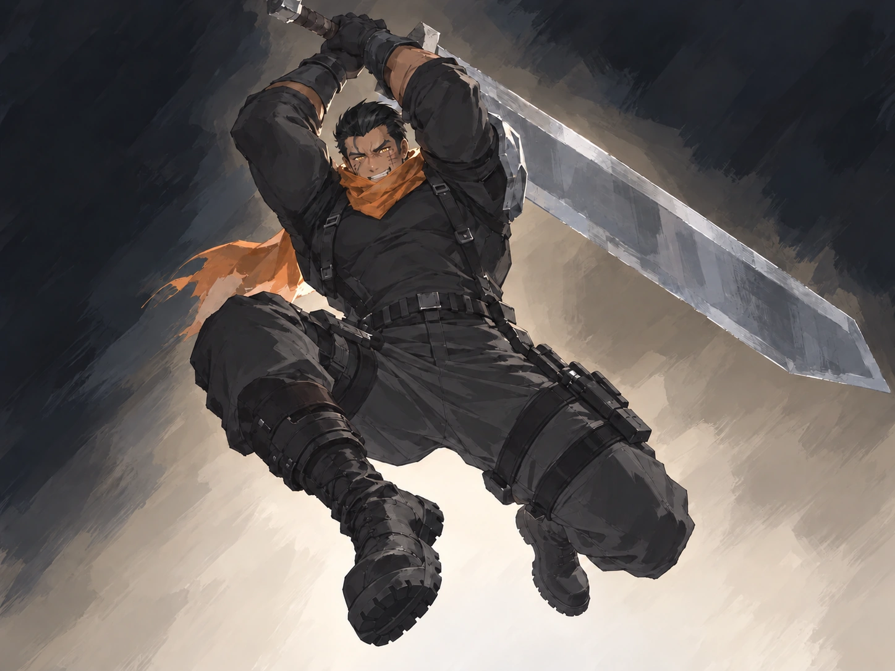
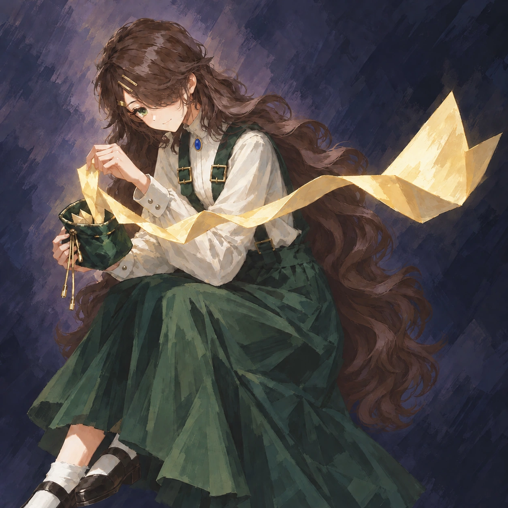

# 职业卡局部修正 · 31张已实装

内置重绘；保留原分镜。老板已授权全部实装，31张均已替换正式游戏卡图与缩略图。

黑像四张已修回黑发；白塔九张补齐两枚金色细长发夹，并统一金托椭圆蓝宝石、白衬衫与深绿双背带裙。聚能最新基于老板指定的fc2bb208底图；征召回原卡面修正，被否定的脸部版本未选用。

## 最新聚能

## 按人物查阅

| 人物 | 卡牌 | 最终素材 | 正式卡图 |
|---|---|---|---|
|无|盗宝|[查看](cmtn1i64j7y7.webp)|[游戏图](D:/素材/代号柒/搜打撤/game/assets/cards/martial-cmtn1i64j7y7.webp)|
|无|江湖救急-改|[查看](cmtn1wnhhym.webp)|[游戏图](D:/素材/代号柒/搜打撤/game/assets/cards/martial-cmtn1wnhhym.webp)|
|黑像|急行军|[查看](tt7-marchrush.webp)|[游戏图](D:/素材/代号柒/搜打撤/game/assets/cards/martial-tt7-marchrush.webp)|
|黑像|坚盾|[查看](tt7-bulwark.webp)|[游戏图](D:/素材/代号柒/搜打撤/game/assets/cards/martial-tt7-bulwark.webp)|
|黑像|厉兵秣马|[查看](tt7-ironcharge.webp)|[游戏图](D:/素材/代号柒/搜打撤/game/assets/cards/martial-tt7-ironcharge.webp)|
|黑像|全力一击|[查看](tt7-fullstrike.webp)|[游戏图](D:/素材/代号柒/搜打撤/game/assets/cards/martial-tt7-fullstrike.webp)|
|白塔|奥术弹|[查看](tt7-arcanebolt.webp)|[游戏图](D:/素材/代号柒/搜打撤/game/assets/cards/spell-tt7-arcanebolt.webp)|
|白塔|冰封千里|[查看](tt7-frozenight.webp)|[游戏图](D:/素材/代号柒/搜打撤/game/assets/cards/spell-tt7-frozenight.webp)|
|白塔|法力补给|[查看](tt7-maxsupply.webp)|[游戏图](D:/素材/代号柒/搜打撤/game/assets/cards/spell-tt7-maxsupply.webp)|
|白塔|法师锦囊|[查看](tt7-stratagem.webp)|[游戏图](D:/素材/代号柒/搜打撤/game/assets/cards/spell-tt7-stratagem.webp)|
|白塔|坚冰结界|[查看](tt3-firm-barrier.webp)|[游戏图](D:/素材/代号柒/搜打撤/game/assets/cards/spell-tt3-firm-barrier.webp)|
|白塔|聚能|[查看](tt7-energize.webp)|[游戏图](D:/素材/代号柒/搜打撤/game/assets/cards/spell-tt7-energize.webp)|
|白塔|千变万化|[查看](cmtn1p9vb5au.webp)|[游戏图](D:/素材/代号柒/搜打撤/game/assets/cards/spell-cmtn1p9vb5au.webp)|
|白塔|元素风暴|[查看](tt7-elementstorm.webp)|[游戏图](D:/素材/代号柒/搜打撤/game/assets/cards/spell-tt7-elementstorm.webp)|
|白塔|征召|[查看](tt7-recruit.webp)|[游戏图](D:/素材/代号柒/搜打撤/game/assets/cards/spell-tt7-recruit.webp)|
|星月|花瓣法阵|[查看](tt3-petal.webp)|[游戏图](D:/素材/代号柒/搜打撤/game/assets/cards/spell-tt3-petal.webp)|
|星月|禁言术|[查看](tt7-silence.webp)|[游戏图](D:/素材/代号柒/搜打撤/game/assets/cards/spell-tt7-silence.webp)|
|星月|精神控制|[查看](tt13-mind-control.webp)|[游戏图](D:/素材/代号柒/搜打撤/game/assets/cards/spell-tt13-mind-control.webp)|
|星月|满月形态|[查看](tt3-nature-form.webp)|[游戏图](D:/素材/代号柒/搜打撤/game/assets/cards/spell-tt3-nature-form.webp)|
|星月|扰敌|[查看](tt7-provoke.webp)|[游戏图](D:/素材/代号柒/搜打撤/game/assets/cards/spell-tt7-provoke.webp)|
|星月|圣盾|[查看](tt3-holy-shield.webp)|[游戏图](D:/素材/代号柒/搜打撤/game/assets/cards/spell-tt3-holy-shield.webp)|
|星月|圣光治愈|[查看](tt7-holyheal.webp)|[游戏图](D:/素材/代号柒/搜打撤/game/assets/cards/spell-tt7-holyheal.webp)|
|星月|噬血术|[查看](tt7-bloodpotion.webp)|[游戏图](D:/素材/代号柒/搜打撤/game/assets/cards/spell-tt7-bloodpotion.webp)|
|星月|星辰占卜|[查看](tt13-stellar-divination.webp)|[游戏图](D:/素材/代号柒/搜打撤/game/assets/cards/spell-tt13-stellar-divination.webp)|
|常无欲|暗影射击|[查看](tt3sp-shadowshot.webp)|[游戏图](D:/素材/代号柒/搜打撤/game/assets/cards/spell-tt3sp-shadowshot.webp)|
|常无欲|厄运|[查看](cmtn1gfhczzj.webp)|[游戏图](D:/素材/代号柒/搜打撤/game/assets/cards/spell-cmtn1gfhczzj.webp)|
|常无欲|火焰形态|[查看](cmtn1ntxzoc4.webp)|[游戏图](D:/素材/代号柒/搜打撤/game/assets/cards/spell-cmtn1ntxzoc4.webp)|
|常无欲|灵魂契约|[查看](tt13-soul-contract.webp)|[游戏图](D:/素材/代号柒/搜打撤/game/assets/cards/spell-tt13-soul-contract.webp)|
|常无欲|深渊诅咒|[查看](tt7-abysscurse.webp)|[游戏图](D:/素材/代号柒/搜打撤/game/assets/cards/spell-tt7-abysscurse.webp)|
|常无欲|星陨之力|[查看](tt7-meteorstrong.webp)|[游戏图](D:/素材/代号柒/搜打撤/game/assets/cards/spell-tt7-meteorstrong.webp)|
|常无欲|黑暗吊坠|[查看](tt7-darkfort.webp)|[游戏图](D:/素材/代号柒/搜打撤/game/assets/cards/equip-tt7-darkfort.webp)|

## 无

### 盗宝

### 江湖救急-改

## 黑像

### 急行军

### 坚盾

### 厉兵秣马

### 全力一击

## 白塔

### 奥术弹

### 冰封千里

### 法力补给

### 法师锦囊

### 坚冰结界

### 聚能

### 千变万化

### 元素风暴

### 征召

## 星月

### 花瓣法阵

### 禁言术

### 精神控制

### 满月形态

### 扰敌

### 圣盾

### 圣光治愈

### 噬血术

### 星辰占卜

## 常无欲

### 暗影射击

### 厄运

### 火焰形态

### 灵魂契约

### 深渊诅咒

### 星陨之力

### 黑暗吊坠

