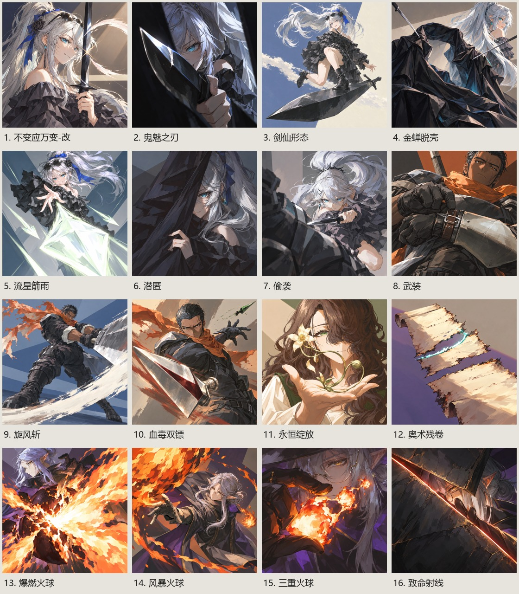

# Career card redraw candidates / 2026-10-23

16 candidates. NAI5 Full draft + built-in repaint. Not installed in runtime assets.

| Card | Candidate |
|---|---|
|不变应万变-改|[tt7-imitate](tt7-imitate.webp)|
|鬼魅之刃|[tt7-ghostblade](tt7-ghostblade.webp)|
|剑仙形态|[tt7-swordimmortal](tt7-swordimmortal.webp)|
|金蝉脱壳|[tt7-goldencicada](tt7-goldencicada.webp)|
|流星箭雨|[tt7-meteorrain](tt7-meteorrain.webp)|
|潜匿|[tt7-stealth](tt7-stealth.webp)|
|偷袭|[tt7-sneak](tt7-sneak.webp)|
|武装|[tt7-armup](tt7-armup.webp)|
|旋风斩|[tt7-whirlwind](tt7-whirlwind.webp)|
|血毒双镖|[tt7-bloodpoison](tt7-bloodpoison.webp)|
|永恒绽放|[tt7-bladebloom](tt7-bladebloom.webp)|
|奥术残卷|[tt7-arcanescroll](tt7-arcanescroll.webp)|
|爆燃火球|[tt7-burnharvest](tt7-burnharvest.webp)|
|风暴火球|[tt3-flame-storm](tt3-flame-storm.webp)|
|三重火球|[tt7-twinfireball](tt7-twinfireball.webp)|
|致命射线|[tt3-nuke-ray](tt3-nuke-ray.webp)|

Full NAI payloads and planned compositions: [request](../../../docs/evidence/2026-10-23-class-card-redraw/request.json).
Actual built-in prompts and input references: [built-in receipt](../../../docs/evidence/2026-10-23-class-card-redraw/builtin-receipt.json).
Provenance, dimensions and SHA256: [receipt](../../../docs/evidence/2026-10-23-class-card-redraw/receipt.json).
Local correction list: [31 cards](../../../docs/evidence/2026-10-23-class-card-redraw/local-corrections.md).
