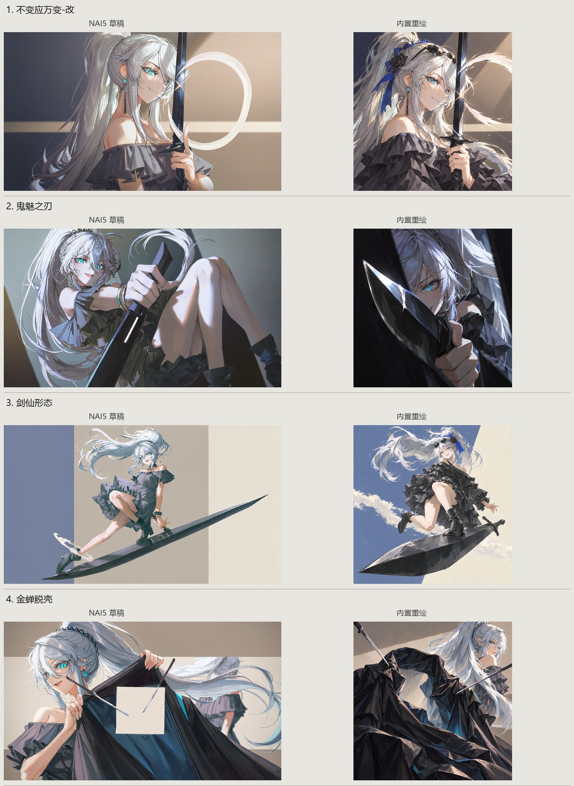
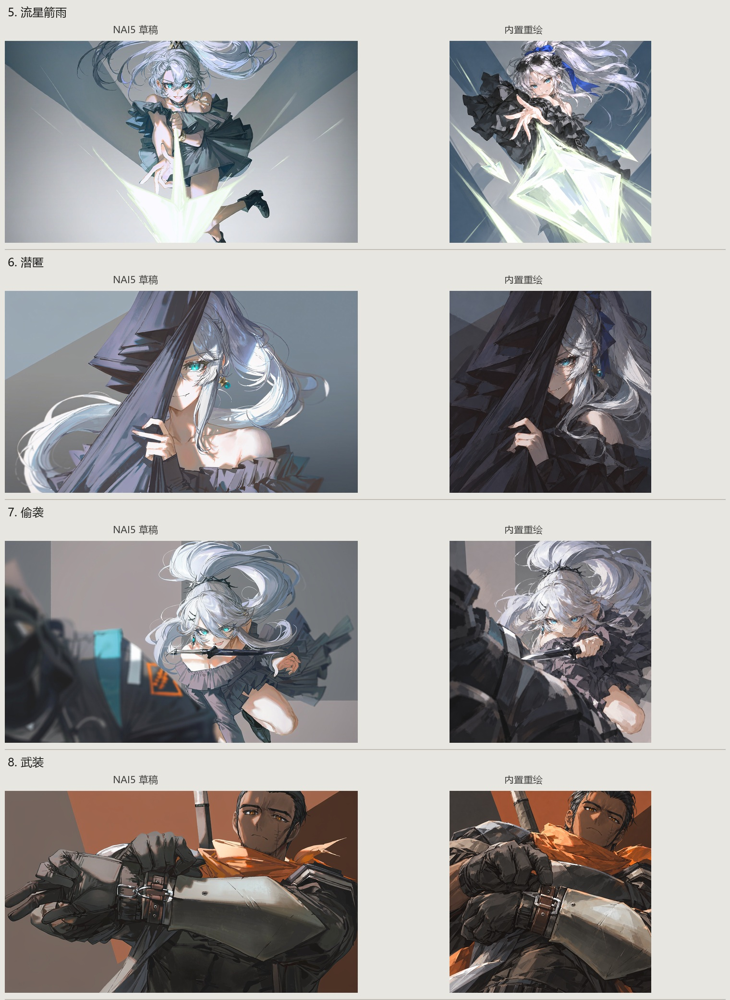
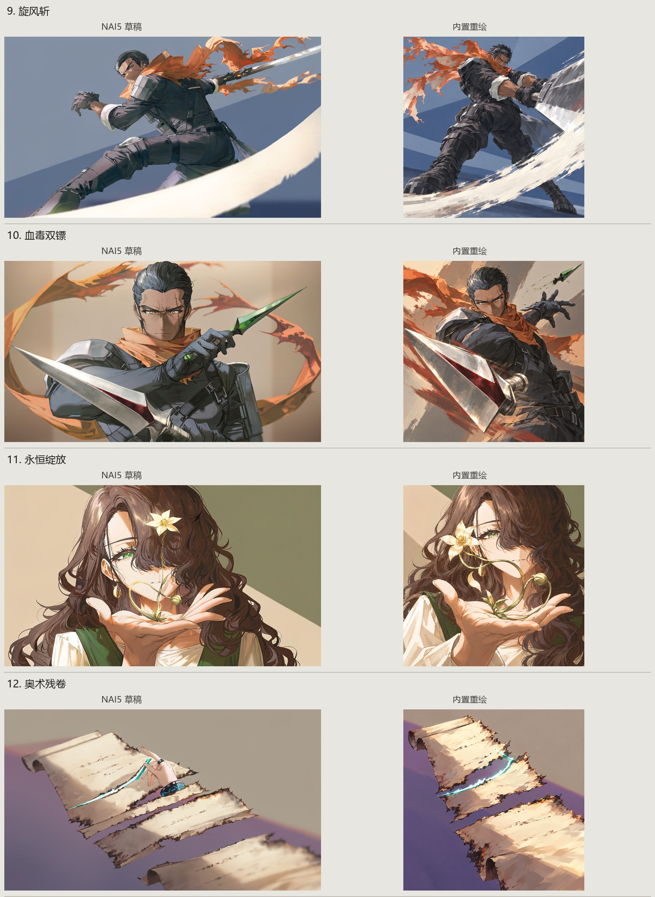
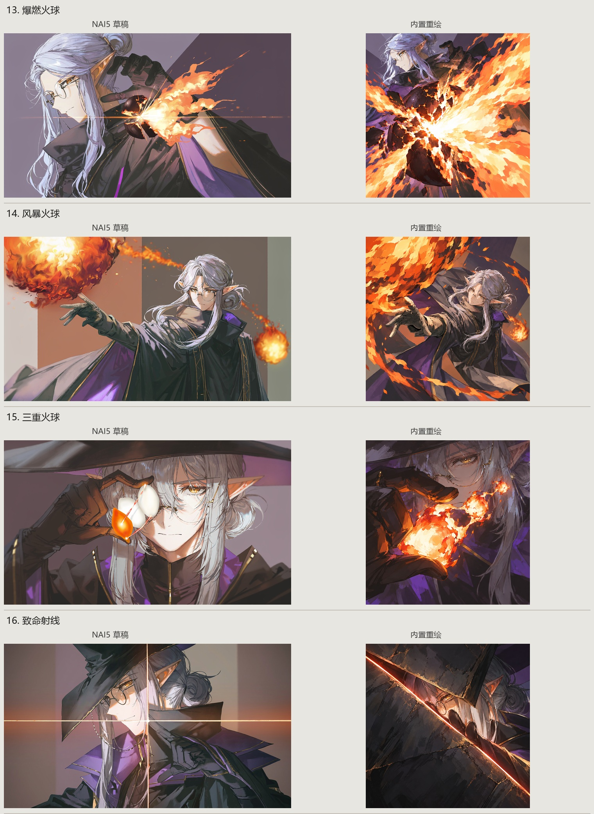

# NAI5 / built-in comparison

Left: NAI5 draft. Right: built-in repaint. Full frames preserved. Drafts are 1344x768; repaints are 1254x1254. Both are fitted within equal-height viewing areas without cropping.

